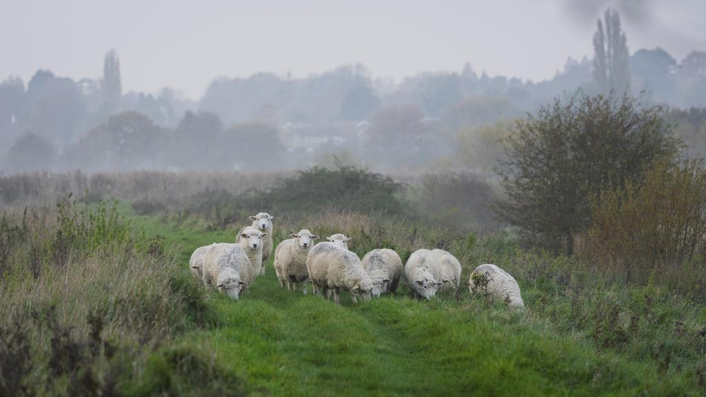

# Model Output Gallery

Generated on: 2026-11-15 00:28:19 GMT

- *Evaluation lane:* assisted
- *Prompt hints:* the image's description and keyword hints were included in the prompt, so field content may be copied from them rather than seen
- *Assessment:* General checks + metadata fields and duplicate keywords; length limits and factual accuracy not assessed
- *Input image:* JPEG, 9,984 x 5,616 pixels (56.1 MP), 28.7 MB
- *Human accuracy notes:* 0 of 41 outputs reviewed by a person for this exact image, model revision and output (accuracy_notes.yaml); the others are unreviewed; 1 note for other images or models

This run records model responses to one shared image and prompt (evaluation
lane: assisted). Mechanical checks are not factual-accuracy judgments; inspect
the image, prompt and final answers before choosing a model. Results do not
establish fitness for other tasks.

Complete per-model evidence artifact with image metadata, the source prompt, a
facts-only chooser, and full generated or crash output for every attempted
model.

## Reference Image



## Current-run Chooser

Mechanical observations and captured resource facts for this run only. No concerns detected does not mean the response fulfilled an arbitrary prompt or described the image accurately. Consult the assessment scope above. Total time is end-to-end; throughput covers generation only and requires at least 16 generated tokens. Prefill/first is the measured time to first token (input preparation, prefill and the first decode step) when captured, else upstream's model-loop first-token time; Prompt tok is the full rendered prompt including image tokens, which drives prefill cost. For cross-attention architectures the token count reflects the tokenised text burden only, not total vision prefill compute.

<!-- markdownlint-disable MD034 MD037 MD049 -->

| Model                                                                                                                               | Mechanical checks               | Total s | Gen TPS    | Prefill/first s | Peak GB | Prompt tok | Gen tok | Observations                                         |
|-------------------------------------------------------------------------------------------------------------------------------------|---------------------------------|---------|------------|-----------------|---------|------------|---------|------------------------------------------------------|
| [`TechnoBaptist/Ternary-Bonsai-2-27B-mlx-2bit`](#model-technobaptist-ternary-bonsai-2-27b-mlx-2bit)                                 | `no concerns detected`          | 66.06s  | 35.9 tok/s | 60.84           | 17      | 16,653     | 110     | none                                                 |
| [`ibm-granite/granite-vision-4.1-4b`](#model-ibm-granite-granite-vision-41-4b)                                                      | `no concerns detected`          | 4.23s   | 65.2 tok/s | 1.06            | 9.8     | 1,502      | 79      | none                                                 |
| [`mlx-community/AREX-2-4bit`](#model-mlx-community-arex-2-4bit)                                                                     | `no concerns detected`          | 57.54s  | 30.5 tok/s | 50.56           | 21      | 16,653     | 119     | none                                                 |
| [`mlx-community/ERNIE-4.5-VL-28B-A3B-Thinking-4bit`](#model-mlx-community-ernie-45-vl-28b-a3b-thinking-4bit)                        | `no concerns detected`          | 9.57s   | 130 tok/s  | 1.15            | 19      | 1,606      | 598     | none                                                 |
| [`mlx-community/InternVL3-14B-4bit`](#model-mlx-community-internvl3-14b-4bit)                                                       | `no concerns detected`          | 5.73s   | 56.2 tok/s | 1.97            | 10      | 2,619      | 102     | none                                                 |
| [`mlx-community/InternVL3_5-1B-4bit`](#model-mlx-community-internvl35-1b-4bit)                                                      | `no concerns detected`          | 2.34s   | 401 tok/s  | 0.74            | 2.2     | 2,622      | 107     | none                                                 |
| [`mlx-community/LFM2.5-VL-3B-OptiQ-4bit`](#model-mlx-community-lfm25-vl-3b-optiq-4bit)                                              | `no concerns detected`          | 3.10s   | 207 tok/s  | 1.02            | 4.0     | 2,626      | 108     | none                                                 |
| [`mlx-community/MiniCPM-V-4.7-35B-A3B-4bit`](#model-mlx-community-minicpm-v-47-35b-a3b-4bit)                                        | `no concerns detected`          | 5.88s   | 87.0 tok/s | 1.03            | 25      | 932        | 123     | none                                                 |
| [`mlx-community/MiniCPM-o-4_5-4bit`](#model-mlx-community-minicpm-o-45-4bit)                                                        | `no concerns detected`          | 3.31s   | 104 tok/s  | 0.57            | 7.1     | 385        | 105     | none                                                 |
| [`mlx-community/Ministral-3-14B-Instruct-2512-mxfp4`](#model-mlx-community-ministral-3-14b-instruct-2512-mxfp4)                     | `no concerns detected`          | 5.68s   | 66.3 tok/s | 2.02            | 12      | 2,583      | 120     | none                                                 |
| [`mlx-community/Ministral-3-3B-Instruct-2512-4bit`](#model-mlx-community-ministral-3-3b-instruct-2512-4bit)                         | `no concerns detected`          | 3.22s   | 188 tok/s  | 1.15            | 6.4     | 2,582      | 107     | none                                                 |
| [`mlx-community/Mistral-Small-4-119B-2603-4bit`](#model-mlx-community-mistral-small-4-119b-2603-4bit)                               | `no concerns detected`          | 21.87s  | 78.1 tok/s | 8.11            | 71      | 2,062      | 93      | none                                                 |
| [`mlx-community/Molmo2-8B-4bit`](#model-mlx-community-molmo2-8b-4bit)                                                               | `no concerns detected`          | 4.67s   | 71.0 tok/s | 1.19            | 8.1     | 1,518      | 117     | none                                                 |
| [`mlx-community/MolmoPoint-8B-4bit`](#model-mlx-community-molmopoint-8b-4bit)                                                       | `no concerns detected`          | 8.55s   | 30.5 tok/s | 2.66            | 13      | 3,120      | 109     | none                                                 |
| [`mlx-community/Muse-Glimmer-30B-OptiQ-4bit`](#model-mlx-community-muse-glimmer-30b-optiq-4bit)                                     | `no concerns detected`          | 50.96s  | 24.6 tok/s | 7.16            | 25      | 4,432      | 990     | none                                                 |
| [`mlx-community/North-Micro-Vision-Instruct-4bit`](#model-mlx-community-north-micro-vision-instruct-4bit)                           | `no concerns detected`          | 5.15s   | 206 tok/s  | 2.42            | 3.7     | 4,050      | 121     | none                                                 |
| [`mlx-community/Phi-3.5-vision-instruct-bf16`](#model-mlx-community-phi-35-vision-instruct-bf16)                                    | `no concerns detected`          | 3.68s   | 57.7 tok/s | 0.66            | 9.3     | 1,131      | 87      | none                                                 |
| [`mlx-community/Qwen3-Omni-30B-A3B-Instruct-4bit`](#model-mlx-community-qwen3-omni-30b-a3b-instruct-4bit)                           | `no concerns detected`          | 24.17s  | 73.2 tok/s | 19.24           | 26      | 12,833     | 120     | none                                                 |
| [`mlx-community/Qwen3-VL-30B-A3B-Instruct-4bit`](#model-mlx-community-qwen3-vl-30b-a3b-instruct-4bit)                               | `no concerns detected`          | 38.90s  | 84.7 tok/s | 34.85           | 23      | 16,637     | 111     | none                                                 |
| [`mlx-community/Qwen3-VL-8B-Instruct-4bit`](#model-mlx-community-qwen3-vl-8b-instruct-4bit)                                         | `no concerns detected`          | 40.83s  | 68.1 tok/s | 37.34           | 11      | 16,637     | 95      | none                                                 |
| [`mlx-community/Qwen3.5-35B-A3B-4bit`](#model-mlx-community-qwen35-35b-a3b-4bit)                                                    | `no concerns detected`          | 33.85s  | 111 tok/s  | 29.29           | 25      | 16,653     | 114     | none                                                 |
| [`mlx-community/Qwen3.6-35B-A3B-4bit`](#model-mlx-community-qwen36-35b-a3b-4bit)                                                    | `no concerns detected`          | 37.17s  | 112 tok/s  | 32.43           | 25      | 16,653     | 128     | none                                                 |
| [`mlx-community/Qwen3.8-27B-nvfp4`](#model-mlx-community-qwen38-27b-nvfp4)                                                          | `no concerns detected`          | 62.42s  | 30.9 tok/s | 55.23           | 21      | 16,653     | 129     | none                                                 |
| [`mlx-community/SmolVLM2-2.2B-Instruct-mlx`](#model-mlx-community-smolvlm2-22b-instruct-mlx)                                        | `no concerns detected`          | 3.35s   | 124 tok/s  | 0.96            | 5.6     | 1,415      | 84      | none                                                 |
| [`mlx-community/aya-vision-8b-4bit`](#model-mlx-community-aya-vision-8b-4bit)                                                       | `no concerns detected`          | 4.98s   | 97.7 tok/s | 1.55            | 6.6     | 2,429      | 129     | none                                                 |
| [`mlx-community/gemma-4-12B-it-4bit`](#model-mlx-community-gemma-4-12b-it-4bit)                                                     | `no concerns detected`          | 5.30s   | 62.1 tok/s | 0.94            | 7.6     | 592        | 111     | none                                                 |
| [`mlx-community/gemma-4-26b-a4b-it-4bit`](#model-mlx-community-gemma-4-26b-a4b-it-4bit)                                             | `no concerns detected`          | 4.64s   | 126 tok/s  | 0.78            | 16      | 592        | 90      | none                                                 |
| [`mlx-community/gemma-4-e4b-it-4bit`](#model-mlx-community-gemma-4-e4b-it-4bit)                                                     | `no concerns detected`          | 3.54s   | 124 tok/s  | 0.60            | 6.0     | 588        | 92      | none                                                 |
| [`nativ-community/Mage-VL-OptiQ-4bit`](#model-nativ-community-mage-vl-optiq-4bit)                                                   | `no concerns detected`          | 4.43s   | 124 tok/s  | 2.07            | 5.4     | 4,146      | 102     | none                                                 |
| [`nativ-community/Mistral-Small-3.2-24B-Instruct-2506-4bit`](#model-nativ-community-mistral-small-32-24b-instruct-2506-4bit)        | `no concerns detected`          | 7.09s   | 35.8 tok/s | 1.54            | 18      | 1,113      | 111     | none                                                 |
| [`nativ-community/Nemotron-3-Nano-Omni-30B-A3B-Reasoning-4bit`](#model-nativ-community-nemotron-3-nano-omni-30b-a3b-reasoning-4bit) | `no concerns detected`          | 6.34s   | 161 tok/s  | 2.70            | 23      | 3,641      | 108     | none                                                 |
| [`nvidia/NVIDIA-Nemotron-3.5-Super-VL-120B-A12B-NVFP4`](#model-nvidia-nvidia-nemotron-35-super-vl-120b-a12b-nvfp4)                  | `no concerns detected`          | 41.70s  | 30.4 tok/s | 19.35           | 87      | 3,640      | 105     | none                                                 |
| [`sahilchachra/LensVLM-9B-MXFP4`](#model-sahilchachra-lensvlm-9b-mxfp4)                                                             | `no concerns detected`          | 5.39s   | 99.7 tok/s | 1.34            | 7.4     | 1,841      | 157     | none                                                 |
| [`LiquidAI/LFM2.5-VL-450M-MLX-bf16`](#model-liquidai-lfm25-vl-450m-mlx-bf16)                                                        | `concerns detected`             | 1.79s   | 476 tok/s  | 0.50            | 1.7     | 2,634      | 65      | duplicate keywords                                   |
| [`mlx-community/GLM-4.6V-Flash-4bit`](#model-mlx-community-glm-46v-flash-4bit)                                                      | `concerns detected`             | 8.14s   | 78.4 tok/s | 5.27            | 8.7     | 6,339      | 94      | prompt hint repeated                                 |
| [`mlx-community/MiniCPM-V-4.7-1B-4bit`](#model-mlx-community-minicpm-v-47-1b-4bit)                                                  | `concerns detected`             | 3.09s   | 302 tok/s  | 0.93            | 3.7     | 932        | 104     | prompt hint repeated                                 |
| [`mlx-community/diffusiongemma-26B-A4B-it-mxfp8`](#model-mlx-community-diffusiongemma-26b-a4b-it-mxfp8)                             | `concerns detected`             | 6.16s   | 66.2 tok/s | 2.08            | 28      | 588        | 77      | prompt hint repeated                                 |
| [`mlx-community/granite-4.0-3b-vision-4bit`](#model-mlx-community-granite-40-3b-vision-4bit)                                        | `concerns detected`             | 2.84s   | 179 tok/s  | 1.03            | 4.8     | 1,524      | 70      | prompt hint repeated                                 |
| [`mlx-community/FastVLM-0.5B-bf16`](#model-mlx-community-fastvlm-05b-bf16)                                                          | `major concerns: answer format` | 3.14s   | 359 tok/s  | 1.06            | 2.2     | 328        | 40      | labelled fields not detected                         |
| [`mlx-community/llm-jp-4-vl-9b-mlx-4bit`](#model-mlx-community-llm-jp-4-vl-9b-mlx-4bit)                                             | `major concerns: answer format` | 3.57s   | 101 tok/s  | 1.52            | 6.7     | 2,698      | 30      | control tokens visible; labelled fields not detected |
| [`mlx-community/nanoLLaVA-1.5-4bit`](#model-mlx-community-nanollava-15-4bit)                                                        | `major concerns: answer format` | 2.07s   | 265 tok/s  | 0.56            | 1.6     | 324        | 84      | labelled fields not detected                         |
<!-- markdownlint-enable MD034 MD037 MD049 -->

## Resource Highlights

Quickest completion without detected concerns (end-to-end, including model load): `mlx-community/InternVL3_5-1B-4bit` at 2.34s

Lowest peak memory among completions without detected concerns: `mlx-community/InternVL3_5-1B-4bit` at 2.2 GB

Decode tok/s stays per model in the chooser and is not averaged across models: tokenizers, image-token expansion and reasoning lengths differ too much for a cross-model mean to guide a choice.

## Major Mechanical Concerns in This Run

<!-- markdownlint-disable MD034 MD037 MD049 -->

| Model                                                                                   | Mechanical checks               | Observations                                         |
|-----------------------------------------------------------------------------------------|---------------------------------|------------------------------------------------------|
| [`mlx-community/FastVLM-0.5B-bf16`](#model-mlx-community-fastvlm-05b-bf16)              | `major concerns: answer format` | labelled fields not detected                         |
| [`mlx-community/llm-jp-4-vl-9b-mlx-4bit`](#model-mlx-community-llm-jp-4-vl-9b-mlx-4bit) | `major concerns: answer format` | control tokens visible; labelled fields not detected |
| [`mlx-community/nanoLLaVA-1.5-4bit`](#model-mlx-community-nanollava-15-4bit)            | `major concerns: answer format` | labelled fields not detected                         |
<!-- markdownlint-enable MD034 MD037 MD049 -->

## Output at a Glance

A compact preview of each model's final answer (or failure evidence for crashes), in chooser order. Where the requested catalogue fields were detected, the preview shows a little of each: the title, the start of the description, and the first keywords with their count, so the weakest field is not hidden behind a long description. Otherwise it is the first 280 characters. A closed reasoning trace is left out of the preview and reported as an omitted-character count; the complete output, trace included, is in the model's evidence block below.

<!-- markdownlint-disable MD034 MD037 MD049 -->

| Model                                                                                                                               | Mechanical checks      | Output preview                                                                                                                                                                                                                                                                                                                                                                       |
|-------------------------------------------------------------------------------------------------------------------------------------|------------------------|--------------------------------------------------------------------------------------------------------------------------------------------------------------------------------------------------------------------------------------------------------------------------------------------------------------------------------------------------------------------------------------|
| [`TechnoBaptist/Ternary-Bonsai-2-27B-mlx-2bit`](#model-technobaptist-ternary-bonsai-2-27b-mlx-2bit)                                 | `no concerns detected` | Title: Sheep grazing on misty rural path \| Description: A small flock of sheep stands and grazes along a grassy path in a rural meadow under an overcast, foggy sk... \| Keywords (14): Sheep, Grazing, Meadow, Mist, Rural, Countryside, Grass, Overcast Sky, Pasture, Livestock, Autumn, Shrubs, ...                                                                              |
| [`ibm-granite/granite-vision-4.1-4b`](#model-ibm-granite-granite-vision-41-4b)                                                      | `no concerns detected` | Title: "Sheep Grazing in a Foggy British Meadow" \| Description: A flock of sheep grazes peacefully in a misty, open meadow, surrounded by autumnal trees and shrubs, under an... \| Keywords (11): Sheep, Grazing, British Countryside, Fog, Mist, Autumn, Rural, Meadow, Trees, Shrubs, Overcast Sky                                                                               |
| [`mlx-community/AREX-2-4bit`](#model-mlx-community-arex-2-4bit)                                                                     | `no concerns detected` | Title: Sheep Grazing on a Misty Autumn Path \| Description: A small flock of sheep stands and grazes along a grassy path in a rural meadow, surrounded by misty aut... \| Keywords (20): Agriculture, British countryside, Bushes, Countryside, English landscape, Farmland, Field, Grass, Grazing, ...                                                                              |
| [`mlx-community/ERNIE-4.5-VL-28B-A3B-Thinking-4bit`](#model-mlx-community-ernie-45-vl-28b-a3b-thinking-4bit)                        | `no concerns detected` | Title: Sheep Grazing in a Foggy English Meadow \| Description: A small flock of sheep gathers and grazes along a grassy path in a rural meadow surrounded by misty... \| Keywords (17): Sheep, Meadow, Grass, Pasture, English landscape, Rural, Countryside, Mist, Grazing, Shrubs, Overcast Sky, ...[1,798 characters of reasoning omitted; complete output in the evidence block] |
| [`mlx-community/InternVL3-14B-4bit`](#model-mlx-community-internvl3-14b-4bit)                                                       | `no concerns detected` | Title: Foggy Meadow with Grazing Sheep \| Description: A small flock of sheep grazes on a grassy path in a misty rural meadow, surrounded by autumnal shrubs and tr... \| Keywords (19): Agriculture, British countryside, Bushes, Countryside, English landscape, Farmland, Field, Grass, Grazing, ...                                                                              |
| [`mlx-community/InternVL3_5-1B-4bit`](#model-mlx-community-internvl35-1b-4bit)                                                      | `no concerns detected` | Title: Flock of Sheep Grazing in a Misty Meadow \| Description: A small flock of sheep grazes along a misty grassy path in a rural setting, surrounded by autumn trees a... \| Keywords (20): Agriculture, British countryside, Meadow, Mist, Sheep, Grazing, Open meadow, Shrubs, Rural landscape, ...                                                                              |
| [`mlx-community/LFM2.5-VL-3B-OptiQ-4bit`](#model-mlx-community-lfm25-vl-3b-optiq-4bit)                                              | `no concerns detected` | Title: Sheep Grazing in Misty Rural Landscape \| Description: A small flock of sheep gathers and grazes along a grassy path in an open meadow surrounded by misty a... \| Keywords (18): Agriculture, British countryside, Bushes, Countryside, English landscape, Farmland, Field, Grass, Grazing, ...                                                                              |
| [`mlx-community/MiniCPM-V-4.7-35B-A3B-4bit`](#model-mlx-community-minicpm-v-47-35b-a3b-4bit)                                        | `no concerns detected` | Title: Sheep Grazing on Misty Countryside Path \| Description: A small flock of sheep grazes and stands along a grassy path in a rural meadow, surrounded by mis... \| Keywords (18): Sheep, grazing, mist, countryside, rural, meadow, grass, fog, autumn, livestock, pastoral, landscape, bushes, ...                                                                              |
| [`mlx-community/MiniCPM-o-4_5-4bit`](#model-mlx-community-minicpm-o-45-4bit)                                                        | `no concerns detected` | Title: Foggy meadow sheep grazing along grassy path \| Description: A small flock of sheep grazes and stands along a lush grassy path in a rural, misty English... \| Keywords (16): Sheep, Grazing, Grass, Foggy, Meadow, Rural, Countryside, English landscape, Mist, Pasture, Livestock, Autumn, ...                                                                              |
| [`mlx-community/Ministral-3-14B-Instruct-2512-mxfp4`](#model-mlx-community-ministral-3-14b-instruct-2512-mxfp4)                     | `no concerns detected` | Title: **Sheep Grazing in Misty British Countryside** \| Description: A small flock of sheep grazes and stands along a grassy path in a rural meadow on 7 November 2... \| Keywords (15): Agriculture, British countryside, grazing sheep, grassy meadow, livestock, misty landscape, overcast sky, ...                                                                              |
| [`mlx-community/Ministral-3-3B-Instruct-2512-4bit`](#model-mlx-community-ministral-3-3b-instruct-2512-4bit)                         | `no concerns detected` | Title: Sheep in Misty Meadow at Autumn’s Edge \| Description: A small flock of sheep stands and grazes on a lush, grassy path in a rural meadow on a misty overcast da... \| Keywords (13): sheep grazing, rural meadow, autumn mist, foggy countryside, pastoral scene, misty trees, overcast sky, ...                                                                              |
| [`mlx-community/Mistral-Small-4-119B-2603-4bit`](#model-mlx-community-mistral-small-4-119b-2603-4bit)                               | `no concerns detected` | Title: Flock of sheep grazing in a misty British meadow \| Description: A small flock of sheep grazes along a grassy path in a rural meadow on a misty autumn day, su... \| Keywords (17): sheep, grazing, meadow, British countryside, autumn, mist, overcast sky, shrubs, pasture, rural scenery, ...                                                                              |
| [`mlx-community/Molmo2-8B-4bit`](#model-mlx-community-molmo2-8b-4bit)                                                               | `no concerns detected` | Title: Foggy Meadow Grazing: White Sheep in Rural English Landscape \| Description: A small flock of white sheep grazes and stands along a grassy path in a misty,... \| Keywords (20): Agriculture, British countryside, Bushes, Countryside, English landscape, Farmland, Field, Grass, Grazing, ...                                                                               |
| [`mlx-community/MolmoPoint-8B-4bit`](#model-mlx-community-molmopoint-8b-4bit)                                                       | `no concerns detected` | Title: Foggy Meadow Scene with Grazing Sheep Flock \| Description: A small flock of sheep grazes in a misty, overcast meadow. The scene captures the tranquil beaut... \| Keywords (20): Agriculture, British countryside, Bushes, Countryside, English landscape, Farmland, Field, Grass, Grazing, ...                                                                              |
| [`mlx-community/Muse-Glimmer-30B-OptiQ-4bit`](#model-mlx-community-muse-glimmer-30b-optiq-4bit)                                     | `no concerns detected` | Title: Flock of Sheep Grazing on Misty Meadow Path \| Description: A small flock of white sheep grazes and stands along a grassy path in a misty rural meadow with s... \| Keywords (15): sheep, grazing, meadow, grassy path, mist, overcast sky, British countryside, rural landscape, livestock, ...                                                                              |
| [`mlx-community/North-Micro-Vision-Instruct-4bit`](#model-mlx-community-north-micro-vision-instruct-4bit)                           | `no concerns detected` | Title: Rural Sheep Flock on Misty Morning \| Description: A small flock of sheep gathers and grazes along a grassy path in a rural meadow on a quiet, foggy morning... \| Keywords (19): Agriculture, British countryside, Bushes, Countryside, English landscape, Farmland, Field, Grass, Grazing, ...                                                                              |
| [`mlx-community/Phi-3.5-vision-instruct-bf16`](#model-mlx-community-phi-35-vision-instruct-bf16)                                    | `no concerns detected` | Title: Sheep Grazing in Misty Meadow \| Description: A flock of sheep is seen grazing and standing along a grassy path in a rural meadow, surrounded by misty autumn trees and... \| Keywords (10): sheep, meadow, grass, countryside, rural, landscape, grazing, overcast, autumn, British countryside                                                                              |
| [`mlx-community/Qwen3-Omni-30B-A3B-Instruct-4bit`](#model-mlx-community-qwen3-omni-30b-a3b-instruct-4bit)                           | `no concerns detected` | Title: Sheep grazing in a misty rural meadow \| Description: A small flock of sheep grazes and stands along a grassy path in an open meadow on a quiet, foggy mor... \| Keywords (18): Sheep, Grazing, Meadow, Grass, Rural, Countryside, Landscape, Pasture, Mist, Overcast Sky, Field, Livestock, ...                                                                              |
| [`mlx-community/Qwen3-VL-30B-A3B-Instruct-4bit`](#model-mlx-community-qwen3-vl-30b-a3b-instruct-4bit)                               | `no concerns detected` | Title: Sheep grazing in a misty rural meadow \| Description: A small flock of sheep grazes and stands on a grassy path in a rural meadow on a foggy morning. The sc... \| Keywords (18): Sheep, Grazing, Rural, Countryside, Mist, Fog, Overcast Sky, Grass, Meadow, Field, Livestock, Agriculture, ...                                                                              |
| [`mlx-community/Qwen3-VL-8B-Instruct-4bit`](#model-mlx-community-qwen3-vl-8b-instruct-4bit)                                         | `no concerns detected` | Title: Foggy Meadow Flock Grazing in Autumn \| Description: A small flock of sheep grazes along a grassy path in a misty autumn meadow under an overcast sky, with... \| Keywords (18): sheep, grazing, fog, meadow, autumn, countryside, overcast, rural, pasture, mist, grass, livestock, shrubs, ...                                                                              |
| [`mlx-community/Qwen3.5-35B-A3B-4bit`](#model-mlx-community-qwen35-35b-a3b-4bit)                                                    | `no concerns detected` | Title: Foggy Autumn Meadow with Grazing Sheep \| Description: A flock of sheep grazes and stands along a green grassy path within a rural meadow on a misty afterno... \| Keywords (18): Agriculture, British countryside, Bushes, Countryside, English landscape, Farmland, Field, Grass, Grazing, ...                                                                              |
| [`mlx-community/Qwen3.6-35B-A3B-4bit`](#model-mlx-community-qwen36-35b-a3b-4bit)                                                    | `no concerns detected` | Title: Small Flock of Sheep Grazing on a Foggy Rural Path \| Description: A small flock of sheep grazes along a grassy track in a rural meadow on an overcast, foggy mor... \| Keywords (24): British countryside, sheep, flock, grazing, meadow, rural, pasture, fog, mist, overcast, grass, path, ...                                                                              |
| [`mlx-community/Qwen3.8-27B-nvfp4`](#model-mlx-community-qwen38-27b-nvfp4)                                                          | `no concerns detected` | Title: Small Flock of Sheep Grazing in a Misty Meadow \| Description: A small flock of white sheep grazes along a grassy path in a rural meadow on an overcast, fog... \| Keywords (20): Agriculture, British countryside, Bushes, Countryside, English landscape, Farmland, Field, Grass, Grazing, ...                                                                              |
| [`mlx-community/SmolVLM2-2.2B-Instruct-mlx`](#model-mlx-community-smolvlm2-22b-instruct-mlx)                                        | `no concerns detected` | Title: Sheep in the Meadow \| Description: A group of sheep are grazing in a grassy field surrounded by trees and a misty atmosphere. \| Keywords (20): Agriculture, British countryside, Bushes, Countryside, English landscape, Farmland, Field, Grass, Grazing, ...                                                                                                               |
| [`mlx-community/aya-vision-8b-4bit`](#model-mlx-community-aya-vision-8b-4bit)                                                       | `no concerns detected` | Title: Sheep Grazing in a Misty Rural Meadow \| Description: A small flock of sheep gathers and grazes along a grassy path in a rural meadow on a quiet, foggy morn... \| Keywords (19): Agriculture, British countryside, Bushes, Countryside, English landscape, Farmland, Field, Grass, Grazing, ...                                                                              |
| [`mlx-community/gemma-4-12B-it-4bit`](#model-mlx-community-gemma-4-12b-it-4bit)                                                     | `no concerns detected` | Title: Sheep Grazing in a Misty Rural Meadow \| Description: A small flock of sheep stands and grazes along a grassy path in an open meadow. The scene is enveloped... \| Keywords (20): Agriculture, British countryside, Bushes, Countryside, English landscape, Farmland, Field, Grass, Grazing, ...                                                                              |
| [`mlx-community/gemma-4-26b-a4b-it-4bit`](#model-mlx-community-gemma-4-26b-a4b-it-4bit)                                             | `no concerns detected` | Title: Small flock of sheep grazing in misty meadow \| Description: A small flock of sheep gathers and grazes along a grassy path in an open meadow on a foggy a... \| Keywords (16): Agriculture, British countryside, countryside, English landscape, farmland, grazing, livestock, meadow, mist, ...                                                                              |
| [`mlx-community/gemma-4-e4b-it-4bit`](#model-mlx-community-gemma-4-e4b-it-4bit)                                                     | `no concerns detected` | Title: Sheep graze along path through misty rural meadow \| Description: A small flock of sheep grazes along a grassy path winding through a wide, misty meadow... \| Keywords (16): Sheep, flock, grazing, meadow, rural, countryside, mist, fog, pasture, grass, winding path, livestock, field, ...                                                                               |
| [`nativ-community/Mage-VL-OptiQ-4bit`](#model-nativ-community-mage-vl-optiq-4bit)                                                   | `no concerns detected` | Title: Foggy Morning Sheep Grazing in Rural Meadow \| Description: A small flock of sheep grazes peacefully on a grassy path in a misty, overcast rural meadow, sur... \| Keywords (20): Agriculture, British countryside, Bushes, Countryside, English landscape, Farmland, Field, Grass, Grazing, ...                                                                              |
| [`nativ-community/Mistral-Small-3.2-24B-Instruct-2506-4bit`](#model-nativ-community-mistral-small-32-24b-instruct-2506-4bit)        | `no concerns detected` | Title: Sheep Grazing in Misty British Countryside \| Description: A small flock of sheep grazes along a grassy path in a rural meadow on a foggy afternoon in Nove... \| Keywords (17): Sheep, grazing, British countryside, rural landscape, mist, fog, meadow, grassy path, autumn trees, shrubs, ...                                                                              |
| [`nativ-community/Nemotron-3-Nano-Omni-30B-A3B-Reasoning-4bit`](#model-nativ-community-nemotron-3-nano-omni-30b-a3b-reasoning-4bit) | `no concerns detected` | Title: Sheep grazing on a foggy British meadow path \| Description: A small flock of sheep gathers and grazes along a grassy path in a rural meadow on a quiet, fog... \| Keywords (18): Agriculture, British countryside, Bushes, Countryside, English landscape, Farmland, Field, Grass, Grazing, ...                                                                              |
| [`nvidia/NVIDIA-Nemotron-3.5-Super-VL-120B-A12B-NVFP4`](#model-nvidia-nvidia-nemotron-35-super-vl-120b-a12b-nvfp4)                  | `no concerns detected` | Title: Sheep graze on a misty rural path in autumn \| Description: A small flock of sheep gathers and grazes along a grassy path in a rural meadow on a quiet,... \| Keywords (17): sheep, grazing, flock, meadow, rural, countryside, mist, fog, autumn, grass, path, livestock, overcast, shrubs, ...                                                                              |
| [`sahilchachra/LensVLM-9B-MXFP4`](#model-sahilchachra-lensvlm-9b-mxfp4)                                                             | `no concerns detected` | Title: Flock of sheep grazing on a misty morning in the British countryside. \| Description: A small flock of sheep grazes and stands along a grassy path in an ope... \| Keywords (20): Agriculture, British countryside, Bushes, Countryside, English landscape, Farmland, Field, Grass, Grazing, ...                                                                              |
| [`LiquidAI/LFM2.5-VL-450M-MLX-bf16`](#model-liquidai-lfm25-vl-450m-mlx-bf16)                                                        | `concerns detected`    | Title: Sheep in a foggy meadow \| Description: A flock of sheep grazes in a misty, rural meadow on a foggy morning. \| Keywords (12): Sheep, foggy, meadow, rural, landscape, countryside, pasture, grazing, sheep, landscape, mist, overcast sky                                                                                                                                    |
| [`mlx-community/GLM-4.6V-Flash-4bit`](#model-mlx-community-glm-46v-flash-4bit)                                                      | `concerns detected`    | Title: Sheep in Misty Meadow \| Description: A small flock of sheep grazes and stands along a grassy path in a rural meadow on a quiet, foggy morning. \| Keywords (20): Agriculture, British countryside, Bushes, Countryside, English landscape, Farmland, Field, Grass, Grazing, ...                                                                                              |
| [`mlx-community/MiniCPM-V-4.7-1B-4bit`](#model-mlx-community-minicpm-v-47-1b-4bit)                                                  | `concerns detected`    | Title: Foggy Morning Sheep in Meadow \| Description: A small flock of sheep grazes along a grassy path in a rural meadow on a quiet, foggy morning, with misty autu... \| Keywords (20): Agriculture, British countryside, Bushes, Countryside, English landscape, Farmland, Field, Grass, Grazing, ...                                                                              |
| [`mlx-community/diffusiongemma-26B-A4B-it-mxfp8`](#model-mlx-community-diffusiongemma-26b-a4b-it-mxfp8)                             | `concerns detected`    | Title: Flock of Sheep Grazing in a Misty British Meadow \| Description: A small flock of sheep grazes and stands along a grassy path in a foggy rural meadow sur... \| Keywords (13): Agriculture, British countryside, Sheep, Grazing, Mist, Meadow, Pasture, Rural, Landscape, Livestock, Autumn, ...                                                                              |
| [`mlx-community/granite-4.0-3b-vision-4bit`](#model-mlx-community-granite-40-3b-vision-4bit)                                        | `concerns detected`    | Title: "Sheep in a Foggy Meadow" \| Description: A small flock of sheep grazes along a grassy path in a rural meadow on a foggy morning. \| Keywords (13): Sheep, Meadow, Fog, Rural, Landscape, Grazing, Green, Overcast, Natural, British countryside, Autumn, Mist, ...                                                                                                           |
| [`mlx-community/FastVLM-0.5B-bf16`](#model-mlx-community-fastvlm-05b-bf16)                                                          | `major concerns`       | A serene morning mist blankets a pastoral scene with a flock of sheep grazing along a grassy path in a rural meadow, surrounded by autumnal shrubs and trees, under a cloudy sky.                                                                                                                                                                                                    |
| [`mlx-community/llm-jp-4-vl-9b-mlx-4bit`](#model-mlx-community-llm-jp-4-vl-9b-mlx-4bit)                                             | `major concerns`       | <\|channel\|> analysis<\|message\|> The image shows a small flock of sheep grazing and standing along a grassy path in a rural meadow on a quiet, foggy morning.                                                                                                                                                                                                                     |
| [`mlx-community/nanoLLaVA-1.5-4bit`](#model-mlx-community-nanollava-15-4bit)                                                        | `major concerns`       | Title: A Rural Meadow with Sheep in Focus \| Description: A serene rural landscape featuring a small flock of sheep grazing along a grassy path in a meadow. The misty autumn trees and rural scenery are visible in the background, with the foggy sky adding a dramati... \| Keywords: (not detected)                                                                              |
<!-- markdownlint-enable MD034 MD037 MD049 -->

## Run Stamps

- `mlx-vlm`: `0.8.0`
- `mlx`: `0.32.5.dev20261107+fc344c986`
- `transformers`: `5.23.0`
- `tokenizers`: `0.23.3`
- `huggingface-hub`: `2.4.0`
- *Python Version:* 3.14.7
- *OS:* Darwin 27.2.0
- *macOS Version:* 27.2.1
- *GPU/Chip:* Apple M5 Max
- *MLX Device:* Apple M5 Max
- *GPU Architecture:* applegpu_g17s
- *RAM:* 128.0 GB
- *Recommended Working Set:* 115 GB
- *Fused Attention:* Available

## Image Metadata

- *Description:* A small flock of sheep gathers and grazes along a grassy path
  in a rural meadow on a quiet, foggy morning.

    A small flock of sheep grazes and stands along a grassy path in an open meadow surrounded by misty autumn trees and rural landscape.
- *Keywords:* Agriculture, British countryside, Bushes, Countryside, English
  landscape, Farmland, Field, Grass, Grazing, Landscape, Livestock, Meadow,
  Mist, Overcast Sky, Pasture, Rural, Rural scenery, Sheep, Shrubs, Standing,
  Trees, animals, autumn, country, dawn, dusk, eating, fall, farm, farming,
  flock, flock of sheep, flocking, fog, foggy, footpath, green, hazy, herd,
  idyllic, lamb, morning, nature, outdoors, overcast, pastoral, pathway,
  peaceful, scenic, tranquil, wildlife, wool
- *Date:* 2026-11-07 16:58:09 UTC+01:00
- *Time:* 16:58:09

## Prompt

<!-- markdownlint-disable MD011 MD028 MD037 MD045 -->
>
> Create British-English catalogue metadata from the image and supplied
> context.
>
> Treat any capture date/time and GPS as authoritative facts, but do not claim
> they are visible. Descriptive hints may be incomplete or wrong: retain
> details supported by the image, correct conflicts, and add important visible
> details. Prefer image evidence when a hint conflicts, and omit uncertain
> details.
>
> Context: Authoritative context:
> &#45; Capture date/time: 2026-11-07 16:58:09 UTC+01:00
>
> &#8203;Descriptive hints:
> &#45; Description hint: A small flock of sheep gathers and grazes along a grassy
> path in a rural meadow on a quiet, foggy morning. A small flock of sheep
> grazes and stands along a grassy path in an open meadow surrounded by misty
> autumn trees and rural landscape.
> &#45; Keyword hints: Agriculture, British countryside, Bushes, Countryside,
> English landscape, Farmland, Field, Grass, Grazing, Landscape, Livestock,
> Meadow, Mist, Overcast Sky, Pasture, Rural, Rural scenery, Sheep, Shrubs,
> Standing
>
> &#8203;Write:
> &#45; a concrete 5-10-word title;
> &#45; a 1-2-sentence factual description combining relevant context with the
> main visible subject, setting, action, lighting, and distinctive details;
> &#45; 10-18 unique, comma-separated keywords covering relevant context and
> visible details.
>
> &#8203;Return exactly these three sections and nothing else:
> &#8203;Title:
> &#8203;Description:
> &#8203;Keywords:
<!-- markdownlint-enable MD011 MD028 MD037 MD045 -->

## Complete Per-model Evidence

Complete generated or crash evidence for every attempted model.

<a id="model-technobaptist-ternary-bonsai-2-27b-mlx-2bit"></a>

### TechnoBaptist/Ternary-Bonsai-2-27B-mlx-2bit

<details>
<summary>Complete evidence: TechnoBaptist/Ternary-Bonsai-2-27B-mlx-2bit</summary>

- *Execution:* completed
- *Mechanical checks:* no concerns detected
- *Assessment:* General checks + metadata fields and duplicate keywords;
  length limits and factual accuracy not assessed
- *Maintainer status:* none
- *Observations:* none
- *Arch supported by installed mlx-vlm:* yes (model_type
  prism_hadamard_qwen35)
- *Model load time:* 1.28s
- *Generation time:* 63.91s
- *Total time:* 66.06s
- *Prompt preparation time:* 0.734
- *First-token latency:* 60.2
- *Cleanup time:* 0.111
- *Prompt tokens:* 16,653
- *Generation tokens:* 110
- *Total tokens:* 16,763
- *Prompt throughput (raw):* 277 tok/s
- *Generation throughput (raw):* 35.9 tok/s
- *Peak memory (GB):* 17
- *Active memory (GB):* 8.6
- *Cache memory (GB):* 3.3
- *Model-load active memory (GB):* 8.6
- *Post-cleanup active memory (GB):* 0.00113
- *Post-cleanup cache memory (GB):* 0.0
- *Stop reason:* completed
- *Requested maximum tokens:* 1000
- *Rendered prompt characters:* 1449
- *Processor:* mlx_vlm.models.qwen3_vl.processing_qwen3_vl.Qwen3VLProcessor
- *Tokenizer:* transformers.models.qwen2.tokenization_qwen2.Qwen2Tokenizer
- *Requested model revision:* not requested
- *Resolved model revision:* 498775b03b55d038f716fea2568bf6ae6b8e0b5e
- *Resolved snapshot path:* ~/.cache/huggingface/hub/models--TechnoBaptist--Ternary-Bonsai-2-27B-mlx-2bit/snapshots/498775b03b55d038f716fea2568bf6ae6b8e0b5e
- *Generation settings:* {"max_tokens": 1000, "prefill_step_size": 2048,
  "seed": 0, "temperature": 0.0, "top_k": 0, "top_p": 1.0}
- *EOS token:* <\|im_end\|>

*Readable output:*

<pre class="model-output-readable">
Title:
Sheep grazing on misty rural path

Description:
A small flock of sheep stands and grazes along a grassy path in a rural meadow under an overcast, foggy sky. The scene features misty autumn trees and shrubs in the background, with the flock positioned in the foreground on a green pasture.

Keywords:
Sheep, Grazing, Meadow, Mist, Rural, Countryside, Grass, Overcast Sky, Pasture, Livestock, Autumn, Shrubs, Field, Landscape
</pre>

</details>

---

<a id="model-ibm-granite-granite-vision-41-4b"></a>

### ibm-granite/granite-vision-4.1-4b

<details>
<summary>Complete evidence: ibm-granite/granite-vision-4.1-4b</summary>

- *Execution:* completed
- *Mechanical checks:* no concerns detected
- *Assessment:* General checks + metadata fields and duplicate keywords;
  length limits and factual accuracy not assessed
- *Maintainer status:* none
- *Observations:* none
- *Arch supported by installed mlx-vlm:* yes (model_type granite4_vision)
- *Model load time:* 1.20s
- *Generation time:* 2.28s
- *Total time:* 4.23s
- *Prompt preparation time:* 0.651
- *First-token latency:* 0.456
- *Cleanup time:* 0.0822
- *Prompt tokens:* 1,502
- *Generation tokens:* 79
- *Total tokens:* 1,581
- *Prompt throughput (raw):* 3,297 tok/s
- *Generation throughput (raw):* 65.2 tok/s
- *Peak memory (GB):* 9.8
- *Active memory (GB):* 8.0
- *Cache memory (GB):* 0.24
- *Model-load active memory (GB):* 8
- *Post-cleanup active memory (GB):* 0.00135
- *Post-cleanup cache memory (GB):* 0.0
- *Stop reason:* completed
- *Requested maximum tokens:* 1000
- *Rendered prompt characters:* 1582
- *Image placeholders:* 1
- *Processor:* mlx_vlm.models.granite4_vision.processing_granite4_vision.Granite4VisionProcessor
- *Tokenizer:* transformers.tokenization_utils_tokenizers.TokenizersBackend
- *Requested model revision:* not requested
- *Resolved model revision:* 37d591f06319e8f1638b5adcf58bdf50e0f84f7a
- *Resolved snapshot path:* ~/.cache/huggingface/hub/models--ibm-granite--granite-vision-4.1-4b/snapshots/37d591f06319e8f1638b5adcf58bdf50e0f84f7a
- *Generation settings:* {"max_tokens": 1000, "prefill_step_size": 2048,
  "seed": 0, "temperature": 0.0, "top_k": 0, "top_p": 1.0}
- *EOS token:* <\|end_of_text\|>

*Readable output:*

<pre class="model-output-readable">
Title: "Sheep Grazing in a Foggy British Meadow"
Description: A flock of sheep grazes peacefully in a misty, open meadow, surrounded by autumnal trees and shrubs, under an overcast sky.
Keywords: Sheep, Grazing, British Countryside, Fog, Mist, Autumn, Rural, Meadow, Trees, Shrubs, Overcast Sky
</pre>

</details>

---

<a id="model-mlx-community-arex-2-4bit"></a>

### mlx-community/AREX-2-4bit

<details>
<summary>Complete evidence: mlx-community/AREX-2-4bit</summary>

- *Execution:* completed
- *Mechanical checks:* no concerns detected
- *Assessment:* General checks + metadata fields and duplicate keywords;
  length limits and factual accuracy not assessed
- *Maintainer status:* none
- *Observations:* none
- *Arch supported by installed mlx-vlm:* yes (model_type qwen3_5)
- *Model load time:* 2.13s
- *Generation time:* 54.47s
- *Total time:* 57.54s
- *Prompt preparation time:* 0.8
- *First-token latency:* 49.8
- *Cleanup time:* 0.117
- *Prompt tokens:* 16,653
- *Generation tokens:* 119
- *Total tokens:* 16,772
- *Prompt throughput (raw):* 334 tok/s
- *Generation throughput (raw):* 30.5 tok/s
- *Peak memory (GB):* 21
- *Active memory (GB):* 16
- *Cache memory (GB):* 1.9
- *Model-load active memory (GB):* 16.1
- *Post-cleanup active memory (GB):* 0.00185
- *Post-cleanup cache memory (GB):* 0.0
- *Stop reason:* completed
- *Requested maximum tokens:* 1000
- *Rendered prompt characters:* 1449
- *Processor:* mlx_vlm.models.qwen3_vl.processing_qwen3_vl.Qwen3VLProcessor
- *Tokenizer:* transformers.models.qwen3_5.tokenization_qwen3_5.Qwen3_5Tokenizer
- *Requested model revision:* not requested
- *Resolved model revision:* 02551ee54839c7541ea5adb44b83c9aa86aeb4f5
- *Resolved snapshot path:* ~/.cache/huggingface/hub/models--mlx-community--AREX-2-4bit/snapshots/02551ee54839c7541ea5adb44b83c9aa86aeb4f5
- *Generation settings:* {"max_tokens": 1000, "prefill_step_size": 2048,
  "seed": 0, "temperature": 0.0, "top_k": 0, "top_p": 1.0}
- *EOS token:* <\|im_end\|>

*Readable output:*

<pre class="model-output-readable">
Title: Sheep Grazing on a Misty Autumn Path
Description: A small flock of sheep stands and grazes along a grassy path in a rural meadow, surrounded by misty autumn trees and shrubs under an overcast sky. The scene is set in a quiet, foggy British countryside landscape.
Keywords: Agriculture, British countryside, Bushes, Countryside, English landscape, Farmland, Field, Grass, Grazing, Landscape, Livestock, Meadow, Mist, Overcast Sky, Pasture, Rural, Rural scenery, Sheep, Shrubs, Standing
</pre>

</details>

---

<a id="model-mlx-community-ernie-45-vl-28b-a3b-thinking-4bit"></a>

### mlx-community/ERNIE-4.5-VL-28B-A3B-Thinking-4bit

<details>
<summary>Complete evidence: mlx-community/ERNIE-4.5-VL-28B-A3B-Thinking-4bit</summary>

- *Execution:* completed
- *Mechanical checks:* no concerns detected
- *Assessment:* General checks + metadata fields and duplicate keywords;
  length limits and factual accuracy not assessed
- *Maintainer status:* none
- *Observations:* none
- *Arch supported by installed mlx-vlm:* yes (model_type ernie4_5_moe_vl)
- *Model load time:* 3.16s
- *Generation time:* 5.76s
- *Total time:* 9.57s
- *Prompt preparation time:* 0.527
- *First-token latency:* 0.683
- *Cleanup time:* 0.109
- *Prompt tokens:* 1,606
- *Generation tokens:* 598
- *Total tokens:* 2,204
- *Prompt throughput (raw):* 2,352 tok/s
- *Generation throughput (raw):* 130 tok/s
- *Peak memory (GB):* 19
- *Active memory (GB):* 17
- *Cache memory (GB):* 0.15
- *Model-load active memory (GB):* 17.4
- *Post-cleanup active memory (GB):* 0.00207
- *Post-cleanup cache memory (GB):* 0.0
- *Stop reason:* completed
- *Requested maximum tokens:* 1000
- *Rendered prompt characters:* 1548
- *Processor:* mlx_vlm.models.ernie4_5_moe_vl.processing_ernie4_5_moe_vl.Ernie4_5_VLProcessor
- *Tokenizer:* mlx_vlm.models.ernie4_5_moe_vl.processing_ernie4_5_moe_vl.Ernie4_5_VLTokenizer
- *Requested model revision:* not requested
- *Resolved model revision:* 846ea5576854468f25af3767d769b0805b1b08b6
- *Resolved snapshot path:* ~/.cache/huggingface/hub/models--mlx-community--ERNIE-4.5-VL-28B-A3B-Thinking-4bit/snapshots/846ea5576854468f25af3767d769b0805b1b08b6
- *Generation settings:* {"enable_thinking": true, "max_tokens": 1000,
  "prefill_step_size": 2048, "seed": 0, "temperature": 0.6, "thinking_budget":
  800, "thinking_end_token": "&lt;/think&gt;", "thinking_start_token":
  "&lt;think&gt;", "top_k": 0, "top_p": 0.95}
- *EOS token:* &lt;/s&gt;

*Readable output:*

<pre class="model-output-readable">
Alright, let's get this done. I need to create metadata for this image, a classic pastoral scene. First things first: the title. Gotta keep it concise and descriptive. "Sheep Grazing in a Foggy English Meadow" sounds good.

Now, for the description. The date is set: November 7th, 2026, around 4:58 PM, which is late afternoon/early evening. The scene itself is a quiet, foggy English meadow with sheep grazing. The lighting is soft, diffused by the mist, which is a key element. I'll combine all this, mentioning the meadow, the sheep, the mist, and the late afternoon/early evening time.

Keywords are next. I'll use the provided list, but I'll pick the best ones. I need to cover the subject, the environment, and the lighting. I'll start with the core subjects: Sheep, Meadow, Grass, Pasture, and then the setting: English landscape, Rural, Countryside. Then the key features: Mist, Shrubs, Overcast Sky, and the action: Grazing, Standing. I'll make sure they're all relevant.

I'll review it one last time:

Title: Sheep Grazing in a Foggy English Meadow

Description: A flock of sheep gathers and grazes along a grassy path in a rural meadow surrounded by misty autumn trees. The scene, captured in the late afternoon, features soft, diffused lighting from the foggy atmosphere.

Keywords: Sheep, Meadow, Grass, Pasture, English landscape, Rural, Countryside, Mist, Grazing, Shrubs, Overcast Sky, Shrubbery, Standing, Livestock, Farmland, English countryside, Fog.

Looks good. The title is concise, the description is factual and descriptive, and the keywords are comprehensive and relevant. It's all based on the image and the provided hints, with the date and time incorporated. The description also acknowledges the misty atmosphere. The keywords cover everything. I'm satisfied.
&lt;/think&gt;

Title: Sheep Grazing in a Foggy English Meadow

Description: A small flock of sheep gathers and grazes along a grassy path in a rural meadow surrounded by misty autumn trees. The scene, captured in the late afternoon, features soft, diffused lighting from the foggy atmosphere.

Keywords: Sheep, Meadow, Grass, Pasture, English landscape, Rural, Countryside, Mist, Grazing, Shrubs, Overcast Sky, Shrubbery, Standing, Livestock, Farmland, English countryside, Fog.
</pre>

<details>
<summary>Exact raw output</summary>

```text
Alright, let's get this done. I need to create metadata for this image, a classic pastoral scene. First things first: the title. Gotta keep it concise and descriptive. "Sheep Grazing in a Foggy English Meadow" sounds good.

Now, for the description. The date is set: November 7th, 2026, around 4:58 PM, which is late afternoon/early evening. The scene itself is a quiet, foggy English meadow with sheep grazing. The lighting is soft, diffused by the mist, which is a key element. I'll combine all this, mentioning the meadow, the sheep, the mist, and the late afternoon/early evening time.

Keywords are next. I'll use the provided list, but I'll pick the best ones. I need to cover the subject, the environment, and the lighting. I'll start with the core subjects: Sheep, Meadow, Grass, Pasture, and then the setting: English landscape, Rural, Countryside. Then the key features: Mist, Shrubs, Overcast Sky, and the action: Grazing, Standing. I'll make sure they're all relevant.

I'll review it one last time:

Title: Sheep Grazing in a Foggy English Meadow

Description: A flock of sheep gathers and grazes along a grassy path in a rural meadow surrounded by misty autumn trees. The scene, captured in the late afternoon, features soft, diffused lighting from the foggy atmosphere.

Keywords: Sheep, Meadow, Grass, Pasture, English landscape, Rural, Countryside, Mist, Grazing, Shrubs, Overcast Sky, Shrubbery, Standing, Livestock, Farmland, English countryside, Fog.

Looks good. The title is concise, the description is factual and descriptive, and the keywords are comprehensive and relevant. It's all based on the image and the provided hints, with the date and time incorporated. The description also acknowledges the misty atmosphere. The keywords cover everything. I'm satisfied.
</think>

Title: Sheep Grazing in a Foggy English Meadow

Description: A small flock of sheep gathers and grazes along a grassy path in a rural meadow surrounded by misty autumn trees. The scene, captured in the late afternoon, features soft, diffused lighting from the foggy atmosphere.

Keywords: Sheep, Meadow, Grass, Pasture, English landscape, Rural, Countryside, Mist, Grazing, Shrubs, Overcast Sky, Shrubbery, Standing, Livestock, Farmland, English countryside, Fog.
```

</details>

</details>

---

<a id="model-mlx-community-internvl3-14b-4bit"></a>

### mlx-community/InternVL3-14B-4bit

<details>
<summary>Complete evidence: mlx-community/InternVL3-14B-4bit</summary>

- *Execution:* completed
- *Mechanical checks:* no concerns detected
- *Assessment:* General checks + metadata fields and duplicate keywords;
  length limits and factual accuracy not assessed
- *Maintainer status:* none
- *Observations:* none
- *Arch supported by installed mlx-vlm:* yes (model_type internvl_chat)
- *Model load time:* 1.32s
- *Generation time:* 3.79s
- *Total time:* 5.73s
- *Prompt preparation time:* 0.509
- *First-token latency:* 1.48
- *Cleanup time:* 0.102
- *Prompt tokens:* 2,619
- *Generation tokens:* 102
- *Total tokens:* 2,721
- *Prompt throughput (raw):* 1,767 tok/s
- *Generation throughput (raw):* 56.2 tok/s
- *Peak memory (GB):* 10
- *Active memory (GB):* 8.9
- *Cache memory (GB):* 0.62
- *Model-load active memory (GB):* 8.94
- *Post-cleanup active memory (GB):* 0.003
- *Post-cleanup cache memory (GB):* 0.0
- *Stop reason:* completed
- *Requested maximum tokens:* 1000
- *Rendered prompt characters:* 1363
- *Image placeholders:* 1
- *Processor:* mlx_vlm.models.internvl_chat.processor.InternVLChatProcessor
- *Tokenizer:* transformers.models.qwen2.tokenization_qwen2.Qwen2Tokenizer
- *Requested model revision:* not requested
- *Resolved model revision:* 26328eaab82cdc642fa3b73d8fa0b73db398710d
- *Resolved snapshot path:* ~/.cache/huggingface/hub/models--mlx-community--InternVL3-14B-4bit/snapshots/26328eaab82cdc642fa3b73d8fa0b73db398710d
- *Generation settings:* {"max_tokens": 1000, "prefill_step_size": 2048,
  "seed": 0, "temperature": 0.0, "top_k": 0, "top_p": 1.0}
- *EOS token:* <\|im_end\|>

*Readable output:*

<pre class="model-output-readable">
Title: Foggy Meadow with Grazing Sheep

Description:
A small flock of sheep grazes on a grassy path in a misty rural meadow, surrounded by autumnal shrubs and trees, under an overcast sky.

Keywords:
Agriculture, British countryside, Bushes, Countryside, English landscape, Farmland, Field, Grass, Grazing, Landscape, Livestock, Meadow, Mist, Overcast Sky, Pasture, Rural, Rural scenery, Sheep, Shrubs
</pre>

</details>

---

<a id="model-mlx-community-internvl35-1b-4bit"></a>

### mlx-community/InternVL3_5-1B-4bit

<details>
<summary>Complete evidence: mlx-community/InternVL3_5-1B-4bit</summary>

- *Execution:* completed
- *Mechanical checks:* no concerns detected
- *Assessment:* General checks + metadata fields and duplicate keywords;
  length limits and factual accuracy not assessed
- *Maintainer status:* none
- *Observations:* none
- *Arch supported by installed mlx-vlm:* yes (model_type internvl)
- *Model load time:* 0.72s
- *Generation time:* 1.01s
- *Total time:* 2.34s
- *Prompt preparation time:* 0.507
- *First-token latency:* 0.252
- *Cleanup time:* 0.0876
- *Prompt tokens:* 2,622
- *Generation tokens:* 107
- *Total tokens:* 2,729
- *Prompt throughput (raw):* 10,405 tok/s
- *Generation throughput (raw):* 401 tok/s
- *Peak memory (GB):* 2.2
- *Active memory (GB):* 1.1
- *Cache memory (GB):* 0.36
- *Model-load active memory (GB):* 1.08
- *Post-cleanup active memory (GB):* 0.00331
- *Post-cleanup cache memory (GB):* 0.0
- *Stop reason:* completed
- *Requested maximum tokens:* 1000
- *Rendered prompt characters:* 1401
- *Processor:* mlx_vlm.models.internvl.processing_internvl.InternVLProcessor
- *Tokenizer:* transformers.models.qwen2.tokenization_qwen2.Qwen2Tokenizer
- *Requested model revision:* not requested
- *Resolved model revision:* f9d179a8be8ac53e96c6ee5cce8493856d4b8f09
- *Resolved snapshot path:* ~/.cache/huggingface/hub/models--mlx-community--InternVL3_5-1B-4bit/snapshots/f9d179a8be8ac53e96c6ee5cce8493856d4b8f09
- *Generation settings:* {"max_tokens": 1000, "prefill_step_size": 2048,
  "seed": 0, "temperature": 0.0, "top_k": 0, "top_p": 1.0}
- *EOS token:* <\|im_end\|>

*Readable output:*

<pre class="model-output-readable">
Title: Flock of Sheep Grazing in a Misty Meadow

Description: A small flock of sheep grazes along a misty grassy path in a rural setting, surrounded by autumn trees and overcast skies.

Keywords: Agriculture, British countryside, Meadow, Mist, Sheep, Grazing, Open meadow, Shrubs, Rural landscape, Livestock, Pasture, Foggy morning, Overcast sky, Field, Greenery, Standing sheep, Misty trees, countryside scenery, rural path, English landscape.
</pre>

</details>

---

<a id="model-mlx-community-lfm25-vl-3b-optiq-4bit"></a>

### mlx-community/LFM2.5-VL-3B-OptiQ-4bit

<details>
<summary>Complete evidence: mlx-community/LFM2.5-VL-3B-OptiQ-4bit</summary>

- *Execution:* completed
- *Mechanical checks:* no concerns detected
- *Assessment:* General checks + metadata fields and duplicate keywords;
  length limits and factual accuracy not assessed
- *Maintainer status:* none
- *Observations:* none
- *Arch supported by installed mlx-vlm:* yes (model_type lfm2_vl)
- *Model load time:* 0.89s
- *Generation time:* 1.55s
- *Total time:* 3.10s
- *Prompt preparation time:* 0.562
- *First-token latency:* 0.49
- *Cleanup time:* 0.0808
- *Prompt tokens:* 2,626
- *Generation tokens:* 108
- *Total tokens:* 2,734
- *Prompt throughput (raw):* 5,361 tok/s
- *Generation throughput (raw):* 207 tok/s
- *Peak memory (GB):* 4.0
- *Active memory (GB):* 2.8
- *Cache memory (GB):* 0.10
- *Model-load active memory (GB):* 2.82
- *Post-cleanup active memory (GB):* 0.00357
- *Post-cleanup cache memory (GB):* 0.0
- *Stop reason:* completed
- *Requested maximum tokens:* 1000
- *Rendered prompt characters:* 1409
- *Image placeholders:* 1
- *Processor:* transformers.models.lfm2_vl.processing_lfm2_vl.Lfm2VlProcessor
- *Tokenizer:* transformers.tokenization_utils_tokenizers.TokenizersBackend
- *Requested model revision:* not requested
- *Resolved model revision:* b6311011d95c8894a57289bba8b916e6fbae9a61
- *Resolved snapshot path:* ~/.cache/huggingface/hub/models--mlx-community--LFM2.5-VL-3B-OptiQ-4bit/snapshots/b6311011d95c8894a57289bba8b916e6fbae9a61
- *Generation settings:* {"max_tokens": 1000, "prefill_step_size": 2048,
  "seed": 0, "temperature": 0.0, "top_k": 0, "top_p": 1.0}
- *EOS token:* <\|im_end\|>

*Readable output:*

<pre class="model-output-readable">
Title: Sheep Grazing in Misty Rural Landscape
Description: A small flock of sheep gathers and grazes along a grassy path in an open meadow surrounded by misty autumn trees and rural landscape. The overcast sky casts a soft light on the scene.
Keywords: Agriculture, British countryside, Bushes, Countryside, English landscape, Farmland, Field, Grass, Grazing, Landscape, Livestock, Meadow, Mist, Overcast Sky, Pasture, Rural, Sheep, Shrubs
</pre>

</details>

---

<a id="model-mlx-community-minicpm-v-47-35b-a3b-4bit"></a>

### mlx-community/MiniCPM-V-4.7-35B-A3B-4bit

<details>
<summary>Complete evidence: mlx-community/MiniCPM-V-4.7-35B-A3B-4bit</summary>

- *Execution:* completed
- *Mechanical checks:* no concerns detected
- *Assessment:* General checks + metadata fields and duplicate keywords;
  length limits and factual accuracy not assessed
- *Maintainer status:* none
- *Observations:* none
- *Arch supported by installed mlx-vlm:* yes (model_type minicpmv4_7)
- *Model load time:* 2.75s
- *Generation time:* 2.45s
- *Total time:* 5.88s
- *Prompt preparation time:* 0.533
- *First-token latency:* 0.513
- *Cleanup time:* 0.13
- *Prompt tokens:* 932
- *Generation tokens:* 123
- *Total tokens:* 1,055
- *Prompt throughput (raw):* 1,817 tok/s
- *Generation throughput (raw):* 87.0 tok/s
- *Peak memory (GB):* 25
- *Active memory (GB):* 24
- *Cache memory (GB):* 0.12
- *Model-load active memory (GB):* 23.5
- *Post-cleanup active memory (GB):* 0.00459
- *Post-cleanup cache memory (GB):* 0.0
- *Stop reason:* completed
- *Requested maximum tokens:* 1000
- *Rendered prompt characters:* 1420
- *Processor:* mlx_vlm.models.minicpmv4_7.processing_minicpmv4_7.MiniCPMV4_7Processor
- *Tokenizer:* transformers.models.qwen2.tokenization_qwen2.Qwen2Tokenizer
- *Requested model revision:* not requested
- *Resolved model revision:* 0e3b706c1599ad95294122c67c77ce662de18794
- *Resolved snapshot path:* ~/.cache/huggingface/hub/models--mlx-community--MiniCPM-V-4.7-35B-A3B-4bit/snapshots/0e3b706c1599ad95294122c67c77ce662de18794
- *Generation settings:* {"max_tokens": 1000, "prefill_step_size": 2048,
  "seed": 0, "temperature": 1.0, "top_k": 20, "top_p": 0.95}
- *EOS token:* <\|im_end\|>

*Readable output:*

<pre class="model-output-readable">
Title:
Sheep Grazing on Misty Countryside Path

Description:
A small flock of sheep grazes and stands along a grassy path in a rural meadow, surrounded by misty autumn trees and a foggy landscape, captured on 2026-11-07 at 16:58 UTC+01:00.

Keywords:
Sheep, grazing, mist, countryside, rural, meadow, grass, fog, autumn, livestock, pastoral, landscape, bushes, shrubs, overcast, British countryside, farmland, pasture
</pre>

</details>

---

<a id="model-mlx-community-minicpm-o-45-4bit"></a>

### mlx-community/MiniCPM-o-4_5-4bit

<details>
<summary>Complete evidence: mlx-community/MiniCPM-o-4_5-4bit</summary>

- *Execution:* completed
- *Mechanical checks:* no concerns detected
- *Assessment:* General checks + metadata fields and duplicate keywords;
  length limits and factual accuracy not assessed
- *Maintainer status:* none
- *Observations:* none
- *Arch supported by installed mlx-vlm:* yes (model_type minicpmo)
- *Model load time:* 1.23s
- *Generation time:* 1.59s
- *Total time:* 3.31s
- *Prompt preparation time:* 0.381
- *First-token latency:* 0.209
- *Cleanup time:* 0.098
- *Prompt tokens:* 385
- *Generation tokens:* 105
- *Total tokens:* 490
- *Prompt throughput (raw):* 1,841 tok/s
- *Generation throughput (raw):* 104 tok/s
- *Peak memory (GB):* 7.1
- *Active memory (GB):* 6.1
- *Cache memory (GB):* 0.09
- *Model-load active memory (GB):* 6.15
- *Post-cleanup active memory (GB):* 0.0049
- *Post-cleanup cache memory (GB):* 0.0
- *Stop reason:* completed
- *Requested maximum tokens:* 1000
- *Rendered prompt characters:* 1413
- *Image placeholders:* 1
- *Processor:* mlx_vlm.models.minicpmo.processing_minicpmo.MiniCPMOProcessor
- *Tokenizer:* transformers.models.qwen2.tokenization_qwen2.Qwen2Tokenizer
- *Requested model revision:* not requested
- *Resolved model revision:* 592c09d85e7bffbc8f8e45a417aa8e9a96119814
- *Resolved snapshot path:* ~/.cache/huggingface/hub/models--mlx-community--MiniCPM-o-4_5-4bit/snapshots/592c09d85e7bffbc8f8e45a417aa8e9a96119814
- *Generation settings:* {"max_tokens": 1000, "prefill_step_size": 2048,
  "seed": 0, "temperature": 0.6, "top_k": 20, "top_p": 0.95}
- *EOS token:* <\|im_end\|>

*Readable output:*

<pre class="model-output-readable">
Title: Foggy meadow sheep grazing along grassy path

Description: A small flock of sheep grazes and stands along a lush grassy path in a rural, misty English landscape during late afternoon. The scene features soft fog, distant trees, and overcast lighting, capturing peaceful countryside livestock activity.

Keywords: Sheep, Grazing, Grass, Foggy, Meadow, Rural, Countryside, English landscape, Mist, Pasture, Livestock, Autumn, Overcast, Path, Shrubs, Agriculture
</pre>

</details>

---

<a id="model-mlx-community-ministral-3-14b-instruct-2512-mxfp4"></a>

### mlx-community/Ministral-3-14B-Instruct-2512-mxfp4

<details>
<summary>Complete evidence: mlx-community/Ministral-3-14B-Instruct-2512-mxfp4</summary>

- *Execution:* completed
- *Mechanical checks:* no concerns detected
- *Assessment:* General checks + metadata fields and duplicate keywords;
  length limits and factual accuracy not assessed
- *Maintainer status:* none
- *Observations:* none
- *Arch supported by installed mlx-vlm:* yes (model_type mistral3)
- *Model load time:* 1.32s
- *Generation time:* 3.84s
- *Total time:* 5.68s
- *Prompt preparation time:* 0.423
- *First-token latency:* 1.63
- *Cleanup time:* 0.0947
- *Prompt tokens:* 2,583
- *Generation tokens:* 120
- *Total tokens:* 2,703
- *Prompt throughput (raw):* 1,589 tok/s
- *Generation throughput (raw):* 66.3 tok/s
- *Peak memory (GB):* 12
- *Active memory (GB):* 8.0
- *Cache memory (GB):* 0.51
- *Model-load active memory (GB):* 8.01
- *Post-cleanup active memory (GB):* 0.00516
- *Post-cleanup cache memory (GB):* 0.0
- *Stop reason:* completed
- *Requested maximum tokens:* 1000
- *Rendered prompt characters:* 3796
- *Processor:* mlx_vlm.models.mistral3.processing_mistral3.Mistral3Processor
- *Tokenizer:* transformers.tokenization_utils_tokenizers.TokenizersBackend
- *Requested model revision:* not requested
- *Resolved model revision:* 7c992876448fc5426841a85c6eb951b056fe38d2
- *Resolved snapshot path:* ~/.cache/huggingface/hub/models--mlx-community--Ministral-3-14B-Instruct-2512-mxfp4/snapshots/7c992876448fc5426841a85c6eb951b056fe38d2
- *Generation settings:* {"max_tokens": 1000, "prefill_step_size": 2048,
  "seed": 0, "temperature": 0.0, "top_k": 0, "top_p": 1.0}
- *EOS token:* &lt;/s&gt;

*Readable output:*

<pre class="model-output-readable">
Title:
**Sheep Grazing in Misty British Countryside**

Description:
A small flock of sheep grazes and stands along a grassy path in a rural meadow on 7 November 2026, under an overcast sky and misty autumn conditions, with a backdrop of dense shrubs and distant trees.

Keywords:
Agriculture, British countryside, grazing sheep, grassy meadow, livestock, misty landscape, overcast sky, pastoral scene, rural farmland, sheep flock, shrubs, autumn countryside, pastoral life, foggy morning, English farmland
</pre>

</details>

---

<a id="model-mlx-community-ministral-3-3b-instruct-2512-4bit"></a>

### mlx-community/Ministral-3-3B-Instruct-2512-4bit

<details>
<summary>Complete evidence: mlx-community/Ministral-3-3B-Instruct-2512-4bit</summary>

- *Execution:* completed
- *Mechanical checks:* no concerns detected
- *Assessment:* General checks + metadata fields and duplicate keywords;
  length limits and factual accuracy not assessed
- *Maintainer status:* none
- *Observations:* none
- *Arch supported by installed mlx-vlm:* yes (model_type mistral3)
- *Model load time:* 0.98s
- *Generation time:* 1.72s
- *Total time:* 3.22s
- *Prompt preparation time:* 0.418
- *First-token latency:* 0.754
- *Cleanup time:* 0.0852
- *Prompt tokens:* 2,582
- *Generation tokens:* 107
- *Total tokens:* 2,689
- *Prompt throughput (raw):* 3,425 tok/s
- *Generation throughput (raw):* 188 tok/s
- *Peak memory (GB):* 6.4
- *Active memory (GB):* 2.8
- *Cache memory (GB):* 0.35
- *Model-load active memory (GB):* 2.75
- *Post-cleanup active memory (GB):* 0.00543
- *Post-cleanup cache memory (GB):* 0.0
- *Stop reason:* completed
- *Requested maximum tokens:* 1000
- *Rendered prompt characters:* 3795
- *Processor:* mlx_vlm.models.mistral3.processing_mistral3.Mistral3Processor
- *Tokenizer:* transformers.tokenization_utils_tokenizers.TokenizersBackend
- *Requested model revision:* not requested
- *Resolved model revision:* a962dcb09eee4169c890e544c9eb938f1113fdee
- *Resolved snapshot path:* ~/.cache/huggingface/hub/models--mlx-community--Ministral-3-3B-Instruct-2512-4bit/snapshots/a962dcb09eee4169c890e544c9eb938f1113fdee
- *Generation settings:* {"max_tokens": 1000, "prefill_step_size": 2048,
  "seed": 0, "temperature": 0.0, "top_k": 0, "top_p": 1.0}
- *EOS token:* &lt;/s&gt;

*Readable output:*

<pre class="model-output-readable">
Title:
Sheep in Misty Meadow at Autumn’s Edge

Description:
A small flock of sheep stands and grazes on a lush, grassy path in a rural meadow on a misty overcast day, under the soft light of late afternoon in a misty English autumn landscape.

Keywords:
sheep grazing, rural meadow, autumn mist, foggy countryside, pastoral scene, misty trees, overcast sky, British farmland, pastoral landscape, sheep flock, rural England, misty field, late afternoon lighting
</pre>

</details>

---

<a id="model-mlx-community-mistral-small-4-119b-2603-4bit"></a>

### mlx-community/Mistral-Small-4-119B-2603-4bit

<details>
<summary>Complete evidence: mlx-community/Mistral-Small-4-119B-2603-4bit</summary>

- *Execution:* completed
- *Mechanical checks:* no concerns detected
- *Assessment:* General checks + metadata fields and duplicate keywords;
  length limits and factual accuracy not assessed
- *Maintainer status:* none
- *Observations:* none
- *Arch supported by installed mlx-vlm:* yes (model_type mistral3)
- *Model load time:* 11.84s
- *Generation time:* 9.30s
- *Total time:* 21.87s
- *Prompt preparation time:* 0.43
- *First-token latency:* 6.23
- *Cleanup time:* 0.279
- *Prompt tokens:* 2,062
- *Generation tokens:* 93
- *Total tokens:* 2,155
- *Prompt throughput (raw):* 331 tok/s
- *Generation throughput (raw):* 78.1 tok/s
- *Peak memory (GB):* 71
- *Active memory (GB):* 68
- *Cache memory (GB):* 1.4
- *Model-load active memory (GB):* 67.8
- *Post-cleanup active memory (GB):* 0.00569
- *Post-cleanup cache memory (GB):* 0.0
- *Stop reason:* completed
- *Requested maximum tokens:* 1000
- *Rendered prompt characters:* 1419
- *Processor:* mlx_vlm.models.mistral3.processing_mistral3.Mistral3Processor
- *Tokenizer:* transformers.tokenization_utils_tokenizers.TokenizersBackend
- *Requested model revision:* not requested
- *Resolved model revision:* 87b1249207734f029ec9dcefab80eabedfa6b812
- *Resolved snapshot path:* ~/.cache/huggingface/hub/models--mlx-community--Mistral-Small-4-119B-2603-4bit/snapshots/87b1249207734f029ec9dcefab80eabedfa6b812
- *Generation settings:* {"max_tokens": 1000, "prefill_step_size": 2048,
  "seed": 0, "temperature": 0.0, "top_k": 0, "top_p": 1.0}
- *EOS token:* &lt;/s&gt;

*Readable output:*

<pre class="model-output-readable">
Title:
Flock of sheep grazing in a misty British meadow

Description:
A small flock of sheep grazes along a grassy path in a rural meadow on a misty autumn day, surrounded by overcast skies and sparse shrubs.

Keywords:
sheep, grazing, meadow, British countryside, autumn, mist, overcast sky, shrubs, pasture, rural scenery, livestock, farmland, field, grass, bushes, English landscape, rural
</pre>

</details>

---

<a id="model-mlx-community-molmo2-8b-4bit"></a>

### mlx-community/Molmo2-8B-4bit

<details>
<summary>Complete evidence: mlx-community/Molmo2-8B-4bit</summary>

- *Execution:* completed
- *Mechanical checks:* no concerns detected
- *Assessment:* General checks + metadata fields and duplicate keywords;
  length limits and factual accuracy not assessed
- *Maintainer status:* none
- *Observations:* none
- *Arch supported by installed mlx-vlm:* yes (model_type molmo2)
- *Model load time:* 1.19s
- *Generation time:* 2.85s
- *Total time:* 4.67s
- *Prompt preparation time:* 0.529
- *First-token latency:* 0.702
- *Cleanup time:* 0.0914
- *Prompt tokens:* 1,518
- *Generation tokens:* 117
- *Total tokens:* 1,635
- *Prompt throughput (raw):* 2,164 tok/s
- *Generation throughput (raw):* 71.0 tok/s
- *Peak memory (GB):* 8.1
- *Active memory (GB):* 6.5
- *Cache memory (GB):* 0.31
- *Model-load active memory (GB):* 6.45
- *Post-cleanup active memory (GB):* 0.006
- *Post-cleanup cache memory (GB):* 0.0
- *Stop reason:* completed
- *Requested maximum tokens:* 1000
- *Rendered prompt characters:* 1396
- *Image placeholders:* 1
- *Processor:* mlx_vlm.models.molmo2.processing.Molmo2Processor
- *Tokenizer:* transformers.tokenization_utils_tokenizers.TokenizersBackend
- *Requested model revision:* not requested
- *Resolved model revision:* 4fcbe926577641af12aa5086cf5c292db9dd9730
- *Resolved snapshot path:* ~/.cache/huggingface/hub/models--mlx-community--Molmo2-8B-4bit/snapshots/4fcbe926577641af12aa5086cf5c292db9dd9730
- *Generation settings:* {"max_tokens": 1000, "prefill_step_size": 2048,
  "seed": 0, "temperature": 0.0, "top_k": 0, "top_p": 1.0}
- *EOS token:* <\|im_end\|>

*Readable output:*

<pre class="model-output-readable">
Title: Foggy Meadow Grazing: White Sheep in Rural English Landscape

Description: A small flock of white sheep grazes and stands along a grassy path in a misty, overcast meadow. The scene captures the serene beauty of the British countryside with autumnal trees and a foggy atmosphere.

Keywords: Agriculture, British countryside, Bushes, Countryside, English landscape, Farmland, Field, Grass, Grazing, Landscape, Livestock, Meadow, Mist, Overcast Sky, Pasture, Rural, Rural scenery, Sheep, Shrubs, Standing
</pre>

</details>

---

<a id="model-mlx-community-molmopoint-8b-4bit"></a>

### mlx-community/MolmoPoint-8B-4bit

<details>
<summary>Complete evidence: mlx-community/MolmoPoint-8B-4bit</summary>

- *Execution:* completed
- *Mechanical checks:* no concerns detected
- *Assessment:* General checks + metadata fields and duplicate keywords;
  length limits and factual accuracy not assessed
- *Maintainer status:* none
- *Observations:* none
- *Arch supported by installed mlx-vlm:* yes (model_type molmo_point)
- *Model load time:* 1.55s
- *Generation time:* 6.26s
- *Total time:* 8.55s
- *Prompt preparation time:* 0.643
- *First-token latency:* 2.04
- *Cleanup time:* 0.095
- *Prompt tokens:* 3,120
- *Generation tokens:* 109
- *Total tokens:* 3,229
- *Prompt throughput (raw):* 1,533 tok/s
- *Generation throughput (raw):* 30.5 tok/s
- *Peak memory (GB):* 13
- *Active memory (GB):* 8.6
- *Cache memory (GB):* 3.9
- *Model-load active memory (GB):* 7.23
- *Post-cleanup active memory (GB):* 0.00662
- *Post-cleanup cache memory (GB):* 0.0
- *Stop reason:* completed
- *Requested maximum tokens:* 1000
- *Rendered prompt characters:* 1396
- *Image placeholders:* 1
- *Processor:* mlx_vlm.models.molmo_point.processing_molmo_point.MolmoPointProcessor
- *Tokenizer:* transformers.tokenization_utils_tokenizers.TokenizersBackend
- *Requested model revision:* not requested
- *Resolved model revision:* 9bab196f867ceedecdb1eab071395bfedcd62538
- *Resolved snapshot path:* ~/.cache/huggingface/hub/models--mlx-community--MolmoPoint-8B-4bit/snapshots/9bab196f867ceedecdb1eab071395bfedcd62538
- *Generation settings:* {"max_tokens": 1000, "prefill_step_size": 2048,
  "seed": 0, "temperature": 0.0, "top_k": 0, "top_p": 1.0}
- *EOS token:* <\|im_end\|>

*Readable output:*

<pre class="model-output-readable">
Title: Foggy Meadow Scene with Grazing Sheep Flock

Description: A small flock of sheep grazes in a misty, overcast meadow. The scene captures the tranquil beauty of rural English countryside with sheep standing and grazing among lush grass and scattered bushes.

Keywords: Agriculture, British countryside, Bushes, Countryside, English landscape, Farmland, Field, Grass, Grazing, Landscape, Livestock, Meadow, Mist, Overcast Sky, Pasture, Rural, Rural scenery, Sheep, Shrubs, Standing
</pre>

</details>

---

<a id="model-mlx-community-muse-glimmer-30b-optiq-4bit"></a>

### mlx-community/Muse-Glimmer-30B-OptiQ-4bit

<details>
<summary>Complete evidence: mlx-community/Muse-Glimmer-30B-OptiQ-4bit</summary>

- *Execution:* completed
- *Mechanical checks:* no concerns detected
- *Assessment:* General checks + metadata fields and duplicate keywords;
  length limits and factual accuracy not assessed
- *Maintainer status:* none
- *Observations:* none
- *Arch supported by installed mlx-vlm:* yes (model_type muse_glimmer)
- *Model load time:* 2.84s
- *Generation time:* 47.42s
- *Total time:* 50.96s
- *Prompt preparation time:* 0.549
- *First-token latency:* 6.66
- *Cleanup time:* 0.131
- *Prompt tokens:* 4,432
- *Generation tokens:* 990
- *Total tokens:* 5,422
- *Prompt throughput (raw):* 666 tok/s
- *Generation throughput (raw):* 24.6 tok/s
- *Peak memory (GB):* 25
- *Active memory (GB):* 24
- *Cache memory (GB):* 0.31
- *Model-load active memory (GB):* 23.9
- *Post-cleanup active memory (GB):* 0.00703
- *Post-cleanup cache memory (GB):* 0.0
- *Stop reason:* completed
- *Requested maximum tokens:* 1000
- *Rendered prompt characters:* 1596
- *Processor:* mlx_vlm.models.muse_glimmer.processing_muse_glimmer.MuseGlimmerProcessor
- *Tokenizer:* transformers.tokenization_utils_tokenizers.TokenizersBackend
- *Requested model revision:* not requested
- *Resolved model revision:* 865ee8de65799cc4ee406587e4b607063708f358
- *Resolved snapshot path:* ~/.cache/huggingface/hub/models--mlx-community--Muse-Glimmer-30B-OptiQ-4bit/snapshots/865ee8de65799cc4ee406587e4b607063708f358
- *Generation settings:* {"max_tokens": 1000, "prefill_step_size": 2048,
  "seed": 0, "temperature": 1.0, "top_k": 64, "top_p": 0.95}
- *EOS token:* <\|end_of_text\|>

*Readable output:*

<pre class="model-output-readable">
Title:
Flock of Sheep Grazing on Misty Meadow Path

Description:
A small flock of white sheep grazes and stands along a grassy path in a misty rural meadow with shrubs and distant trees under an overcast sky, captured on 2026-11-07 16:58:09 UTC+01:00. Several animals are feeding while others look toward the camera amid damp wool and autumnal vegetation.

Keywords:
sheep, grazing, meadow, grassy path, mist, overcast sky, British countryside, rural landscape, livestock, farmland, pasture, shrubs, bushes, autumn trees, fog
</pre>

</details>

---

<a id="model-mlx-community-north-micro-vision-instruct-4bit"></a>

### mlx-community/North-Micro-Vision-Instruct-4bit

<details>
<summary>Complete evidence: mlx-community/North-Micro-Vision-Instruct-4bit</summary>

- *Execution:* completed
- *Mechanical checks:* no concerns detected
- *Assessment:* General checks + metadata fields and duplicate keywords;
  length limits and factual accuracy not assessed
- *Maintainer status:* none
- *Observations:* none
- *Arch supported by installed mlx-vlm:* yes (model_type cohere_compass)
- *Model load time:* 1.41s
- *Generation time:* 3.01s
- *Total time:* 5.15s
- *Prompt preparation time:* 0.625
- *First-token latency:* 1.83
- *Cleanup time:* 0.0919
- *Prompt tokens:* 4,050
- *Generation tokens:* 121
- *Total tokens:* 4,171
- *Prompt throughput (raw):* 2,208 tok/s
- *Generation throughput (raw):* 206 tok/s
- *Peak memory (GB):* 3.7
- *Active memory (GB):* 2.2
- *Cache memory (GB):* 0.65
- *Model-load active memory (GB):* 2.18
- *Post-cleanup active memory (GB):* 0.00756
- *Post-cleanup cache memory (GB):* 0.0
- *Stop reason:* completed
- *Requested maximum tokens:* 1000
- *Rendered prompt characters:* 1489
- *Processor:* mlx_vlm.models.cohere_compass.processing_cohere_compass.CohereCompassProcessor
- *Tokenizer:* transformers.models.cohere.tokenization_cohere.CohereTokenizer
- *Requested model revision:* not requested
- *Resolved model revision:* 87466363e6c5f57adf91c18c3a62c3c74765f8df
- *Resolved snapshot path:* ~/.cache/huggingface/hub/models--mlx-community--North-Micro-Vision-Instruct-4bit/snapshots/87466363e6c5f57adf91c18c3a62c3c74765f8df
- *Generation settings:* {"max_tokens": 1000, "prefill_step_size": 2048,
  "seed": 0, "temperature": 0.7, "top_k": 20, "top_p": 0.8}
- *EOS token:* <\|END_OF_TURN_TOKEN\|>

*Readable output:*

<pre class="model-output-readable">
Title: Rural Sheep Flock on Misty Morning

Description: A small flock of sheep gathers and grazes along a grassy path in a rural meadow on a quiet, foggy morning. The sheep are scattered across the lush green grass, with some standing and others grazing. The misty atmosphere and autumnal trees in the background create a serene and picturesque rural scene.

Keywords: Agriculture, British countryside, Bushes, Countryside, English landscape, Farmland, Field, Grass, Grazing, Landscape, Livestock, Meadow, Mist, Overcast Sky, Rural, Rural scenery, Sheep, Shrubs, Standing
</pre>

</details>

---

<a id="model-mlx-community-phi-35-vision-instruct-bf16"></a>

### mlx-community/Phi-3.5-vision-instruct-bf16

<details>
<summary>Complete evidence: mlx-community/Phi-3.5-vision-instruct-bf16</summary>

- *Execution:* completed
- *Mechanical checks:* no concerns detected
- *Assessment:* General checks + metadata fields and duplicate keywords;
  length limits and factual accuracy not assessed
- *Maintainer status:* none
- *Observations:* none
- *Arch supported by installed mlx-vlm:* yes (model_type phi3_v)
- *Model load time:* 1.03s
- *Generation time:* 2.17s
- *Total time:* 3.68s
- *Prompt preparation time:* 0.382
- *First-token latency:* 0.297
- *Cleanup time:* 0.0878
- *Prompt tokens:* 1,131
- *Generation tokens:* 87
- *Total tokens:* 1,218
- *Prompt throughput (raw):* 3,806 tok/s
- *Generation throughput (raw):* 57.7 tok/s
- *Peak memory (GB):* 9.3
- *Active memory (GB):* 8.3
- *Cache memory (GB):* 0.52
- *Model-load active memory (GB):* 8.3
- *Post-cleanup active memory (GB):* 0.00762
- *Post-cleanup cache memory (GB):* 0.0
- *Stop reason:* completed
- *Requested maximum tokens:* 1000
- *Rendered prompt characters:* 1379
- *Image placeholders:* 1
- *Processor:* mlx_vlm.models.phi3_v.processing_phi3_v.Phi3VProcessor
- *Tokenizer:* transformers.tokenization_utils_tokenizers.TokenizersBackend
- *Requested model revision:* not requested
- *Resolved model revision:* d8da684308c275a86659e2b36a9189b2f4aec8ea
- *Resolved snapshot path:* ~/.cache/huggingface/hub/models--mlx-community--Phi-3.5-vision-instruct-bf16/snapshots/d8da684308c275a86659e2b36a9189b2f4aec8ea
- *Generation settings:* {"max_tokens": 1000, "prefill_step_size": 2048,
  "seed": 0, "temperature": 0.0, "top_k": 0, "top_p": 1.0}
- *EOS token:* <\|endoftext\|>

*Readable output:*

<pre class="model-output-readable">
Title: Sheep Grazing in Misty Meadow

Description: A flock of sheep is seen grazing and standing along a grassy path in a rural meadow, surrounded by misty autumn trees and a rural landscape.

Keywords: sheep, meadow, grass, countryside, rural, landscape, grazing, overcast, autumn, British countryside
</pre>

</details>

---

<a id="model-mlx-community-qwen3-omni-30b-a3b-instruct-4bit"></a>

### mlx-community/Qwen3-Omni-30B-A3B-Instruct-4bit

<details>
<summary>Complete evidence: mlx-community/Qwen3-Omni-30B-A3B-Instruct-4bit</summary>

- *Execution:* completed
- *Mechanical checks:* no concerns detected
- *Assessment:* General checks + metadata fields and duplicate keywords;
  length limits and factual accuracy not assessed
- *Maintainer status:* none
- *Observations:* none
- *Arch supported by installed mlx-vlm:* yes (model_type qwen3_omni_moe)
- *Model load time:* 2.36s
- *Generation time:* 20.89s
- *Total time:* 24.17s
- *Prompt preparation time:* 0.769
- *First-token latency:* 18.6
- *Cleanup time:* 0.138
- *Prompt tokens:* 12,833
- *Generation tokens:* 120
- *Total tokens:* 12,953
- *Prompt throughput (raw):* 691 tok/s
- *Generation throughput (raw):* 73.2 tok/s
- *Peak memory (GB):* 26
- *Active memory (GB):* 22
- *Cache memory (GB):* 1.8
- *Model-load active memory (GB):* 21.8
- *Post-cleanup active memory (GB):* 0.00793
- *Post-cleanup cache memory (GB):* 0.0
- *Stop reason:* completed
- *Requested maximum tokens:* 1000
- *Rendered prompt characters:* 1430
- *Processor:* mlx_vlm.models.qwen3_omni_moe.processing_qwen3_omni_moe.Qwen3OmniMoeProcessor
- *Tokenizer:* transformers.models.qwen2.tokenization_qwen2.Qwen2Tokenizer
- *Requested model revision:* not requested
- *Resolved model revision:* 93b3cbddd65ed4babff8f22fba491cdba7a21778
- *Resolved snapshot path:* ~/.cache/huggingface/hub/models--mlx-community--Qwen3-Omni-30B-A3B-Instruct-4bit/snapshots/93b3cbddd65ed4babff8f22fba491cdba7a21778
- *Generation settings:* {"max_tokens": 1000, "prefill_step_size": 2048,
  "seed": 0, "temperature": 0.0, "top_k": 0, "top_p": 1.0}
- *EOS token:* <\|im_end\|>

*Readable output:*

<pre class="model-output-readable">
Title:
Sheep grazing in a misty rural meadow

Description:
A small flock of sheep grazes and stands along a grassy path in an open meadow on a quiet, foggy morning. The sheep are scattered across the green pasture, with misty autumn trees and a rural landscape in the background under an overcast sky.

Keywords:
Sheep, Grazing, Meadow, Grass, Rural, Countryside, Landscape, Pasture, Mist, Overcast Sky, Field, Livestock, Farmland, British countryside, English landscape, Shrubs, Bushes, Standing
</pre>

</details>

---

<a id="model-mlx-community-qwen3-vl-30b-a3b-instruct-4bit"></a>

### mlx-community/Qwen3-VL-30B-A3B-Instruct-4bit

<details>
<summary>Complete evidence: mlx-community/Qwen3-VL-30B-A3B-Instruct-4bit</summary>

- *Execution:* completed
- *Mechanical checks:* no concerns detected
- *Assessment:* General checks + metadata fields and duplicate keywords;
  length limits and factual accuracy not assessed
- *Maintainer status:* none
- *Observations:* none
- *Arch supported by installed mlx-vlm:* yes (model_type qwen3_vl_moe)
- *Model load time:* 1.74s
- *Generation time:* 36.17s
- *Total time:* 38.90s
- *Prompt preparation time:* 0.846
- *First-token latency:* 34.1
- *Cleanup time:* 0.129
- *Prompt tokens:* 16,637
- *Generation tokens:* 111
- *Total tokens:* 16,748
- *Prompt throughput (raw):* 488 tok/s
- *Generation throughput (raw):* 84.7 tok/s
- *Peak memory (GB):* 23
- *Active memory (GB):* 18
- *Cache memory (GB):* 2.4
- *Model-load active memory (GB):* 18.3
- *Post-cleanup active memory (GB):* 0.00824
- *Post-cleanup cache memory (GB):* 0.0
- *Stop reason:* completed
- *Requested maximum tokens:* 1000
- *Rendered prompt characters:* 1430
- *Processor:* mlx_vlm.models.qwen3_vl.processing_qwen3_vl.Qwen3VLProcessor
- *Tokenizer:* transformers.models.qwen2.tokenization_qwen2.Qwen2Tokenizer
- *Requested model revision:* not requested
- *Resolved model revision:* 0555d34cb1ed80c0e61a5635194c70027b4c2ff3
- *Resolved snapshot path:* ~/.cache/huggingface/hub/models--mlx-community--Qwen3-VL-30B-A3B-Instruct-4bit/snapshots/0555d34cb1ed80c0e61a5635194c70027b4c2ff3
- *Generation settings:* {"max_tokens": 1000, "prefill_step_size": 2048,
  "seed": 0, "temperature": 0.7, "top_k": 20, "top_p": 0.8}
- *EOS token:* <\|im_end\|>

*Readable output:*

<pre class="model-output-readable">
Title: Sheep grazing in a misty rural meadow

Description: A small flock of sheep grazes and stands on a grassy path in a rural meadow on a foggy morning. The scene is set in the British countryside, with misty trees and an overcast sky creating a serene atmosphere.

Keywords: Sheep, Grazing, Rural, Countryside, Mist, Fog, Overcast Sky, Grass, Meadow, Field, Livestock, Agriculture, British countryside, Pasture, Landscape, Bushes, Shrubs, Farmland
</pre>

</details>

---

<a id="model-mlx-community-qwen3-vl-8b-instruct-4bit"></a>

### mlx-community/Qwen3-VL-8B-Instruct-4bit

<details>
<summary>Complete evidence: mlx-community/Qwen3-VL-8B-Instruct-4bit</summary>

- *Execution:* completed
- *Mechanical checks:* no concerns detected
- *Assessment:* General checks + metadata fields and duplicate keywords;
  length limits and factual accuracy not assessed
- *Maintainer status:* none
- *Observations:* none
- *Arch supported by installed mlx-vlm:* yes (model_type qwen3_vl)
- *Model load time:* 1.13s
- *Generation time:* 38.74s
- *Total time:* 40.83s
- *Prompt preparation time:* 0.844
- *First-token latency:* 36.6
- *Cleanup time:* 0.106
- *Prompt tokens:* 16,637
- *Generation tokens:* 95
- *Total tokens:* 16,732
- *Prompt throughput (raw):* 454 tok/s
- *Generation throughput (raw):* 68.1 tok/s
- *Peak memory (GB):* 11
- *Active memory (GB):* 5.8
- *Cache memory (GB):* 3.4
- *Model-load active memory (GB):* 5.77
- *Post-cleanup active memory (GB):* 0.00856
- *Post-cleanup cache memory (GB):* 0.0
- *Stop reason:* completed
- *Requested maximum tokens:* 1000
- *Rendered prompt characters:* 1430
- *Processor:* mlx_vlm.models.qwen3_vl.processing_qwen3_vl.Qwen3VLProcessor
- *Tokenizer:* transformers.models.qwen2.tokenization_qwen2.Qwen2Tokenizer
- *Requested model revision:* not requested
- *Resolved model revision:* defcdea7cc7a4b0858fea563cbbce171d328e457
- *Resolved snapshot path:* ~/.cache/huggingface/hub/models--mlx-community--Qwen3-VL-8B-Instruct-4bit/snapshots/defcdea7cc7a4b0858fea563cbbce171d328e457
- *Generation settings:* {"max_tokens": 1000, "prefill_step_size": 2048,
  "seed": 0, "temperature": 0.7, "top_k": 20, "top_p": 0.8}
- *EOS token:* <\|im_end\|>

*Readable output:*

<pre class="model-output-readable">
Title: Foggy Meadow Flock Grazing in Autumn

Description: A small flock of sheep grazes along a grassy path in a misty autumn meadow under an overcast sky, with blurred trees and distant houses visible through the fog.

Keywords: sheep, grazing, fog, meadow, autumn, countryside, overcast, rural, pasture, mist, grass, livestock, shrubs, bushes, English landscape, farmland, rural scenery, livestock farming
</pre>

</details>

---

<a id="model-mlx-community-qwen35-35b-a3b-4bit"></a>

### mlx-community/Qwen3.5-35B-A3B-4bit

<details>
<summary>Complete evidence: mlx-community/Qwen3.5-35B-A3B-4bit</summary>

- *Execution:* completed
- *Mechanical checks:* no concerns detected
- *Assessment:* General checks + metadata fields and duplicate keywords;
  length limits and factual accuracy not assessed
- *Maintainer status:* none
- *Observations:* none
- *Arch supported by installed mlx-vlm:* yes (model_type qwen3_5_moe)
- *Model load time:* 2.57s
- *Generation time:* 30.32s
- *Total time:* 33.85s
- *Prompt preparation time:* 0.821
- *First-token latency:* 28.6
- *Cleanup time:* 0.13
- *Prompt tokens:* 16,653
- *Generation tokens:* 114
- *Total tokens:* 16,767
- *Prompt throughput (raw):* 583 tok/s
- *Generation throughput (raw):* 111 tok/s
- *Peak memory (GB):* 25
- *Active memory (GB):* 20
- *Cache memory (GB):* 0.91
- *Model-load active memory (GB):* 20.4
- *Post-cleanup active memory (GB):* 0.00906
- *Post-cleanup cache memory (GB):* 0.0
- *Stop reason:* completed
- *Requested maximum tokens:* 1000
- *Rendered prompt characters:* 1449
- *Processor:* mlx_vlm.models.qwen3_vl.processing_qwen3_vl.Qwen3VLProcessor
- *Tokenizer:* transformers.models.qwen3_5.tokenization_qwen3_5.Qwen3_5Tokenizer
- *Requested model revision:* not requested
- *Resolved model revision:* 1e20fd8d42056f870933bf98ca6211024744f7ec
- *Resolved snapshot path:* ~/.cache/huggingface/hub/models--mlx-community--Qwen3.5-35B-A3B-4bit/snapshots/1e20fd8d42056f870933bf98ca6211024744f7ec
- *Generation settings:* {"max_tokens": 1000, "prefill_step_size": 2048,
  "seed": 0, "temperature": 1.0, "top_k": 20, "top_p": 0.95}
- *EOS token:* <\|im_end\|>

*Readable output:*

<pre class="model-output-readable">
Title: Foggy Autumn Meadow with Grazing Sheep

Description: A flock of sheep grazes and stands along a green grassy path within a rural meadow on a misty afternoon. The scene is characterized by dense fog obscuring distant trees, creating an overcast and damp atmosphere typical of late autumn.

Keywords: Agriculture, British countryside, Bushes, Countryside, English landscape, Farmland, Field, Grass, Grazing, Livestock, Meadow, Mist, Overcast Sky, Pasture, Rural scenery, Sheep, Shrubs, Standing
</pre>

</details>

---

<a id="model-mlx-community-qwen36-35b-a3b-4bit"></a>

### mlx-community/Qwen3.6-35B-A3B-4bit

<details>
<summary>Complete evidence: mlx-community/Qwen3.6-35B-A3B-4bit</summary>

- *Execution:* completed
- *Mechanical checks:* no concerns detected
- *Assessment:* General checks + metadata fields and duplicate keywords;
  length limits and factual accuracy not assessed
- *Maintainer status:* none
- *Observations:* none
- *Arch supported by installed mlx-vlm:* yes (model_type qwen3_5_moe)
- *Model load time:* 2.63s
- *Generation time:* 33.57s
- *Total time:* 37.17s
- *Prompt preparation time:* 0.83
- *First-token latency:* 31.7
- *Cleanup time:* 0.127
- *Prompt tokens:* 16,653
- *Generation tokens:* 128
- *Total tokens:* 16,781
- *Prompt throughput (raw):* 526 tok/s
- *Generation throughput (raw):* 112 tok/s
- *Peak memory (GB):* 25
- *Active memory (GB):* 20
- *Cache memory (GB):* 0.91
- *Model-load active memory (GB):* 20.4
- *Post-cleanup active memory (GB):* 0.00957
- *Post-cleanup cache memory (GB):* 0.0
- *Stop reason:* completed
- *Requested maximum tokens:* 1000
- *Rendered prompt characters:* 1449
- *Processor:* mlx_vlm.models.qwen3_vl.processing_qwen3_vl.Qwen3VLProcessor
- *Tokenizer:* transformers.models.qwen3_5.tokenization_qwen3_5.Qwen3_5Tokenizer
- *Requested model revision:* not requested
- *Resolved model revision:* 38740b847e4cb78f352aba30aa41c76e08e6eb46
- *Resolved snapshot path:* ~/.cache/huggingface/hub/models--mlx-community--Qwen3.6-35B-A3B-4bit/snapshots/38740b847e4cb78f352aba30aa41c76e08e6eb46
- *Generation settings:* {"max_tokens": 1000, "prefill_step_size": 2048,
  "seed": 0, "temperature": 1.0, "top_k": 20, "top_p": 0.95}
- *EOS token:* <\|im_end\|>

*Readable output:*

<pre class="model-output-readable">
Title:
Small Flock of Sheep Grazing on a Foggy Rural Path

Description:
A small flock of sheep grazes along a grassy track in a rural meadow on an overcast, foggy morning. The scene is framed by autumnal bushes and distant trees fading into the mist, indicating a typical British countryside setting.

Keywords:
British countryside, sheep, flock, grazing, meadow, rural, pasture, fog, mist, overcast, grass, path, livestock, agriculture, landscape, nature, rural scenery, shrubs, bushes, autumn, English landscape, farmland, field, standing
</pre>

</details>

---

<a id="model-mlx-community-qwen38-27b-nvfp4"></a>

### mlx-community/Qwen3.8-27B-nvfp4

<details>
<summary>Complete evidence: mlx-community/Qwen3.8-27B-nvfp4</summary>

- *Execution:* completed
- *Mechanical checks:* no concerns detected
- *Assessment:* General checks + metadata fields and duplicate keywords;
  length limits and factual accuracy not assessed
- *Maintainer status:* none
- *Observations:* none
- *Arch supported by installed mlx-vlm:* yes (model_type qwen3_5)
- *Model load time:* 2.04s
- *Generation time:* 59.41s
- *Total time:* 62.42s
- *Prompt preparation time:* 0.817
- *First-token latency:* 54.5
- *Cleanup time:* 0.137
- *Prompt tokens:* 16,653
- *Generation tokens:* 129
- *Total tokens:* 16,782
- *Prompt throughput (raw):* 306 tok/s
- *Generation throughput (raw):* 30.9 tok/s
- *Peak memory (GB):* 21
- *Active memory (GB):* 16
- *Cache memory (GB):* 1.9
- *Model-load active memory (GB):* 16.1
- *Post-cleanup active memory (GB):* 0.0101
- *Post-cleanup cache memory (GB):* 0.0
- *Stop reason:* completed
- *Requested maximum tokens:* 1000
- *Rendered prompt characters:* 1449
- *Processor:* mlx_vlm.models.qwen3_vl.processing_qwen3_vl.Qwen3VLProcessor
- *Tokenizer:* transformers.models.qwen3_5.tokenization_qwen3_5.Qwen3_5Tokenizer
- *Requested model revision:* not requested
- *Resolved model revision:* f9cb6495054684578f19bf751882716f87542a96
- *Resolved snapshot path:* ~/.cache/huggingface/hub/models--mlx-community--Qwen3.8-27B-nvfp4/snapshots/f9cb6495054684578f19bf751882716f87542a96
- *Generation settings:* {"max_tokens": 1000, "prefill_step_size": 2048,
  "seed": 0, "temperature": 1.0, "top_k": 20, "top_p": 0.95}
- *EOS token:* <\|im_end\|>

*Readable output:*

<pre class="model-output-readable">
Title:
Small Flock of Sheep Grazing in a Misty Meadow

Description:
A small flock of white sheep grazes along a grassy path in a rural meadow on an overcast, foggy day. The animals are positioned in the foreground, with the hazy background revealing misty autumn trees and a distant rural landscape.

Keywords:
Agriculture, British countryside, Bushes, Countryside, English landscape, Farmland, Field, Grass, Grazing, Landscape, Livestock, Meadow, Mist, Overcast Sky, Pasture, Rural, Rural scenery, Sheep, Shrubs, Standing
</pre>

</details>

---

<a id="model-mlx-community-smolvlm2-22b-instruct-mlx"></a>

### mlx-community/SmolVLM2-2.2B-Instruct-mlx

<details>
<summary>Complete evidence: mlx-community/SmolVLM2-2.2B-Instruct-mlx</summary>

- *Execution:* completed
- *Mechanical checks:* no concerns detected
- *Assessment:* General checks + metadata fields and duplicate keywords;
  length limits and factual accuracy not assessed
- *Maintainer status:* none
- *Observations:* none
- *Arch supported by installed mlx-vlm:* yes (model_type smolvlm)
- *Model load time:* 0.99s
- *Generation time:* 1.64s
- *Total time:* 3.35s
- *Prompt preparation time:* 0.618
- *First-token latency:* 0.379
- *Cleanup time:* 0.0891
- *Prompt tokens:* 1,415
- *Generation tokens:* 84
- *Total tokens:* 1,499
- *Prompt throughput (raw):* 3,735 tok/s
- *Generation throughput (raw):* 124 tok/s
- *Peak memory (GB):* 5.6
- *Active memory (GB):* 4.5
- *Cache memory (GB):* 0.35
- *Model-load active memory (GB):* 4.5
- *Post-cleanup active memory (GB):* 0.0102
- *Post-cleanup cache memory (GB):* 0.0
- *Stop reason:* completed
- *Requested maximum tokens:* 1000
- *Rendered prompt characters:* 1390
- *Image placeholders:* 1
- *Processor:* mlx_vlm.models.smolvlm.processing_smolvlm.SmolVLMProcessor
- *Tokenizer:* transformers.tokenization_utils_tokenizers.TokenizersBackend
- *Requested model revision:* not requested
- *Resolved model revision:* 844516024a1c4400d34489b89ee067d794e432ed
- *Resolved snapshot path:* ~/.cache/huggingface/hub/models--mlx-community--SmolVLM2-2.2B-Instruct-mlx/snapshots/844516024a1c4400d34489b89ee067d794e432ed
- *Generation settings:* {"max_tokens": 1000, "prefill_step_size": 2048,
  "seed": 0, "temperature": 0.0, "top_k": 0, "top_p": 1.0}
- *EOS token:* <end_of_utterance>

*Readable output:*

<pre class="model-output-readable">
 Title: Sheep in the Meadow
Description: A group of sheep are grazing in a grassy field surrounded by trees and a misty atmosphere.
Keywords: Agriculture, British countryside, Bushes, Countryside, English landscape, Farmland, Field, Grass, Grazing, Landscape, Livestock, Meadow, Mist, Overcast Sky, Pasture, Rural, Rural scenery, Sheep, Shrubs, Standing
</pre>

</details>

---

<a id="model-mlx-community-aya-vision-8b-4bit"></a>

### mlx-community/aya-vision-8b-4bit

<details>
<summary>Complete evidence: mlx-community/aya-vision-8b-4bit</summary>

- *Execution:* completed
- *Mechanical checks:* no concerns detected
- *Assessment:* General checks + metadata fields and duplicate keywords;
  length limits and factual accuracy not assessed
- *Maintainer status:* none
- *Observations:* none
- *Arch supported by installed mlx-vlm:* yes (model_type aya_vision)
- *Model load time:* 1.14s
- *Generation time:* 2.88s
- *Total time:* 4.98s
- *Prompt preparation time:* 0.85
- *First-token latency:* 0.763
- *Cleanup time:* 0.111
- *Prompt tokens:* 2,429
- *Generation tokens:* 129
- *Total tokens:* 2,558
- *Prompt throughput (raw):* 3,182 tok/s
- *Generation throughput (raw):* 97.7 tok/s
- *Peak memory (GB):* 6.6
- *Active memory (GB):* 5.5
- *Cache memory (GB):* 0.39
- *Model-load active memory (GB):* 5.46
- *Post-cleanup active memory (GB):* 0.0107
- *Post-cleanup cache memory (GB):* 0.0
- *Stop reason:* completed
- *Requested maximum tokens:* 1000
- *Rendered prompt characters:* 4296
- *Image placeholders:* 1
- *Processor:* mlx_vlm.models.aya_vision.processing_aya_vision.AyaVisionOutputProcessor
- *Tokenizer:* transformers.models.cohere.tokenization_cohere.CohereTokenizer
- *Requested model revision:* not requested
- *Resolved model revision:* 3e679b3e08f04d741c8965ebf0cb258295e8acf7
- *Resolved snapshot path:* ~/.cache/huggingface/hub/models--mlx-community--aya-vision-8b-4bit/snapshots/3e679b3e08f04d741c8965ebf0cb258295e8acf7
- *Generation settings:* {"max_tokens": 1000, "prefill_step_size": 2048,
  "seed": 0, "temperature": 0.0, "top_k": 0, "top_p": 1.0}
- *EOS token:* <\|END_OF_TURN_TOKEN\|>

*Readable output:*

<pre class="model-output-readable">
Title: Sheep Grazing in a Misty Rural Meadow

Description: A small flock of sheep gathers and grazes along a grassy path in a rural meadow on a quiet, foggy morning. The sheep are surrounded by autumn trees and shrubs, with a misty landscape in the background. The overcast sky adds to the serene atmosphere of this peaceful countryside scene.

Keywords: Agriculture, British countryside, Bushes, Countryside, English landscape, Farmland, Field, Grass, Grazing, Livestock, Meadow, Mist, Overcast Sky, Pasture, Rural, Rural scenery, Sheep, Shrubs, Standing
</pre>

</details>

---

<a id="model-mlx-community-gemma-4-12b-it-4bit"></a>

### mlx-community/gemma-4-12B-it-4bit

<details>
<summary>Complete evidence: mlx-community/gemma-4-12B-it-4bit</summary>

- *Execution:* completed
- *Mechanical checks:* no concerns detected
- *Assessment:* General checks + metadata fields and duplicate keywords;
  length limits and factual accuracy not assessed
- *Maintainer status:* none
- *Observations:* none
- *Arch supported by installed mlx-vlm:* yes (model_type gemma4_unified)
- *Model load time:* 1.90s
- *Generation time:* 2.73s
- *Total time:* 5.30s
- *Prompt preparation time:* 0.505
- *First-token latency:* 0.492
- *Cleanup time:* 0.125
- *Prompt tokens:* 592
- *Generation tokens:* 111
- *Total tokens:* 703
- *Prompt throughput (raw):* 1,203 tok/s
- *Generation throughput (raw):* 62.1 tok/s
- *Peak memory (GB):* 7.6
- *Active memory (GB):* 6.8
- *Cache memory (GB):* 0.32
- *Model-load active memory (GB):* 6.75
- *Post-cleanup active memory (GB):* 0.0112
- *Post-cleanup cache memory (GB):* 0.0
- *Stop reason:* completed
- *Requested maximum tokens:* 1000
- *Rendered prompt characters:* 1412
- *Image placeholders:* 1
- *Processor:* mlx_vlm.models.gemma4_unified.processing_gemma4_unified.Gemma4UnifiedProcessor
- *Tokenizer:* transformers.models.gemma.tokenization_gemma.GemmaTokenizer
- *Requested model revision:* not requested
- *Resolved model revision:* 73bcf09092aa277861d5a191b989b666f7f32e8f
- *Resolved snapshot path:* ~/.cache/huggingface/hub/models--mlx-community--gemma-4-12B-it-4bit/snapshots/73bcf09092aa277861d5a191b989b666f7f32e8f
- *Generation settings:* {"max_tokens": 1000, "prefill_step_size": 2048,
  "seed": 0, "temperature": 1.0, "top_k": 64, "top_p": 0.95}
- *EOS token:* &lt;eos&gt;

*Readable output:*

<pre class="model-output-readable">
Title: Sheep Grazing in a Misty Rural Meadow

Description: A small flock of sheep stands and grazes along a grassy path in an open meadow. The scene is enveloped in a heavy morning mist, with autumnal trees and a rural landscape visible in the background under an overcast sky.

Keywords: Agriculture, British countryside, Bushes, Countryside, English landscape, Farmland, Field, Grass, Grazing, Landscape, Livestock, Meadow, Mist, Overcast Sky, Pasture, Rural, Rural scenery, Sheep, Shrubs, Standing
</pre>

</details>

---

<a id="model-mlx-community-gemma-4-26b-a4b-it-4bit"></a>

### mlx-community/gemma-4-26b-a4b-it-4bit

<details>
<summary>Complete evidence: mlx-community/gemma-4-26b-a4b-it-4bit</summary>

- *Execution:* completed
- *Mechanical checks:* no concerns detected
- *Assessment:* General checks + metadata fields and duplicate keywords;
  length limits and factual accuracy not assessed
- *Maintainer status:* none
- *Observations:* none
- *Arch supported by installed mlx-vlm:* yes (model_type gemma4)
- *Model load time:* 2.52s
- *Generation time:* 1.50s
- *Total time:* 4.64s
- *Prompt preparation time:* 0.465
- *First-token latency:* 0.349
- *Cleanup time:* 0.121
- *Prompt tokens:* 592
- *Generation tokens:* 90
- *Total tokens:* 682
- *Prompt throughput (raw):* 1,698 tok/s
- *Generation throughput (raw):* 126 tok/s
- *Peak memory (GB):* 16
- *Active memory (GB):* 15
- *Cache memory (GB):* 0.22
- *Model-load active memory (GB):* 15.4
- *Post-cleanup active memory (GB):* 0.0118
- *Post-cleanup cache memory (GB):* 0.0
- *Stop reason:* completed
- *Requested maximum tokens:* 1000
- *Rendered prompt characters:* 1412
- *Image placeholders:* 1
- *Processor:* mlx_vlm.models.gemma4.processing_gemma4.Gemma4Processor
- *Tokenizer:* transformers.models.gemma.tokenization_gemma.GemmaTokenizer
- *Requested model revision:* not requested
- *Resolved model revision:* 0d77464eeb233a2da68ebf9d7dc4edaac7db956d
- *Resolved snapshot path:* ~/.cache/huggingface/hub/models--mlx-community--gemma-4-26b-a4b-it-4bit/snapshots/0d77464eeb233a2da68ebf9d7dc4edaac7db956d
- *Generation settings:* {"max_tokens": 1000, "prefill_step_size": 2048,
  "seed": 0, "temperature": 1.0, "top_k": 64, "top_p": 0.95}
- *EOS token:* &lt;eos&gt;

*Readable output:*

<pre class="model-output-readable">
Title: Small flock of sheep grazing in misty meadow
Description: A small flock of sheep gathers and grazes along a grassy path in an open meadow on a foggy autumn morning. The rural landscape is surrounded by misty trees and dense shrubs under an overcast sky.
Keywords: Agriculture, British countryside, countryside, English landscape, farmland, grazing, livestock, meadow, mist, overcast sky, pasture, rural, scenery, sheep, shrubs, autumn
</pre>

</details>

---

<a id="model-mlx-community-gemma-4-e4b-it-4bit"></a>

### mlx-community/gemma-4-e4b-it-4bit

<details>
<summary>Complete evidence: mlx-community/gemma-4-e4b-it-4bit</summary>

- *Execution:* completed
- *Mechanical checks:* no concerns detected
- *Assessment:* General checks + metadata fields and duplicate keywords;
  length limits and factual accuracy not assessed
- *Maintainer status:* none
- *Observations:* none
- *Arch supported by installed mlx-vlm:* yes (model_type gemma4)
- *Model load time:* 1.59s
- *Generation time:* 1.35s
- *Total time:* 3.54s
- *Prompt preparation time:* 0.468
- *First-token latency:* 0.169
- *Cleanup time:* 0.103
- *Prompt tokens:* 588
- *Generation tokens:* 92
- *Total tokens:* 680
- *Prompt throughput (raw):* 3,470 tok/s
- *Generation throughput (raw):* 124 tok/s
- *Peak memory (GB):* 6.0
- *Active memory (GB):* 5.2
- *Cache memory (GB):* 0.08
- *Model-load active memory (GB):* 5.16
- *Post-cleanup active memory (GB):* 0.0123
- *Post-cleanup cache memory (GB):* 0.0
- *Stop reason:* completed
- *Requested maximum tokens:* 1000
- *Rendered prompt characters:* 1384
- *Image placeholders:* 1
- *Processor:* mlx_vlm.models.gemma4.processing_gemma4.Gemma4Processor
- *Tokenizer:* transformers.models.gemma.tokenization_gemma.GemmaTokenizer
- *Requested model revision:* not requested
- *Resolved model revision:* 475b9088d29754a3379866cf5aeb6b41acd313c2
- *Resolved snapshot path:* ~/.cache/huggingface/hub/models--mlx-community--gemma-4-e4b-it-4bit/snapshots/475b9088d29754a3379866cf5aeb6b41acd313c2
- *Generation settings:* {"max_tokens": 1000, "prefill_step_size": 2048,
  "seed": 0, "temperature": 1.0, "top_k": 64, "top_p": 0.95}
- *EOS token:* &lt;eos&gt;

*Readable output:*

<pre class="model-output-readable">
Title: Sheep graze along path through misty rural meadow
Description: A small flock of sheep grazes along a grassy path winding through a wide, misty meadow during the late afternoon. The scene is bordered by dense vegetation and distant fog-laden trees, characteristic of the British countryside.
Keywords: Sheep, flock, grazing, meadow, rural, countryside, mist, fog, pasture, grass, winding path, livestock, field, vegetation, upland, landscape
</pre>

</details>

---

<a id="model-nativ-community-mage-vl-optiq-4bit"></a>

### nativ-community/Mage-VL-OptiQ-4bit

<details>
<summary>Complete evidence: nativ-community/Mage-VL-OptiQ-4bit</summary>

- *Execution:* completed
- *Mechanical checks:* no concerns detected
- *Assessment:* General checks + metadata fields and duplicate keywords;
  length limits and factual accuracy not assessed
- *Maintainer status:* none
- *Observations:* none
- *Arch supported by installed mlx-vlm:* yes (model_type mage_vl)
- *Model load time:* 0.85s
- *Generation time:* 2.89s
- *Total time:* 4.43s
- *Prompt preparation time:* 0.557
- *First-token latency:* 1.55
- *Cleanup time:* 0.118
- *Prompt tokens:* 4,146
- *Generation tokens:* 102
- *Total tokens:* 4,248
- *Prompt throughput (raw):* 2,668 tok/s
- *Generation throughput (raw):* 124 tok/s
- *Peak memory (GB):* 5.4
- *Active memory (GB):* 3.9
- *Cache memory (GB):* 0.72
- *Model-load active memory (GB):* 3.93
- *Post-cleanup active memory (GB):* 0.0138
- *Post-cleanup cache memory (GB):* 0.0
- *Stop reason:* completed
- *Requested maximum tokens:* 1000
- *Rendered prompt characters:* 1488
- *Processor:* mlx_vlm.models.mage_vl.processing_mage_vl.MageVLProcessor
- *Tokenizer:* transformers.models.qwen2.tokenization_qwen2.Qwen2Tokenizer
- *Requested model revision:* not requested
- *Resolved model revision:* 4f0a424370e54984ed783db8f8633a219c72db78
- *Resolved snapshot path:* ~/.cache/huggingface/hub/models--nativ-community--Mage-VL-OptiQ-4bit/snapshots/4f0a424370e54984ed783db8f8633a219c72db78
- *Generation settings:* {"max_tokens": 1000, "prefill_step_size": 2048,
  "seed": 0, "temperature": 0.0, "top_k": 0, "top_p": 1.0}
- *EOS token:* <\|im_end\|>

*Readable output:*

<pre class="model-output-readable">
Title: Foggy Morning Sheep Grazing in Rural Meadow
Description: A small flock of sheep grazes peacefully on a grassy path in a misty, overcast rural meadow, surrounded by autumnal trees and shrubs.
Keywords: Agriculture, British countryside, Bushes, Countryside, English landscape, Farmland, Field, Grass, Grazing, Landscape, Livestock, Meadow, Mist, Overcast Sky, Pasture, Rural, Rural scenery, Sheep, Shrubs, Standing
</pre>

</details>

---

<a id="model-nativ-community-mistral-small-32-24b-instruct-2506-4bit"></a>

### nativ-community/Mistral-Small-3.2-24B-Instruct-2506-4bit

<details>
<summary>Complete evidence: nativ-community/Mistral-Small-3.2-24B-Instruct-2506-4bit</summary>

- *Execution:* completed
- *Mechanical checks:* no concerns detected
- *Assessment:* General checks + metadata fields and duplicate keywords;
  length limits and factual accuracy not assessed
- *Maintainer status:* none
- *Observations:* none
- *Arch supported by installed mlx-vlm:* yes (model_type mistral3)
- *Model load time:* 1.92s
- *Generation time:* 4.65s
- *Total time:* 7.09s
- *Prompt preparation time:* 0.393
- *First-token latency:* 1.16
- *Cleanup time:* 0.109
- *Prompt tokens:* 1,113
- *Generation tokens:* 111
- *Total tokens:* 1,224
- *Prompt throughput (raw):* 963 tok/s
- *Generation throughput (raw):* 35.8 tok/s
- *Peak memory (GB):* 18
- *Active memory (GB):* 15
- *Cache memory (GB):* 0.23
- *Model-load active memory (GB):* 15.1
- *Post-cleanup active memory (GB):* 0.0141
- *Post-cleanup cache memory (GB):* 0.0
- *Stop reason:* completed
- *Requested maximum tokens:* 1000
- *Rendered prompt characters:* 1358
- *Processor:* mlx_vlm.models.mistral3.processing_mistral3.Mistral3Processor
- *Tokenizer:* transformers.tokenization_utils_tokenizers.TokenizersBackend
- *Requested model revision:* not requested
- *Resolved model revision:* bdbeb0d8c89eb01efd49b01139eaa9f5fa3fe19b
- *Resolved snapshot path:* ~/.cache/huggingface/hub/models--nativ-community--Mistral-Small-3.2-24B-Instruct-2506-4bit/snapshots/bdbeb0d8c89eb01efd49b01139eaa9f5fa3fe19b
- *Generation settings:* {"max_tokens": 1000, "prefill_step_size": 2048,
  "seed": 0, "temperature": 0.15, "top_k": 0, "top_p": 1.0}
- *EOS token:* &lt;/s&gt;

*Readable output:*

<pre class="model-output-readable">
Title:
Sheep Grazing in Misty British Countryside

Description:
A small flock of sheep grazes along a grassy path in a rural meadow on a foggy afternoon in November 2026. The misty landscape features autumn trees and shrubs in the background.

Keywords:
Sheep, grazing, British countryside, rural landscape, mist, fog, meadow, grassy path, autumn trees, shrubs, overcast sky, pasture, livestock, agriculture, farmland, rural scenery, November 2026
</pre>

</details>

---

<a id="model-nativ-community-nemotron-3-nano-omni-30b-a3b-reasoning-4bit"></a>

### nativ-community/Nemotron-3-Nano-Omni-30B-A3B-Reasoning-4bit

<details>
<summary>Complete evidence: nativ-community/Nemotron-3-Nano-Omni-30B-A3B-Reasoning-4bit</summary>

- *Execution:* completed
- *Mechanical checks:* no concerns detected
- *Assessment:* General checks + metadata fields and duplicate keywords;
  length limits and factual accuracy not assessed
- *Maintainer status:* none
- *Observations:* none
- *Arch supported by installed mlx-vlm:* yes (model_type
  nemotronh_nano_omni_reasoning_v3 via nemotron_h_nano_omni)
- *Model load time:* 2.31s
- *Generation time:* 3.38s
- *Total time:* 6.34s
- *Prompt preparation time:* 0.513
- *First-token latency:* 2.15
- *Cleanup time:* 0.113
- *Prompt tokens:* 3,641
- *Generation tokens:* 108
- *Total tokens:* 3,749
- *Prompt throughput (raw):* 1,693 tok/s
- *Generation throughput (raw):* 161 tok/s
- *Peak memory (GB):* 23
- *Active memory (GB):* 20
- *Cache memory (GB):* 0.15
- *Model-load active memory (GB):* 19.7
- *Post-cleanup active memory (GB):* 0.015
- *Post-cleanup cache memory (GB):* 0.0
- *Stop reason:* completed
- *Requested maximum tokens:* 1000
- *Rendered prompt characters:* 1440
- *Image placeholders:* 1
- *Processor:* mlx_vlm.models.nemotron_h_nano_omni.processing_nemotron_h_nano_omni.NemotronHNanoOmniProcessor
- *Tokenizer:* transformers.tokenization_utils_tokenizers.TokenizersBackend
- *Requested model revision:* not requested
- *Resolved model revision:* 75c89904e1c2a045098d9111e7cb250a4d8adcec
- *Resolved snapshot path:* ~/.cache/huggingface/hub/models--nativ-community--Nemotron-3-Nano-Omni-30B-A3B-Reasoning-4bit/snapshots/75c89904e1c2a045098d9111e7cb250a4d8adcec
- *Generation settings:* {"max_tokens": 1000, "prefill_step_size": 2048,
  "seed": 0, "temperature": 0.6, "top_k": 0, "top_p": 0.95}
- *EOS token:* <\|im_end\|>

*Readable output:*

<pre class="model-output-readable">

Title: Sheep grazing on a foggy British meadow path

Description: A small flock of sheep gathers and grazes along a grassy path in a rural meadow on a quiet, foggy morning, with misty trees visible in the background under an overcast sky.

Keywords: Agriculture, British countryside, Bushes, Countryside, English landscape, Farmland, Field, Grass, Grazing, Landscape, Livestock, Meadow, Mist, Overcast Sky, Pasture, Rural, Sheep, Shrubs
</pre>

</details>

---

<a id="model-nvidia-nvidia-nemotron-35-super-vl-120b-a12b-nvfp4"></a>

### nvidia/NVIDIA-Nemotron-3.5-Super-VL-120B-A12B-NVFP4

<details>
<summary>Complete evidence: nvidia/NVIDIA-Nemotron-3.5-Super-VL-120B-A12B-NVFP4</summary>

- *Execution:* completed
- *Mechanical checks:* no concerns detected
- *Assessment:* General checks + metadata fields and duplicate keywords;
  length limits and factual accuracy not assessed
- *Maintainer status:* none
- *Observations:* none
- *Arch supported by installed mlx-vlm:* yes (model_type nemotron_h_omni via
  nemotron_h_nano_omni)
- *Model load time:* 16.99s
- *Generation time:* 22.82s
- *Total time:* 41.70s
- *Prompt preparation time:* 1.59
- *First-token latency:* 17.4
- *Cleanup time:* 0.261
- *Prompt tokens:* 3,640
- *Generation tokens:* 105
- *Total tokens:* 3,745
- *Prompt throughput (raw):* 209 tok/s
- *Generation throughput (raw):* 30.4 tok/s
- *Peak memory (GB):* 87
- *Active memory (GB):* 78
- *Cache memory (GB):* 0.29
- *Model-load active memory (GB):* 78.4
- *Post-cleanup active memory (GB):* 0.0153
- *Post-cleanup cache memory (GB):* 0.0
- *Stop reason:* completed
- *Requested maximum tokens:* 1000
- *Rendered prompt characters:* 1439
- *Image placeholders:* 1
- *Processor:* mlx_vlm.models.nemotron_h_nano_omni.processing_nemotron_h_nano_omni.NemotronHNanoOmniProcessor
- *Tokenizer:* transformers.tokenization_utils_tokenizers.TokenizersBackend
- *Requested model revision:* not requested
- *Resolved model revision:* 3acb09951cff50cda7be0200ebbad2c15a3e63ba
- *Resolved snapshot path:* ~/.cache/huggingface/hub/models--nvidia--NVIDIA-Nemotron-3.5-Super-VL-120B-A12B-NVFP4/snapshots/3acb09951cff50cda7be0200ebbad2c15a3e63ba
- *Generation settings:* {"max_tokens": 1000, "prefill_step_size": 2048,
  "seed": 0, "temperature": 1.0, "top_k": 0, "top_p": 0.95}
- *EOS token:* <\|im_end\|>

*Readable output:*

<pre class="model-output-readable">
Title: Sheep graze on a misty rural path in autumn

Description: A small flock of sheep gathers and grazes along a grassy path in a rural meadow on a quiet, foggy morning. The scene is set in a misty, overcast landscape with autumn trees and shrubs in the background.

Keywords: sheep, grazing, flock, meadow, rural, countryside, mist, fog, autumn, grass, path, livestock, overcast, shrubs, trees, pastoral, English landscape
</pre>

</details>

---

<a id="model-sahilchachra-lensvlm-9b-mxfp4"></a>

### sahilchachra/LensVLM-9B-MXFP4

<details>
<summary>Complete evidence: sahilchachra/LensVLM-9B-MXFP4</summary>

- *Execution:* completed
- *Mechanical checks:* no concerns detected
- *Assessment:* General checks + metadata fields and duplicate keywords;
  length limits and factual accuracy not assessed
- *Maintainer status:* none
- *Observations:* none
- *Arch supported by installed mlx-vlm:* yes (model_type qwen3_5)
- *Model load time:* 1.57s
- *Generation time:* 2.92s
- *Total time:* 5.39s
- *Prompt preparation time:* 0.78
- *First-token latency:* 0.879
- *Cleanup time:* 0.104
- *Prompt tokens:* 1,841
- *Generation tokens:* 157
- *Total tokens:* 1,998
- *Prompt throughput (raw):* 2,095 tok/s
- *Generation throughput (raw):* 99.7 tok/s
- *Peak memory (GB):* 7.4
- *Active memory (GB):* 5.7
- *Cache memory (GB):* 0.20
- *Model-load active memory (GB):* 5.69
- *Post-cleanup active memory (GB):* 0.0158
- *Post-cleanup cache memory (GB):* 0.0
- *Stop reason:* completed
- *Requested maximum tokens:* 1000
- *Rendered prompt characters:* 1449
- *Processor:* mlx_vlm.models.qwen3_vl.processing_qwen3_vl.Qwen3VLProcessor
- *Tokenizer:* transformers.models.qwen3_5.tokenization_qwen3_5.Qwen3_5Tokenizer
- *Requested model revision:* not requested
- *Resolved model revision:* 23ae80ae9a7d0b8ce975f5a409ba6f017699af6c
- *Resolved snapshot path:* ~/.cache/huggingface/hub/models--sahilchachra--LensVLM-9B-MXFP4/snapshots/23ae80ae9a7d0b8ce975f5a409ba6f017699af6c
- *Generation settings:* {"max_tokens": 1000, "prefill_step_size": 2048,
  "seed": 0, "temperature": 0.0, "top_k": 0, "top_p": 1.0}
- *EOS token:* <\|im_end\|>

*Readable output:*

<pre class="model-output-readable">
Title:
Flock of sheep grazing on a misty morning in the British countryside.

Description:
A small flock of sheep grazes and stands along a grassy path in an open meadow surrounded by misty autumn trees and rural landscape. The scene is set on a quiet, foggy morning, with the sheep scattered across the green field, some低头吃草, others looking up. The background features blurred trees and shrubs, creating a serene and atmospheric countryside setting.

Keywords:
Agriculture, British countryside, Bushes, Countryside, English landscape, Farmland, Field, Grass, Grazing, Landscape, Livestock, Meadow, Mist, Overcast Sky, Pasture, Rural, Rural scenery, Sheep, Shrubs, Standing
</pre>

</details>

---

<a id="model-liquidai-lfm25-vl-450m-mlx-bf16"></a>

### LiquidAI/LFM2.5-VL-450M-MLX-bf16

<details>
<summary>Complete evidence: LiquidAI/LFM2.5-VL-450M-MLX-bf16</summary>

- *Execution:* completed
- *Mechanical checks:* concerns detected
- *Assessment:* General checks + metadata fields and duplicate keywords;
  length limits and factual accuracy not assessed
- *Maintainer status:* none
- *Observations:* Duplicate keywords: sheep, landscape
- *Arch supported by installed mlx-vlm:* yes (model_type lfm2-vl via lfm2_vl)
- *Model load time:* 0.45s
- *Generation time:* 0.64s
- *Total time:* 1.79s
- *Prompt preparation time:* 0.389
- *First-token latency:* 0.126
- *Cleanup time:* 0.0649
- *Prompt tokens:* 2,634
- *Generation tokens:* 65
- *Total tokens:* 2,699
- *Prompt throughput (raw):* 20,953 tok/s
- *Generation throughput (raw):* 476 tok/s
- *Peak memory (GB):* 1.7
- *Active memory (GB):* 0.90
- *Cache memory (GB):* 0.10
- *Model-load active memory (GB):* 0.897
- *Post-cleanup active memory (GB):* 0.000134
- *Post-cleanup cache memory (GB):* 0.0
- *Stop reason:* completed
- *Requested maximum tokens:* 1000
- *Rendered prompt characters:* 1409
- *Image placeholders:* 1
- *Processor:* transformers.models.lfm2_vl.processing_lfm2_vl.Lfm2VlProcessor
- *Tokenizer:* transformers.tokenization_utils_tokenizers.TokenizersBackend
- *Requested model revision:* not requested
- *Resolved model revision:* ed71acdae0799c98cb450787d049d1343b65cd52
- *Resolved snapshot path:* ~/.cache/huggingface/hub/models--LiquidAI--LFM2.5-VL-450M-MLX-bf16/snapshots/ed71acdae0799c98cb450787d049d1343b65cd52
- *Generation settings:* {"max_tokens": 1000, "prefill_step_size": 2048,
  "seed": 0, "temperature": 0.0, "top_k": 0, "top_p": 1.0}
- *EOS token:* <\|im_end\|>

*Readable output:*

<pre class="model-output-readable">
Title:
Sheep in a foggy meadow

Description:
A flock of sheep grazes in a misty, rural meadow on a foggy morning.

Keywords:
Sheep, foggy, meadow, rural, landscape, countryside, pasture, grazing, sheep, landscape, mist, overcast sky
</pre>

</details>

---

<a id="model-mlx-community-glm-46v-flash-4bit"></a>

### mlx-community/GLM-4.6V-Flash-4bit

<details>
<summary>Complete evidence: mlx-community/GLM-4.6V-Flash-4bit</summary>

- *Execution:* completed
- *Mechanical checks:* concerns detected
- *Assessment:* General checks + metadata fields and duplicate keywords;
  length limits and factual accuracy not assessed
- *Maintainer status:* none
- *Observations:* Repeats the prompt's hint text: description
- *Arch supported by installed mlx-vlm:* yes (model_type glm4v)
- *Model load time:* 1.14s
- *Generation time:* 6.48s
- *Total time:* 8.14s
- *Prompt preparation time:* 0.421
- *First-token latency:* 4.9
- *Cleanup time:* 0.0888
- *Prompt tokens:* 6,339
- *Generation tokens:* 94
- *Total tokens:* 6,433
- *Prompt throughput (raw):* 1,293 tok/s
- *Generation throughput (raw):* 78.4 tok/s
- *Peak memory (GB):* 8.7
- *Active memory (GB):* 7.1
- *Cache memory (GB):* 0.47
- *Model-load active memory (GB):* 7.08
- *Post-cleanup active memory (GB):* 0.00269
- *Post-cleanup cache memory (GB):* 0.0
- *Stop reason:* completed
- *Requested maximum tokens:* 1000
- *Rendered prompt characters:* 1439
- *Image placeholders:* 1
- *Processor:* mlx_vlm.models.glm4v.processing.Glm46VProcessor
- *Tokenizer:* transformers.tokenization_utils_tokenizers.TokenizersBackend
- *Requested model revision:* not requested
- *Resolved model revision:* bd7b20686e8cbf22ad221a3de8399cdc5a2a7e0e
- *Resolved snapshot path:* ~/.cache/huggingface/hub/models--mlx-community--GLM-4.6V-Flash-4bit/snapshots/bd7b20686e8cbf22ad221a3de8399cdc5a2a7e0e
- *Generation settings:* {"max_tokens": 1000, "prefill_step_size": 2048,
  "seed": 0, "temperature": 0.8, "top_k": 2, "top_p": 0.6}
- *EOS token:* <\|endoftext\|>

*Readable output:*

<pre class="model-output-readable">
Title: Sheep in Misty Meadow
Description: A small flock of sheep grazes and stands along a grassy path in a rural meadow on a quiet, foggy morning.
Keywords: Agriculture, British countryside, Bushes, Countryside, English landscape, Farmland, Field, Grass, Grazing, Landscape, Livestock, Meadow, Mist, Overcast Sky, Pasture, Rural, Rural scenery, Sheep, Shrubs, Standing
</pre>

</details>

---

<a id="model-mlx-community-minicpm-v-47-1b-4bit"></a>

### mlx-community/MiniCPM-V-4.7-1B-4bit

<details>
<summary>Complete evidence: mlx-community/MiniCPM-V-4.7-1B-4bit</summary>

- *Execution:* completed
- *Mechanical checks:* concerns detected
- *Assessment:* General checks + metadata fields and duplicate keywords;
  length limits and factual accuracy not assessed
- *Maintainer status:* none
- *Observations:* Repeats the prompt's hint text: description
- *Arch supported by installed mlx-vlm:* yes (model_type minicpmv4_7)
- *Model load time:* 1.15s
- *Generation time:* 1.28s
- *Total time:* 3.09s
- *Prompt preparation time:* 0.547
- *First-token latency:* 0.416
- *Cleanup time:* 0.0922
- *Prompt tokens:* 932
- *Generation tokens:* 104
- *Total tokens:* 1,036
- *Prompt throughput (raw):* 2,243 tok/s
- *Generation throughput (raw):* 302 tok/s
- *Peak memory (GB):* 3.7
- *Active memory (GB):* 2.7
- *Cache memory (GB):* 0.06
- *Model-load active memory (GB):* 2.67
- *Post-cleanup active memory (GB):* 0.00408
- *Post-cleanup cache memory (GB):* 0.0
- *Stop reason:* completed
- *Requested maximum tokens:* 1000
- *Rendered prompt characters:* 1420
- *Processor:* mlx_vlm.models.minicpmv4_7.processing_minicpmv4_7.MiniCPMV4_7Processor
- *Tokenizer:* transformers.models.qwen2.tokenization_qwen2.Qwen2Tokenizer
- *Requested model revision:* not requested
- *Resolved model revision:* 13caa569f70e4b68b0ad7dd9574f15a241b34a7d
- *Resolved snapshot path:* ~/.cache/huggingface/hub/models--mlx-community--MiniCPM-V-4.7-1B-4bit/snapshots/13caa569f70e4b68b0ad7dd9574f15a241b34a7d
- *Generation settings:* {"max_tokens": 1000, "prefill_step_size": 2048,
  "seed": 0, "temperature": 0.0, "top_k": 0, "top_p": 1.0}
- *EOS token:* <\|im_end\|>

*Readable output:*

<pre class="model-output-readable">
Title: Foggy Morning Sheep in Meadow

Description: A small flock of sheep grazes along a grassy path in a rural meadow on a quiet, foggy morning, with misty autumn trees and rural landscape in the background.

Keywords: Agriculture, British countryside, Bushes, Countryside, English landscape, Farmland, Field, Grass, Grazing, Landscape, Livestock, Meadow, Mist, Overcast Sky, Pasture, Rural, Rural scenery, Sheep, Shrubs, Standing
</pre>

</details>

---

<a id="model-mlx-community-diffusiongemma-26b-a4b-it-mxfp8"></a>

### mlx-community/diffusiongemma-26B-A4B-it-mxfp8

<details>
<summary>Complete evidence: mlx-community/diffusiongemma-26B-A4B-it-mxfp8</summary>

- *Execution:* completed
- *Mechanical checks:* concerns detected
- *Assessment:* General checks + metadata fields and duplicate keywords;
  length limits and factual accuracy not assessed
- *Maintainer status:* none
- *Observations:* Repeats the prompt's hint text: description
- *Arch supported by installed mlx-vlm:* yes (model_type diffusion_gemma)
- *Model load time:* 3.42s
- *Generation time:* 2.10s
- *Total time:* 6.16s
- *Prompt preparation time:* 0.485
- *First-token latency:* 0.273
- *Cleanup time:* 0.135
- *Prompt tokens:* 588
- *Generation tokens:* 77
- *Total tokens:* 665
- *Prompt throughput (raw):* 2,152 tok/s
- *Generation throughput (raw):* 66.2 tok/s
- *Peak memory (GB):* 28
- *Active memory (GB):* 27
- *Cache memory (GB):* 0.01
- *Model-load active memory (GB):* 27.2
- *Post-cleanup active memory (GB):* 0.0107
- *Post-cleanup cache memory (GB):* 0.0
- *Stop reason:* completed
- *Requested maximum tokens:* 1000
- *Rendered prompt characters:* 1384
- *Image placeholders:* 1
- *Processor:* mlx_vlm.models.diffusion_gemma.processing_diffusion_gemma.DiffusionGemma4Processor
- *Tokenizer:* transformers.models.gemma.tokenization_gemma.GemmaTokenizer
- *Requested model revision:* not requested
- *Resolved model revision:* ded389e478f86d498ad9e7f47666e83b166a28f1
- *Resolved snapshot path:* ~/.cache/huggingface/hub/models--mlx-community--diffusiongemma-26B-A4B-it-mxfp8/snapshots/ded389e478f86d498ad9e7f47666e83b166a28f1
- *Generation settings:* {"max_tokens": 1000, "prefill_step_size": 2048,
  "seed": 0, "temperature": 0.0, "top_k": 0, "top_p": 1.0}
- *EOS token:* &lt;eos&gt;

*Readable output:*

<pre class="model-output-readable">
Title: Flock of Sheep Grazing in a Misty British Meadow
Description: A small flock of sheep grazes and stands along a grassy path in a foggy rural meadow surrounded by misty autumn trees.
Keywords: Agriculture, British countryside, Sheep, Grazing, Mist, Meadow, Pasture, Rural, Landscape, Livestock, Autumn, Overcast, Field
</pre>

<details>
<summary>Exact raw output</summary>

```text
Title: Flock of Sheep Grazing in a Misty British Meadow
Description: A small flock of sheep grazes and stands along a grassy path in a foggy rural meadow surrounded by misty autumn trees. 
Keywords: Agriculture, British countryside, Sheep, Grazing, Mist, Meadow, Pasture, Rural, Landscape, Livestock, Autumn, Overcast, Field
```

</details>

</details>

---

<a id="model-mlx-community-granite-40-3b-vision-4bit"></a>

### mlx-community/granite-4.0-3b-vision-4bit

<details>
<summary>Complete evidence: mlx-community/granite-4.0-3b-vision-4bit</summary>

- *Execution:* completed
- *Mechanical checks:* concerns detected
- *Assessment:* General checks + metadata fields and duplicate keywords;
  length limits and factual accuracy not assessed
- *Maintainer status:* none
- *Observations:* Repeats the prompt's hint text: description
- *Arch supported by installed mlx-vlm:* yes (model_type granite4_vision)
- *Model load time:* 0.66s
- *Generation time:* 1.43s
- *Total time:* 2.84s
- *Prompt preparation time:* 0.649
- *First-token latency:* 0.418
- *Cleanup time:* 0.094
- *Prompt tokens:* 1,524
- *Generation tokens:* 70
- *Total tokens:* 1,594
- *Prompt throughput (raw):* 3,645 tok/s
- *Generation throughput (raw):* 179 tok/s
- *Peak memory (GB):* 4.8
- *Active memory (GB):* 3.0
- *Cache memory (GB):* 0.25
- *Model-load active memory (GB):* 3.03
- *Post-cleanup active memory (GB):* 0.0125
- *Post-cleanup cache memory (GB):* 0.0
- *Stop reason:* completed
- *Requested maximum tokens:* 1000
- *Rendered prompt characters:* 1582
- *Image placeholders:* 1
- *Processor:* mlx_vlm.models.granite4_vision.processing_granite4_vision.Granite4VisionProcessor
- *Tokenizer:* transformers.models.gpt2.tokenization_gpt2.GPT2Tokenizer
- *Requested model revision:* not requested
- *Resolved model revision:* 70fe1d89f42c71b5635cd945ed304bed438fa1e3
- *Resolved snapshot path:* ~/.cache/huggingface/hub/models--mlx-community--granite-4.0-3b-vision-4bit/snapshots/70fe1d89f42c71b5635cd945ed304bed438fa1e3
- *Generation settings:* {"max_tokens": 1000, "prefill_step_size": 2048,
  "seed": 0, "temperature": 0.0, "top_k": 0, "top_p": 1.0}
- *EOS token:* <\|end_of_text\|>

*Readable output:*

<pre class="model-output-readable">
Title: "Sheep in a Foggy Meadow"
Description: A small flock of sheep grazes along a grassy path in a rural meadow on a foggy morning.
Keywords: Sheep, Meadow, Fog, Rural, Landscape, Grazing, Green, Overcast, Natural, British countryside, Autumn, Mist, Open space
</pre>

</details>

---

<a id="model-mlx-community-fastvlm-05b-bf16"></a>

### mlx-community/FastVLM-0.5B-bf16

<details>
<summary>Complete evidence: mlx-community/FastVLM-0.5B-bf16</summary>

- *Execution:* completed
- *Mechanical checks:* major concerns
- *Assessment:* General checks + metadata fields and duplicate keywords;
  length limits and factual accuracy not assessed
- *Maintainer status:* none
- *Observations:* Required labelled fields not detected: title, description,
  keywords
- *Arch supported by installed mlx-vlm:* yes (model_type llava_qwen2 via
  fastvlm)
- *Model load time:* 0.89s
- *Generation time:* 1.17s
- *Total time:* 3.14s
- *Prompt preparation time:* 0.986
- *First-token latency:* 0.107
- *Cleanup time:* 0.0832
- *Prompt tokens:* 328
- *Generation tokens:* 40
- *Total tokens:* 368
- *Prompt throughput (raw):* 3,058 tok/s
- *Generation throughput (raw):* 359 tok/s
- *Peak memory (GB):* 2.2
- *Active memory (GB):* 1.2
- *Cache memory (GB):* 0.03
- *Model-load active memory (GB):* 1.25
- *Post-cleanup active memory (GB):* 0.00238
- *Post-cleanup cache memory (GB):* 0.0
- *Stop reason:* completed
- *Requested maximum tokens:* 1000
- *Rendered prompt characters:* 1453
- *Image placeholders:* 1
- *Processor:* mlx_vlm.models.fastvlm.processing.FastVLMProcessor
- *Tokenizer:* transformers.models.qwen2.tokenization_qwen2.Qwen2Tokenizer
- *Requested model revision:* not requested
- *Resolved model revision:* 81ffe929046666c43de53691147b1669ba0f3a4c
- *Resolved snapshot path:* ~/.cache/huggingface/hub/models--mlx-community--FastVLM-0.5B-bf16/snapshots/81ffe929046666c43de53691147b1669ba0f3a4c
- *Generation settings:* {"max_tokens": 1000, "prefill_step_size": 2048,
  "seed": 0, "temperature": 0.0, "top_k": 0, "top_p": 1.0}
- *EOS token:* <\|im_end\|>

*Readable output:*

<pre class="model-output-readable">
A serene morning mist blankets a pastoral scene with a flock of sheep grazing along a grassy path in a rural meadow, surrounded by autumnal shrubs and trees, under a cloudy sky.
</pre>

</details>

---

<a id="model-mlx-community-llm-jp-4-vl-9b-mlx-4bit"></a>

### mlx-community/llm-jp-4-vl-9b-mlx-4bit

<details>
<summary>Complete evidence: mlx-community/llm-jp-4-vl-9b-mlx-4bit</summary>

- *Execution:* completed
- *Mechanical checks:* major concerns
- *Assessment:* General checks + metadata fields and duplicate keywords;
  length limits and factual accuracy not assessed
- *Maintainer status:* observation needs reproduction
- *Observations:* Unrecognised model control tokens remain visible; Required
  labelled fields not detected: title, description, keywords
- *Arch supported by installed mlx-vlm:* yes (model_type llmjpvl)
- *Model load time:* 1.04s
- *Generation time:* 1.82s
- *Total time:* 3.57s
- *Prompt preparation time:* 0.554
- *First-token latency:* 0.99
- *Cleanup time:* 0.149
- *Prompt tokens:* 2,698
- *Generation tokens:* 30
- *Total tokens:* 2,728
- *Prompt throughput (raw):* 2,725 tok/s
- *Generation throughput (raw):* 101 tok/s
- *Peak memory (GB):* 6.7
- *Active memory (GB):* 5.7
- *Cache memory (GB):* 0.43
- *Model-load active memory (GB):* 5.69
- *Post-cleanup active memory (GB):* 0.0129
- *Post-cleanup cache memory (GB):* 0.0
- *Stop reason:* completed
- *Requested maximum tokens:* 1000
- *Rendered prompt characters:* 1617
- *Image placeholders:* 1
- *Processor:* transformers_modules._9c056d48b1e611dc586139a5deb927ae363cfe6f.0e62407644efd7c3.processing_llmjpvl.LLMjpVLProcessor
- *Tokenizer:* transformers.tokenization_utils_tokenizers.TokenizersBackend
- *Requested model revision:* not requested
- *Resolved model revision:* 9c056d48b1e611dc586139a5deb927ae363cfe6f
- *Resolved snapshot path:* ~/.cache/huggingface/hub/models--mlx-community--llm-jp-4-vl-9b-mlx-4bit/snapshots/9c056d48b1e611dc586139a5deb927ae363cfe6f
- *Generation settings:* {"max_tokens": 1000, "prefill_step_size": 2048,
  "seed": 0, "temperature": 0.0, "top_k": 0, "top_p": 1.0}
- *EOS token:* <\|return\|>

*Readable output:*

<pre class="model-output-readable">
&lt;|channel|&gt; analysis&lt;|message|&gt; The image shows a small flock of sheep grazing and standing along a grassy path in a rural meadow on a quiet, foggy morning.
</pre>

<details>
<summary>Exact raw output</summary>

```text
<|channel|> analysis<|message|> The image shows a small flock of sheep grazing and standing along a grassy path in a rural meadow on a quiet, foggy morning.
```

</details>

</details>

---

<a id="model-mlx-community-nanollava-15-4bit"></a>

### mlx-community/nanoLLaVA-1.5-4bit

<details>
<summary>Complete evidence: mlx-community/nanoLLaVA-1.5-4bit</summary>

- *Execution:* completed
- *Mechanical checks:* major concerns
- *Assessment:* General checks + metadata fields and duplicate keywords;
  length limits and factual accuracy not assessed
- *Maintainer status:* none
- *Observations:* Required labelled fields not detected: keywords
- *Arch supported by installed mlx-vlm:* yes (model_type llava-qwen2 via
  llava_bunny)
- *Model load time:* 0.60s
- *Generation time:* 0.88s
- *Total time:* 2.07s
- *Prompt preparation time:* 0.465
- *First-token latency:* 0.0884
- *Cleanup time:* 0.119
- *Prompt tokens:* 324
- *Generation tokens:* 84
- *Total tokens:* 408
- *Prompt throughput (raw):* 3,667 tok/s
- *Generation throughput (raw):* 265 tok/s
- *Peak memory (GB):* 1.6
- *Active memory (GB):* 0.61
- *Cache memory (GB):* 0.29
- *Model-load active memory (GB):* 0.612
- *Post-cleanup active memory (GB):* 0.0135
- *Post-cleanup cache memory (GB):* 0.0
- *Stop reason:* completed
- *Requested maximum tokens:* 1000
- *Rendered prompt characters:* 1444
- *Image placeholders:* 1
- *Processor:* transformers.models.qwen2.tokenization_qwen2.Qwen2Tokenizer
- *Tokenizer:* transformers.models.qwen2.tokenization_qwen2.Qwen2Tokenizer
- *Requested model revision:* not requested
- *Resolved model revision:* 5240204744963d72823e5de933c528c4aa82dfca
- *Resolved snapshot path:* ~/.cache/huggingface/hub/models--mlx-community--nanoLLaVA-1.5-4bit/snapshots/5240204744963d72823e5de933c528c4aa82dfca
- *Generation settings:* {"max_tokens": 1000, "prefill_step_size": 2048,
  "seed": 0, "temperature": 0.0, "top_k": 0, "top_p": 1.0}
- *EOS token:* <\|im_end\|>

*Readable output:*

<pre class="model-output-readable">
Title: A Rural Meadow with Sheep in Focus
Description: A serene rural landscape featuring a small flock of sheep grazing along a grassy path in a meadow. The misty autumn trees and rural scenery are visible in the background, with the foggy sky adding a dramatic effect to the scene. The image captures the essence of rural life, with the sheep as the main subject and the landscape as the setting.
</pre>

</details>

---
