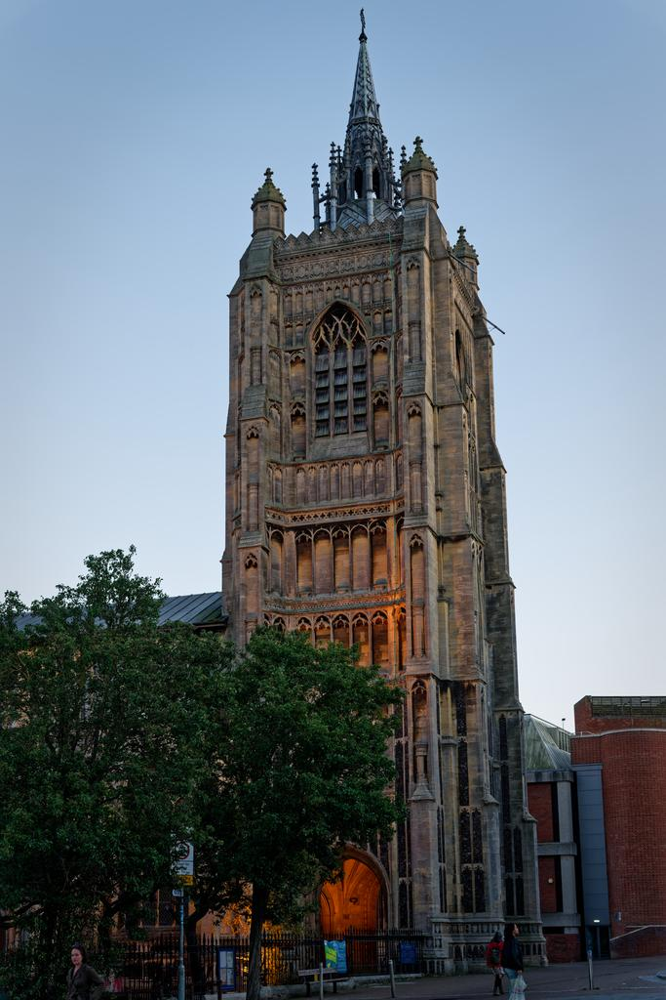

# Model Output Gallery

Generated on: 2026-10-16 17:06:36 BST

- *Evaluation lane:* assisted
- *Prompt hints:* the image's description and keyword hints were included in the prompt, so field content may be copied from them rather than seen
- *Assessment:* General checks + metadata fields and duplicate keywords; length limits and factual accuracy not assessed
- *Input image:* JPEG, 6,213 x 9,320 pixels (57.9 MP), 52.1 MB

This run records model responses to one shared image and prompt (evaluation
lane: assisted). Mechanical checks are not factual-accuracy judgments; inspect
the image, prompt and final answers before choosing a model. Results do not
establish fitness for other tasks.

Complete per-model evidence artifact with image metadata, the source prompt, a
facts-only chooser, and full generated or crash output for every attempted
model.

## Reference Image



## Current-run Chooser

Mechanical observations and captured resource facts for this run only. No concerns detected does not mean the response fulfilled an arbitrary prompt or described the image accurately. Consult the assessment scope above. Total time is end-to-end; throughput covers generation only and requires at least 16 generated tokens. Prefill/first is the measured time to first token (input preparation, prefill and the first decode step) when captured, else upstream's model-loop first-token time; Prompt tok is the full rendered prompt including image tokens, which drives prefill cost. For cross-attention architectures the token count reflects the tokenised text burden only, not total vision prefill compute.

<!-- markdownlint-disable MD034 MD037 MD049 -->

| Model                                                                                                                               | Mechanical checks               | Total s | Gen TPS    | Prefill/first s | Peak GB | Prompt tok | Gen tok | Observations                                                                                |
|-------------------------------------------------------------------------------------------------------------------------------------|---------------------------------|---------|------------|-----------------|---------|------------|---------|---------------------------------------------------------------------------------------------|
| [`LiquidAI/LFM2.5-VL-450M-MLX-bf16`](#model-liquidai-lfm25-vl-450m-mlx-bf16)                                                        | `no concerns detected`          | 2.02s   | 493 tok/s  | 0.60            | 1.9     | 2,131      | 83      | none                                                                                        |
| [`TechnoBaptist/Ternary-Bonsai-2-27B-mlx-2bit`](#model-technobaptist-ternary-bonsai-2-27b-mlx-2bit)                                 | `no concerns detected`          | 67.22s  | 36.2 tok/s | 61.75           | 17      | 16,579     | 123     | none                                                                                        |
| [`mlx-community/ERNIE-4.5-VL-28B-A3B-Thinking-4bit`](#model-mlx-community-ernie-45-vl-28b-a3b-thinking-4bit)                        | `no concerns detected`          | 8.60s   | 124 tok/s  | 1.32            | 19      | 1,656      | 617     | none                                                                                        |
| [`mlx-community/GLM-4.6V-nvfp4`](#model-mlx-community-glm-46v-nvfp4)                                                                | `no concerns detected`          | 21.78s  | 44.7 tok/s | 12.24           | 78      | 6,372      | 112     | none                                                                                        |
| [`mlx-community/InternVL3-14B-4bit`](#model-mlx-community-internvl3-14b-4bit)                                                       | `no concerns detected`          | 5.46s   | 57.6 tok/s | 1.97            | 10      | 2,132      | 98      | none                                                                                        |
| [`mlx-community/InternVL3_5-1B-4bit`](#model-mlx-community-internvl35-1b-4bit)                                                      | `no concerns detected`          | 2.29s   | 423 tok/s  | 0.83            | 2.1     | 2,135      | 126     | none                                                                                        |
| [`mlx-community/Kimi-VL-A3B-Thinking-2506-8bit`](#model-mlx-community-kimi-vl-a3b-thinking-2506-8bit)                               | `no concerns detected`          | 15.28s  | 66.6 tok/s | 1.32            | 20      | 1,342      | 750     | none                                                                                        |
| [`mlx-community/Llama-3.2-11B-Vision-Instruct-8bit`](#model-mlx-community-llama-32-11b-vision-instruct-8bit)                        | `no concerns detected`          | 8.70s   | 22.0 tok/s | 2.04            | 15      | 320        | 101     | none                                                                                        |
| [`mlx-community/MiniCPM-V-4.6-4bit`](#model-mlx-community-minicpm-v-46-4bit)                                                        | `no concerns detected`          | 3.52s   | 305 tok/s  | 0.87            | 3.2     | 950        | 333     | none                                                                                        |
| [`mlx-community/MiniCPM-V-4.7-1B-4bit`](#model-mlx-community-minicpm-v-47-1b-4bit)                                                  | `no concerns detected`          | 2.68s   | 311 tok/s  | 0.87            | 3.7     | 952        | 77      | none                                                                                        |
| [`mlx-community/MiniCPM-V-4.7-35B-A3B-4bit`](#model-mlx-community-minicpm-v-47-35b-a3b-4bit)                                        | `no concerns detected`          | 5.80s   | 88.9 tok/s | 1.22            | 25      | 952        | 120     | none                                                                                        |
| [`mlx-community/MiniCPM-o-4_5-4bit`](#model-mlx-community-minicpm-o-45-4bit)                                                        | `no concerns detected`          | 3.32s   | 104 tok/s  | 0.72            | 7.1     | 410        | 104     | none                                                                                        |
| [`mlx-community/Ministral-3-14B-Instruct-2512-mxfp4`](#model-mlx-community-ministral-3-14b-instruct-2512-mxfp4)                     | `no concerns detected`          | 6.41s   | 66.1 tok/s | 2.56            | 13      | 2,959      | 122     | none                                                                                        |
| [`mlx-community/Ministral-3-3B-Instruct-2512-4bit`](#model-mlx-community-ministral-3-3b-instruct-2512-4bit)                         | `no concerns detected`          | 3.66s   | 187 tok/s  | 1.50            | 7.8     | 2,958      | 113     | none                                                                                        |
| [`mlx-community/North-Micro-Vision-Instruct-4bit`](#model-mlx-community-north-micro-vision-instruct-4bit)                           | `no concerns detected`          | 5.20s   | 209 tok/s  | 2.65            | 3.9     | 4,101      | 158     | none                                                                                        |
| [`mlx-community/Qwen3-Omni-30B-A3B-Instruct-4bit`](#model-mlx-community-qwen3-omni-30b-a3b-instruct-4bit)                           | `no concerns detected`          | 25.05s  | 72.0 tok/s | 20.11           | 26      | 12,809     | 120     | none                                                                                        |
| [`mlx-community/Qwen3-VL-30B-A3B-Instruct-4bit`](#model-mlx-community-qwen3-vl-30b-a3b-instruct-4bit)                               | `no concerns detected`          | 43.65s  | 85.9 tok/s | 39.10           | 23      | 16,566     | 144     | none                                                                                        |
| [`mlx-community/Qwen3-VL-8B-Instruct-4bit`](#model-mlx-community-qwen3-vl-8b-instruct-4bit)                                         | `no concerns detected`          | 43.99s  | 69.0 tok/s | 40.81           | 11      | 16,566     | 91      | none                                                                                        |
| [`mlx-community/Qwen3.5-35B-A3B-4bit`](#model-mlx-community-qwen35-35b-a3b-4bit)                                                    | `no concerns detected`          | 42.82s  | 108 tok/s  | 38.24           | 25      | 16,579     | 130     | none                                                                                        |
| [`mlx-community/Qwen3.8-27B-nvfp4`](#model-mlx-community-qwen38-27b-nvfp4)                                                          | `no concerns detected`          | 62.79s  | 29.8 tok/s | 55.34           | 21      | 16,579     | 133     | none                                                                                        |
| [`mlx-community/X-Reasoner-7B-8bit`](#model-mlx-community-x-reasoner-7b-8bit)                                                       | `no concerns detected`          | 18.55s  | 59.7 tok/s | 14.00           | 14      | 16,577     | 127     | none                                                                                        |
| [`mlx-community/aya-vision-8b-4bit`](#model-mlx-community-aya-vision-8b-4bit)                                                       | `no concerns detected`          | 4.60s   | 102 tok/s  | 1.57            | 6.5     | 2,108      | 102     | none                                                                                        |
| [`mlx-community/diffusiongemma-26B-A4B-it-mxfp8`](#model-mlx-community-diffusiongemma-26b-a4b-it-mxfp8)                             | `no concerns detected`          | 6.12s   | 75.8 tok/s | 2.28            | 28      | 611        | 92      | none                                                                                        |
| [`mlx-community/gemma-3-27b-it-qat-4bit`](#model-mlx-community-gemma-3-27b-it-qat-4bit)                                             | `no concerns detected`          | 8.97s   | 31.5 tok/s | 1.48            | 17      | 610        | 145     | none                                                                                        |
| [`mlx-community/gemma-4-12B-it-4bit`](#model-mlx-community-gemma-4-12b-it-4bit)                                                     | `no concerns detected`          | 5.19s   | 62.6 tok/s | 0.92            | 7.6     | 615        | 118     | none                                                                                        |
| [`mlx-community/gemma-4-26b-a4b-it-4bit`](#model-mlx-community-gemma-4-26b-a4b-it-4bit)                                             | `no concerns detected`          | 4.84s   | 123 tok/s  | 0.96            | 16      | 615        | 105     | none                                                                                        |
| [`mlx-community/gemma-4-e4b-it-4bit`](#model-mlx-community-gemma-4-e4b-it-4bit)                                                     | `no concerns detected`          | 3.83s   | 125 tok/s  | 0.74            | 6.0     | 611        | 108     | none                                                                                        |
| [`nativ-community/NVIDIA-Nemotron-3.5-Bolt-74B-A9B-4bit`](#model-nativ-community-nvidia-nemotron-35-bolt-74b-a9b-4bit)              | `no concerns detected`          | 11.75s  | 69.6 tok/s | 4.82            | 52      | 3,641      | 153     | none                                                                                        |
| [`nativ-community/Nemotron-3-Nano-Omni-30B-A3B-Reasoning-4bit`](#model-nativ-community-nemotron-3-nano-omni-30b-a3b-reasoning-4bit) | `no concerns detected`          | 6.44s   | 156 tok/s  | 2.69            | 23      | 3,642      | 121     | none                                                                                        |
| [`mlx-community/AREX-2-4bit`](#model-mlx-community-arex-2-4bit)                                                                     | `concerns detected`             | 60.95s  | 30.8 tok/s | 53.91           | 21      | 16,579     | 123     | prompt hint repeated                                                                        |
| [`mlx-community/GLM-4.6V-Flash-4bit`](#model-mlx-community-glm-46v-flash-4bit)                                                      | `concerns detected`             | 8.96s   | 78.6 tok/s | 5.58            | 8.7     | 6,372      | 121     | prompt hint repeated                                                                        |
| [`mlx-community/LFM2.5-VL-3B-OptiQ-4bit`](#model-mlx-community-lfm25-vl-3b-optiq-4bit)                                              | `concerns detected`             | 3.14s   | 213 tok/s  | 1.10            | 4.0     | 2,122      | 84      | prompt hint repeated                                                                        |
| [`mlx-community/Molmo2-8B-4bit`](#model-mlx-community-molmo2-8b-4bit)                                                               | `concerns detected`             | 5.10s   | 72.6 tok/s | 1.39            | 8.2     | 1,562      | 141     | duplicate keywords                                                                          |
| [`mlx-community/SmolVLM2-2.2B-Instruct-mlx`](#model-mlx-community-smolvlm2-22b-instruct-mlx)                                        | `concerns detected`             | 3.56s   | 127 tok/s  | 1.09            | 5.6     | 1,446      | 128     | duplicate keywords; prompt hint repeated                                                    |
| [`mlx-community/Step-3.7-Flash-oQ3e`](#model-mlx-community-step-37-flash-oq3e)                                                      | `concerns detected`             | 36.89s  | 53.0 tok/s | 20.19           | 92      | 3,506      | 118     | prompt hint repeated                                                                        |
| [`mlx-community/granite-4.0-3b-vision-4bit`](#model-mlx-community-granite-40-3b-vision-4bit)                                        | `concerns detected`             | 3.27s   | 180 tok/s  | 1.18            | 4.8     | 1,410      | 105     | prompt hint repeated                                                                        |
| [`mlx-community/pixtral-12b-8bit`](#model-mlx-community-pixtral-12b-8bit)                                                           | `concerns detected`             | 7.38s   | 40.2 tok/s | 2.28            | 16      | 3,152      | 115     | prompt hint repeated                                                                        |
| [`nativ-community/Mage-VL-OptiQ-4bit`](#model-nativ-community-mage-vl-optiq-4bit)                                                   | `concerns detected`             | 4.64s   | 127 tok/s  | 2.10            | 5.4     | 4,229      | 125     | prompt hint repeated                                                                        |
| [`nativ-community/Mistral-Small-3.2-24B-Instruct-2506-4bit`](#model-nativ-community-mistral-small-32-24b-instruct-2506-4bit)        | `concerns detected`             | 7.25s   | 37.0 tok/s | 1.99            | 18      | 1,299      | 110     | prompt hint repeated                                                                        |
| [`sahilchachra/LensVLM-9B-MXFP4`](#model-sahilchachra-lensvlm-9b-mxfp4)                                                             | `concerns detected`             | 4.20s   | 104 tok/s  | 1.50            | 7.4     | 1,843      | 93      | prompt hint repeated                                                                        |
| [`mlx-community/FastVLM-0.5B-bf16`](#model-mlx-community-fastvlm-05b-bf16)                                                          | `major concerns: answer format` | 2.95s   | 364 tok/s  | 1.12            | 2.2     | 353        | 44      | labelled fields not detected; prompt hint repeated                                          |
| [`mlx-community/MolmoPoint-8B-4bit`](#model-mlx-community-molmopoint-8b-4bit)                                                       | `major concerns: answer format` | 9.68s   | 31.8 tok/s | 2.83            | 13      | 3,164      | 144     | labelled fields not detected                                                                |
| [`mlx-community/Muse-Glimmer-30B-OptiQ-4bit`](#model-mlx-community-muse-glimmer-30b-optiq-4bit)                                     | `major concerns: answer format` | 50.71s  | 25.2 tok/s | 7.50            | 25      | 4,418      | 1,000   | labelled fields not detected; cut off at token limit                                        |
| [`mlx-community/Phi-3.5-vision-instruct-bf16`](#model-mlx-community-phi-35-vision-instruct-bf16)                                    | `major concerns: generation`    | 5.67s   | 58.5 tok/s | 0.80            | 9.3     | 1,151      | 200     | repeated text; stopped early: repeating; duplicate keywords                                 |
| [`mlx-community/Qwen2-VL-2B-mlx`](#model-mlx-community-qwen2-vl-2b-mlx)                                                             | `major concerns: generation`    | 49.67s  | 125 tok/s  | 39.81           | 9.4     | 16,577     | 1,000   | repeated text; control tokens visible; labelled fields not detected; cut off at token limit |
| [`mlx-community/SmolVLM-256M-Instruct-4bit`](#model-mlx-community-smolvlm-256m-instruct-4bit)                                       | `major concerns: answer format` | 2.08s   | 517 tok/s  | 0.88            | 1.1     | 1,225      | 36      | labelled fields not detected; prompt hint repeated                                          |
| [`mlx-community/gemma-3n-E4B-it-4bit`](#model-mlx-community-gemma-3n-e4b-it-4bit)                                                   | `major concerns: answer format` | 5.76s   | 96.8 tok/s | 0.82            | 7.2     | 609        | 261     | labelled fields not detected                                                                |
| [`mlx-community/granite-vision-3.2-2b-nvfp4`](#model-mlx-community-granite-vision-32-2b-nvfp4)                                      | `major concerns: generation`    | 5.65s   | 149 tok/s  | 3.02            | 4.3     | 5,688      | 200     | repeated text; stopped early: repeating; labelled fields not detected; duplicate keywords   |
| [`mlx-community/llm-jp-4-vl-9b-mlx-4bit`](#model-mlx-community-llm-jp-4-vl-9b-mlx-4bit)                                             | `major concerns: answer format` | 3.43s   | 107 tok/s  | 1.46            | 6.7     | 2,211      | 19      | control tokens visible; labelled fields not detected                                        |
| [`mlx-community/nanoLLaVA-1.5-4bit`](#model-mlx-community-nanollava-15-4bit)                                                        | `major concerns: answer format` | 2.18s   | 334 tok/s  | 0.66            | 1.8     | 349        | 131     | labelled fields not detected                                                                |
| [`vikhyatk/moondream2`](#model-vikhyatk-moondream2)                                                                                 | `major concerns: answer format` | 2.91s   | 169 tok/s  | 0.92            | 4.8     | 1,038      | 37      | labelled fields not detected; prompt hint repeated                                          |
<!-- markdownlint-enable MD034 MD037 MD049 -->

## Resource Highlights

Quickest completion without detected concerns (end-to-end, including model load): `LiquidAI/LFM2.5-VL-450M-MLX-bf16` at 2.02s

Lowest peak memory among completions without detected concerns: `LiquidAI/LFM2.5-VL-450M-MLX-bf16` at 1.9 GB

Decode tok/s stays per model in the chooser and is not averaged across models: tokenizers, image-token expansion and reasoning lengths differ too much for a cross-model mean to guide a choice.

## Major Mechanical Concerns in This Run

<!-- markdownlint-disable MD034 MD037 MD049 -->

| Model                                                                                            | Mechanical checks               | Observations                                                                                |
|--------------------------------------------------------------------------------------------------|---------------------------------|---------------------------------------------------------------------------------------------|
| [`mlx-community/FastVLM-0.5B-bf16`](#model-mlx-community-fastvlm-05b-bf16)                       | `major concerns: answer format` | labelled fields not detected; prompt hint repeated                                          |
| [`mlx-community/MolmoPoint-8B-4bit`](#model-mlx-community-molmopoint-8b-4bit)                    | `major concerns: answer format` | labelled fields not detected                                                                |
| [`mlx-community/Muse-Glimmer-30B-OptiQ-4bit`](#model-mlx-community-muse-glimmer-30b-optiq-4bit)  | `major concerns: answer format` | labelled fields not detected; cut off at token limit                                        |
| [`mlx-community/Phi-3.5-vision-instruct-bf16`](#model-mlx-community-phi-35-vision-instruct-bf16) | `major concerns: generation`    | repeated text; stopped early: repeating; duplicate keywords                                 |
| [`mlx-community/Qwen2-VL-2B-mlx`](#model-mlx-community-qwen2-vl-2b-mlx)                          | `major concerns: generation`    | repeated text; control tokens visible; labelled fields not detected; cut off at token limit |
| [`mlx-community/SmolVLM-256M-Instruct-4bit`](#model-mlx-community-smolvlm-256m-instruct-4bit)    | `major concerns: answer format` | labelled fields not detected; prompt hint repeated                                          |
| [`mlx-community/gemma-3n-E4B-it-4bit`](#model-mlx-community-gemma-3n-e4b-it-4bit)                | `major concerns: answer format` | labelled fields not detected                                                                |
| [`mlx-community/granite-vision-3.2-2b-nvfp4`](#model-mlx-community-granite-vision-32-2b-nvfp4)   | `major concerns: generation`    | repeated text; stopped early: repeating; labelled fields not detected; duplicate keywords   |
| [`mlx-community/llm-jp-4-vl-9b-mlx-4bit`](#model-mlx-community-llm-jp-4-vl-9b-mlx-4bit)          | `major concerns: answer format` | control tokens visible; labelled fields not detected                                        |
| [`mlx-community/nanoLLaVA-1.5-4bit`](#model-mlx-community-nanollava-15-4bit)                     | `major concerns: answer format` | labelled fields not detected                                                                |
| [`vikhyatk/moondream2`](#model-vikhyatk-moondream2)                                              | `major concerns: answer format` | labelled fields not detected; prompt hint repeated                                          |
<!-- markdownlint-enable MD034 MD037 MD049 -->

## Output at a Glance

A compact preview of each model's final answer (or failure evidence for crashes), in chooser order. Where the requested catalogue fields were detected, the preview shows a little of each: the title, the start of the description, and the first keywords with their count, so the weakest field is not hidden behind a long description. Otherwise it is the first 280 characters. A closed reasoning trace is left out of the preview and reported as an omitted-character count; the complete output, trace included, is in the model's evidence block below.

<!-- markdownlint-disable MD034 MD037 MD049 -->

| Model                                                                                                                               | Mechanical checks      | Output preview                                                                                                                                                                                                                                                                                                                                                                        |
|-------------------------------------------------------------------------------------------------------------------------------------|------------------------|---------------------------------------------------------------------------------------------------------------------------------------------------------------------------------------------------------------------------------------------------------------------------------------------------------------------------------------------------------------------------------------|
| [`LiquidAI/LFM2.5-VL-450M-MLX-bf16`](#model-liquidai-lfm25-vl-450m-mlx-bf16)                                                        | `no concerns detected` | Title: St. Peter Mancroft Church Tower \| Description: A Gothic-style church tower illuminated at twilight, with a Victorian lead flèche and a clear sky in the background. \| Keywords (15): Church tower, Gothic architecture, St. Peter Mancroft, Norwich, Norfolk, England, illuminated, spire, ...                                                                               |
| [`TechnoBaptist/Ternary-Bonsai-2-27B-mlx-2bit`](#model-technobaptist-ternary-bonsai-2-27b-mlx-2bit)                                 | `no concerns detected` | Title: St Peter Mancroft Tower at Evening \| Description: A low-angle view of the medieval tower and Victorian lead flèche of the Church of St Peter Mancroft in... \| Keywords (16): St Peter Mancroft, Norwich, Church Tower, Gothic Architecture, Spire, Twilight, Evening Light, Stone Masonry, ...                                                                               |
| [`mlx-community/ERNIE-4.5-VL-28B-A3B-Thinking-4bit`](#model-mlx-community-ernie-45-vl-28b-a3b-thinking-4bit)                        | `no concerns detected` | Title: St Peter Mancroft, Norwich, at Twilight \| Description: A low-angle, evening view of the medieval St Peter Mancroft church in Norwich, Norfolk, England... \| Keywords (35): St Peter Mancroft, Norwich, church tower, St Peter's, Norwich Cathedral, tower, spire, stone, Gothic, medieval, ...[1,626 characters of reasoning omitted; complete output in the evidence block] |
| [`mlx-community/GLM-4.6V-nvfp4`](#model-mlx-community-glm-46v-nvfp4)                                                                | `no concerns detected` | Title: St Peter Mancroft Tower, Norwich \| Description: The Perpendicular Gothic tower of St Peter Mancroft in Norwich, England, stands illuminated in evening light, with pedes... \| Keywords (19): St Peter Mancroft, Norwich, England, Church Tower, Gothic Architecture, Perpendicular Gothic, ...                                                                               |
| [`mlx-community/InternVL3-14B-4bit`](#model-mlx-community-internvl3-14b-4bit)                                                       | `no concerns detected` | Title: St Peter Mancroft Tower at Twilight \| Description: The Church of St Peter Mancroft's Gothic tower is illuminated in the evening light, with pedestrians walking by in N... \| Keywords (18): Archway, Bell Tower, Church Tower, Clear Sky, England, Gothic Architecture, Historic Landmark, ...                                                                               |
| [`mlx-community/InternVL3_5-1B-4bit`](#model-mlx-community-internvl35-1b-4bit)                                                      | `no concerns detected` | Title: Evening view of St Peter Mancroft Church illuminated in Norwich \| Description: The image captures a serene evening scene featuring the illuminated bell tower o... \| Keywords (23): St Peter Mancroft, Gothic Architecture, Bell Tower, Church Tower, Perpendicular Gothic, Stone Masonry, ...                                                                               |
| [`mlx-community/Kimi-VL-A3B-Thinking-2506-8bit`](#model-mlx-community-kimi-vl-a3b-thinking-2506-8bit)                               | `no concerns detected` | Title: St Peter Mancroft Tower at Twilight \| Description: A low-angle view of St Peter Mancroft's medieval tower and Victorian stone facade illuminated by evening light, with... \| Keywords (19): Archway, Bell Tower, Church Tower, Clear Sky, England, Gothic Architecture, Historic Landmark, ...[2,799 characters of reasoning omitted; complete output in the evidence block] |
| [`mlx-community/Llama-3.2-11B-Vision-Instruct-8bit`](#model-mlx-community-llama-32-11b-vision-instruct-8bit)                        | `no concerns detected` | Title: Evening Illumination of St Peter Mancroft's Tower in Norwich \| Description: The medieval tower of St Peter Mancroft church in Norwich, England, is illumin... \| Keywords (11): Gothic architecture, historic landmark, stone masonry, medieval tower, St Peter Mancroft, Norwich, England, ...                                                                               |
| [`mlx-community/MiniCPM-V-4.6-4bit`](#model-mlx-community-minicpm-v-46-4bit)                                                        | `no concerns detected` | Title: Medieval Church Tower Illuminated at Twilight \| Description: The Gothic tower of St Peter Mancroft is visible at twilight, lit warmly by evening light, wit... \| Keywords (18): Gothic architecture, Church tower, medieval, evening light, illuminated, pedestrians, historical landmark, ...[1,098 characters of reasoning omitted; complete output in the evidence block] |
| [`mlx-community/MiniCPM-V-4.7-1B-4bit`](#model-mlx-community-minicpm-v-47-1b-4bit)                                                  | `no concerns detected` | Title: Gothic Church Tower in Norwich \| Description: A tall medieval stone tower with a spire, illuminated at evening, stands against a clear sky in Norwich, wi... \| Keywords (13): Gothic Architecture, Church Tower, Spire, Stone Masonry, Twilight, Landmark, Historic Architecture, England, ...                                                                               |
| [`mlx-community/MiniCPM-V-4.7-35B-A3B-4bit`](#model-mlx-community-minicpm-v-47-35b-a3b-4bit)                                        | `no concerns detected` | Title: St Peter Mancroft Tower at Twilight \| Description: The medieval tower of the Church of St Peter Mancroft in Norwich, Norfolk, is illuminated by warm eve... \| Keywords (18): St Peter Mancroft, Norwich, Norfolk, England, Church Tower, Gothic Architecture, Perpendicular Gothic, Spire, ...                                                                               |
| [`mlx-community/MiniCPM-o-4_5-4bit`](#model-mlx-community-minicpm-o-45-4bit)                                                        | `no concerns detected` | Title: St Peter Mancroft Tower at Twilight in Norwich \| Description: A low-angle evening shot captures the illuminated Gothic stone tower of St Peter Mancrof... \| Keywords (15): St Peter Mancroft, Gothic Architecture, Church Tower, Stone Masonry, Spire, Victorian Flèche, Norwich, Norfolk, ...                                                                               |
| [`mlx-community/Ministral-3-14B-Instruct-2512-mxfp4`](#model-mlx-community-ministral-3-14b-instruct-2512-mxfp4)                     | `no concerns detected` | Title: **St Peter Mancroft Church Tower at Twilight, Norwich** \| Description: A low-angle evening photograph captures the medieval stone tower and Victorian lead sp... \| Keywords (16): St Peter Mancroft, Norwich, England, Gothic architecture, Perpendicular Gothic, stone tower, lead spire, ...                                                                               |
| [`mlx-community/Ministral-3-3B-Instruct-2512-4bit`](#model-mlx-community-ministral-3-3b-instruct-2512-4bit)                         | `no concerns detected` | Title: **St Peter Mancroft’s Gothic Tower in Norwich Twilight** \| Description: A towering medieval church spire in Norwich, Norfolk, stands illuminated under twiligh... \| Keywords (17): Church of St Peter Mancroft, Norwich, Norfolk, England, Gothic architecture, Stone masonry, Bell tower, ...                                                                               |
| [`mlx-community/North-Micro-Vision-Instruct-4bit`](#model-mlx-community-north-micro-vision-instruct-4bit)                           | `no concerns detected` | Title: Medieval Tower of St Peter Mancroft \| Description: A low-angle view of the medieval tower and Victorian lead flèche of the Church of St Peter Mancroft illuminated in e... \| Keywords (20): Archway, Bell Tower, Church Tower, Clear Sky, England, Gothic Architecture, Historic Landmark, ...                                                                               |
| [`mlx-community/Qwen3-Omni-30B-A3B-Instruct-4bit`](#model-mlx-community-qwen3-omni-30b-a3b-instruct-4bit)                           | `no concerns detected` | Title: St Peter Mancroft Church Tower at Twilight \| Description: The Perpendicular Gothic tower of St Peter Mancroft in Norwich, England, stands tall against... \| Keywords (18): Church Tower, Gothic Architecture, Perpendicular Gothic, Historic Landmark, Stone Masonry, Stone facade, Spire, ...                                                                               |
| [`mlx-community/Qwen3-VL-30B-A3B-Instruct-4bit`](#model-mlx-community-qwen3-vl-30b-a3b-instruct-4bit)                               | `no concerns detected` | Title: Church of St Peter Mancroft at twilight \| Description: The Church of St Peter Mancroft in Norwich, Norfolk, England, is captured at dusk, its stone facade illuminated by... \| Keywords (21): Church of St Peter Mancroft, Norwich, Norfolk, England, United Kingdom, Gothic Architecture, ...                                                                               |
| [`mlx-community/Qwen3-VL-8B-Instruct-4bit`](#model-mlx-community-qwen3-vl-8b-instruct-4bit)                                         | `no concerns detected` | Title: St Peter Mancroft Tower at Twilight \| Description: The Gothic tower of St Peter Mancroft in Norwich glows in evening light, its stone facade and spire... \| Keywords (10): St Peter Mancroft, Norwich, Gothic Architecture, Tower, Twilight, Stone Masonry, Spire, Pedestrians, Clear Sky, ...                                                                               |
| [`mlx-community/Qwen3.5-35B-A3B-4bit`](#model-mlx-community-qwen35-35b-a3b-4bit)                                                    | `no concerns detected` | Title: St Peter Mancroft Tower at Dusk \| Description: This low-angle view captures the Gothic Church of St Peter Mancroft in Norwich at twilight, its Victorian s... \| Keywords (18): St Peter Mancroft, Norwich, Norfolk, England, Gothic Architecture, Church Tower, Victorian Spire, Twilight, ...                                                                               |
| [`mlx-community/Qwen3.8-27B-nvfp4`](#model-mlx-community-qwen38-27b-nvfp4)                                                          | `no concerns detected` | Title: Tower and Spire of St Peter Mancroft at Dusk in Norwich \| Description: A low-angle view of the medieval tower and Victorian lead spire of the Church of St Pe... \| Keywords (15): Archway, Church Tower, Clear Sky, England, Gothic Architecture, Golden Hour, Historic Landmark, Norwich, ...                                                                               |
| [`mlx-community/X-Reasoner-7B-8bit`](#model-mlx-community-x-reasoner-7b-8bit)                                                       | `no concerns detected` | Title: Norwich St Peter Mancroft Tower Twilight \| Description: A low-angle view captures the illuminated medieval tower and Victorian lead flèche of St Peter M... \| Keywords (22): Norwich, St Peter Mancroft, Church Tower, Perpendicular Gothic, Victorian lead flèche, medieval architecture, ...                                                                               |
| [`mlx-community/aya-vision-8b-4bit`](#model-mlx-community-aya-vision-8b-4bit)                                                       | `no concerns detected` | Title: Medieval Tower Illuminated at Twilight \| Description: The Gothic architecture of St Peter Mancroft's bell tower, with its intricate stone masonry and Victor... \| Keywords (18): Medieval, Gothic, Stone, Victorian, Tower, Bell, Clock, Norwich, England, Historical, Landmark, Twilight, ...                                                                               |
| [`mlx-community/diffusiongemma-26B-A4B-it-mxfp8`](#model-mlx-community-diffusiongemma-26b-a4b-it-mxfp8)                             | `no concerns detected` | Title: The Gothic Tower of St Peter Mancroft in Norwich \| Description: A low-angle evening view of the illuminated medieval stone tower and spire of the St Peter Manc... \| Keywords (15): Norwich, Norfolk, England, St Peter Mancroft, Gothic Architecture, Church Tower, Spire, Stone Masonry, ...                                                                               |
| [`mlx-community/gemma-3-27b-it-qat-4bit`](#model-mlx-community-gemma-3-27b-it-qat-4bit)                                             | `no concerns detected` | Title: St Peter Mancroft Tower, Norwich – October Evening \| Description: Captured on 10 October 2026 at 18:09 UTC+01:00, this low-angle view shows the medieval tower and Vi... \| Keywords (18): St Peter Mancroft, Church Tower, Norwich, Norfolk, England, United Kingdom, Gothic Architecture, ...                                                                               |
| [`mlx-community/gemma-4-12B-it-4bit`](#model-mlx-community-gemma-4-12b-it-4bit)                                                     | `no concerns detected` | Title: St Peter Mancroft Church Tower at Twilight \| Description: A low-angle view of the medieval bell tower and Victorian lead flèche of the Church of St Peter Ma... \| Keywords (17): St Peter Mancroft, Norwich, England, Church Tower, Bell Tower, Perpendicular Gothic, Gothic Architecture, ...                                                                               |
| [`mlx-community/gemma-4-26b-a4b-it-4bit`](#model-mlx-community-gemma-4-26b-a4b-it-4bit)                                             | `no concerns detected` | Title: St Peter Mancroft tower in evening light \| Description: A low-angle view shows the medieval stone tower and Victorian lead flèche of St Peter Mancroft illumi... \| Keywords (16): St Peter Mancroft, Norwich, Norfolk, England, United Kingdom, Gothic architecture, Perpendicular Gothic, ...                                                                               |
| [`mlx-community/gemma-4-e4b-it-4bit`](#model-mlx-community-gemma-4-e4b-it-4bit)                                                     | `no concerns detected` | Title: St Peter Mancroft Church Tower at Twilight in Norwich \| Description: A low-angle view captures the Gothic architecture of St Peter Mancroft Church's towe... \| Keywords (15): St Peter Mancroft, Church Tower, Gothic Architecture, Norwich, Twilight, Perpendicular Gothic, Stone Facade, ...                                                                               |
| [`nativ-community/NVIDIA-Nemotron-3.5-Bolt-74B-A9B-4bit`](#model-nativ-community-nvidia-nemotron-35-bolt-74b-a9b-4bit)              | `no concerns detected` | Title: St Peter Mancroft Church illuminated at twilight in Norwich \| Description: A low-angle photograph captures the historic Church of St Peter Mancroft in... \| Keywords (22): Church of St Peter Mancroft, Norwich, Norfolk, England, United Kingdom, Gothic architecture, Historic landmark, ...                                                                               |
| [`nativ-community/Nemotron-3-Nano-Omni-30B-A3B-Reasoning-4bit`](#model-nativ-community-nemotron-3-nano-omni-30b-a3b-reasoning-4bit) | `no concerns detected` | Title: St Peter Mancroft Church Tower at Dusk \| Description: A low-angle view captures the medieval stone tower and Victorian lead flèche of the Church of St Peter Ma... \| Keywords (17): Church Tower, Gothic Architecture, Perpendicular Gothic, Norwich, Norfolk, England, Historic Landmark, ...                                                                               |
| [`mlx-community/AREX-2-4bit`](#model-mlx-community-arex-2-4bit)                                                                     | `concerns detected`    | Title: St Peter Mancroft Tower at Dusk, Norwich \| Description: A low-angle view of the medieval tower and Victorian lead flèche of the Church of St Peter Mancroft,... \| Keywords (18): Archway, Bell Tower, Church Tower, Clear Sky, England, Gothic Architecture, Historic Landmark, Landmark, ...                                                                                |
| [`mlx-community/GLM-4.6V-Flash-4bit`](#model-mlx-community-glm-46v-flash-4bit)                                                      | `concerns detected`    | Title: St Peter Mancroft Tower \| Description: A low-angle view of the medieval tower and Victorian lead flèche of the Church of St Peter Mancroft illuminated in evening light... \| Keywords (20): Archway, Bell Tower, Church Tower, Clear Sky, England, Gothic Architecture, Historic Landmark, ...                                                                               |
| [`mlx-community/LFM2.5-VL-3B-OptiQ-4bit`](#model-mlx-community-lfm25-vl-3b-optiq-4bit)                                              | `concerns detected`    | Title: St Peter Mancroft Tower, Norwich, England \| Description: A low-angle view of the medieval tower and Victorian lead flèche illuminated in evening light, wit... \| Keywords (13): Church Tower, Gothic Architecture, Historic Landmark, England, Norwich, Pedestrians, Spire, Stone Masonry, ...                                                                               |
| [`mlx-community/Molmo2-8B-4bit`](#model-mlx-community-molmo2-8b-4bit)                                                               | `concerns detected`    | Title: St Peter Mancroft Tower at Twilight, Norwich \| Description: A low-angle view of the medieval tower and Victorian lead flèche of St Peter Mancroft Churc... \| Keywords (19): St Peter Mancroft, Norwich, Church Tower, Gothic Architecture, Stone Masonry, Victorian Lead Flèche, Twilight, ...                                                                               |
| [`mlx-community/SmolVLM2-2.2B-Instruct-mlx`](#model-mlx-community-smolvlm2-22b-instruct-mlx)                                        | `concerns detected`    | Title: St Peter Mancroft Church, Norwich, England \| Description: A low-angle view of the medieval tower and Victorian lead flèche of the Church of St Peter Mancroft illuminat... \| Keywords (21): Archway, Bell Tower, Church Tower, Clear Sky, England, Gothic Architecture, Historic Landmark, ...                                                                               |
| [`mlx-community/Step-3.7-Flash-oQ3e`](#model-mlx-community-step-37-flash-oq3e)                                                      | `concerns detected`    | Title: St Peter Mancroft Tower at Twilight, Norwich \| Description: A low-angle view of the medieval tower and Victorian lead flèche of the Church of St Peter Mancroft illumin... \| Keywords (20): Archway, Bell Tower, Church Tower, Clear Sky, England, Gothic Architecture, Historic Landmark, ...                                                                               |
| [`mlx-community/granite-4.0-3b-vision-4bit`](#model-mlx-community-granite-40-3b-vision-4bit)                                        | `concerns detected`    | Title: "Evening Illumination of Norwich's St Peter Mancroft" \| Description: A low-angle view captures the grandeur of the medieval tower and Victorian lead flèche... \| Keywords (10): Gothic Architecture, Historic Landmark, St Peter Mancroft, Stone Masonry, Spire, Twilight, United Kingdom, ...                                                                               |
| [`mlx-community/pixtral-12b-8bit`](#model-mlx-community-pixtral-12b-8bit)                                                           | `concerns detected`    | Title: St Peter Mancroft Tower in Evening Light \| Description: The medieval tower and Victorian lead flèche of St Peter Mancroft are illuminated in the evening light, with pe... \| Keywords (20): Archway, Bell Tower, Church Tower, Clear Sky, England, Gothic Architecture, Historic Landmark, ...                                                                               |
| [`nativ-community/Mage-VL-OptiQ-4bit`](#model-nativ-community-mage-vl-optiq-4bit)                                                   | `concerns detected`    | Title: St Peter Mancroft Church Tower Illuminated at Twilight in Norwich, England \| Description: The medieval tower and Victorian lead flèche of the Church of St Peter Mancro... \| Keywords (20): Archway, Bell Tower, Church Tower, Clear Sky, England, Gothic Architecture, Historic Landmark, ...                                                                               |
| [`nativ-community/Mistral-Small-3.2-24B-Instruct-2506-4bit`](#model-nativ-community-mistral-small-32-24b-instruct-2506-4bit)        | `concerns detected`    | Title: St Peter Mancroft Tower at Twilight \| Description: The medieval tower and Victorian lead flèche of St Peter Mancroft Church in Norwich, Norfolk, Engla... \| Keywords (18): St Peter Mancroft, Norwich, Church Tower, Gothic Architecture, Perpendicular Gothic, Bell Tower, Stone Masonry, ...                                                                               |
| [`sahilchachra/LensVLM-9B-MXFP4`](#model-sahilchachra-lensvlm-9b-mxfp4)                                                             | `concerns detected`    | Title: St Peter Mancroft Church Tower at Dusk \| Description: A low-angle view of the medieval tower and Victorian lead flèche of the Church of St Peter Mancroft illu... \| Keywords (10): Church Tower, Gothic Architecture, Norwich, Pedestrians, Twilight, Stone Masonry, Perpendicular Gothic, ...                                                                               |
| [`mlx-community/FastVLM-0.5B-bf16`](#model-mlx-community-fastvlm-05b-bf16)                                                          | `major concerns`       | A low-angle view of the medieval tower and Victorian lead flèche of the Church of St Peter Mancroft illuminated in evening light, with pedestrians walking along the street below in Norwich, Norfolk, England.                                                                                                                                                                       |
| [`mlx-community/MolmoPoint-8B-4bit`](#model-mlx-community-molmopoint-8b-4bit)                                                       | `major concerns`       | St Peter Mancroft Tower, Norwich: Gothic Stone Facade at Sunset<br><br>A low-angle view captures the medieval stone tower and Victorian lead flèche of St Peter Mancroft Church in Norwich, Norfolk, England. The structure's intricate Gothic architecture is illuminated by the warm glow...                                                                                        |
| [`mlx-community/Muse-Glimmer-30B-OptiQ-4bit`](#model-mlx-community-muse-glimmer-30b-optiq-4bit)                                     | `major concerns`       | Title: St Peter Mancroft Church Tower Norwich Evening \| Description: (not detected) \| Keywords: (not detected)                                                                                                                                                                                                                                                                      |
| [`mlx-community/Phi-3.5-vision-instruct-bf16`](#model-mlx-community-phi-35-vision-instruct-bf16)                                    | `major concerns`       | Title: Gothic Church Tower of St Peter Mancroft in Norwich \| Description: The Gothic Church Tower of St Peter Mancroft in Norwich, Norfolk, England, stands tall with... \| Keywords (37): Gothic architecture, Victorian lead flèche, Church Tower, St Peter Mancroft, Norwich, Norfolk, England, ...                                                                               |
| [`mlx-community/Qwen2-VL-2B-mlx`](#model-mlx-community-qwen2-vl-2b-mlx)                                                             | `major concerns`       | Title: Low-angle view of the medieval tower and Victorian lead flèche of the Church... \| Description: The image shows a low-angle view of the medieval tower and Victorian lead flèche of the Church of St Peter Mancroft in Norwich, Norfolk, England. The tower is il... \| Keywords: (not detected)                                                                               |
| [`mlx-community/SmolVLM-256M-Instruct-4bit`](#model-mlx-community-smolvlm-256m-instruct-4bit)                                       | `major concerns`       | A low-angle view of the medieval church of St Peter Mancroft illuminated in evening light, with pedestrians walking along the street below in Norwich, Norfolk, England.                                                                                                                                                                                                              |
| [`mlx-community/gemma-3n-E4B-it-4bit`](#model-mlx-community-gemma-3n-e4b-it-4bit)                                                   | `major concerns`       | ```json<br>{<br>"caption": "A low-angle view of the medieval tower and Victorian lead flèche of the Church of St Peter Mancroft located in England, with pedestrians walking along the street below in Norwich, UK.",<br>"bounding_boxes": [<br>[<br>125,<br>0,<br>987,<br>1000<br>]<br>],<br>"keywords": [<br>"Archway",...                                                          |
| [`mlx-community/granite-vision-3.2-2b-nvfp4`](#model-mlx-community-granite-vision-32-2b-nvfp4)                                      | `major concerns`       | Title: "Twilight at St Peter Mancroft: A Gothic Symphony of Light and Shadow" \| Description: (not detected) \| Keywords (48): Gothic Architecture, Historic Landmark, Norwich, Pedestrians, Perpendicular Gothic, Stone Masonry, ...                                                                                                                                                 |
| [`mlx-community/llm-jp-4-vl-9b-mlx-4bit`](#model-mlx-community-llm-jp-4-vl-9b-mlx-4bit)                                             | `major concerns`       | <\|channel\|> analysis<\|message\|> The image shows a large church tower with a spire and a pointed roof.                                                                                                                                                                                                                                                                             |
| [`mlx-community/nanoLLaVA-1.5-4bit`](#model-mlx-community-nanollava-15-4bit)                                                        | `major concerns`       | Title: A Gothic Architecture Snapshot of the Church of St Peter Mancroft Illuminated... \| Description: A detailed view of the medieval church of St Peter Mancroft, illuminated by the twilight, with a low-angle view of the church and its bell tower. The image capt... \| Keywords: (not detected)                                                                               |
| [`vikhyatk/moondream2`](#model-vikhyatk-moondream2)                                                                                 | `major concerns`       | A low-angle view of the medieval tower and Victorian lead flèche of the Church of St Peter Mancroft illuminated in evening light, with pedestrians walking along the street below in Norwich, Norfolk, England.                                                                                                                                                                       |
<!-- markdownlint-enable MD034 MD037 MD049 -->

## Run Stamps

- `mlx-vlm`: `0.7.8`
- `mlx`: `0.32.5.dev20261016+b6642e604`
- `transformers`: `5.20.1`
- `tokenizers`: `0.23.3`
- `huggingface-hub`: `2.2.0`
- *Python Version:* 3.14.7
- *OS:* Darwin 27.0.0
- *macOS Version:* 27.0.1
- *GPU/Chip:* Apple M5 Max
- *MLX Device:* Apple M5 Max
- *GPU Architecture:* applegpu_g17s
- *RAM:* 128.0 GB
- *Recommended Working Set:* 115 GB
- *Fused Attention:* Available

## Image Metadata

- *Description:* A low-angle view of the medieval tower and Victorian lead
  flèche of the Church of St Peter Mancroft illuminated in evening light, with
  pedestrians walking along the street below in Norwich, Norfolk, England.
- *Keywords:* Archway, Bell Tower, Church Tower, Clear Sky, England, Gothic
  Architecture, Historic Landmark, Historic architecture, Landmark, Norwich,
  Pedestrians, Perpendicular Gothic, Spire, St Peter Mancroft, Stone Masonry,
  Stone facade, Trees, Twilight, United Kingdom, Walking, ancient,
  architectural heritage, architecture, belfry, british architecture, carved
  stone, cathedral, christianity, church, city, dusk, evening, evening light,
  exterior, facade, great britain, heritage, historic building, history,
  illuminated, lantern spire, medieval, medieval architecture, nightfall,
  norfolk, pinnacles, place of worship, religion, religious building, stone
  tower, street scene, tourism, tower, travel destination, urban landmark,
  warm lighting
- *Date:* 2026-10-10 18:09:17 UTC+01:00
- *Time:* 18:09:17
- *GPS:* 52.628000°N, 1.293600°E

## Prompt

<!-- markdownlint-disable MD011 MD028 MD037 MD045 -->
>
> Create British-English catalogue metadata from the image and supplied
> context.
>
> Treat any capture date/time and GPS as authoritative facts, but do not claim
> they are visible. Descriptive hints may be incomplete or wrong: retain
> details supported by the image, correct conflicts, and add important visible
> details. Prefer image evidence when a hint conflicts, and omit uncertain
> details.
>
> Context: Authoritative context:
> &#45; Capture date/time: 2026-10-10 18:09:17 UTC+01:00
> &#45; GPS: 52.628000°N, 1.293600°E
>
> &#8203;Descriptive hints:
> &#45; Description hint: A low-angle view of the medieval tower and Victorian
> lead flèche of the Church of St Peter Mancroft illuminated in evening light,
> with pedestrians walking along the street below in Norwich, Norfolk,
> England.
> &#45; Keyword hints: Archway, Bell Tower, Church Tower, Clear Sky, England,
> Gothic Architecture, Historic Landmark, Historic architecture, Landmark,
> Norwich, Pedestrians, Perpendicular Gothic, Spire, St Peter Mancroft, Stone
> Masonry, Stone facade, Trees, Twilight, United Kingdom, Walking
>
> &#8203;Write:
> &#45; a concrete 5-10-word title;
> &#45; a 1-2-sentence factual description combining relevant context with the
> main visible subject, setting, action, lighting, and distinctive details;
> &#45; 10-18 unique, comma-separated keywords covering relevant context and
> visible details.
>
> &#8203;Return exactly these three sections and nothing else:
> &#8203;Title:
> &#8203;Description:
> &#8203;Keywords:
<!-- markdownlint-enable MD011 MD028 MD037 MD045 -->

## Complete Per-model Evidence

Complete generated or crash evidence for every attempted model.

<a id="model-liquidai-lfm25-vl-450m-mlx-bf16"></a>

### LiquidAI/LFM2.5-VL-450M-MLX-bf16

<details>
<summary>Complete evidence: LiquidAI/LFM2.5-VL-450M-MLX-bf16</summary>

- *Execution:* completed
- *Mechanical checks:* no concerns detected
- *Assessment:* General checks + metadata fields and duplicate keywords;
  length limits and factual accuracy not assessed
- *Maintainer status:* none
- *Observations:* none
- *Arch supported by installed mlx-vlm:* yes (model_type lfm2-vl via lfm2_vl)
- *Model load time:* 0.40s
- *Generation time:* 0.77s
- *Total time:* 2.02s
- *Prompt preparation time:* 0.49
- *First-token latency:* 0.12
- *Cleanup time:* 0.0629
- *Prompt tokens:* 2,131
- *Generation tokens:* 83
- *Total tokens:* 2,214
- *Prompt throughput (raw):* 17,742 tok/s
- *Generation throughput (raw):* 493 tok/s
- *Peak memory (GB):* 1.9
- *Active memory (GB):* 0.90
- *Cache memory (GB):* 0.08
- *Model-load active memory (GB):* 0.897
- *Post-cleanup active memory (GB):* 0.000134
- *Post-cleanup cache memory (GB):* 0.0
- *Stop reason:* completed
- *Requested maximum tokens:* 1000
- *Rendered prompt characters:* 1464
- *Image placeholders:* 1
- *Processor:* transformers.models.lfm2_vl.processing_lfm2_vl.Lfm2VlProcessor
- *Tokenizer:* transformers.tokenization_utils_tokenizers.TokenizersBackend
- *Requested model revision:* not requested
- *Resolved model revision:* ed71acdae0799c98cb450787d049d1343b65cd52
- *Resolved snapshot path:* ~/.cache/huggingface/hub/models--LiquidAI--LFM2.5-VL-450M-MLX-bf16/snapshots/ed71acdae0799c98cb450787d049d1343b65cd52
- *Generation settings:* {"max_tokens": 1000, "prefill_step_size": 2048,
  "seed": 0, "temperature": 0.0, "top_p": 1.0}
- *EOS token:* <\|im_end\|>

*Readable output:*

<pre class="model-output-readable">
Title:
St. Peter Mancroft Church Tower

Description:
A Gothic-style church tower illuminated at twilight, with a Victorian lead flèche and a clear sky in the background.

Keywords:
Church tower, Gothic architecture, St. Peter Mancroft, Norwich, Norfolk, England, illuminated, spire, historical landmark, historic architecture, London, twilight, pedestrian, street, trees
</pre>

</details>

---

<a id="model-technobaptist-ternary-bonsai-2-27b-mlx-2bit"></a>

### TechnoBaptist/Ternary-Bonsai-2-27B-mlx-2bit

<details>
<summary>Complete evidence: TechnoBaptist/Ternary-Bonsai-2-27B-mlx-2bit</summary>

- *Execution:* completed
- *Mechanical checks:* no concerns detected
- *Assessment:* General checks + metadata fields and duplicate keywords;
  length limits and factual accuracy not assessed
- *Maintainer status:* none
- *Observations:* none
- *Arch supported by installed mlx-vlm:* yes (model_type
  prism_hadamard_qwen35)
- *Model load time:* 1.17s
- *Generation time:* 65.16s
- *Total time:* 67.22s
- *Prompt preparation time:* 0.877
- *First-token latency:* 60.9
- *Cleanup time:* 0.118
- *Prompt tokens:* 16,579
- *Generation tokens:* 123
- *Total tokens:* 16,702
- *Prompt throughput (raw):* 272 tok/s
- *Generation throughput (raw):* 36.2 tok/s
- *Peak memory (GB):* 17
- *Active memory (GB):* 8.6
- *Cache memory (GB):* 3.3
- *Model-load active memory (GB):* 8.6
- *Post-cleanup active memory (GB):* 0.00113
- *Post-cleanup cache memory (GB):* 0.0
- *Stop reason:* completed
- *Requested maximum tokens:* 1000
- *Rendered prompt characters:* 1504
- *Processor:* mlx_vlm.models.qwen3_vl.processing_qwen3_vl.Qwen3VLProcessor
- *Tokenizer:* transformers.models.qwen2.tokenization_qwen2.Qwen2Tokenizer
- *Requested model revision:* not requested
- *Resolved model revision:* 498775b03b55d038f716fea2568bf6ae6b8e0b5e
- *Resolved snapshot path:* ~/.cache/huggingface/hub/models--TechnoBaptist--Ternary-Bonsai-2-27B-mlx-2bit/snapshots/498775b03b55d038f716fea2568bf6ae6b8e0b5e
- *Generation settings:* {"max_tokens": 1000, "prefill_step_size": 2048,
  "seed": 0, "temperature": 0.0, "top_p": 1.0}
- *EOS token:* <\|im_end\|>

*Readable output:*

<pre class="model-output-readable">
Title: St Peter Mancroft Tower at Evening

Description: A low-angle view of the medieval tower and Victorian lead flèche of the Church of St Peter Mancroft in Norwich, illuminated by warm evening light against a clear twilight sky. Pedestrians walk along the street below, with trees and a black iron fence in the foreground.

Keywords: St Peter Mancroft, Norwich, Church Tower, Gothic Architecture, Spire, Twilight, Evening Light, Stone Masonry, Pedestrians, Trees, Iron Fence, Historic Landmark, England, United Kingdom, Clear Sky, Perpendicular Gothic
</pre>

</details>

---

<a id="model-mlx-community-ernie-45-vl-28b-a3b-thinking-4bit"></a>

### mlx-community/ERNIE-4.5-VL-28B-A3B-Thinking-4bit

<details>
<summary>Complete evidence: mlx-community/ERNIE-4.5-VL-28B-A3B-Thinking-4bit</summary>

- *Execution:* completed
- *Mechanical checks:* no concerns detected
- *Assessment:* General checks + metadata fields and duplicate keywords;
  length limits and factual accuracy not assessed
- *Maintainer status:* none
- *Observations:* none
- *Arch supported by installed mlx-vlm:* yes (model_type ernie4_5_moe_vl)
- *Model load time:* 1.65s
- *Generation time:* 6.28s
- *Total time:* 8.60s
- *Prompt preparation time:* 0.649
- *First-token latency:* 0.714
- *Cleanup time:* 0.101
- *Prompt tokens:* 1,656
- *Generation tokens:* 617
- *Total tokens:* 2,273
- *Prompt throughput (raw):* 2,319 tok/s
- *Generation throughput (raw):* 124 tok/s
- *Peak memory (GB):* 19
- *Active memory (GB):* 17
- *Cache memory (GB):* 0.15
- *Model-load active memory (GB):* 17.4
- *Post-cleanup active memory (GB):* 0.00185
- *Post-cleanup cache memory (GB):* 0.0
- *Stop reason:* completed
- *Requested maximum tokens:* 1000
- *Rendered prompt characters:* 1603
- *Processor:* mlx_vlm.models.ernie4_5_moe_vl.processing_ernie4_5_moe_vl.Ernie4_5_VLProcessor
- *Tokenizer:* mlx_vlm.models.ernie4_5_moe_vl.processing_ernie4_5_moe_vl.Ernie4_5_VLTokenizer
- *Requested model revision:* not requested
- *Resolved model revision:* 846ea5576854468f25af3767d769b0805b1b08b6
- *Resolved snapshot path:* ~/.cache/huggingface/hub/models--mlx-community--ERNIE-4.5-VL-28B-A3B-Thinking-4bit/snapshots/846ea5576854468f25af3767d769b0805b1b08b6
- *Generation settings:* {"enable_thinking": true, "max_tokens": 1000,
  "prefill_step_size": 2048, "seed": 0, "temperature": 0.6, "thinking_budget":
  800, "thinking_end_token": "&lt;/think&gt;", "thinking_start_token":
  "&lt;think&gt;", "top_p": 0.95}
- *EOS token:* &lt;/s&gt;

*Readable output:*

<pre class="model-output-readable">
Alright, let's get this done. I need to create metadata for this image, a classic church tower scene. First things first: the title. Gotta keep it concise and informative. "St Peter Mancroft, Norwich, at Twilight" – perfect.

Now for the description. I'm going to pull from the hints and the image itself. The church is St Peter Mancroft, a 14th-century Norman-Gothic structure, and it's illuminated. The architectural details are key – the Perpendicular Gothic, the stone, the spire, the tower, the archways. It's evening, twilight, and the city's bustling with pedestrians. The hints mention a Victorian flèche, and that's something I'll definitely include.

Okay, let's put it together. "A low-angle, evening view of St Peter Mancroft church in Norwich, Norfolk, England. The medieval tower is illuminated, with pedestrians below and a clear, twilight sky." That's it, a solid description.

Finally, keywords. I need to be comprehensive. The title, description, and hints are my guide. Let's see: St Peter Mancroft, Norwich, church tower, St Peter's, Norwich Cathedral, tower, spire, stone, Gothic, medieval, Perpendicular Gothic, 14th century, Norman-Gothic, illuminated, twilight, evening, dusk, street, pedestrians, low-angle, England, Norfolk, United Kingdom, historic, landmark, architecture, stone masonry, archway, bell tower, church of England, church building, ancient, historic England, cathedral, cityscape, urban. That should cover everything.

Okay, let's double-check. Title is good. Description is accurate and evocative. Keywords are relevant. Everything matches the image and hints. I'm satisfied.
&lt;/think&gt;

Title: St Peter Mancroft, Norwich, at Twilight

Description: A low-angle, evening view of the medieval St Peter Mancroft church in Norwich, Norfolk, England. The stone tower and spire are illuminated, with pedestrians walking on the street below under a clear, twilight sky.

Keywords: St Peter Mancroft, Norwich, church tower, St Peter's, Norwich Cathedral, tower, spire, stone, Gothic, medieval, Perpendicular Gothic, 14th century, Norman-Gothic, illuminated, twilight, evening, dusk, street, pedestrians, low-angle, England, Norfolk, United Kingdom, historic, landmark, architecture, stone masonry, archway, bell tower, church of England, church building, ancient, historic England, cityscape, urban
</pre>

<details>
<summary>Exact raw output</summary>

```text
Alright, let's get this done. I need to create metadata for this image, a classic church tower scene. First things first: the title. Gotta keep it concise and informative. "St Peter Mancroft, Norwich, at Twilight" – perfect.

Now for the description. I'm going to pull from the hints and the image itself. The church is St Peter Mancroft, a 14th-century Norman-Gothic structure, and it's illuminated. The architectural details are key – the Perpendicular Gothic, the stone, the spire, the tower, the archways. It's evening, twilight, and the city's bustling with pedestrians. The hints mention a Victorian flèche, and that's something I'll definitely include.

Okay, let's put it together. "A low-angle, evening view of St Peter Mancroft church in Norwich, Norfolk, England. The medieval tower is illuminated, with pedestrians below and a clear, twilight sky." That's it, a solid description.

Finally, keywords. I need to be comprehensive. The title, description, and hints are my guide. Let's see: St Peter Mancroft, Norwich, church tower, St Peter's, Norwich Cathedral, tower, spire, stone, Gothic, medieval, Perpendicular Gothic, 14th century, Norman-Gothic, illuminated, twilight, evening, dusk, street, pedestrians, low-angle, England, Norfolk, United Kingdom, historic, landmark, architecture, stone masonry, archway, bell tower, church of England, church building, ancient, historic England, cathedral, cityscape, urban. That should cover everything.

Okay, let's double-check. Title is good. Description is accurate and evocative. Keywords are relevant. Everything matches the image and hints. I'm satisfied.
</think>

Title: St Peter Mancroft, Norwich, at Twilight

Description: A low-angle, evening view of the medieval St Peter Mancroft church in Norwich, Norfolk, England. The stone tower and spire are illuminated, with pedestrians walking on the street below under a clear, twilight sky.

Keywords: St Peter Mancroft, Norwich, church tower, St Peter's, Norwich Cathedral, tower, spire, stone, Gothic, medieval, Perpendicular Gothic, 14th century, Norman-Gothic, illuminated, twilight, evening, dusk, street, pedestrians, low-angle, England, Norfolk, United Kingdom, historic, landmark, architecture, stone masonry, archway, bell tower, church of England, church building, ancient, historic England, cityscape, urban
```

</details>

</details>

---

<a id="model-mlx-community-glm-46v-nvfp4"></a>

### mlx-community/GLM-4.6V-nvfp4

<details>
<summary>Complete evidence: mlx-community/GLM-4.6V-nvfp4</summary>

- *Execution:* completed
- *Mechanical checks:* no concerns detected
- *Assessment:* General checks + metadata fields and duplicate keywords;
  length limits and factual accuracy not assessed
- *Maintainer status:* none
- *Observations:* none
- *Arch supported by installed mlx-vlm:* yes (model_type glm4v_moe)
- *Model load time:* 6.45s
- *Generation time:* 14.75s
- *Total time:* 21.78s
- *Prompt preparation time:* 0.563
- *First-token latency:* 10.9
- *Cleanup time:* 0.257
- *Prompt tokens:* 6,372
- *Generation tokens:* 112
- *Total tokens:* 6,484
- *Prompt throughput (raw):* 583 tok/s
- *Generation throughput (raw):* 44.7 tok/s
- *Peak memory (GB):* 78
- *Active memory (GB):* 62
- *Cache memory (GB):* 1.4
- *Model-load active memory (GB):* 61.9
- *Post-cleanup active memory (GB):* 0.00279
- *Post-cleanup cache memory (GB):* 0.0
- *Stop reason:* completed
- *Requested maximum tokens:* 1000
- *Rendered prompt characters:* 1494
- *Image placeholders:* 1
- *Processor:* mlx_vlm.models.glm4v_moe.processing.Glm46VMoEProcessor
- *Tokenizer:* transformers.tokenization_utils_tokenizers.TokenizersBackend
- *Requested model revision:* not requested
- *Resolved model revision:* 2da6855d4e28a0e61c84543262074bc17ac27d6e
- *Resolved snapshot path:* ~/.cache/huggingface/hub/models--mlx-community--GLM-4.6V-nvfp4/snapshots/2da6855d4e28a0e61c84543262074bc17ac27d6e
- *Generation settings:* {"max_tokens": 1000, "prefill_step_size": 2048,
  "seed": 0, "temperature": 0.8, "top_k": 2, "top_p": 0.6}
- *EOS token:* <\|endoftext\|>

*Readable output:*

<pre class="model-output-readable">
Title: St Peter Mancroft Tower, Norwich
Description: The Perpendicular Gothic tower of St Peter Mancroft in Norwich, England, stands illuminated in evening light, with pedestrians walking below and a clear sky overhead.
Keywords: St Peter Mancroft, Norwich, England, Church Tower, Gothic Architecture, Perpendicular Gothic, Historic Landmark, Stone Facade, Evening Light, Pedestrians, Clear Sky, United Kingdom, Walking, Archway, Historic Architecture, Spire, Stone Masonry, Trees, Twilight
</pre>

</details>

---

<a id="model-mlx-community-internvl3-14b-4bit"></a>

### mlx-community/InternVL3-14B-4bit

<details>
<summary>Complete evidence: mlx-community/InternVL3-14B-4bit</summary>

- *Execution:* completed
- *Mechanical checks:* no concerns detected
- *Assessment:* General checks + metadata fields and duplicate keywords;
  length limits and factual accuracy not assessed
- *Maintainer status:* none
- *Observations:* none
- *Arch supported by installed mlx-vlm:* yes (model_type internvl_chat)
- *Model load time:* 1.14s
- *Generation time:* 3.68s
- *Total time:* 5.46s
- *Prompt preparation time:* 0.63
- *First-token latency:* 1.37
- *Cleanup time:* 0.103
- *Prompt tokens:* 2,132
- *Generation tokens:* 98
- *Total tokens:* 2,230
- *Prompt throughput (raw):* 1,561 tok/s
- *Generation throughput (raw):* 57.6 tok/s
- *Peak memory (GB):* 10
- *Active memory (GB):* 8.9
- *Cache memory (GB):* 0.51
- *Model-load active memory (GB):* 8.94
- *Post-cleanup active memory (GB):* 0.0031
- *Post-cleanup cache memory (GB):* 0.0
- *Stop reason:* completed
- *Requested maximum tokens:* 1000
- *Rendered prompt characters:* 1418
- *Image placeholders:* 1
- *Processor:* mlx_vlm.models.internvl_chat.processor.InternVLChatProcessor
- *Tokenizer:* transformers.models.qwen2.tokenization_qwen2.Qwen2Tokenizer
- *Requested model revision:* not requested
- *Resolved model revision:* 26328eaab82cdc642fa3b73d8fa0b73db398710d
- *Resolved snapshot path:* ~/.cache/huggingface/hub/models--mlx-community--InternVL3-14B-4bit/snapshots/26328eaab82cdc642fa3b73d8fa0b73db398710d
- *Generation settings:* {"max_tokens": 1000, "prefill_step_size": 2048,
  "seed": 0, "temperature": 0.0, "top_p": 1.0}
- *EOS token:* <\|im_end\|>

*Readable output:*

<pre class="model-output-readable">
Title:
St Peter Mancroft Tower at Twilight

Description:
The Church of St Peter Mancroft's Gothic tower is illuminated in the evening light, with pedestrians walking by in Norwich, England.

Keywords:
Archway, Bell Tower, Church Tower, Clear Sky, England, Gothic Architecture, Historic Landmark, Historic architecture, Landmark, Norwich, Pedestrians, Perpendicular Gothic, Spire, Stone Masonry, Stone facade, Trees, Twilight, United Kingdom
</pre>

</details>

---

<a id="model-mlx-community-internvl35-1b-4bit"></a>

### mlx-community/InternVL3_5-1B-4bit

<details>
<summary>Complete evidence: mlx-community/InternVL3_5-1B-4bit</summary>

- *Execution:* completed
- *Mechanical checks:* no concerns detected
- *Assessment:* General checks + metadata fields and duplicate keywords;
  length limits and factual accuracy not assessed
- *Maintainer status:* none
- *Observations:* none
- *Arch supported by installed mlx-vlm:* yes (model_type internvl)
- *Model load time:* 0.53s
- *Generation time:* 1.13s
- *Total time:* 2.29s
- *Prompt preparation time:* 0.624
- *First-token latency:* 0.224
- *Cleanup time:* 0.0849
- *Prompt tokens:* 2,135
- *Generation tokens:* 126
- *Total tokens:* 2,261
- *Prompt throughput (raw):* 9,537 tok/s
- *Generation throughput (raw):* 423 tok/s
- *Peak memory (GB):* 2.1
- *Active memory (GB):* 1.1
- *Cache memory (GB):* 0.29
- *Model-load active memory (GB):* 1.08
- *Post-cleanup active memory (GB):* 0.00341
- *Post-cleanup cache memory (GB):* 0.0
- *Stop reason:* completed
- *Requested maximum tokens:* 1000
- *Rendered prompt characters:* 1456
- *Processor:* mlx_vlm.models.internvl.processing_internvl.InternVLProcessor
- *Tokenizer:* transformers.models.qwen2.tokenization_qwen2.Qwen2Tokenizer
- *Requested model revision:* not requested
- *Resolved model revision:* f9d179a8be8ac53e96c6ee5cce8493856d4b8f09
- *Resolved snapshot path:* ~/.cache/huggingface/hub/models--mlx-community--InternVL3_5-1B-4bit/snapshots/f9d179a8be8ac53e96c6ee5cce8493856d4b8f09
- *Generation settings:* {"max_tokens": 1000, "prefill_step_size": 2048,
  "seed": 0, "temperature": 0.0, "top_p": 1.0}
- *EOS token:* <\|im_end\|>

*Readable output:*

<pre class="model-output-readable">
Title: Evening view of St Peter Mancroft Church illuminated in Norwich

Description: The image captures a serene evening scene featuring the illuminated bell tower of St Peter Mancroft, with pedestrians walking along a street, surrounded by trees and under a clear sky.

Keywords: St Peter Mancroft, Gothic Architecture, Bell Tower, Church Tower, Perpendicular Gothic, Stone Masonry, Historic Landmark, Norwich, Pedestrians, Clear Sky, Evening Light, Stone Facade, Tree, Walking, UK, Historic architecture, Spire, United Kingdom, Bell, Perpendicular, Time, Location, England
</pre>

</details>

---

<a id="model-mlx-community-kimi-vl-a3b-thinking-2506-8bit"></a>

### mlx-community/Kimi-VL-A3B-Thinking-2506-8bit

<details>
<summary>Complete evidence: mlx-community/Kimi-VL-A3B-Thinking-2506-8bit</summary>

- *Execution:* completed
- *Mechanical checks:* no concerns detected
- *Assessment:* General checks + metadata fields and duplicate keywords;
  length limits and factual accuracy not assessed
- *Maintainer status:* none
- *Observations:* none
- *Arch supported by installed mlx-vlm:* yes (model_type kimi_vl)
- *Model load time:* 2.11s
- *Generation time:* 12.58s
- *Total time:* 15.28s
- *Prompt preparation time:* 0.578
- *First-token latency:* 0.669
- *Cleanup time:* 0.109
- *Prompt tokens:* 1,342
- *Generation tokens:* 750
- *Total tokens:* 2,092
- *Prompt throughput (raw):* 2,005 tok/s
- *Generation throughput (raw):* 66.6 tok/s
- *Peak memory (GB):* 20
- *Active memory (GB):* 18
- *Cache memory (GB):* 1.3
- *Model-load active memory (GB):* 17.8
- *Post-cleanup active memory (GB):* 0.00407
- *Post-cleanup cache memory (GB):* 0.0
- *Stop reason:* completed
- *Requested maximum tokens:* 1000
- *Rendered prompt characters:* 1600
- *Processor:* mlx_vlm.models.kimi_vl.processing_kimi_vl.KimiVLProcessor
- *Tokenizer:* transformers.tokenization_utils_tokenizers.TokenizersBackend
- *Requested model revision:* not requested
- *Resolved model revision:* e5abbe34cbfabd829fafd0362856e5b468d19f85
- *Resolved snapshot path:* ~/.cache/huggingface/hub/models--mlx-community--Kimi-VL-A3B-Thinking-2506-8bit/snapshots/e5abbe34cbfabd829fafd0362856e5b468d19f85
- *Generation settings:* {"max_tokens": 1000, "prefill_step_size": 2048,
  "seed": 0, "temperature": 0.6, "top_p": 1.0}
- *EOS token:* [EOS]

*Readable output:*

<pre class="model-output-readable">
◁think▷Okay, let's tackle this task step by step. First, I need to create a British-English catalogue metadata based on the provided context and image. The key points from the context are the capture date/time (2026-10-10 18:09:17 UTC+01:00) and GPS coordinates (52.628000°N, 1.293600°E), which are authoritative. The descriptive hints mention a low-angle view of St Peter Mancroft Church's tower, Victorian lead flèche, illuminated in evening light, pedestrians below in Norwich, Norfolk, England. The keywords include Archway, Bell Tower, Church Tower, Clear Sky, England, Gothic Architecture, Historic Landmark, Historic architecture, Landmark, Norwich, Pedestrians, Perpendicular Gothic, Spire, St Peter Mancroft, Stone Masonry, Stone facade, Trees, Twilight, United Kingdom, Walking.

First, the title needs to be a concrete 5-10 words. The main subject is the church tower, so something like "St Peter Mancroft Church Tower at Twilight" works.

For the description, combine the context: "A low-angle view of St Peter Mancroft's medieval tower and Victorian lead flèche illuminated by evening light, with pedestrians walking along the street in Norwich, Norfolk, England." That includes time, location, main elements, lighting, and action.

For keywords, list 10-18 unique ones. Let's pick the ones from the hints that are visible or confirmed: Archway, Bell Tower, Church Tower, Clear Sky, England, Gothic Architecture, Historic Landmark, Historic architecture, Landmark, Norwich, Pedestrians, Perpendicular Gothic, Spire, St Peter Mancroft, Stone Masonry, Stone facade, Trees, Twilight, United Kingdom, Walking. That's 18 keywords.

Check if any hints conflict. The original hints mention "Victorian lead flèche" but the image shows the tower, not the flèche. So maybe exclude flèche. Also, the GPS and date/time are authoritative but not visible, so omit them in the metadata. The description and keywords should focus on what's visible. The image shows a low-angle view, so "low-angle" might be a detail to include. Wait, the user said to retain details supported by the image, correct conflicts, and add important visible details. The original hints have "Victorian lead flèche" but the image might not show the flèche clearly. The tower is Victorian, so maybe include that. Let me adjust the keywords to include Victorian if visible. The stone masonry and facade are visible. Also, "Twilight" from the hints. So finalizing the keywords: Archway, Bell Tower, Church Tower, Clear Sky, England, Gothic Architecture, Historic Landmark, Historic architecture, Landmark, Norwich, Pedestrians, Perpendicular Gothic, Spire, St Peter Mancroft, Stone Masonry, Stone facade, Trees, Twilight, United Kingdom, Walking. That's 18. The title and description should reflect the visible elements.◁/think▷Title: St Peter Mancroft Tower at Twilight
Description: A low-angle view of St Peter Mancroft's medieval tower and Victorian stone facade illuminated by evening light, with pedestrians walking along the street in Norwich, Norfolk, England.
Keywords: Archway, Bell Tower, Church Tower, Clear Sky, England, Gothic Architecture, Historic Landmark, Historic architecture, Landmark, Norwich, Pedestrians, Perpendicular Gothic, Spire, Stone Masonry, Stone facade, Trees, Twilight, United Kingdom, Walking
</pre>

<details>
<summary>Exact raw output</summary>

```text
◁think▷Okay, let's tackle this task step by step. First, I need to create a British-English catalogue metadata based on the provided context and image. The key points from the context are the capture date/time (2026-10-10 18:09:17 UTC+01:00) and GPS coordinates (52.628000°N, 1.293600°E), which are authoritative. The descriptive hints mention a low-angle view of St Peter Mancroft Church's tower, Victorian lead flèche, illuminated in evening light, pedestrians below in Norwich, Norfolk, England. The keywords include Archway, Bell Tower, Church Tower, Clear Sky, England, Gothic Architecture, Historic Landmark, Historic architecture, Landmark, Norwich, Pedestrians, Perpendicular Gothic, Spire, St Peter Mancroft, Stone Masonry, Stone facade, Trees, Twilight, United Kingdom, Walking.

First, the title needs to be a concrete 5-10 words. The main subject is the church tower, so something like "St Peter Mancroft Church Tower at Twilight" works. 

For the description, combine the context: "A low-angle view of St Peter Mancroft's medieval tower and Victorian lead flèche illuminated by evening light, with pedestrians walking along the street in Norwich, Norfolk, England." That includes time, location, main elements, lighting, and action.

For keywords, list 10-18 unique ones. Let's pick the ones from the hints that are visible or confirmed: Archway, Bell Tower, Church Tower, Clear Sky, England, Gothic Architecture, Historic Landmark, Historic architecture, Landmark, Norwich, Pedestrians, Perpendicular Gothic, Spire, St Peter Mancroft, Stone Masonry, Stone facade, Trees, Twilight, United Kingdom, Walking. That's 18 keywords.

Check if any hints conflict. The original hints mention "Victorian lead flèche" but the image shows the tower, not the flèche. So maybe exclude flèche. Also, the GPS and date/time are authoritative but not visible, so omit them in the metadata. The description and keywords should focus on what's visible. The image shows a low-angle view, so "low-angle" might be a detail to include. Wait, the user said to retain details supported by the image, correct conflicts, and add important visible details. The original hints have "Victorian lead flèche" but the image might not show the flèche clearly. The tower is Victorian, so maybe include that. Let me adjust the keywords to include Victorian if visible. The stone masonry and facade are visible. Also, "Twilight" from the hints. So finalizing the keywords: Archway, Bell Tower, Church Tower, Clear Sky, England, Gothic Architecture, Historic Landmark, Historic architecture, Landmark, Norwich, Pedestrians, Perpendicular Gothic, Spire, St Peter Mancroft, Stone Masonry, Stone facade, Trees, Twilight, United Kingdom, Walking. That's 18. The title and description should reflect the visible elements.◁/think▷Title: St Peter Mancroft Tower at Twilight  
Description: A low-angle view of St Peter Mancroft's medieval tower and Victorian stone facade illuminated by evening light, with pedestrians walking along the street in Norwich, Norfolk, England.  
Keywords: Archway, Bell Tower, Church Tower, Clear Sky, England, Gothic Architecture, Historic Landmark, Historic architecture, Landmark, Norwich, Pedestrians, Perpendicular Gothic, Spire, Stone Masonry, Stone facade, Trees, Twilight, United Kingdom, Walking
```

</details>

</details>

---

<a id="model-mlx-community-llama-32-11b-vision-instruct-8bit"></a>

### mlx-community/Llama-3.2-11B-Vision-Instruct-8bit

<details>
<summary>Complete evidence: mlx-community/Llama-3.2-11B-Vision-Instruct-8bit</summary>

- *Execution:* completed
- *Mechanical checks:* no concerns detected
- *Assessment:* General checks + metadata fields and duplicate keywords;
  length limits and factual accuracy not assessed
- *Maintainer status:* none
- *Observations:* none
- *Arch supported by installed mlx-vlm:* yes (model_type mllama)
- *Model load time:* 1.51s
- *Generation time:* 6.65s
- *Total time:* 8.70s
- *Prompt preparation time:* 0.541
- *First-token latency:* 1.51
- *Cleanup time:* 0.101
- *Prompt tokens:* 320
- *Generation tokens:* 101
- *Total tokens:* 421
- *Prompt throughput (raw):* 211 tok/s
- *Generation throughput (raw):* 22.0 tok/s
- *Peak memory (GB):* 15
- *Active memory (GB):* 11
- *Cache memory (GB):* 0.59
- *Model-load active memory (GB):* 11.4
- *Post-cleanup active memory (GB):* 0.00485
- *Post-cleanup cache memory (GB):* 0.0
- *Stop reason:* completed
- *Requested maximum tokens:* 1000
- *Rendered prompt characters:* 1517
- *Image placeholders:* 1
- *Processor:* mlx_vlm.models.mllama.processing_mllama.MllamaProcessor
- *Tokenizer:* transformers.tokenization_utils_tokenizers.TokenizersBackend
- *Requested model revision:* not requested
- *Resolved model revision:* 8451adc50203b50b8f4199e75e753fb9c06e2af6
- *Resolved snapshot path:* ~/.cache/huggingface/hub/models--mlx-community--Llama-3.2-11B-Vision-Instruct-8bit/snapshots/8451adc50203b50b8f4199e75e753fb9c06e2af6
- *Generation settings:* {"max_tokens": 1000, "prefill_step_size": 2048,
  "seed": 0, "temperature": 0.0, "top_p": 1.0}
- *EOS token:* <\|eot_id\|>

*Readable output:*

<pre class="model-output-readable">
Title: Evening Illumination of St Peter Mancroft's Tower in Norwich
Description: The medieval tower of St Peter Mancroft church in Norwich, England, is illuminated in the evening, with a clear sky and pedestrians walking below. The tower's Gothic architecture and stone masonry are prominently featured.
Keywords: Gothic architecture, historic landmark, stone masonry, medieval tower, St Peter Mancroft, Norwich, England, evening illumination, clear sky, pedestrians, church tower.
</pre>

</details>

---

<a id="model-mlx-community-minicpm-v-46-4bit"></a>

### mlx-community/MiniCPM-V-4.6-4bit

<details>
<summary>Complete evidence: mlx-community/MiniCPM-V-4.6-4bit</summary>

- *Execution:* completed
- *Mechanical checks:* no concerns detected
- *Assessment:* General checks + metadata fields and duplicate keywords;
  length limits and factual accuracy not assessed
- *Maintainer status:* none
- *Observations:* none
- *Arch supported by installed mlx-vlm:* yes (model_type minicpmv4_6)
- *Model load time:* 0.88s
- *Generation time:* 1.96s
- *Total time:* 3.52s
- *Prompt preparation time:* 0.661
- *First-token latency:* 0.232
- *Cleanup time:* 0.0915
- *Prompt tokens:* 950
- *Generation tokens:* 333
- *Total tokens:* 1,283
- *Prompt throughput (raw):* 4,087 tok/s
- *Generation throughput (raw):* 305 tok/s
- *Peak memory (GB):* 3.2
- *Active memory (GB):* 2.2
- *Cache memory (GB):* 0.06
- *Model-load active memory (GB):* 2.16
- *Post-cleanup active memory (GB):* 0.00536
- *Post-cleanup cache memory (GB):* 0.0
- *Stop reason:* completed
- *Requested maximum tokens:* 1000
- *Rendered prompt characters:* 1481
- *Image placeholders:* 1
- *Processor:* mlx_vlm.models.minicpmv4_6.processing_minicpmv4_6.MiniCPMVProcessor
- *Tokenizer:* transformers.models.qwen2.tokenization_qwen2.Qwen2Tokenizer
- *Requested model revision:* not requested
- *Resolved model revision:* 86cd463d33a946e4481b77e3c10fc63121b60a19
- *Resolved snapshot path:* ~/.cache/huggingface/hub/models--mlx-community--MiniCPM-V-4.6-4bit/snapshots/86cd463d33a946e4481b77e3c10fc63121b60a19
- *Generation settings:* {"max_tokens": 1000, "prefill_step_size": 2048,
  "seed": 0, "temperature": 0.7, "top_k": 0, "top_p": 1.0}
- *EOS token:* <\|im_end\|>

*Readable output:*

<pre class="model-output-readable">
&lt;think&gt;
Here's a breakdown of the required sections:

Title: I need a 5-10 word title that captures the image. Based on the context, it should mention the church tower and the evening light.

Description: I need a 1-2 sentence factual description combining the main subject, setting, action, lighting, and distinctive details. I'll use the context and descriptive hints.

Keywords: I need 10-18 unique keywords covering relevant context and visible details. I'll list them, ensuring they cover Gothic Architecture, Church Tower, evening light, pedestrians, etc.

Let's construct:

Title: Medieval Church Tower Illuminated at Twilight

Description: The Gothic tower of St Peter Mancroft is visible at twilight, lit warmly by evening light, with pedestrians walking nearby.

Keywords: Gothic architecture, Church tower, medieval, evening light, illuminated, pedestrians, historical landmark, stone, spire, clear sky, Norwich, England, trees, landmark, walk, tradition, facade, archway.

Now, check the word count: Title is 5-10 words, description is 1-2 sentences, keywords are 10-18 unique.
&lt;/think&gt;

Title: Medieval Church Tower Illuminated at Twilight
Description: The Gothic tower of St Peter Mancroft is visible at twilight, lit warmly by evening light, with pedestrians walking nearby.
Keywords: Gothic architecture, Church tower, medieval, evening light, illuminated, pedestrians, historical landmark, stone, spire, clear sky, Norwich, England, trees, landmark, walk, tradition, facade, archway
</pre>

<details>
<summary>Exact raw output</summary>

```text
<think>
Here's a breakdown of the required sections:

Title: I need a 5-10 word title that captures the image. Based on the context, it should mention the church tower and the evening light.

Description: I need a 1-2 sentence factual description combining the main subject, setting, action, lighting, and distinctive details. I'll use the context and descriptive hints.

Keywords: I need 10-18 unique keywords covering relevant context and visible details. I'll list them, ensuring they cover Gothic Architecture, Church Tower, evening light, pedestrians, etc.

Let's construct:

Title: Medieval Church Tower Illuminated at Twilight

Description: The Gothic tower of St Peter Mancroft is visible at twilight, lit warmly by evening light, with pedestrians walking nearby.

Keywords: Gothic architecture, Church tower, medieval, evening light, illuminated, pedestrians, historical landmark, stone, spire, clear sky, Norwich, England, trees, landmark, walk, tradition, facade, archway.

Now, check the word count: Title is 5-10 words, description is 1-2 sentences, keywords are 10-18 unique.
</think>

Title: Medieval Church Tower Illuminated at Twilight
Description: The Gothic tower of St Peter Mancroft is visible at twilight, lit warmly by evening light, with pedestrians walking nearby.
Keywords: Gothic architecture, Church tower, medieval, evening light, illuminated, pedestrians, historical landmark, stone, spire, clear sky, Norwich, England, trees, landmark, walk, tradition, facade, archway
```

</details>

</details>

---

<a id="model-mlx-community-minicpm-v-47-1b-4bit"></a>

### mlx-community/MiniCPM-V-4.7-1B-4bit

<details>
<summary>Complete evidence: mlx-community/MiniCPM-V-4.7-1B-4bit</summary>

- *Execution:* completed
- *Mechanical checks:* no concerns detected
- *Assessment:* General checks + metadata fields and duplicate keywords;
  length limits and factual accuracy not assessed
- *Maintainer status:* none
- *Observations:* none
- *Arch supported by installed mlx-vlm:* yes (model_type minicpmv4_7)
- *Model load time:* 0.87s
- *Generation time:* 1.12s
- *Total time:* 2.68s
- *Prompt preparation time:* 0.673
- *First-token latency:* 0.229
- *Cleanup time:* 0.0893
- *Prompt tokens:* 952
- *Generation tokens:* 77
- *Total tokens:* 1,029
- *Prompt throughput (raw):* 4,162 tok/s
- *Generation throughput (raw):* 311 tok/s
- *Peak memory (GB):* 3.7
- *Active memory (GB):* 2.7
- *Cache memory (GB):* 0.06
- *Model-load active memory (GB):* 2.67
- *Post-cleanup active memory (GB):* 0.00587
- *Post-cleanup cache memory (GB):* 0.0
- *Stop reason:* completed
- *Requested maximum tokens:* 1000
- *Rendered prompt characters:* 1475
- *Processor:* mlx_vlm.models.minicpmv4_7.processing_minicpmv4_7.MiniCPMV4_7Processor
- *Tokenizer:* transformers.models.qwen2.tokenization_qwen2.Qwen2Tokenizer
- *Requested model revision:* not requested
- *Resolved model revision:* 13caa569f70e4b68b0ad7dd9574f15a241b34a7d
- *Resolved snapshot path:* ~/.cache/huggingface/hub/models--mlx-community--MiniCPM-V-4.7-1B-4bit/snapshots/13caa569f70e4b68b0ad7dd9574f15a241b34a7d
- *Generation settings:* {"max_tokens": 1000, "prefill_step_size": 2048,
  "seed": 0, "temperature": 0.0, "top_p": 1.0}
- *EOS token:* <\|im_end\|>

*Readable output:*

<pre class="model-output-readable">
Title: Gothic Church Tower in Norwich

Description: A tall medieval stone tower with a spire, illuminated at evening, stands against a clear sky in Norwich, with pedestrians walking nearby.

Keywords: Gothic Architecture, Church Tower, Spire, Stone Masonry, Twilight, Landmark, Historic Architecture, England, Trees, Pedestrians, Clear Sky, Norwich, United Kingdom
</pre>

</details>

---

<a id="model-mlx-community-minicpm-v-47-35b-a3b-4bit"></a>

### mlx-community/MiniCPM-V-4.7-35B-A3B-4bit

<details>
<summary>Complete evidence: mlx-community/MiniCPM-V-4.7-35B-A3B-4bit</summary>

- *Execution:* completed
- *Mechanical checks:* no concerns detected
- *Assessment:* General checks + metadata fields and duplicate keywords;
  length limits and factual accuracy not assessed
- *Maintainer status:* none
- *Observations:* none
- *Arch supported by installed mlx-vlm:* yes (model_type minicpmv4_7)
- *Model load time:* 2.55s
- *Generation time:* 2.57s
- *Total time:* 5.80s
- *Prompt preparation time:* 0.655
- *First-token latency:* 0.581
- *Cleanup time:* 0.127
- *Prompt tokens:* 952
- *Generation tokens:* 120
- *Total tokens:* 1,072
- *Prompt throughput (raw):* 1,639 tok/s
- *Generation throughput (raw):* 88.9 tok/s
- *Peak memory (GB):* 25
- *Active memory (GB):* 24
- *Cache memory (GB):* 0.12
- *Model-load active memory (GB):* 23.5
- *Post-cleanup active memory (GB):* 0.00638
- *Post-cleanup cache memory (GB):* 0.0
- *Stop reason:* completed
- *Requested maximum tokens:* 1000
- *Rendered prompt characters:* 1475
- *Processor:* mlx_vlm.models.minicpmv4_7.processing_minicpmv4_7.MiniCPMV4_7Processor
- *Tokenizer:* transformers.models.qwen2.tokenization_qwen2.Qwen2Tokenizer
- *Requested model revision:* not requested
- *Resolved model revision:* 0e3b706c1599ad95294122c67c77ce662de18794
- *Resolved snapshot path:* ~/.cache/huggingface/hub/models--mlx-community--MiniCPM-V-4.7-35B-A3B-4bit/snapshots/0e3b706c1599ad95294122c67c77ce662de18794
- *Generation settings:* {"max_tokens": 1000, "prefill_step_size": 2048,
  "seed": 0, "temperature": 1.0, "top_k": 20, "top_p": 0.95}
- *EOS token:* <\|im_end\|>

*Readable output:*

<pre class="model-output-readable">
Title: St Peter Mancroft Tower at Twilight

Description: The medieval tower of the Church of St Peter Mancroft in Norwich, Norfolk, is illuminated by warm evening light against a clear twilight sky, with pedestrians walking along the street below and mature trees framing the base of the historic stone structure.

Keywords: St Peter Mancroft, Norwich, Norfolk, England, Church Tower, Gothic Architecture, Perpendicular Gothic, Spire, Bell Tower, Stone Masonry, Historic Landmark, Twilight, Evening Light, Clear Sky, Pedestrians, Trees, Archway, United Kingdom
</pre>

</details>

---

<a id="model-mlx-community-minicpm-o-45-4bit"></a>

### mlx-community/MiniCPM-o-4_5-4bit

<details>
<summary>Complete evidence: mlx-community/MiniCPM-o-4_5-4bit</summary>

- *Execution:* completed
- *Mechanical checks:* no concerns detected
- *Assessment:* General checks + metadata fields and duplicate keywords;
  length limits and factual accuracy not assessed
- *Maintainer status:* none
- *Observations:* none
- *Arch supported by installed mlx-vlm:* yes (model_type minicpmo)
- *Model load time:* 1.08s
- *Generation time:* 1.72s
- *Total time:* 3.32s
- *Prompt preparation time:* 0.501
- *First-token latency:* 0.244
- *Cleanup time:* 0.102
- *Prompt tokens:* 410
- *Generation tokens:* 104
- *Total tokens:* 514
- *Prompt throughput (raw):* 1,683 tok/s
- *Generation throughput (raw):* 104 tok/s
- *Peak memory (GB):* 7.1
- *Active memory (GB):* 6.2
- *Cache memory (GB):* 0.13
- *Model-load active memory (GB):* 6.15
- *Post-cleanup active memory (GB):* 0.00669
- *Post-cleanup cache memory (GB):* 0.0
- *Stop reason:* completed
- *Requested maximum tokens:* 1000
- *Rendered prompt characters:* 1468
- *Image placeholders:* 1
- *Processor:* mlx_vlm.models.minicpmo.processing_minicpmo.MiniCPMOProcessor
- *Tokenizer:* transformers.models.qwen2.tokenization_qwen2.Qwen2Tokenizer
- *Requested model revision:* not requested
- *Resolved model revision:* 592c09d85e7bffbc8f8e45a417aa8e9a96119814
- *Resolved snapshot path:* ~/.cache/huggingface/hub/models--mlx-community--MiniCPM-o-4_5-4bit/snapshots/592c09d85e7bffbc8f8e45a417aa8e9a96119814
- *Generation settings:* {"max_tokens": 1000, "prefill_step_size": 2048,
  "seed": 0, "temperature": 0.6, "top_k": 20, "top_p": 0.95}
- *EOS token:* <\|im_end\|>

*Readable output:*

<pre class="model-output-readable">
Title: St Peter Mancroft Tower at Twilight in Norwich

Description: A low-angle evening shot captures the illuminated Gothic stone tower of St Peter Mancroft, with a pointed spire and surrounding trees, under clear twilight skies in Norwich, England.

Keywords: St Peter Mancroft, Gothic Architecture, Church Tower, Stone Masonry, Spire, Victorian Flèche, Norwich, Norfolk, England, Twilight, Pedestrians, Street, Trees, Historic Landmark, Stone Facade
</pre>

</details>

---

<a id="model-mlx-community-ministral-3-14b-instruct-2512-mxfp4"></a>

### mlx-community/Ministral-3-14B-Instruct-2512-mxfp4

<details>
<summary>Complete evidence: mlx-community/Ministral-3-14B-Instruct-2512-mxfp4</summary>

- *Execution:* completed
- *Mechanical checks:* no concerns detected
- *Assessment:* General checks + metadata fields and duplicate keywords;
  length limits and factual accuracy not assessed
- *Maintainer status:* none
- *Observations:* none
- *Arch supported by installed mlx-vlm:* yes (model_type mistral3)
- *Model load time:* 1.44s
- *Generation time:* 4.41s
- *Total time:* 6.41s
- *Prompt preparation time:* 0.54
- *First-token latency:* 2.05
- *Cleanup time:* 0.0934
- *Prompt tokens:* 2,959
- *Generation tokens:* 122
- *Total tokens:* 3,081
- *Prompt throughput (raw):* 1,444 tok/s
- *Generation throughput (raw):* 66.1 tok/s
- *Peak memory (GB):* 13
- *Active memory (GB):* 8.0
- *Cache memory (GB):* 0.60
- *Model-load active memory (GB):* 8.01
- *Post-cleanup active memory (GB):* 0.00695
- *Post-cleanup cache memory (GB):* 0.0
- *Stop reason:* completed
- *Requested maximum tokens:* 1000
- *Rendered prompt characters:* 3851
- *Processor:* mlx_vlm.models.mistral3.processing_mistral3.Mistral3Processor
- *Tokenizer:* transformers.tokenization_utils_tokenizers.TokenizersBackend
- *Requested model revision:* not requested
- *Resolved model revision:* 7c992876448fc5426841a85c6eb951b056fe38d2
- *Resolved snapshot path:* ~/.cache/huggingface/hub/models--mlx-community--Ministral-3-14B-Instruct-2512-mxfp4/snapshots/7c992876448fc5426841a85c6eb951b056fe38d2
- *Generation settings:* {"max_tokens": 1000, "prefill_step_size": 2048,
  "seed": 0, "temperature": 0.0, "top_p": 1.0}
- *EOS token:* &lt;/s&gt;

*Readable output:*

<pre class="model-output-readable">
Title:
**St Peter Mancroft Church Tower at Twilight, Norwich**

Description:
A low-angle evening photograph captures the medieval stone tower and Victorian lead spire of St Peter Mancroft Church in Norwich, illuminated against a clear twilight sky, with pedestrians walking along the street below and surrounding trees framing the historic Gothic architecture.

Keywords:
St Peter Mancroft, Norwich, England, Gothic architecture, Perpendicular Gothic, stone tower, lead spire, historic landmark, twilight, evening light, pedestrians, street scene, trees, stone masonry, church bell tower, United Kingdom
</pre>

</details>

---

<a id="model-mlx-community-ministral-3-3b-instruct-2512-4bit"></a>

### mlx-community/Ministral-3-3B-Instruct-2512-4bit

<details>
<summary>Complete evidence: mlx-community/Ministral-3-3B-Instruct-2512-4bit</summary>

- *Execution:* completed
- *Mechanical checks:* no concerns detected
- *Assessment:* General checks + metadata fields and duplicate keywords;
  length limits and factual accuracy not assessed
- *Maintainer status:* none
- *Observations:* none
- *Arch supported by installed mlx-vlm:* yes (model_type mistral3)
- *Model load time:* 1.00s
- *Generation time:* 2.11s
- *Total time:* 3.66s
- *Prompt preparation time:* 0.54
- *First-token latency:* 0.981
- *Cleanup time:* 0.0821
- *Prompt tokens:* 2,958
- *Generation tokens:* 113
- *Total tokens:* 3,071
- *Prompt throughput (raw):* 3,014 tok/s
- *Generation throughput (raw):* 187 tok/s
- *Peak memory (GB):* 7.8
- *Active memory (GB):* 2.8
- *Cache memory (GB):* 0.38
- *Model-load active memory (GB):* 2.75
- *Post-cleanup active memory (GB):* 0.00721
- *Post-cleanup cache memory (GB):* 0.0
- *Stop reason:* completed
- *Requested maximum tokens:* 1000
- *Rendered prompt characters:* 3850
- *Processor:* mlx_vlm.models.mistral3.processing_mistral3.Mistral3Processor
- *Tokenizer:* transformers.tokenization_utils_tokenizers.TokenizersBackend
- *Requested model revision:* not requested
- *Resolved model revision:* a962dcb09eee4169c890e544c9eb938f1113fdee
- *Resolved snapshot path:* ~/.cache/huggingface/hub/models--mlx-community--Ministral-3-3B-Instruct-2512-4bit/snapshots/a962dcb09eee4169c890e544c9eb938f1113fdee
- *Generation settings:* {"max_tokens": 1000, "prefill_step_size": 2048,
  "seed": 0, "temperature": 0.0, "top_p": 1.0}
- *EOS token:* &lt;/s&gt;

*Readable output:*

<pre class="model-output-readable">
Title:
**St Peter Mancroft’s Gothic Tower in Norwich Twilight**

Description:
A towering medieval church spire in Norwich, Norfolk, stands illuminated under twilight skies, framed by Victorian lead flèche and surrounded by pedestrian activity along its stone facade.

Keywords:
Church of St Peter Mancroft, Norwich, Norfolk, England, Gothic architecture, Stone masonry, Bell tower, Victorian lead flèche, Historic landmark, Clear sky, Twilight lighting, Pedestrian street, Stone facade, Norwich skyline, Historic architecture, Spire, Medieval tower
</pre>

</details>

---

<a id="model-mlx-community-north-micro-vision-instruct-4bit"></a>

### mlx-community/North-Micro-Vision-Instruct-4bit

<details>
<summary>Complete evidence: mlx-community/North-Micro-Vision-Instruct-4bit</summary>

- *Execution:* completed
- *Mechanical checks:* no concerns detected
- *Assessment:* General checks + metadata fields and duplicate keywords;
  length limits and factual accuracy not assessed
- *Maintainer status:* none
- *Observations:* none
- *Arch supported by installed mlx-vlm:* yes (model_type cohere_compass)
- *Model load time:* 1.02s
- *Generation time:* 3.41s
- *Total time:* 5.20s
- *Prompt preparation time:* 0.766
- *First-token latency:* 1.9
- *Cleanup time:* 0.0919
- *Prompt tokens:* 4,101
- *Generation tokens:* 158
- *Total tokens:* 4,259
- *Prompt throughput (raw):* 2,158 tok/s
- *Generation throughput (raw):* 209 tok/s
- *Peak memory (GB):* 3.9
- *Active memory (GB):* 2.2
- *Cache memory (GB):* 0.66
- *Model-load active memory (GB):* 2.18
- *Post-cleanup active memory (GB):* 0.00908
- *Post-cleanup cache memory (GB):* 0.0
- *Stop reason:* completed
- *Requested maximum tokens:* 1000
- *Rendered prompt characters:* 1544
- *Processor:* mlx_vlm.models.cohere_compass.processing_cohere_compass.CohereCompassProcessor
- *Tokenizer:* transformers.models.cohere.tokenization_cohere.CohereTokenizer
- *Requested model revision:* not requested
- *Resolved model revision:* 87466363e6c5f57adf91c18c3a62c3c74765f8df
- *Resolved snapshot path:* ~/.cache/huggingface/hub/models--mlx-community--North-Micro-Vision-Instruct-4bit/snapshots/87466363e6c5f57adf91c18c3a62c3c74765f8df
- *Generation settings:* {"max_tokens": 1000, "prefill_step_size": 2048,
  "seed": 0, "temperature": 0.7, "top_k": 20, "top_p": 0.8}
- *EOS token:* <\|END_OF_TURN_TOKEN\|>

*Readable output:*

<pre class="model-output-readable">
Title: Medieval Tower of St Peter Mancroft

Description: A low-angle view of the medieval tower and Victorian lead flèche of the Church of St Peter Mancroft illuminated in evening light, with pedestrians walking along the street below in Norwich, Norfolk, England. The tower is constructed from stone and features intricate Gothic architecture, including a prominent arched entrance and a tall, pointed spire. The clear sky and the warm glow of the tower's interior create a striking contrast, highlighting the historic landmark.

Keywords: Archway, Bell Tower, Church Tower, Clear Sky, England, Gothic Architecture, Historic Landmark, Historic architecture, Landmark, Norwich, Pedestrians, Perpendicular Gothic, Spire, St Peter Mancroft, Stone Masonry, Stone facade, Trees, Twilight, United Kingdom, Walking
</pre>

</details>

---

<a id="model-mlx-community-qwen3-omni-30b-a3b-instruct-4bit"></a>

### mlx-community/Qwen3-Omni-30B-A3B-Instruct-4bit

<details>
<summary>Complete evidence: mlx-community/Qwen3-Omni-30B-A3B-Instruct-4bit</summary>

- *Execution:* completed
- *Mechanical checks:* no concerns detected
- *Assessment:* General checks + metadata fields and duplicate keywords;
  length limits and factual accuracy not assessed
- *Maintainer status:* none
- *Observations:* none
- *Arch supported by installed mlx-vlm:* yes (model_type qwen3_omni_moe)
- *Model load time:* 2.33s
- *Generation time:* 21.78s
- *Total time:* 25.05s
- *Prompt preparation time:* 0.919
- *First-token latency:* 19.3
- *Cleanup time:* 0.142
- *Prompt tokens:* 12,809
- *Generation tokens:* 120
- *Total tokens:* 12,929
- *Prompt throughput (raw):* 663 tok/s
- *Generation throughput (raw):* 72.0 tok/s
- *Peak memory (GB):* 26
- *Active memory (GB):* 22
- *Cache memory (GB):* 1.8
- *Model-load active memory (GB):* 21.8
- *Post-cleanup active memory (GB):* 0.00977
- *Post-cleanup cache memory (GB):* 0.0
- *Stop reason:* completed
- *Requested maximum tokens:* 1000
- *Rendered prompt characters:* 1485
- *Processor:* mlx_vlm.models.qwen3_omni_moe.processing_qwen3_omni_moe.Qwen3OmniMoeProcessor
- *Tokenizer:* transformers.models.qwen2.tokenization_qwen2.Qwen2Tokenizer
- *Requested model revision:* not requested
- *Resolved model revision:* 93b3cbddd65ed4babff8f22fba491cdba7a21778
- *Resolved snapshot path:* ~/.cache/huggingface/hub/models--mlx-community--Qwen3-Omni-30B-A3B-Instruct-4bit/snapshots/93b3cbddd65ed4babff8f22fba491cdba7a21778
- *Generation settings:* {"max_tokens": 1000, "prefill_step_size": 2048,
  "seed": 0, "temperature": 0.0, "top_p": 1.0}
- *EOS token:* <\|im_end\|>

*Readable output:*

<pre class="model-output-readable">
Title:
St Peter Mancroft Church Tower at Twilight

Description:
The Perpendicular Gothic tower of St Peter Mancroft in Norwich, England, stands tall against a clear sky, its stone facade illuminated by the warm light of twilight. Pedestrians walk along the street below, with trees framing the historic landmark.

Keywords:
Church Tower, Gothic Architecture, Perpendicular Gothic, Historic Landmark, Stone Masonry, Stone facade, Spire, Twilight, Trees, England, Norwich, United Kingdom, Clear Sky, Historic architecture, Archway, Bell Tower, Walking, Landmark
</pre>

</details>

---

<a id="model-mlx-community-qwen3-vl-30b-a3b-instruct-4bit"></a>

### mlx-community/Qwen3-VL-30B-A3B-Instruct-4bit

<details>
<summary>Complete evidence: mlx-community/Qwen3-VL-30B-A3B-Instruct-4bit</summary>

- *Execution:* completed
- *Mechanical checks:* no concerns detected
- *Assessment:* General checks + metadata fields and duplicate keywords;
  length limits and factual accuracy not assessed
- *Maintainer status:* none
- *Observations:* none
- *Arch supported by installed mlx-vlm:* yes (model_type qwen3_vl_moe)
- *Model load time:* 1.89s
- *Generation time:* 40.78s
- *Total time:* 43.65s
- *Prompt preparation time:* 0.968
- *First-token latency:* 38.2
- *Cleanup time:* 0.128
- *Prompt tokens:* 16,566
- *Generation tokens:* 144
- *Total tokens:* 16,710
- *Prompt throughput (raw):* 433 tok/s
- *Generation throughput (raw):* 85.9 tok/s
- *Peak memory (GB):* 23
- *Active memory (GB):* 18
- *Cache memory (GB):* 2.3
- *Model-load active memory (GB):* 18.3
- *Post-cleanup active memory (GB):* 0.0101
- *Post-cleanup cache memory (GB):* 0.0
- *Stop reason:* completed
- *Requested maximum tokens:* 1000
- *Rendered prompt characters:* 1485
- *Processor:* mlx_vlm.models.qwen3_vl.processing_qwen3_vl.Qwen3VLProcessor
- *Tokenizer:* transformers.models.qwen2.tokenization_qwen2.Qwen2Tokenizer
- *Requested model revision:* not requested
- *Resolved model revision:* 0555d34cb1ed80c0e61a5635194c70027b4c2ff3
- *Resolved snapshot path:* ~/.cache/huggingface/hub/models--mlx-community--Qwen3-VL-30B-A3B-Instruct-4bit/snapshots/0555d34cb1ed80c0e61a5635194c70027b4c2ff3
- *Generation settings:* {"max_tokens": 1000, "prefill_step_size": 2048,
  "seed": 0, "temperature": 0.7, "top_k": 20, "top_p": 0.8}
- *EOS token:* <\|im_end\|>

*Readable output:*

<pre class="model-output-readable">
Title: Church of St Peter Mancroft at twilight
Description: The Church of St Peter Mancroft in Norwich, Norfolk, England, is captured at dusk, its stone facade illuminated by warm evening light. The Gothic tower, featuring a Victorian lead flèche and Perpendicular Gothic style, stands tall against a clear sky, with pedestrians walking below.
Keywords: Church of St Peter Mancroft, Norwich, Norfolk, England, United Kingdom, Gothic Architecture, Perpendicular Gothic, Church Tower, Bell Tower, Spire, Flèche, Stone Masonry, Stone facade, Historic Landmark, Historic architecture, Twilight, Clear Sky, Trees, Pedestrians, Walking, Archway
</pre>

</details>

---

<a id="model-mlx-community-qwen3-vl-8b-instruct-4bit"></a>

### mlx-community/Qwen3-VL-8B-Instruct-4bit

<details>
<summary>Complete evidence: mlx-community/Qwen3-VL-8B-Instruct-4bit</summary>

- *Execution:* completed
- *Mechanical checks:* no concerns detected
- *Assessment:* General checks + metadata fields and duplicate keywords;
  length limits and factual accuracy not assessed
- *Maintainer status:* none
- *Observations:* none
- *Arch supported by installed mlx-vlm:* yes (model_type qwen3_vl)
- *Model load time:* 0.91s
- *Generation time:* 42.13s
- *Total time:* 43.99s
- *Prompt preparation time:* 0.941
- *First-token latency:* 40
- *Cleanup time:* 0.108
- *Prompt tokens:* 16,566
- *Generation tokens:* 91
- *Total tokens:* 16,657
- *Prompt throughput (raw):* 415 tok/s
- *Generation throughput (raw):* 69.0 tok/s
- *Peak memory (GB):* 11
- *Active memory (GB):* 5.8
- *Cache memory (GB):* 3.4
- *Model-load active memory (GB):* 5.77
- *Post-cleanup active memory (GB):* 0.0104
- *Post-cleanup cache memory (GB):* 0.0
- *Stop reason:* completed
- *Requested maximum tokens:* 1000
- *Rendered prompt characters:* 1485
- *Processor:* mlx_vlm.models.qwen3_vl.processing_qwen3_vl.Qwen3VLProcessor
- *Tokenizer:* transformers.models.qwen2.tokenization_qwen2.Qwen2Tokenizer
- *Requested model revision:* not requested
- *Resolved model revision:* defcdea7cc7a4b0858fea563cbbce171d328e457
- *Resolved snapshot path:* ~/.cache/huggingface/hub/models--mlx-community--Qwen3-VL-8B-Instruct-4bit/snapshots/defcdea7cc7a4b0858fea563cbbce171d328e457
- *Generation settings:* {"max_tokens": 1000, "prefill_step_size": 2048,
  "seed": 0, "temperature": 0.7, "top_k": 20, "top_p": 0.8}
- *EOS token:* <\|im_end\|>

*Readable output:*

<pre class="model-output-readable">
Title: St Peter Mancroft Tower at Twilight

Description: The Gothic tower of St Peter Mancroft in Norwich glows in evening light, its stone facade and spire silhouetted against a clear sky as pedestrians walk past beneath leafy trees.

Keywords: St Peter Mancroft, Norwich, Gothic Architecture, Tower, Twilight, Stone Masonry, Spire, Pedestrians, Clear Sky, Historic Landmark
</pre>

</details>

---

<a id="model-mlx-community-qwen35-35b-a3b-4bit"></a>

### mlx-community/Qwen3.5-35B-A3B-4bit

<details>
<summary>Complete evidence: mlx-community/Qwen3.5-35B-A3B-4bit</summary>

- *Execution:* completed
- *Mechanical checks:* no concerns detected
- *Assessment:* General checks + metadata fields and duplicate keywords;
  length limits and factual accuracy not assessed
- *Maintainer status:* none
- *Observations:* none
- *Arch supported by installed mlx-vlm:* yes (model_type qwen3_5_moe)
- *Model load time:* 2.40s
- *Generation time:* 39.45s
- *Total time:* 42.82s
- *Prompt preparation time:* 0.957
- *First-token latency:* 37.4
- *Cleanup time:* 0.125
- *Prompt tokens:* 16,579
- *Generation tokens:* 130
- *Total tokens:* 16,709
- *Prompt throughput (raw):* 443 tok/s
- *Generation throughput (raw):* 108 tok/s
- *Peak memory (GB):* 25
- *Active memory (GB):* 20
- *Cache memory (GB):* 0.91
- *Model-load active memory (GB):* 20.4
- *Post-cleanup active memory (GB):* 0.0109
- *Post-cleanup cache memory (GB):* 0.0
- *Stop reason:* completed
- *Requested maximum tokens:* 1000
- *Rendered prompt characters:* 1504
- *Processor:* mlx_vlm.models.qwen3_vl.processing_qwen3_vl.Qwen3VLProcessor
- *Tokenizer:* transformers.models.qwen3_5.tokenization_qwen3_5.Qwen3_5Tokenizer
- *Requested model revision:* not requested
- *Resolved model revision:* 1e20fd8d42056f870933bf98ca6211024744f7ec
- *Resolved snapshot path:* ~/.cache/huggingface/hub/models--mlx-community--Qwen3.5-35B-A3B-4bit/snapshots/1e20fd8d42056f870933bf98ca6211024744f7ec
- *Generation settings:* {"max_tokens": 1000, "prefill_step_size": 2048,
  "seed": 0, "temperature": 1.0, "top_k": 20, "top_p": 0.95}
- *EOS token:* <\|im_end\|>

*Readable output:*

<pre class="model-output-readable">
Title: St Peter Mancroft Tower at Dusk

Description: This low-angle view captures the Gothic Church of St Peter Mancroft in Norwich at twilight, its Victorian stone flèche silhouetted against a clear blue sky. Warm interior light glows from the arched doorway at street level, illuminating pedestrians walking below large green trees.

Keywords: St Peter Mancroft, Norwich, Norfolk, England, Gothic Architecture, Church Tower, Victorian Spire, Twilight, Evening Light, Stone Facade, Pedestrians, Trees, Archway, Historic Landmark, Perpendicular Gothic, United Kingdom, Clear Sky, Architecture
</pre>

</details>

---

<a id="model-mlx-community-qwen38-27b-nvfp4"></a>

### mlx-community/Qwen3.8-27B-nvfp4

<details>
<summary>Complete evidence: mlx-community/Qwen3.8-27B-nvfp4</summary>

- *Execution:* completed
- *Mechanical checks:* no concerns detected
- *Assessment:* General checks + metadata fields and duplicate keywords;
  length limits and factual accuracy not assessed
- *Maintainer status:* none
- *Observations:* none
- *Arch supported by installed mlx-vlm:* yes (model_type qwen3_5)
- *Model load time:* 2.00s
- *Generation time:* 59.82s
- *Total time:* 62.79s
- *Prompt preparation time:* 0.96
- *First-token latency:* 54.5
- *Cleanup time:* 0.132
- *Prompt tokens:* 16,579
- *Generation tokens:* 133
- *Total tokens:* 16,712
- *Prompt throughput (raw):* 304 tok/s
- *Generation throughput (raw):* 29.8 tok/s
- *Peak memory (GB):* 21
- *Active memory (GB):* 16
- *Cache memory (GB):* 1.9
- *Model-load active memory (GB):* 16.1
- *Post-cleanup active memory (GB):* 0.0114
- *Post-cleanup cache memory (GB):* 0.0
- *Stop reason:* completed
- *Requested maximum tokens:* 1000
- *Rendered prompt characters:* 1504
- *Processor:* mlx_vlm.models.qwen3_vl.processing_qwen3_vl.Qwen3VLProcessor
- *Tokenizer:* transformers.models.qwen3_5.tokenization_qwen3_5.Qwen3_5Tokenizer
- *Requested model revision:* not requested
- *Resolved model revision:* 5ff8ef173ad0d7c3aae92f0be43031a6ab8067c6
- *Resolved snapshot path:* ~/.cache/huggingface/hub/models--mlx-community--Qwen3.8-27B-nvfp4/snapshots/5ff8ef173ad0d7c3aae92f0be43031a6ab8067c6
- *Generation settings:* {"max_tokens": 1000, "prefill_step_size": 2048,
  "seed": 0, "temperature": 1.0, "top_k": 20, "top_p": 0.95}
- *EOS token:* <\|im_end\|>

*Readable output:*

<pre class="model-output-readable">
Title:
Tower and Spire of St Peter Mancroft at Dusk in Norwich

Description:
A low-angle view of the medieval tower and Victorian lead spire of the Church of St Peter Mancroft in Norwich, illuminated by golden evening light against a clear twilight sky. Lush trees partially obscure the stone facade below, where pedestrians walk along the street in front of a black metal fence.

Keywords:
Archway, Church Tower, Clear Sky, England, Gothic Architecture, Golden Hour, Historic Landmark, Norwich, Pedestrians, Spire, St Peter Mancroft, Stone Masonry, Trees, Twilight, United Kingdom
</pre>

</details>

---

<a id="model-mlx-community-x-reasoner-7b-8bit"></a>

### mlx-community/X-Reasoner-7B-8bit

<details>
<summary>Complete evidence: mlx-community/X-Reasoner-7B-8bit</summary>

- *Execution:* completed
- *Mechanical checks:* no concerns detected
- *Assessment:* General checks + metadata fields and duplicate keywords;
  length limits and factual accuracy not assessed
- *Maintainer status:* none
- *Observations:* none
- *Arch supported by installed mlx-vlm:* yes (model_type qwen2_5_vl)
- *Model load time:* 1.53s
- *Generation time:* 16.13s
- *Total time:* 18.55s
- *Prompt preparation time:* 0.886
- *First-token latency:* 13.2
- *Cleanup time:* 0.0998
- *Prompt tokens:* 16,577
- *Generation tokens:* 127
- *Total tokens:* 16,704
- *Prompt throughput (raw):* 1,258 tok/s
- *Generation throughput (raw):* 59.7 tok/s
- *Peak memory (GB):* 14
- *Active memory (GB):* 9.5
- *Cache memory (GB):* 1.4
- *Model-load active memory (GB):* 9.46
- *Post-cleanup active memory (GB):* 0.0122
- *Post-cleanup cache memory (GB):* 0.0
- *Stop reason:* completed
- *Requested maximum tokens:* 1000
- *Rendered prompt characters:* 1543
- *Processor:* mlx_vlm.models.qwen2_5_vl.processing_qwen2_5_vl.Qwen2_5_VLProcessor
- *Tokenizer:* transformers.models.qwen2.tokenization_qwen2.Qwen2Tokenizer
- *Requested model revision:* not requested
- *Resolved model revision:* 21732e74613b465bc98e9d5ec210aba5c7adbcc1
- *Resolved snapshot path:* ~/.cache/huggingface/hub/models--mlx-community--X-Reasoner-7B-8bit/snapshots/21732e74613b465bc98e9d5ec210aba5c7adbcc1
- *Generation settings:* {"max_tokens": 1000, "prefill_step_size": 2048,
  "seed": 0, "temperature": 0.0, "top_p": 1.0}
- *EOS token:* <\|im_end\|>

*Readable output:*

<pre class="model-output-readable">
Title:
Norwich St Peter Mancroft Tower Twilight

Description:
A low-angle view captures the illuminated medieval tower and Victorian lead flèche of St Peter Mancroft Church in Norwich, Norfolk, England, with pedestrians walking below under a clear sky at dusk.

Keywords: Norwich, St Peter Mancroft, Church Tower, Perpendicular Gothic, Victorian lead flèche, medieval architecture, historic landmark, stone masonry, Gothic architecture, historic architecture, twilight, clear sky, pedestrian, United Kingdom, England, Norfolk, stone facade, archway, bell tower, trees, walking, evening light.
</pre>

</details>

---

<a id="model-mlx-community-aya-vision-8b-4bit"></a>

### mlx-community/aya-vision-8b-4bit

<details>
<summary>Complete evidence: mlx-community/aya-vision-8b-4bit</summary>

- *Execution:* completed
- *Mechanical checks:* no concerns detected
- *Assessment:* General checks + metadata fields and duplicate keywords;
  length limits and factual accuracy not assessed
- *Maintainer status:* none
- *Observations:* none
- *Arch supported by installed mlx-vlm:* yes (model_type aya_vision)
- *Model load time:* 1.10s
- *Generation time:* 2.57s
- *Total time:* 4.60s
- *Prompt preparation time:* 0.922
- *First-token latency:* 0.721
- *Cleanup time:* 0.101
- *Prompt tokens:* 2,108
- *Generation tokens:* 102
- *Total tokens:* 2,210
- *Prompt throughput (raw):* 2,923 tok/s
- *Generation throughput (raw):* 102 tok/s
- *Peak memory (GB):* 6.5
- *Active memory (GB):* 5.5
- *Cache memory (GB):* 0.35
- *Model-load active memory (GB):* 5.46
- *Post-cleanup active memory (GB):* 0.0127
- *Post-cleanup cache memory (GB):* 0.0
- *Stop reason:* completed
- *Requested maximum tokens:* 1000
- *Rendered prompt characters:* 4351
- *Image placeholders:* 1
- *Processor:* mlx_vlm.models.aya_vision.processing_aya_vision.AyaVisionOutputProcessor
- *Tokenizer:* transformers.models.cohere.tokenization_cohere.CohereTokenizer
- *Requested model revision:* not requested
- *Resolved model revision:* 3e679b3e08f04d741c8965ebf0cb258295e8acf7
- *Resolved snapshot path:* ~/.cache/huggingface/hub/models--mlx-community--aya-vision-8b-4bit/snapshots/3e679b3e08f04d741c8965ebf0cb258295e8acf7
- *Generation settings:* {"max_tokens": 1000, "prefill_step_size": 2048,
  "seed": 0, "temperature": 0.0, "top_p": 1.0}
- *EOS token:* <\|END_OF_TURN_TOKEN\|>

*Readable output:*

<pre class="model-output-readable">
Title: Medieval Tower Illuminated at Twilight
Description: The Gothic architecture of St Peter Mancroft's bell tower, with its intricate stone masonry and Victorian lead flèche, is illuminated by the evening light, casting a warm glow on the surrounding trees and pedestrians walking along the street in Norwich, England.
Keywords: Medieval, Gothic, Stone, Victorian, Tower, Bell, Clock, Norwich, England, Historical, Landmark, Twilight, Pedestrian, Street, Streetlight, Green, Grass, People
</pre>

</details>

---

<a id="model-mlx-community-diffusiongemma-26b-a4b-it-mxfp8"></a>

### mlx-community/diffusiongemma-26B-A4B-it-mxfp8

<details>
<summary>Complete evidence: mlx-community/diffusiongemma-26B-A4B-it-mxfp8</summary>

- *Execution:* completed
- *Mechanical checks:* no concerns detected
- *Assessment:* General checks + metadata fields and duplicate keywords;
  length limits and factual accuracy not assessed
- *Maintainer status:* none
- *Observations:* none
- *Arch supported by installed mlx-vlm:* yes (model_type diffusion_gemma)
- *Model load time:* 3.19s
- *Generation time:* 2.29s
- *Total time:* 6.12s
- *Prompt preparation time:* 0.613
- *First-token latency:* 0.315
- *Cleanup time:* 0.139
- *Prompt tokens:* 611
- *Generation tokens:* 92
- *Total tokens:* 703
- *Prompt throughput (raw):* 1,942 tok/s
- *Generation throughput (raw):* 75.8 tok/s
- *Peak memory (GB):* 28
- *Active memory (GB):* 27
- *Cache memory (GB):* 0.01
- *Model-load active memory (GB):* 27.2
- *Post-cleanup active memory (GB):* 0.0127
- *Post-cleanup cache memory (GB):* 0.0
- *Stop reason:* completed
- *Requested maximum tokens:* 1000
- *Rendered prompt characters:* 1439
- *Image placeholders:* 1
- *Processor:* mlx_vlm.models.diffusion_gemma.processing_diffusion_gemma.DiffusionGemma4Processor
- *Tokenizer:* transformers.models.gemma.tokenization_gemma.GemmaTokenizer
- *Requested model revision:* not requested
- *Resolved model revision:* ded389e478f86d498ad9e7f47666e83b166a28f1
- *Resolved snapshot path:* ~/.cache/huggingface/hub/models--mlx-community--diffusiongemma-26B-A4B-it-mxfp8/snapshots/ded389e478f86d498ad9e7f47666e83b166a28f1
- *Generation settings:* {"max_tokens": 1000, "prefill_step_size": 2048,
  "seed": 0, "temperature": 0.0, "top_p": 1.0}
- *EOS token:* &lt;eos&gt;

*Readable output:*

<pre class="model-output-readable">
Title: The Gothic Tower of St Peter Mancroft in Norwich
Description: A low-angle evening view of the illuminated medieval stone tower and spire of the St Peter Mancroft Church at twilight in Norfolk, England.
Keywords: Norwich, Norfolk, England, St Peter Mancroft, Gothic Architecture, Church Tower, Spire, Stone Masonry, Medieval, Twilight, Landmark, Pedestrians, Historic, Archway, United Kingdom
</pre>

</details>

---

<a id="model-mlx-community-gemma-3-27b-it-qat-4bit"></a>

### mlx-community/gemma-3-27b-it-qat-4bit

<details>
<summary>Complete evidence: mlx-community/gemma-3-27b-it-qat-4bit</summary>

- *Execution:* completed
- *Mechanical checks:* no concerns detected
- *Assessment:* General checks + metadata fields and duplicate keywords;
  length limits and factual accuracy not assessed
- *Maintainer status:* none
- *Observations:* none
- *Arch supported by installed mlx-vlm:* yes (model_type gemma3)
- *Model load time:* 2.28s
- *Generation time:* 6.09s
- *Total time:* 8.97s
- *Prompt preparation time:* 0.569
- *First-token latency:* 0.926
- *Cleanup time:* 0.127
- *Prompt tokens:* 610
- *Generation tokens:* 145
- *Total tokens:* 755
- *Prompt throughput (raw):* 659 tok/s
- *Generation throughput (raw):* 31.5 tok/s
- *Peak memory (GB):* 17
- *Active memory (GB):* 16
- *Cache memory (GB):* 0.45
- *Model-load active memory (GB):* 16.1
- *Post-cleanup active memory (GB):* 0.0133
- *Post-cleanup cache memory (GB):* 0.0
- *Stop reason:* completed
- *Requested maximum tokens:* 1000
- *Rendered prompt characters:* 1468
- *Image placeholders:* 1
- *Processor:* mlx_vlm.models.gemma3.processing_gemma3.Gemma3Processor
- *Tokenizer:* transformers.models.gemma.tokenization_gemma.GemmaTokenizer
- *Requested model revision:* not requested
- *Resolved model revision:* fc4e000f32af1b7b6779294e490a7d2a80bac611
- *Resolved snapshot path:* ~/.cache/huggingface/hub/models--mlx-community--gemma-3-27b-it-qat-4bit/snapshots/fc4e000f32af1b7b6779294e490a7d2a80bac611
- *Generation settings:* {"max_tokens": 1000, "prefill_step_size": 2048,
  "seed": 0, "temperature": 0.0, "top_k": 64, "top_p": 0.95}
- *EOS token:* &lt;eos&gt;

*Readable output:*

<pre class="model-output-readable">
Title: St Peter Mancroft Tower, Norwich – October Evening
Description: Captured on 10 October 2026 at 18:09 UTC+01:00, this low-angle view shows the medieval tower and Victorian lead flèche of St Peter Mancroft Church in Norwich, Norfolk, illuminated against a twilight sky with pedestrians on the street below. The stone facade features prominent arched windows and detailed stone masonry.
Keywords: St Peter Mancroft, Church Tower, Norwich, Norfolk, England, United Kingdom, Gothic Architecture, Perpendicular Gothic, Stone Masonry, Stone facade, Landmark, Historic Landmark, Tower, Archway, Pedestrians, Twilight, Trees, Evening Light
</pre>

</details>

---

<a id="model-mlx-community-gemma-4-12b-it-4bit"></a>

### mlx-community/gemma-4-12B-it-4bit

<details>
<summary>Complete evidence: mlx-community/gemma-4-12B-it-4bit</summary>

- *Execution:* completed
- *Mechanical checks:* no concerns detected
- *Assessment:* General checks + metadata fields and duplicate keywords;
  length limits and factual accuracy not assessed
- *Maintainer status:* none
- *Observations:* none
- *Arch supported by installed mlx-vlm:* yes (model_type gemma4_unified)
- *Model load time:* 1.73s
- *Generation time:* 2.81s
- *Total time:* 5.19s
- *Prompt preparation time:* 0.613
- *First-token latency:* 0.357
- *Cleanup time:* 0.111
- *Prompt tokens:* 615
- *Generation tokens:* 118
- *Total tokens:* 733
- *Prompt throughput (raw):* 1,721 tok/s
- *Generation throughput (raw):* 62.6 tok/s
- *Peak memory (GB):* 7.6
- *Active memory (GB):* 6.8
- *Cache memory (GB):* 0.33
- *Model-load active memory (GB):* 6.76
- *Post-cleanup active memory (GB):* 0.0143
- *Post-cleanup cache memory (GB):* 0.0
- *Stop reason:* completed
- *Requested maximum tokens:* 1000
- *Rendered prompt characters:* 1467
- *Image placeholders:* 1
- *Processor:* mlx_vlm.models.gemma4_unified.processing_gemma4_unified.Gemma4UnifiedProcessor
- *Tokenizer:* transformers.models.gemma.tokenization_gemma.GemmaTokenizer
- *Requested model revision:* not requested
- *Resolved model revision:* 73bcf09092aa277861d5a191b989b666f7f32e8f
- *Resolved snapshot path:* ~/.cache/huggingface/hub/models--mlx-community--gemma-4-12B-it-4bit/snapshots/73bcf09092aa277861d5a191b989b666f7f32e8f
- *Generation settings:* {"max_tokens": 1000, "prefill_step_size": 2048,
  "seed": 0, "temperature": 1.0, "top_k": 64, "top_p": 0.95}
- *EOS token:* &lt;eos&gt;

*Readable output:*

<pre class="model-output-readable">
Title: St Peter Mancroft Church Tower at Twilight

Description: A low-angle view of the medieval bell tower and Victorian lead flèche of the Church of St Peter Mancroft in Norwich, illuminated in evening light. Pedestrians walk along the street beside the ornate Perpendicular Gothic stone facade and surrounding trees.

Keywords: St Peter Mancroft, Norwich, England, Church Tower, Bell Tower, Perpendicular Gothic, Gothic Architecture, Flèche, Spire, Stone Masonry, Historic Landmark, Twilight, Pedestrians, Urban Landscape, Architecture, United Kingdom, Clear Sky
</pre>

</details>

---

<a id="model-mlx-community-gemma-4-26b-a4b-it-4bit"></a>

### mlx-community/gemma-4-26b-a4b-it-4bit

<details>
<summary>Complete evidence: mlx-community/gemma-4-26b-a4b-it-4bit</summary>

- *Execution:* completed
- *Mechanical checks:* no concerns detected
- *Assessment:* General checks + metadata fields and duplicate keywords;
  length limits and factual accuracy not assessed
- *Maintainer status:* none
- *Observations:* none
- *Arch supported by installed mlx-vlm:* yes (model_type gemma4)
- *Model load time:* 2.42s
- *Generation time:* 1.81s
- *Total time:* 4.84s
- *Prompt preparation time:* 0.584
- *First-token latency:* 0.394
- *Cleanup time:* 0.125
- *Prompt tokens:* 615
- *Generation tokens:* 105
- *Total tokens:* 720
- *Prompt throughput (raw):* 1,561 tok/s
- *Generation throughput (raw):* 123 tok/s
- *Peak memory (GB):* 16
- *Active memory (GB):* 15
- *Cache memory (GB):* 0.22
- *Model-load active memory (GB):* 15.4
- *Post-cleanup active memory (GB):* 0.0149
- *Post-cleanup cache memory (GB):* 0.0
- *Stop reason:* completed
- *Requested maximum tokens:* 1000
- *Rendered prompt characters:* 1467
- *Image placeholders:* 1
- *Processor:* mlx_vlm.models.gemma4.processing_gemma4.Gemma4Processor
- *Tokenizer:* transformers.models.gemma.tokenization_gemma.GemmaTokenizer
- *Requested model revision:* not requested
- *Resolved model revision:* 0d77464eeb233a2da68ebf9d7dc4edaac7db956d
- *Resolved snapshot path:* ~/.cache/huggingface/hub/models--mlx-community--gemma-4-26b-a4b-it-4bit/snapshots/0d77464eeb233a2da68ebf9d7dc4edaac7db956d
- *Generation settings:* {"max_tokens": 1000, "prefill_step_size": 2048,
  "seed": 0, "temperature": 1.0, "top_k": 64, "top_p": 0.95}
- *EOS token:* &lt;eos&gt;

*Readable output:*

<pre class="model-output-readable">
Title: St Peter Mancroft tower in evening light

Description: A low-angle view shows the medieval stone tower and Victorian lead flèche of St Peter Mancroft illuminated in the evening light in Norwich, England. Pedestrians walk along the street beside the historic Gothic architecture at twilight.

Keywords: St Peter Mancroft, Norwich, Norfolk, England, United Kingdom, Gothic architecture, Perpendicular Gothic, church tower, spire, historic landmark, stone masonry, twilight, clear sky, pedestrians, walking, historic architecture
</pre>

</details>

---

<a id="model-mlx-community-gemma-4-e4b-it-4bit"></a>

### mlx-community/gemma-4-e4b-it-4bit

<details>
<summary>Complete evidence: mlx-community/gemma-4-e4b-it-4bit</summary>

- *Execution:* completed
- *Mechanical checks:* no concerns detected
- *Assessment:* General checks + metadata fields and duplicate keywords;
  length limits and factual accuracy not assessed
- *Maintainer status:* none
- *Observations:* none
- *Arch supported by installed mlx-vlm:* yes (model_type gemma4)
- *Model load time:* 1.61s
- *Generation time:* 1.61s
- *Total time:* 3.83s
- *Prompt preparation time:* 0.582
- *First-token latency:* 0.178
- *Cleanup time:* 0.102
- *Prompt tokens:* 611
- *Generation tokens:* 108
- *Total tokens:* 719
- *Prompt throughput (raw):* 3,429 tok/s
- *Generation throughput (raw):* 125 tok/s
- *Peak memory (GB):* 6.0
- *Active memory (GB):* 5.2
- *Cache memory (GB):* 0.08
- *Model-load active memory (GB):* 5.16
- *Post-cleanup active memory (GB):* 0.0154
- *Post-cleanup cache memory (GB):* 0.0
- *Stop reason:* completed
- *Requested maximum tokens:* 1000
- *Rendered prompt characters:* 1439
- *Image placeholders:* 1
- *Processor:* mlx_vlm.models.gemma4.processing_gemma4.Gemma4Processor
- *Tokenizer:* transformers.models.gemma.tokenization_gemma.GemmaTokenizer
- *Requested model revision:* not requested
- *Resolved model revision:* 475b9088d29754a3379866cf5aeb6b41acd313c2
- *Resolved snapshot path:* ~/.cache/huggingface/hub/models--mlx-community--gemma-4-e4b-it-4bit/snapshots/475b9088d29754a3379866cf5aeb6b41acd313c2
- *Generation settings:* {"max_tokens": 1000, "prefill_step_size": 2048,
  "seed": 0, "temperature": 1.0, "top_k": 64, "top_p": 0.95}
- *EOS token:* &lt;eos&gt;

*Readable output:*

<pre class="model-output-readable">
Title: St Peter Mancroft Church Tower at Twilight in Norwich
Description: A low-angle view captures the Gothic architecture of St Peter Mancroft Church's tower against the evening sky, flanked by dark trees and pedestrians. The interplay of the stone facade and the fading twilight creates a dramatic scene in Norwich.
Keywords: St Peter Mancroft, Church Tower, Gothic Architecture, Norwich, Twilight, Perpendicular Gothic, Stone Facade, Spire, Bell Tower, Landmark, Trees, Pedestrians, England, Historic, Architecture
</pre>

</details>

---

<a id="model-nativ-community-nvidia-nemotron-35-bolt-74b-a9b-4bit"></a>

### nativ-community/NVIDIA-Nemotron-3.5-Bolt-74B-A9B-4bit

<details>
<summary>Complete evidence: nativ-community/NVIDIA-Nemotron-3.5-Bolt-74B-A9B-4bit</summary>

- *Execution:* completed
- *Mechanical checks:* no concerns detected
- *Assessment:* General checks + metadata fields and duplicate keywords;
  length limits and factual accuracy not assessed
- *Maintainer status:* none
- *Observations:* none
- *Arch supported by installed mlx-vlm:* yes (model_type nemotron_h_omni via
  nemotron_h_nano_omni)
- *Model load time:* 4.07s
- *Generation time:* 7.02s
- *Total time:* 11.75s
- *Prompt preparation time:* 0.636
- *First-token latency:* 4.03
- *Cleanup time:* 0.164
- *Prompt tokens:* 3,641
- *Generation tokens:* 153
- *Total tokens:* 3,794
- *Prompt throughput (raw):* 904 tok/s
- *Generation throughput (raw):* 69.6 tok/s
- *Peak memory (GB):* 52
- *Active memory (GB):* 43
- *Cache memory (GB):* 0.30
- *Model-load active memory (GB):* 43.2
- *Post-cleanup active memory (GB):* 0.0184
- *Post-cleanup cache memory (GB):* 0.0
- *Stop reason:* completed
- *Requested maximum tokens:* 1000
- *Rendered prompt characters:* 1494
- *Image placeholders:* 1
- *Processor:* mlx_vlm.models.nemotron_h_nano_omni.processing_nemotron_h_nano_omni.NemotronHNanoOmniProcessor
- *Tokenizer:* transformers.tokenization_utils_tokenizers.TokenizersBackend
- *Requested model revision:* not requested
- *Resolved model revision:* 4bc0a247d78e3621a1dc8929a3d0172ace572ada
- *Resolved snapshot path:* ~/.cache/huggingface/hub/models--nativ-community--NVIDIA-Nemotron-3.5-Bolt-74B-A9B-4bit/snapshots/4bc0a247d78e3621a1dc8929a3d0172ace572ada
- *Generation settings:* {"max_tokens": 1000, "prefill_step_size": 2048,
  "seed": 0, "temperature": 1.0, "top_p": 0.95}
- *EOS token:* <\|im_end\|>

*Readable output:*

<pre class="model-output-readable">
Title: St Peter Mancroft Church illuminated at twilight in Norwich

Description: A low-angle photograph captures the historic Church of St Peter Mancroft in Norwich, Norfolk, England, bathed in evening light against a clear twilight sky. The Gothic Revival stone tower features a pointed spire, ornate masonry, and an arched entrance, while pedestrians walk along the street below beneath green trees.

Keywords: Church of St Peter Mancroft, Norwich, Norfolk, England, United Kingdom, Gothic architecture, Historic landmark, Stone tower, Spire, Archway, Pedestrians, Twilight, Clear sky, Stone masonry, Trees, Street scene, Evening light, Bell tower, Victorian architecture, Landmark, English church, Medieval architecture
</pre>

</details>

---

<a id="model-nativ-community-nemotron-3-nano-omni-30b-a3b-reasoning-4bit"></a>

### nativ-community/Nemotron-3-Nano-Omni-30B-A3B-Reasoning-4bit

<details>
<summary>Complete evidence: nativ-community/Nemotron-3-Nano-Omni-30B-A3B-Reasoning-4bit</summary>

- *Execution:* completed
- *Mechanical checks:* no concerns detected
- *Assessment:* General checks + metadata fields and duplicate keywords;
  length limits and factual accuracy not assessed
- *Maintainer status:* none
- *Observations:* none
- *Arch supported by installed mlx-vlm:* yes (model_type
  nemotronh_nano_omni_reasoning_v3 via nemotron_h_nano_omni)
- *Model load time:* 2.31s
- *Generation time:* 3.47s
- *Total time:* 6.44s
- *Prompt preparation time:* 0.628
- *First-token latency:* 2.04
- *Cleanup time:* 0.113
- *Prompt tokens:* 3,642
- *Generation tokens:* 121
- *Total tokens:* 3,763
- *Prompt throughput (raw):* 1,784 tok/s
- *Generation throughput (raw):* 156 tok/s
- *Peak memory (GB):* 23
- *Active memory (GB):* 20
- *Cache memory (GB):* 0.15
- *Model-load active memory (GB):* 19.7
- *Post-cleanup active memory (GB):* 0.0187
- *Post-cleanup cache memory (GB):* 0.0
- *Stop reason:* completed
- *Requested maximum tokens:* 1000
- *Rendered prompt characters:* 1495
- *Image placeholders:* 1
- *Processor:* mlx_vlm.models.nemotron_h_nano_omni.processing_nemotron_h_nano_omni.NemotronHNanoOmniProcessor
- *Tokenizer:* transformers.tokenization_utils_tokenizers.TokenizersBackend
- *Requested model revision:* not requested
- *Resolved model revision:* 75c89904e1c2a045098d9111e7cb250a4d8adcec
- *Resolved snapshot path:* ~/.cache/huggingface/hub/models--nativ-community--Nemotron-3-Nano-Omni-30B-A3B-Reasoning-4bit/snapshots/75c89904e1c2a045098d9111e7cb250a4d8adcec
- *Generation settings:* {"max_tokens": 1000, "prefill_step_size": 2048,
  "seed": 0, "temperature": 0.6, "top_p": 0.95}
- *EOS token:* <\|im_end\|>

*Readable output:*

<pre class="model-output-readable">

Title: St Peter Mancroft Church Tower at Dusk

Description: A low-angle view captures the medieval stone tower and Victorian lead flèche of the Church of St Peter Mancroft in Norwich, Norfolk, illuminated by warm evening light against a clear blue sky, with pedestrians walking along the street below.

Keywords: Church Tower, Gothic Architecture, Perpendicular Gothic, Norwich, Norfolk, England, Historic Landmark, Stone facade, Evening light, Clear Sky, Pedestrians, Trees, Victorian flèche, Medieval tower, United Kingdom, St Peter Mancroft, Archway
</pre>

</details>

---

<a id="model-mlx-community-arex-2-4bit"></a>

### mlx-community/AREX-2-4bit

<details>
<summary>Complete evidence: mlx-community/AREX-2-4bit</summary>

- *Execution:* completed
- *Mechanical checks:* concerns detected
- *Assessment:* General checks + metadata fields and duplicate keywords;
  length limits and factual accuracy not assessed
- *Maintainer status:* none
- *Observations:* Repeats the prompt's hint text: description
- *Arch supported by installed mlx-vlm:* yes (model_type qwen3_5)
- *Model load time:* 2.05s
- *Generation time:* 57.91s
- *Total time:* 60.95s
- *Prompt preparation time:* 0.964
- *First-token latency:* 53
- *Cleanup time:* 0.119
- *Prompt tokens:* 16,579
- *Generation tokens:* 123
- *Total tokens:* 16,702
- *Prompt throughput (raw):* 313 tok/s
- *Generation throughput (raw):* 30.8 tok/s
- *Peak memory (GB):* 21
- *Active memory (GB):* 16
- *Cache memory (GB):* 1.9
- *Model-load active memory (GB):* 16.1
- *Post-cleanup active memory (GB):* 0.00164
- *Post-cleanup cache memory (GB):* 0.0
- *Stop reason:* completed
- *Requested maximum tokens:* 1000
- *Rendered prompt characters:* 1504
- *Processor:* mlx_vlm.models.qwen3_vl.processing_qwen3_vl.Qwen3VLProcessor
- *Tokenizer:* transformers.models.qwen3_5.tokenization_qwen3_5.Qwen3_5Tokenizer
- *Requested model revision:* not requested
- *Resolved model revision:* 02551ee54839c7541ea5adb44b83c9aa86aeb4f5
- *Resolved snapshot path:* ~/.cache/huggingface/hub/models--mlx-community--AREX-2-4bit/snapshots/02551ee54839c7541ea5adb44b83c9aa86aeb4f5
- *Generation settings:* {"max_tokens": 1000, "prefill_step_size": 2048,
  "seed": 0, "temperature": 0.0, "top_p": 1.0}
- *EOS token:* <\|im_end\|>

*Readable output:*

<pre class="model-output-readable">
Title: St Peter Mancroft Tower at Dusk, Norwich
Description: A low-angle view of the medieval tower and Victorian lead flèche of the Church of St Peter Mancroft, illuminated in warm evening light against a clear twilight sky, with pedestrians walking along the street below in Norwich, Norfolk, England.
Keywords: Archway, Bell Tower, Church Tower, Clear Sky, England, Gothic Architecture, Historic Landmark, Landmark, Norwich, Pedestrians, Perpendicular Gothic, Spire, St Peter Mancroft, Stone Masonry, Trees, Twilight, United Kingdom, Walking
</pre>

</details>

---

<a id="model-mlx-community-glm-46v-flash-4bit"></a>

### mlx-community/GLM-4.6V-Flash-4bit

<details>
<summary>Complete evidence: mlx-community/GLM-4.6V-Flash-4bit</summary>

- *Execution:* completed
- *Mechanical checks:* concerns detected
- *Assessment:* General checks + metadata fields and duplicate keywords;
  length limits and factual accuracy not assessed
- *Maintainer status:* none
- *Observations:* Repeats the prompt's hint text: description
- *Arch supported by installed mlx-vlm:* yes (model_type glm4v)
- *Model load time:* 1.26s
- *Generation time:* 7.13s
- *Total time:* 8.96s
- *Prompt preparation time:* 0.551
- *First-token latency:* 5.08
- *Cleanup time:* 0.0937
- *Prompt tokens:* 6,372
- *Generation tokens:* 121
- *Total tokens:* 6,493
- *Prompt throughput (raw):* 1,255 tok/s
- *Generation throughput (raw):* 78.6 tok/s
- *Peak memory (GB):* 8.7
- *Active memory (GB):* 7.1
- *Cache memory (GB):* 0.47
- *Model-load active memory (GB):* 7.08
- *Post-cleanup active memory (GB):* 0.00248
- *Post-cleanup cache memory (GB):* 0.0
- *Stop reason:* completed
- *Requested maximum tokens:* 1000
- *Rendered prompt characters:* 1494
- *Image placeholders:* 1
- *Processor:* mlx_vlm.models.glm4v.processing.Glm46VProcessor
- *Tokenizer:* transformers.tokenization_utils_tokenizers.TokenizersBackend
- *Requested model revision:* not requested
- *Resolved model revision:* bd7b20686e8cbf22ad221a3de8399cdc5a2a7e0e
- *Resolved snapshot path:* ~/.cache/huggingface/hub/models--mlx-community--GLM-4.6V-Flash-4bit/snapshots/bd7b20686e8cbf22ad221a3de8399cdc5a2a7e0e
- *Generation settings:* {"max_tokens": 1000, "prefill_step_size": 2048,
  "seed": 0, "temperature": 0.8, "top_k": 2, "top_p": 0.6}
- *EOS token:* <\|endoftext\|>

*Readable output:*

<pre class="model-output-readable">
Title: St Peter Mancroft Tower
Description: A low-angle view of the medieval tower and Victorian lead flèche of the Church of St Peter Mancroft illuminated in evening light, with pedestrians walking along the street below in Norwich, Norfolk, England.
Keywords: Archway, Bell Tower, Church Tower, Clear Sky, England, Gothic Architecture, Historic Landmark, Historic architecture, Landmark, Norwich, Pedestrians, Perpendicular Gothic, Spire, St Peter Mancroft, Stone Masonry, Stone facade, Trees, Twilight, United Kingdom, Walking
</pre>

</details>

---

<a id="model-mlx-community-lfm25-vl-3b-optiq-4bit"></a>

### mlx-community/LFM2.5-VL-3B-OptiQ-4bit

<details>
<summary>Complete evidence: mlx-community/LFM2.5-VL-3B-OptiQ-4bit</summary>

- *Execution:* completed
- *Mechanical checks:* concerns detected
- *Assessment:* General checks + metadata fields and duplicate keywords;
  length limits and factual accuracy not assessed
- *Maintainer status:* none
- *Observations:* Repeats the prompt's hint text: description
- *Arch supported by installed mlx-vlm:* yes (model_type lfm2_vl)
- *Model load time:* 0.98s
- *Generation time:* 1.50s
- *Total time:* 3.14s
- *Prompt preparation time:* 0.648
- *First-token latency:* 0.465
- *Cleanup time:* 0.0816
- *Prompt tokens:* 2,122
- *Generation tokens:* 84
- *Total tokens:* 2,206
- *Prompt throughput (raw):* 4,565 tok/s
- *Generation throughput (raw):* 213 tok/s
- *Peak memory (GB):* 4.0
- *Active memory (GB):* 2.8
- *Cache memory (GB):* 0.08
- *Model-load active memory (GB):* 2.82
- *Post-cleanup active memory (GB):* 0.00433
- *Post-cleanup cache memory (GB):* 0.0
- *Stop reason:* completed
- *Requested maximum tokens:* 1000
- *Rendered prompt characters:* 1464
- *Image placeholders:* 1
- *Processor:* transformers.models.lfm2_vl.processing_lfm2_vl.Lfm2VlProcessor
- *Tokenizer:* transformers.tokenization_utils_tokenizers.TokenizersBackend
- *Requested model revision:* not requested
- *Resolved model revision:* 7886c0b4a4b529265c226a45aa8763ea9ac46ebd
- *Resolved snapshot path:* ~/.cache/huggingface/hub/models--mlx-community--LFM2.5-VL-3B-OptiQ-4bit/snapshots/7886c0b4a4b529265c226a45aa8763ea9ac46ebd
- *Generation settings:* {"max_tokens": 1000, "prefill_step_size": 2048,
  "seed": 0, "temperature": 0.0, "top_p": 1.0}
- *EOS token:* <\|im_end\|>

*Readable output:*

<pre class="model-output-readable">
Title: St Peter Mancroft Tower, Norwich, England
Description: A low-angle view of the medieval tower and Victorian lead flèche illuminated in evening light, with pedestrians walking along the street below.
Keywords: Church Tower, Gothic Architecture, Historic Landmark, England, Norwich, Pedestrians, Spire, Stone Masonry, Clear Sky, Twilight, United Kingdom, Architecture, Walking
</pre>

</details>

---

<a id="model-mlx-community-molmo2-8b-4bit"></a>

### mlx-community/Molmo2-8B-4bit

<details>
<summary>Complete evidence: mlx-community/Molmo2-8B-4bit</summary>

- *Execution:* completed
- *Mechanical checks:* concerns detected
- *Assessment:* General checks + metadata fields and duplicate keywords;
  length limits and factual accuracy not assessed
- *Maintainer status:* none
- *Observations:* Duplicate keywords: gothic architecture, stone masonry
- *Arch supported by installed mlx-vlm:* yes (model_type molmo2)
- *Model load time:* 1.09s
- *Generation time:* 3.34s
- *Total time:* 5.10s
- *Prompt preparation time:* 0.654
- *First-token latency:* 0.771
- *Cleanup time:* 0.0877
- *Prompt tokens:* 1,562
- *Generation tokens:* 141
- *Total tokens:* 1,703
- *Prompt throughput (raw):* 2,027 tok/s
- *Generation throughput (raw):* 72.6 tok/s
- *Peak memory (GB):* 8.2
- *Active memory (GB):* 6.5
- *Cache memory (GB):* 0.31
- *Model-load active memory (GB):* 6.45
- *Post-cleanup active memory (GB):* 0.00752
- *Post-cleanup cache memory (GB):* 0.0
- *Stop reason:* completed
- *Requested maximum tokens:* 1000
- *Rendered prompt characters:* 1451
- *Image placeholders:* 1
- *Processor:* mlx_vlm.models.molmo2.processing.Molmo2Processor
- *Tokenizer:* transformers.tokenization_utils_tokenizers.TokenizersBackend
- *Requested model revision:* not requested
- *Resolved model revision:* 4fcbe926577641af12aa5086cf5c292db9dd9730
- *Resolved snapshot path:* ~/.cache/huggingface/hub/models--mlx-community--Molmo2-8B-4bit/snapshots/4fcbe926577641af12aa5086cf5c292db9dd9730
- *Generation settings:* {"max_tokens": 1000, "prefill_step_size": 2048,
  "seed": 0, "temperature": 0.0, "top_p": 1.0}
- *EOS token:* <\|im_end\|>

*Readable output:*

<pre class="model-output-readable">
Title: St Peter Mancroft Tower at Twilight, Norwich

Description: A low-angle view of the medieval tower and Victorian lead flèche of St Peter Mancroft Church, illuminated in golden evening light. Pedestrians walk along the street below as the historic landmark stands against a clear sky, with trees and a modern building visible in the foreground.

Keywords: St Peter Mancroft, Norwich, Church Tower, Gothic Architecture, Stone Masonry, Victorian Lead Flèche, Twilight, Clear Sky, Pedestrians, Historic Landmark, Stone Facade, Archway, Bell Tower, Gothic Architecture, Stone Masonry, Trees, United Kingdom, Walking, Norwich Cathedral
</pre>

</details>

---

<a id="model-mlx-community-smolvlm2-22b-instruct-mlx"></a>

### mlx-community/SmolVLM2-2.2B-Instruct-mlx

<details>
<summary>Complete evidence: mlx-community/SmolVLM2-2.2B-Instruct-mlx</summary>

- *Execution:* completed
- *Mechanical checks:* concerns detected
- *Assessment:* General checks + metadata fields and duplicate keywords;
  length limits and factual accuracy not assessed
- *Maintainer status:* none
- *Observations:* Duplicate keywords: stone facade; Repeats the prompt's hint
  text: description
- *Arch supported by installed mlx-vlm:* yes (model_type smolvlm)
- *Model load time:* 0.70s
- *Generation time:* 2.10s
- *Total time:* 3.56s
- *Prompt preparation time:* 0.747
- *First-token latency:* 0.375
- *Cleanup time:* 0.087
- *Prompt tokens:* 1,446
- *Generation tokens:* 128
- *Total tokens:* 1,574
- *Prompt throughput (raw):* 3,858 tok/s
- *Generation throughput (raw):* 127 tok/s
- *Peak memory (GB):* 5.6
- *Active memory (GB):* 4.5
- *Cache memory (GB):* 0.40
- *Model-load active memory (GB):* 4.51
- *Post-cleanup active memory (GB):* 0.0116
- *Post-cleanup cache memory (GB):* 0.0
- *Stop reason:* completed
- *Requested maximum tokens:* 1000
- *Rendered prompt characters:* 1445
- *Image placeholders:* 1
- *Processor:* mlx_vlm.models.smolvlm.processing_smolvlm.SmolVLMProcessor
- *Tokenizer:* transformers.tokenization_utils_tokenizers.TokenizersBackend
- *Requested model revision:* not requested
- *Resolved model revision:* 844516024a1c4400d34489b89ee067d794e432ed
- *Resolved snapshot path:* ~/.cache/huggingface/hub/models--mlx-community--SmolVLM2-2.2B-Instruct-mlx/snapshots/844516024a1c4400d34489b89ee067d794e432ed
- *Generation settings:* {"max_tokens": 1000, "prefill_step_size": 2048,
  "seed": 0, "temperature": 0.0, "top_p": 1.0}
- *EOS token:* <end_of_utterance>

*Readable output:*

<pre class="model-output-readable">
 Title: St Peter Mancroft Church, Norwich, England
Description: A low-angle view of the medieval tower and Victorian lead flèche of the Church of St Peter Mancroft illuminated in evening light, with pedestrians walking along the street below in Norwich, Norfolk, England.
Keywords: Archway, Bell Tower, Church Tower, Clear Sky, England, Gothic Architecture, Historic Landmark, Historic architecture, Landmark, Norwich, Pedestrians, Perpendicular Gothic, Spire, St Peter Mancroft, Stone Masonry, Stone facade, Stone facade, Trees, Twilight, United Kingdom, Walking
</pre>

</details>

---

<a id="model-mlx-community-step-37-flash-oq3e"></a>

### mlx-community/Step-3.7-Flash-oQ3e

<details>
<summary>Complete evidence: mlx-community/Step-3.7-Flash-oQ3e</summary>

- *Execution:* completed
- *Mechanical checks:* concerns detected
- *Assessment:* General checks + metadata fields and duplicate keywords;
  length limits and factual accuracy not assessed
- *Maintainer status:* none
- *Observations:* Repeats the prompt's hint text: description
- *Arch supported by installed mlx-vlm:* yes (model_type step3p7)
- *Model load time:* 13.51s
- *Generation time:* 22.42s
- *Total time:* 36.89s
- *Prompt preparation time:* 0.952
- *First-token latency:* 18.5
- *Cleanup time:* 0.331
- *Prompt tokens:* 3,506
- *Generation tokens:* 118
- *Total tokens:* 3,624
- *Prompt throughput (raw):* 189 tok/s
- *Generation throughput (raw):* 53.0 tok/s
- *Peak memory (GB):* 92
- *Active memory (GB):* 85
- *Cache memory (GB):* 0.41
- *Model-load active memory (GB):* 85
- *Post-cleanup active memory (GB):* 0.0119
- *Post-cleanup cache memory (GB):* 0.0
- *Stop reason:* completed
- *Requested maximum tokens:* 1000
- *Rendered prompt characters:* 1491
- *Processor:* mlx_vlm.models.step3p7.processing_step3p7.Step3VLProcessor
- *Tokenizer:* transformers.tokenization_utils_tokenizers.TokenizersBackend
- *Requested model revision:* not requested
- *Resolved model revision:* 41d17ee00e168a2918bb839e4a7b6e445c6f03f1
- *Resolved snapshot path:* ~/.cache/huggingface/hub/models--mlx-community--Step-3.7-Flash-oQ3e/snapshots/41d17ee00e168a2918bb839e4a7b6e445c6f03f1
- *Generation settings:* {"max_tokens": 1000, "prefill_step_size": 2048,
  "seed": 0, "temperature": 0.0, "top_p": 1.0}
- *EOS token:* <\|im_end\|>

*Readable output:*

<pre class="model-output-readable">
Title:
St Peter Mancroft Tower at Twilight, Norwich
Description:
A low-angle view of the medieval tower and Victorian lead flèche of the Church of St Peter Mancroft illuminated in evening light, with pedestrians walking along the street below in Norwich, Norfolk, England.
Keywords:
Archway, Bell Tower, Church Tower, Clear Sky, England, Gothic Architecture, Historic Landmark, Historic architecture, Landmark, Norwich, Pedestrians, Perpendicular Gothic, Spire, St Peter Mancroft, Stone Masonry, Stone facade, Trees, Twilight, United Kingdom, Walking
</pre>

</details>

---

<a id="model-mlx-community-granite-40-3b-vision-4bit"></a>

### mlx-community/granite-4.0-3b-vision-4bit

<details>
<summary>Complete evidence: mlx-community/granite-4.0-3b-vision-4bit</summary>

- *Execution:* completed
- *Mechanical checks:* concerns detected
- *Assessment:* General checks + metadata fields and duplicate keywords;
  length limits and factual accuracy not assessed
- *Maintainer status:* none
- *Observations:* Repeats the prompt's hint text: description
- *Arch supported by installed mlx-vlm:* yes (model_type granite4_vision)
- *Model load time:* 0.72s
- *Generation time:* 1.77s
- *Total time:* 3.27s
- *Prompt preparation time:* 0.777
- *First-token latency:* 0.433
- *Cleanup time:* 0.0915
- *Prompt tokens:* 1,410
- *Generation tokens:* 105
- *Total tokens:* 1,515
- *Prompt throughput (raw):* 3,259 tok/s
- *Generation throughput (raw):* 180 tok/s
- *Peak memory (GB):* 4.8
- *Active memory (GB):* 3.0
- *Cache memory (GB):* 0.23
- *Model-load active memory (GB):* 3.03
- *Post-cleanup active memory (GB):* 0.0156
- *Post-cleanup cache memory (GB):* 0.0
- *Stop reason:* completed
- *Requested maximum tokens:* 1000
- *Rendered prompt characters:* 1637
- *Image placeholders:* 1
- *Processor:* mlx_vlm.models.granite4_vision.processing_granite4_vision.Granite4VisionProcessor
- *Tokenizer:* transformers.models.gpt2.tokenization_gpt2.GPT2Tokenizer
- *Requested model revision:* not requested
- *Resolved model revision:* 70fe1d89f42c71b5635cd945ed304bed438fa1e3
- *Resolved snapshot path:* ~/.cache/huggingface/hub/models--mlx-community--granite-4.0-3b-vision-4bit/snapshots/70fe1d89f42c71b5635cd945ed304bed438fa1e3
- *Generation settings:* {"max_tokens": 1000, "prefill_step_size": 2048,
  "seed": 0, "temperature": 0.0, "top_p": 1.0}
- *EOS token:* <\|end_of_text\|>

*Readable output:*

<pre class="model-output-readable">
Title: "Evening Illumination of Norwich's St Peter Mancroft"
Description: A low-angle view captures the grandeur of the medieval tower and Victorian lead flèche of the Church of St Peter Mancroft, bathed in evening light, with pedestrians strolling along the street below.
Keywords: Gothic Architecture, Historic Landmark, St Peter Mancroft, Stone Masonry, Spire, Twilight, United Kingdom, Pedestrians, Clear Sky, Architectural Detail
</pre>

</details>

---

<a id="model-mlx-community-pixtral-12b-8bit"></a>

### mlx-community/pixtral-12b-8bit

<details>
<summary>Complete evidence: mlx-community/pixtral-12b-8bit</summary>

- *Execution:* completed
- *Mechanical checks:* concerns detected
- *Assessment:* General checks + metadata fields and duplicate keywords;
  length limits and factual accuracy not assessed
- *Maintainer status:* none
- *Observations:* Repeats the prompt's hint text: description
- *Arch supported by installed mlx-vlm:* yes (model_type pixtral)
- *Model load time:* 1.71s
- *Generation time:* 5.14s
- *Total time:* 7.38s
- *Prompt preparation time:* 0.516
- *First-token latency:* 1.79
- *Cleanup time:* 0.104
- *Prompt tokens:* 3,152
- *Generation tokens:* 115
- *Total tokens:* 3,267
- *Prompt throughput (raw):* 1,764 tok/s
- *Generation throughput (raw):* 40.2 tok/s
- *Peak memory (GB):* 16
- *Active memory (GB):* 13
- *Cache memory (GB):* 0.59
- *Model-load active memory (GB):* 13.5
- *Post-cleanup active memory (GB):* 0.017
- *Post-cleanup cache memory (GB):* 0.0
- *Stop reason:* completed
- *Requested maximum tokens:* 1000
- *Rendered prompt characters:* 1413
- *Processor:* mlx_vlm.models.pixtral.processing_pixtral.PixtralProcessor
- *Tokenizer:* transformers.tokenization_utils_tokenizers.TokenizersBackend
- *Requested model revision:* not requested
- *Resolved model revision:* 79e24b66302d4ac5e75491767f8914b2aa6ac1f8
- *Resolved snapshot path:* ~/.cache/huggingface/hub/models--mlx-community--pixtral-12b-8bit/snapshots/79e24b66302d4ac5e75491767f8914b2aa6ac1f8
- *Generation settings:* {"max_tokens": 1000, "prefill_step_size": 2048,
  "seed": 0, "temperature": 0.0, "top_p": 1.0}
- *EOS token:* &lt;/s&gt;

*Readable output:*

<pre class="model-output-readable">
Title:
St Peter Mancroft Tower in Evening Light

Description:
The medieval tower and Victorian lead flèche of St Peter Mancroft are illuminated in the evening light, with pedestrians walking along the street below in Norwich, Norfolk, England.

Keywords:
Archway, Bell Tower, Church Tower, Clear Sky, England, Gothic Architecture, Historic Landmark, Historic architecture, Landmark, Norwich, Pedestrians, Perpendicular Gothic, Spire, St Peter Mancroft, Stone Masonry, Stone facade, Trees, Twilight, United Kingdom, Walking
</pre>

</details>

---

<a id="model-nativ-community-mage-vl-optiq-4bit"></a>

### nativ-community/Mage-VL-OptiQ-4bit

<details>
<summary>Complete evidence: nativ-community/Mage-VL-OptiQ-4bit</summary>

- *Execution:* completed
- *Mechanical checks:* concerns detected
- *Assessment:* General checks + metadata fields and duplicate keywords;
  length limits and factual accuracy not assessed
- *Maintainer status:* none
- *Observations:* Repeats the prompt's hint text: description
- *Arch supported by installed mlx-vlm:* yes (model_type mage_vl)
- *Model load time:* 0.86s
- *Generation time:* 3.08s
- *Total time:* 4.64s
- *Prompt preparation time:* 0.689
- *First-token latency:* 1.46
- *Cleanup time:* 0.0976
- *Prompt tokens:* 4,229
- *Generation tokens:* 125
- *Total tokens:* 4,354
- *Prompt throughput (raw):* 2,890 tok/s
- *Generation throughput (raw):* 127 tok/s
- *Peak memory (GB):* 5.4
- *Active memory (GB):* 3.9
- *Cache memory (GB):* 0.76
- *Model-load active memory (GB):* 3.93
- *Post-cleanup active memory (GB):* 0.0173
- *Post-cleanup cache memory (GB):* 0.0
- *Stop reason:* completed
- *Requested maximum tokens:* 1000
- *Rendered prompt characters:* 1543
- *Processor:* mlx_vlm.models.mage_vl.processing_mage_vl.MageVLProcessor
- *Tokenizer:* transformers.models.qwen2.tokenization_qwen2.Qwen2Tokenizer
- *Requested model revision:* not requested
- *Resolved model revision:* 4f0a424370e54984ed783db8f8633a219c72db78
- *Resolved snapshot path:* ~/.cache/huggingface/hub/models--nativ-community--Mage-VL-OptiQ-4bit/snapshots/4f0a424370e54984ed783db8f8633a219c72db78
- *Generation settings:* {"max_tokens": 1000, "prefill_step_size": 2048,
  "seed": 0, "temperature": 0.0, "top_p": 1.0}
- *EOS token:* <\|im_end\|>

*Readable output:*

<pre class="model-output-readable">
Title: St Peter Mancroft Church Tower Illuminated at Twilight in Norwich, England
Description: The medieval tower and Victorian lead flèche of the Church of St Peter Mancroft are illuminated in evening light, with pedestrians walking along the street below in Norwich, Norfolk, England.
Keywords: Archway, Bell Tower, Church Tower, Clear Sky, England, Gothic Architecture, Historic Landmark, Historic architecture, Landmark, Norwich, Pedestrians, Perpendicular Gothic, Spire, St Peter Mancroft, Stone Masonry, Stone facade, Trees, Twilight, United Kingdom, Walking
</pre>

</details>

---

<a id="model-nativ-community-mistral-small-32-24b-instruct-2506-4bit"></a>

### nativ-community/Mistral-Small-3.2-24B-Instruct-2506-4bit

<details>
<summary>Complete evidence: nativ-community/Mistral-Small-3.2-24B-Instruct-2506-4bit</summary>

- *Execution:* completed
- *Mechanical checks:* concerns detected
- *Assessment:* General checks + metadata fields and duplicate keywords;
  length limits and factual accuracy not assessed
- *Maintainer status:* none
- *Observations:* Repeats the prompt's hint text: description
- *Arch supported by installed mlx-vlm:* yes (model_type mistral3)
- *Model load time:* 1.76s
- *Generation time:* 4.97s
- *Total time:* 7.25s
- *Prompt preparation time:* 0.515
- *First-token latency:* 1.5
- *Cleanup time:* 0.11
- *Prompt tokens:* 1,299
- *Generation tokens:* 110
- *Total tokens:* 1,409
- *Prompt throughput (raw):* 868 tok/s
- *Generation throughput (raw):* 37.0 tok/s
- *Peak memory (GB):* 18
- *Active memory (GB):* 15
- *Cache memory (GB):* 0.28
- *Model-load active memory (GB):* 15.1
- *Post-cleanup active memory (GB):* 0.0176
- *Post-cleanup cache memory (GB):* 0.0
- *Stop reason:* completed
- *Requested maximum tokens:* 1000
- *Rendered prompt characters:* 1413
- *Processor:* mlx_vlm.models.mistral3.processing_mistral3.Mistral3Processor
- *Tokenizer:* transformers.tokenization_utils_tokenizers.TokenizersBackend
- *Requested model revision:* not requested
- *Resolved model revision:* bdbeb0d8c89eb01efd49b01139eaa9f5fa3fe19b
- *Resolved snapshot path:* ~/.cache/huggingface/hub/models--nativ-community--Mistral-Small-3.2-24B-Instruct-2506-4bit/snapshots/bdbeb0d8c89eb01efd49b01139eaa9f5fa3fe19b
- *Generation settings:* {"max_tokens": 1000, "prefill_step_size": 2048,
  "seed": 0, "temperature": 0.15, "top_p": 1.0}
- *EOS token:* &lt;/s&gt;

*Readable output:*

<pre class="model-output-readable">
Title:
St Peter Mancroft Tower at Twilight

Description:
The medieval tower and Victorian lead flèche of St Peter Mancroft Church in Norwich, Norfolk, England, are captured in evening light, with pedestrians walking below.

Keywords:
St Peter Mancroft, Norwich, Church Tower, Gothic Architecture, Perpendicular Gothic, Bell Tower, Stone Masonry, Lead Flèche, Evening Light, Pedestrians, Historic Landmark, Clear Sky, Trees, Archway, United Kingdom, Historic Architecture, Twilight, Stone Facade
</pre>

</details>

---

<a id="model-sahilchachra-lensvlm-9b-mxfp4"></a>

### sahilchachra/LensVLM-9B-MXFP4

<details>
<summary>Complete evidence: sahilchachra/LensVLM-9B-MXFP4</summary>

- *Execution:* completed
- *Mechanical checks:* concerns detected
- *Assessment:* General checks + metadata fields and duplicate keywords;
  length limits and factual accuracy not assessed
- *Maintainer status:* none
- *Observations:* Repeats the prompt's hint text: description
- *Arch supported by installed mlx-vlm:* yes (model_type qwen3_5)
- *Model load time:* 1.15s
- *Generation time:* 2.40s
- *Total time:* 4.20s
- *Prompt preparation time:* 0.632
- *First-token latency:* 0.877
- *Cleanup time:* 0.108
- *Prompt tokens:* 1,843
- *Generation tokens:* 93
- *Total tokens:* 1,936
- *Prompt throughput (raw):* 2,101 tok/s
- *Generation throughput (raw):* 104 tok/s
- *Peak memory (GB):* 7.4
- *Active memory (GB):* 5.7
- *Cache memory (GB):* 0.20
- *Model-load active memory (GB):* 5.69
- *Post-cleanup active memory (GB):* 0.0192
- *Post-cleanup cache memory (GB):* 0.0
- *Stop reason:* completed
- *Requested maximum tokens:* 1000
- *Rendered prompt characters:* 1504
- *Processor:* mlx_vlm.models.qwen3_vl.processing_qwen3_vl.Qwen3VLProcessor
- *Tokenizer:* transformers.models.qwen3_5.tokenization_qwen3_5.Qwen3_5Tokenizer
- *Requested model revision:* not requested
- *Resolved model revision:* 23ae80ae9a7d0b8ce975f5a409ba6f017699af6c
- *Resolved snapshot path:* ~/.cache/huggingface/hub/models--sahilchachra--LensVLM-9B-MXFP4/snapshots/23ae80ae9a7d0b8ce975f5a409ba6f017699af6c
- *Generation settings:* {"max_tokens": 1000, "prefill_step_size": 2048,
  "seed": 0, "temperature": 0.0, "top_p": 1.0}
- *EOS token:* <\|im_end\|>

*Readable output:*

<pre class="model-output-readable">
Title:
St Peter Mancroft Church Tower at Dusk

Description:
A low-angle view of the medieval tower and Victorian lead flèche of the Church of St Peter Mancroft illuminated in evening light, with pedestrians walking along the street below in Norwich, Norfolk, England.

Keywords:
Church Tower, Gothic Architecture, Norwich, Pedestrians, Twilight, Stone Masonry, Perpendicular Gothic, Historic Landmark, England, Spire
</pre>

</details>

---

<a id="model-mlx-community-fastvlm-05b-bf16"></a>

### mlx-community/FastVLM-0.5B-bf16

<details>
<summary>Complete evidence: mlx-community/FastVLM-0.5B-bf16</summary>

- *Execution:* completed
- *Mechanical checks:* major concerns
- *Assessment:* General checks + metadata fields and duplicate keywords;
  length limits and factual accuracy not assessed
- *Maintainer status:* none
- *Observations:* Required labelled fields not detected: title, description,
  keywords; Repeats the prompt's hint text: description
- *Arch supported by installed mlx-vlm:* yes (model_type llava_qwen2 via
  fastvlm)
- *Model load time:* 0.64s
- *Generation time:* 1.25s
- *Total time:* 2.95s
- *Prompt preparation time:* 1.06
- *First-token latency:* 0.107
- *Cleanup time:* 0.0813
- *Prompt tokens:* 353
- *Generation tokens:* 44
- *Total tokens:* 397
- *Prompt throughput (raw):* 3,290 tok/s
- *Generation throughput (raw):* 364 tok/s
- *Peak memory (GB):* 2.2
- *Active memory (GB):* 1.2
- *Cache memory (GB):* 0.03
- *Model-load active memory (GB):* 1.25
- *Post-cleanup active memory (GB):* 0.00217
- *Post-cleanup cache memory (GB):* 0.0
- *Stop reason:* completed
- *Requested maximum tokens:* 1000
- *Rendered prompt characters:* 1508
- *Image placeholders:* 1
- *Processor:* mlx_vlm.models.fastvlm.processing.FastVLMProcessor
- *Tokenizer:* transformers.models.qwen2.tokenization_qwen2.Qwen2Tokenizer
- *Requested model revision:* not requested
- *Resolved model revision:* 81ffe929046666c43de53691147b1669ba0f3a4c
- *Resolved snapshot path:* ~/.cache/huggingface/hub/models--mlx-community--FastVLM-0.5B-bf16/snapshots/81ffe929046666c43de53691147b1669ba0f3a4c
- *Generation settings:* {"max_tokens": 1000, "prefill_step_size": 2048,
  "seed": 0, "temperature": 0.0, "top_p": 1.0}
- *EOS token:* <\|im_end\|>

*Readable output:*

<pre class="model-output-readable">
A low-angle view of the medieval tower and Victorian lead flèche of the Church of St Peter Mancroft illuminated in evening light, with pedestrians walking along the street below in Norwich, Norfolk, England.
</pre>

</details>

---

<a id="model-mlx-community-molmopoint-8b-4bit"></a>

### mlx-community/MolmoPoint-8B-4bit

<details>
<summary>Complete evidence: mlx-community/MolmoPoint-8B-4bit</summary>

- *Execution:* completed
- *Mechanical checks:* major concerns
- *Assessment:* General checks + metadata fields and duplicate keywords;
  length limits and factual accuracy not assessed
- *Maintainer status:* none
- *Observations:* Required labelled fields not detected: title, description,
  keywords
- *Arch supported by installed mlx-vlm:* yes (model_type molmo_point)
- *Model load time:* 1.50s
- *Generation time:* 7.38s
- *Total time:* 9.68s
- *Prompt preparation time:* 0.783
- *First-token latency:* 2.07
- *Cleanup time:* 0.0945
- *Prompt tokens:* 3,164
- *Generation tokens:* 144
- *Total tokens:* 3,308
- *Prompt throughput (raw):* 1,529 tok/s
- *Generation throughput (raw):* 31.8 tok/s
- *Peak memory (GB):* 13
- *Active memory (GB):* 8.6
- *Cache memory (GB):* 3.9
- *Model-load active memory (GB):* 7.23
- *Post-cleanup active memory (GB):* 0.00815
- *Post-cleanup cache memory (GB):* 0.0
- *Stop reason:* completed
- *Requested maximum tokens:* 1000
- *Rendered prompt characters:* 1451
- *Image placeholders:* 1
- *Processor:* mlx_vlm.models.molmo_point.processing_molmo_point.MolmoPointProcessor
- *Tokenizer:* transformers.tokenization_utils_tokenizers.TokenizersBackend
- *Requested model revision:* not requested
- *Resolved model revision:* 9bab196f867ceedecdb1eab071395bfedcd62538
- *Resolved snapshot path:* ~/.cache/huggingface/hub/models--mlx-community--MolmoPoint-8B-4bit/snapshots/9bab196f867ceedecdb1eab071395bfedcd62538
- *Generation settings:* {"max_tokens": 1000, "prefill_step_size": 2048,
  "seed": 0, "temperature": 0.0, "top_p": 1.0}
- *EOS token:* <\|im_end\|>

*Readable output:*

<pre class="model-output-readable">
St Peter Mancroft Tower, Norwich: Gothic Stone Facade at Sunset

A low-angle view captures the medieval stone tower and Victorian lead flèche of St Peter Mancroft Church in Norwich, Norfolk, England. The structure's intricate Gothic architecture is illuminated by the warm glow of sunset, creating a striking contrast against the clear blue sky. Pedestrians walk along the street below, adding life to the historic landmark.

Gothic architecture, historic landmark, Norwich, England, medieval tower, Victorian lead flèche, Gothic stone facade, clear sky, sunset, pedestrians, St Peter Mancroft, stone masonry, spire, archway, trees, twilight, United Kingdom
</pre>

</details>

---

<a id="model-mlx-community-muse-glimmer-30b-optiq-4bit"></a>

### mlx-community/Muse-Glimmer-30B-OptiQ-4bit

<details>
<summary>Complete evidence: mlx-community/Muse-Glimmer-30B-OptiQ-4bit</summary>

- *Execution:* completed
- *Mechanical checks:* major concerns
- *Assessment:* General checks + metadata fields and duplicate keywords;
  length limits and factual accuracy not assessed
- *Maintainer status:* none
- *Observations:* Required labelled fields not detected: description,
  keywords; Response appears cut off at the token limit
- *Arch supported by installed mlx-vlm:* yes (model_type muse_glimmer)
- *Model load time:* 2.90s
- *Generation time:* 47.12s
- *Total time:* 50.71s
- *Prompt preparation time:* 0.673
- *First-token latency:* 6.88
- *Cleanup time:* 0.129
- *Prompt tokens:* 4,418
- *Generation tokens:* 1,000
- *Total tokens:* 5,418
- *Prompt throughput (raw):* 642 tok/s
- *Generation throughput (raw):* 25.2 tok/s
- *Peak memory (GB):* 25
- *Active memory (GB):* 24
- *Cache memory (GB):* 0.23
- *Model-load active memory (GB):* 23.9
- *Post-cleanup active memory (GB):* 0.00856
- *Post-cleanup cache memory (GB):* 0.0
- *Stop reason:* max_tokens
- *Requested maximum tokens:* 1000
- *Rendered prompt characters:* 1651
- *Processor:* mlx_vlm.models.muse_glimmer.processing_muse_glimmer.MuseGlimmerProcessor
- *Tokenizer:* transformers.tokenization_utils_tokenizers.TokenizersBackend
- *Requested model revision:* not requested
- *Resolved model revision:* 865ee8de65799cc4ee406587e4b607063708f358
- *Resolved snapshot path:* ~/.cache/huggingface/hub/models--mlx-community--Muse-Glimmer-30B-OptiQ-4bit/snapshots/865ee8de65799cc4ee406587e4b607063708f358
- *Generation settings:* {"max_tokens": 1000, "prefill_step_size": 2048,
  "seed": 0, "temperature": 1.0, "top_k": 64, "top_p": 0.95}
- *EOS token:* <\|end_of_text\|>

*Readable output:*

<pre class="model-output-readable">
Title: St Peter Mancroft Church Tower Norwich Evening
Description:
</pre>

</details>

---

<a id="model-mlx-community-phi-35-vision-instruct-bf16"></a>

### mlx-community/Phi-3.5-vision-instruct-bf16

<details>
<summary>Complete evidence: mlx-community/Phi-3.5-vision-instruct-bf16</summary>

- *Execution:* completed
- *Mechanical checks:* major concerns
- *Assessment:* General checks + metadata fields and duplicate keywords;
  length limits and factual accuracy not assessed
- *Maintainer status:* observation needs reproduction
- *Observations:* Response repeats the same text; Generation was stopped early
  after sustained repeated output; Duplicate keywords: historic architecture,
  stone architecture
- *Arch supported by installed mlx-vlm:* yes (model_type phi3_v)
- *Model load time:* 0.94s
- *Generation time:* 4.21s
- *Total time:* 5.67s
- *Prompt preparation time:* 0.511
- *First-token latency:* 0.304
- *Cleanup time:* 0.0942
- *Prompt tokens:* 1,151
- *Generation tokens:* 200
- *Total tokens:* 1,351
- *Prompt throughput (raw):* 3,791 tok/s
- *Generation throughput (raw):* 58.5 tok/s
- *Peak memory (GB):* 9.3
- *Active memory (GB):* 8.3
- *Cache memory (GB):* 1.1
- *Model-load active memory (GB):* 8.3
- *Post-cleanup active memory (GB):* 0.00915
- *Post-cleanup cache memory (GB):* 0.0
- *Stop reason:* repetition_abort
- *Requested maximum tokens:* 1000
- *Rendered prompt characters:* 1434
- *Image placeholders:* 1
- *Processor:* mlx_vlm.models.phi3_v.processing_phi3_v.Phi3VProcessor
- *Tokenizer:* transformers.tokenization_utils_tokenizers.TokenizersBackend
- *Requested model revision:* not requested
- *Resolved model revision:* d8da684308c275a86659e2b36a9189b2f4aec8ea
- *Resolved snapshot path:* ~/.cache/huggingface/hub/models--mlx-community--Phi-3.5-vision-instruct-bf16/snapshots/d8da684308c275a86659e2b36a9189b2f4aec8ea
- *Generation settings:* {"max_tokens": 1000, "prefill_step_size": 2048,
  "seed": 0, "temperature": 0.0, "top_p": 1.0}
- *EOS token:* <\|endoftext\|>

*Readable output:*

<pre class="model-output-readable">
Title: Gothic Church Tower of St Peter Mancroft in Norwich

Description: The Gothic Church Tower of St Peter Mancroft in Norwich, Norfolk, England, stands tall with its Victorian lead flèche illuminated in the evening light, as pedestrians walk along the street below.

Keywords: Gothic architecture, Victorian lead flèche, Church Tower, St Peter Mancroft, Norwich, Norfolk, England, historic landmark, stone masonry, stone facade, clear sky, twilight, United Kingdom, walking, pedestrians, perpendicular gothic, spire, historic architecture, historic architecture, stone architecture, stone architecture, stone architecture, stone architecture, stone architecture, stone architecture, stone architecture, stone architecture, stone architecture, stone architecture, stone architecture, stone architecture, stone architecture, stone architecture, stone architecture, stone architecture, stone architecture, stone
</pre>

</details>

---

<a id="model-mlx-community-qwen2-vl-2b-mlx"></a>

### mlx-community/Qwen2-VL-2B-mlx

<details>
<summary>Complete evidence: mlx-community/Qwen2-VL-2B-mlx</summary>

- *Execution:* completed
- *Mechanical checks:* major concerns
- *Assessment:* General checks + metadata fields and duplicate keywords;
  length limits and factual accuracy not assessed
- *Maintainer status:* observation needs reproduction
- *Observations:* Response repeats the same text; Unrecognised model control
  tokens remain visible; Required labelled fields not detected: keywords;
  Response appears cut off at the token limit
- *Arch supported by installed mlx-vlm:* yes (model_type qwen2_vl)
- *Model load time:* 0.92s
- *Generation time:* 47.82s
- *Total time:* 49.67s
- *Prompt preparation time:* 0.928
- *First-token latency:* 39
- *Cleanup time:* 0.0941
- *Prompt tokens:* 16,577
- *Generation tokens:* 1,000
- *Total tokens:* 17,577
- *Prompt throughput (raw):* 425 tok/s
- *Generation throughput (raw):* 125 tok/s
- *Peak memory (GB):* 9.4
- *Active memory (GB):* 4.4
- *Cache memory (GB):* 0.81
- *Model-load active memory (GB):* 4.43
- *Post-cleanup active memory (GB):* 0.00946
- *Post-cleanup cache memory (GB):* 0.0
- *Stop reason:* max_tokens
- *Requested maximum tokens:* 1000
- *Rendered prompt characters:* 1543
- *Processor:* mlx_vlm.models.qwen2_vl.processing_qwen2_vl.Qwen2VLProcessor
- *Tokenizer:* transformers.models.qwen2.tokenization_qwen2.Qwen2Tokenizer
- *Requested model revision:* not requested
- *Resolved model revision:* d8c7c767e2e2c62cda8a51943276458ea6ad43bc
- *Resolved snapshot path:* ~/.cache/huggingface/hub/models--mlx-community--Qwen2-VL-2B-mlx/snapshots/d8c7c767e2e2c62cda8a51943276458ea6ad43bc
- *Generation settings:* {"max_tokens": 1000, "prefill_step_size": 2048,
  "seed": 0, "temperature": 0.1, "top_k": 1, "top_p": 0.001}
- *EOS token:* <\|im_end\|>

*Readable output:*

<pre class="model-output-readable">
Title: Low-angle view of the medieval tower and Victorian lead flèche of the Church of St Peter Mancroft illuminated in evening light, with pedestrians walking along the street below in Norwich, Norfolk, England.

Description: The image shows a low-angle view of the medieval tower and Victorian lead flèche of the Church of St Peter Mancroft in Norwich, Norfolk, England. The tower is illuminated in evening light, with pedestrians walking along the street below. The church has a gothic architectural style with intricate details and a spire. The sky is clear, and there are trees in the foreground. The image is taken during twilight, with the sky transitioning from day to night. The church is a historic landmark and a popular tourist destination. The keywords include Gothic Architecture, Historic Landmark, Historic architecture, Landmark, Norwich, Pedestrians, Perpendicular Gothic, Spire, St Peter Mancroft, Stone Masonry, Stone facade, Trees, Twilight, United Kingdom, Walking.

&lt;|im_start|&gt;assistant
&lt;|im_start|&gt;assistant
&lt;|im_start|&gt;assistant
&lt;|im_start|&gt;assistant
&lt;|im_start|&gt;assistant
&lt;|im_start|&gt;assistant
&lt;|im_start|&gt;assistant
&lt;|im_start|&gt;assistant
&lt;|im_start|&gt;assistant
&lt;|im_start|&gt;assistant
&lt;|im_start|&gt;assistant
&lt;|im_start|&gt;assistant
&lt;|im_start|&gt;assistant
&lt;|im_start|&gt;assistant
&lt;|im_start|&gt;assistant
&lt;|im_start|&gt;assistant
&lt;|im_start|&gt;assistant
&lt;|im_start|&gt;assistant
&lt;|im_start|&gt;assistant
&lt;|im_start|&gt;assistant
&lt;|im_start|&gt;assistant
&lt;|im_start|&gt;assistant
&lt;|im_start|&gt;assistant
&lt;|im_start|&gt;assistant
&lt;|im_start|&gt;assistant
&lt;|im_start|&gt;assistant
&lt;|im_start|&gt;assistant
&lt;|im_start|&gt;assistant
&lt;|im_start|&gt;assistant
&lt;|im_start|&gt;assistant
&lt;|im_start|&gt;assistant
&lt;|im_start|&gt;assistant
&lt;|im_start|&gt;assistant
&lt;|im_start|&gt;assistant
&lt;|im_start|&gt;assistant
&lt;|im_start|&gt;assistant
&lt;|im_start|&gt;assistant
&lt;|im_start|&gt;assistant
&lt;|im_start|&gt;assistant
&lt;|im_start|&gt;assistant
&lt;|im_start|&gt;assistant
&lt;|im_start|&gt;assistant
&lt;|im_start|&gt;assistant
&lt;|im_start|&gt;assistant
&lt;|im_start|&gt;assistant
&lt;|im_start|&gt;assistant
&lt;|im_start|&gt;assistant
&lt;|im_start|&gt;assistant
&lt;|im_start|&gt;assistant
&lt;|im_start|&gt;assistant
&lt;|im_start|&gt;assistant
&lt;|im_start|&gt;assistant
&lt;|im_start|&gt;assistant
&lt;|im_start|&gt;assistant
&lt;|im_start|&gt;assistant
&lt;|im_start|&gt;assistant
&lt;|im_start|&gt;assistant
&lt;|im_start|&gt;assistant
&lt;|im_start|&gt;assistant
&lt;|im_start|&gt;assistant
&lt;|im_start|&gt;assistant
&lt;|im_start|&gt;assistant
&lt;|im_start|&gt;assistant
&lt;|im_start|&gt;assistant
&lt;|im_start|&gt;assistant
&lt;|im_start|&gt;assistant
&lt;|im_start|&gt;assistant
&lt;|im_start|&gt;assistant
&lt;|im_start|&gt;assistant
&lt;|im_start|&gt;assistant
&lt;|im_start|&gt;assistant
&lt;|im_start|&gt;assistant
&lt;|im_start|&gt;assistant
&lt;|im_start|&gt;assistant
&lt;|im_start|&gt;assistant
&lt;|im_start|&gt;assistant
&lt;|im_start|&gt;assistant
&lt;|im_start|&gt;assistant
&lt;|im_start|&gt;assistant
&lt;|im_start|&gt;assistant
&lt;|im_start|&gt;assistant
&lt;|im_start|&gt;assistant
&lt;|im_start|&gt;assistant
&lt;|im_start|&gt;assistant
&lt;|im_start|&gt;assistant
&lt;|im_start|&gt;assistant
&lt;|im_start|&gt;assistant
&lt;|im_start|&gt;assistant
&lt;|im_start|&gt;assistant
&lt;|im_start|&gt;assistant
&lt;|im_start|&gt;assistant
&lt;|im_start|&gt;assistant
&lt;|im_start|&gt;assistant
&lt;|im_start|&gt;assistant
&lt;|im_start|&gt;assistant
&lt;|im_start|&gt;assistant
&lt;|im_start|&gt;assistant
&lt;|im_start|&gt;assistant
&lt;|im_start|&gt;assistant
&lt;|im_start|&gt;assistant
&lt;|im_start|&gt;assistant
&lt;|im_start|&gt;assistant
&lt;|im_start|&gt;assistant
&lt;|im_start|&gt;assistant
&lt;|im_start|&gt;assistant
&lt;|im_start|&gt;assistant
&lt;|im_start|&gt;assistant
&lt;|im_start|&gt;assistant
&lt;|im_start|&gt;assistant
&lt;|im_start|&gt;assistant
&lt;|im_start|&gt;assistant
&lt;|im_start|&gt;assistant
&lt;|im_start|&gt;assistant
&lt;|im_start|&gt;assistant
&lt;|im_start|&gt;assistant
&lt;|im_start|&gt;assistant
&lt;|im_start|&gt;assistant
&lt;|im_start|&gt;assistant
&lt;|im_start|&gt;assistant
&lt;|im_start|&gt;assistant
&lt;|im_start|&gt;assistant
&lt;|im_start|&gt;assistant
&lt;|im_start|&gt;assistant
&lt;|im_start|&gt;assistant
&lt;|im_start|&gt;assistant
&lt;|im_start|&gt;assistant
&lt;|im_start|&gt;assistant
&lt;|im_start|&gt;assistant
&lt;|im_start|&gt;assistant
&lt;|im_start|&gt;assistant
&lt;|im_start|&gt;assistant
&lt;|im_start|&gt;assistant
&lt;|im_start|&gt;assistant
&lt;|im_start|&gt;assistant
&lt;|im_start|&gt;assistant
&lt;|im_start|&gt;assistant
&lt;|im_start|&gt;assistant
&lt;|im_start|&gt;assistant
&lt;|im_start|&gt;assistant
&lt;|im_start|&gt;assistant
&lt;|im_start|&gt;assistant
&lt;|im_start|&gt;assistant
&lt;|im_start|&gt;assistant
&lt;|im_start|&gt;assistant
&lt;|im_start|&gt;assistant
&lt;|im_start|&gt;assistant
&lt;|im_start|&gt;assistant
&lt;|im_start|&gt;assistant
&lt;|im_start|&gt;assistant
&lt;|im_start|&gt;assistant
&lt;|im_start|&gt;assistant
&lt;|im_start|&gt;assistant
&lt;|im_start|&gt;assistant
&lt;|im_start|&gt;assistant
&lt;|im_start|&gt;assistant
&lt;|im_start|&gt;assistant
&lt;|im_start|&gt;assistant
&lt;|im_start|&gt;assistant
&lt;|im_start|&gt;assistant
&lt;|im_start|&gt;assistant
&lt;|im_start|&gt;assistant
&lt;|im_start|&gt;assistant
&lt;|im_start|&gt;assistant
&lt;|im_start|&gt;assistant
&lt;|im_start|&gt;assistant
&lt;|im_start|&gt;assistant
&lt;|im_start|&gt;assistant
&lt;|im_start|&gt;assistant
&lt;|im_start|&gt;assistant
&lt;|im_start|&gt;assistant
&lt;|im_start|&gt;assistant
&lt;|im_start|&gt;assistant
&lt;|im_start|&gt;assistant
&lt;|im_start|&gt;assistant
&lt;|im_start|&gt;assistant
&lt;|im_start|&gt;assistant
&lt;|im_start|&gt;assistant
&lt;|im_start|&gt;assistant
&lt;|im_start|&gt;assistant
&lt;|im_start|&gt;assistant
&lt;|im_start|&gt;assistant
&lt;|im_start|&gt;assistant
&lt;|im_start|&gt;assistant
&lt;|im_start|&gt;assistant
&lt;|im_start|&gt;assistant
&lt;|im_start|&gt;assistant
&lt;|im_start|&gt;assistant
&lt;|im_start|&gt;assistant
&lt;|im_start|&gt;assistant
&lt;|im_start|&gt;assistant
&lt;|im_start|&gt;assistant
&lt;|im_start|&gt;assistant
&lt;|im_start|&gt;assistant
&lt;|im_start|&gt;assistant
&lt;|im_start|&gt;assistant
&lt;|im_start|&gt;assistant
&lt;|im_start|&gt;assistant
&lt;|im_start|&gt;assistant
&lt;|im_start|&gt;assistant
&lt;|im_start|&gt;assistant
&lt;|im_start|&gt;assistant
&lt;|im_start|&gt;assistant
&lt;|im_start|&gt;assistant
&lt;|im_start|&gt;assistant
&lt;|im_start|&gt;assistant
&lt;|im_start|&gt;assistant
&lt;|im_start|&gt;assistant
&lt;|im_start|&gt;assistant
&lt;|im_start|&gt;assistant
&lt;|im_start|&gt;assistant
&lt;|im_start|&gt;assistant
&lt;|im_start|&gt;assistant
&lt;|im_start|&gt;assistant
&lt;|im_start|&gt;assistant
&lt;|im_start|&gt;assistant
&lt;|im_start|&gt;assistant
&lt;|im_start|&gt;assistant
&lt;|im_start|&gt;assistant
&lt;|im_start|&gt;assistant
&lt;|im_start|&gt;assistant
&lt;|im_start|&gt;assistant
&lt;|im_start|&gt;assistant
&lt;|im_start|&gt;assistant
&lt;|im_start|&gt;assistant
&lt;|im_start|&gt;assistant
&lt;|im_start|&gt;assistant
&lt;|im_start|&gt;assistant
&lt;|im_start|&gt;assistant
&lt;|im_start|&gt;assistant
&lt;|im_start|&gt;assistant
&lt;|im_start|&gt;assistant
&lt;|im_start|&gt;assistant
&lt;|im_start|&gt;assistant
&lt;|im_start|&gt;assistant
&lt;|im_start|&gt;assistant
&lt;|im_start|&gt;assistant
&lt;|im_start|&gt;assistant
&lt;|im_start|&gt;assistant
&lt;|im_start|&gt;assistant
&lt;|im_start|&gt;assistant
&lt;|im_start|&gt;assistant
&lt;|im_start|&gt;assistant
&lt;|im_start|&gt;assistant
&lt;|im_start|&gt;assistant
&lt;|im_start|&gt;assistant
&lt;|im_start|&gt;assistant
&lt;|im_start|&gt;assistant
&lt;|im_start|&gt;assistant
&lt;|im_start|&gt;assistant
&lt;|im_start|&gt;assistant
&lt;|im_start|&gt;assistant
&lt;|im_start|&gt;assistant
&lt;|im_start|&gt;assistant
&lt;|im_start|&gt;assistant
&lt;|im_start|&gt;assistant
&lt;|im_start|&gt;assistant
&lt;|im_start|&gt;assistant
&lt;|im_start|&gt;assistant
&lt;|im_start|&gt;assistant
&lt;|im_start|&gt;assistant
&lt;|im_start|&gt;assistant
&lt;|im_start|&gt;assistant
&lt;|im_start|&gt;assistant
&lt;|im_start|&gt;assistant
&lt;|im_start|&gt;assistant

</pre>

<details>
<summary>Exact raw output</summary>

```text
Title: Low-angle view of the medieval tower and Victorian lead flèche of the Church of St Peter Mancroft illuminated in evening light, with pedestrians walking along the street below in Norwich, Norfolk, England.

Description: The image shows a low-angle view of the medieval tower and Victorian lead flèche of the Church of St Peter Mancroft in Norwich, Norfolk, England. The tower is illuminated in evening light, with pedestrians walking along the street below. The church has a gothic architectural style with intricate details and a spire. The sky is clear, and there are trees in the foreground. The image is taken during twilight, with the sky transitioning from day to night. The church is a historic landmark and a popular tourist destination. The keywords include Gothic Architecture, Historic Landmark, Historic architecture, Landmark, Norwich, Pedestrians, Perpendicular Gothic, Spire, St Peter Mancroft, Stone Masonry, Stone facade, Trees, Twilight, United Kingdom, Walking.

<|im_start|>assistant
<|im_start|>assistant
<|im_start|>assistant
<|im_start|>assistant
<|im_start|>assistant
<|im_start|>assistant
<|im_start|>assistant
<|im_start|>assistant
<|im_start|>assistant
<|im_start|>assistant
<|im_start|>assistant
<|im_start|>assistant
<|im_start|>assistant
<|im_start|>assistant
<|im_start|>assistant
<|im_start|>assistant
<|im_start|>assistant
<|im_start|>assistant
<|im_start|>assistant
<|im_start|>assistant
<|im_start|>assistant
<|im_start|>assistant
<|im_start|>assistant
<|im_start|>assistant
<|im_start|>assistant
<|im_start|>assistant
<|im_start|>assistant
<|im_start|>assistant
<|im_start|>assistant
<|im_start|>assistant
<|im_start|>assistant
<|im_start|>assistant
<|im_start|>assistant
<|im_start|>assistant
<|im_start|>assistant
<|im_start|>assistant
<|im_start|>assistant
<|im_start|>assistant
<|im_start|>assistant
<|im_start|>assistant
<|im_start|>assistant
<|im_start|>assistant
<|im_start|>assistant
<|im_start|>assistant
<|im_start|>assistant
<|im_start|>assistant
<|im_start|>assistant
<|im_start|>assistant
<|im_start|>assistant
<|im_start|>assistant
<|im_start|>assistant
<|im_start|>assistant
<|im_start|>assistant
<|im_start|>assistant
<|im_start|>assistant
<|im_start|>assistant
<|im_start|>assistant
<|im_start|>assistant
<|im_start|>assistant
<|im_start|>assistant
<|im_start|>assistant
<|im_start|>assistant
<|im_start|>assistant
<|im_start|>assistant
<|im_start|>assistant
<|im_start|>assistant
<|im_start|>assistant
<|im_start|>assistant
<|im_start|>assistant
<|im_start|>assistant
<|im_start|>assistant
<|im_start|>assistant
<|im_start|>assistant
<|im_start|>assistant
<|im_start|>assistant
<|im_start|>assistant
<|im_start|>assistant
<|im_start|>assistant
<|im_start|>assistant
<|im_start|>assistant
<|im_start|>assistant
<|im_start|>assistant
<|im_start|>assistant
<|im_start|>assistant
<|im_start|>assistant
<|im_start|>assistant
<|im_start|>assistant
<|im_start|>assistant
<|im_start|>assistant
<|im_start|>assistant
<|im_start|>assistant
<|im_start|>assistant
<|im_start|>assistant
<|im_start|>assistant
<|im_start|>assistant
<|im_start|>assistant
<|im_start|>assistant
<|im_start|>assistant
<|im_start|>assistant
<|im_start|>assistant
<|im_start|>assistant
<|im_start|>assistant
<|im_start|>assistant
<|im_start|>assistant
<|im_start|>assistant
<|im_start|>assistant
<|im_start|>assistant
<|im_start|>assistant
<|im_start|>assistant
<|im_start|>assistant
<|im_start|>assistant
<|im_start|>assistant
<|im_start|>assistant
<|im_start|>assistant
<|im_start|>assistant
<|im_start|>assistant
<|im_start|>assistant
<|im_start|>assistant
<|im_start|>assistant
<|im_start|>assistant
<|im_start|>assistant
<|im_start|>assistant
<|im_start|>assistant
<|im_start|>assistant
<|im_start|>assistant
<|im_start|>assistant
<|im_start|>assistant
<|im_start|>assistant
<|im_start|>assistant
<|im_start|>assistant
<|im_start|>assistant
<|im_start|>assistant
<|im_start|>assistant
<|im_start|>assistant
<|im_start|>assistant
<|im_start|>assistant
<|im_start|>assistant
<|im_start|>assistant
<|im_start|>assistant
<|im_start|>assistant
<|im_start|>assistant
<|im_start|>assistant
<|im_start|>assistant
<|im_start|>assistant
<|im_start|>assistant
<|im_start|>assistant
<|im_start|>assistant
<|im_start|>assistant
<|im_start|>assistant
<|im_start|>assistant
<|im_start|>assistant
<|im_start|>assistant
<|im_start|>assistant
<|im_start|>assistant
<|im_start|>assistant
<|im_start|>assistant
<|im_start|>assistant
<|im_start|>assistant
<|im_start|>assistant
<|im_start|>assistant
<|im_start|>assistant
<|im_start|>assistant
<|im_start|>assistant
<|im_start|>assistant
<|im_start|>assistant
<|im_start|>assistant
<|im_start|>assistant
<|im_start|>assistant
<|im_start|>assistant
<|im_start|>assistant
<|im_start|>assistant
<|im_start|>assistant
<|im_start|>assistant
<|im_start|>assistant
<|im_start|>assistant
<|im_start|>assistant
<|im_start|>assistant
<|im_start|>assistant
<|im_start|>assistant
<|im_start|>assistant
<|im_start|>assistant
<|im_start|>assistant
<|im_start|>assistant
<|im_start|>assistant
<|im_start|>assistant
<|im_start|>assistant
<|im_start|>assistant
<|im_start|>assistant
<|im_start|>assistant
<|im_start|>assistant
<|im_start|>assistant
<|im_start|>assistant
<|im_start|>assistant
<|im_start|>assistant
<|im_start|>assistant
<|im_start|>assistant
<|im_start|>assistant
<|im_start|>assistant
<|im_start|>assistant
<|im_start|>assistant
<|im_start|>assistant
<|im_start|>assistant
<|im_start|>assistant
<|im_start|>assistant
<|im_start|>assistant
<|im_start|>assistant
<|im_start|>assistant
<|im_start|>assistant
<|im_start|>assistant
<|im_start|>assistant
<|im_start|>assistant
<|im_start|>assistant
<|im_start|>assistant
<|im_start|>assistant
<|im_start|>assistant
<|im_start|>assistant
<|im_start|>assistant
<|im_start|>assistant
<|im_start|>assistant
<|im_start|>assistant
<|im_start|>assistant
<|im_start|>assistant
<|im_start|>assistant
<|im_start|>assistant
<|im_start|>assistant
<|im_start|>assistant
<|im_start|>assistant
<|im_start|>assistant
<|im_start|>assistant
<|im_start|>assistant
<|im_start|>assistant
<|im_start|>assistant
<|im_start|>assistant
<|im_start|>assistant
<|im_start|>assistant
<|im_start|>assistant
<|im_start|>assistant
<|im_start|>assistant
<|im_start|>assistant
<|im_start|>assistant
<|im_start|>assistant
<|im_start|>assistant
<|im_start|>assistant
<|im_start|>assistant
<|im_start|>assistant
<|im_start|>assistant
<|im_start|>assistant
<|im_start|>assistant
<|im_start|>assistant
<|im_start|>assistant
<|im_start|>assistant
<|im_start|>assistant
<|im_start|>assistant
<|im_start|>assistant
<|im_start|>assistant
<|im_start|>assistant
<|im_start|>assistant
<|im_start|>assistant
<|im_start|>assistant
<|im_start|>assistant
<|im_start|>assistant
<|im_start|>assistant
<|im_start|>assistant
<|im_start|>assistant
<|im_start|>assistant

```

</details>

</details>

---

<a id="model-mlx-community-smolvlm-256m-instruct-4bit"></a>

### mlx-community/SmolVLM-256M-Instruct-4bit

<details>
<summary>Complete evidence: mlx-community/SmolVLM-256M-Instruct-4bit</summary>

- *Execution:* completed
- *Mechanical checks:* major concerns
- *Assessment:* General checks + metadata fields and duplicate keywords;
  length limits and factual accuracy not assessed
- *Maintainer status:* none
- *Observations:* Required labelled fields not detected: title, description,
  keywords; Repeats the prompt's hint text: description
- *Arch supported by installed mlx-vlm:* yes (model_type idefics3)
- *Model load time:* 0.35s
- *Generation time:* 0.95s
- *Total time:* 2.08s
- *Prompt preparation time:* 0.777
- *First-token latency:* 0.127
- *Cleanup time:* 0.084
- *Prompt tokens:* 1,225
- *Generation tokens:* 36
- *Total tokens:* 1,261
- *Prompt throughput (raw):* 9,678 tok/s
- *Generation throughput (raw):* 517 tok/s
- *Peak memory (GB):* 1.1
- *Active memory (GB):* 0.16
- *Cache memory (GB):* 0.10
- *Model-load active memory (GB):* 0.161
- *Post-cleanup active memory (GB):* 0.0115
- *Post-cleanup cache memory (GB):* 0.0
- *Stop reason:* completed
- *Requested maximum tokens:* 1000
- *Rendered prompt characters:* 1445
- *Image placeholders:* 1
- *Processor:* mlx_vlm.models.idefics3.processing_idefics3.Idefics3Processor
- *Tokenizer:* transformers.models.gpt2.tokenization_gpt2.GPT2Tokenizer
- *Requested model revision:* not requested
- *Resolved model revision:* 69cb5195f414ceb6398c5581254673d2c6c8d0d8
- *Resolved snapshot path:* ~/.cache/huggingface/hub/models--mlx-community--SmolVLM-256M-Instruct-4bit/snapshots/69cb5195f414ceb6398c5581254673d2c6c8d0d8
- *Generation settings:* {"max_tokens": 1000, "prefill_step_size": 2048,
  "seed": 0, "temperature": 0.0, "top_p": 1.0}
- *EOS token:* <\|im_end\|>

*Readable output:*

<pre class="model-output-readable">
 A low-angle view of the medieval church of St Peter Mancroft illuminated in evening light, with pedestrians walking along the street below in Norwich, Norfolk, England.
</pre>

</details>

---

<a id="model-mlx-community-gemma-3n-e4b-it-4bit"></a>

### mlx-community/gemma-3n-E4B-it-4bit

<details>
<summary>Complete evidence: mlx-community/gemma-3n-E4B-it-4bit</summary>

- *Execution:* completed
- *Mechanical checks:* major concerns
- *Assessment:* General checks + metadata fields and duplicate keywords;
  length limits and factual accuracy not assessed
- *Maintainer status:* none
- *Observations:* Required labelled fields not detected: title, description,
  keywords
- *Arch supported by installed mlx-vlm:* yes (model_type gemma3n)
- *Model load time:* 1.64s
- *Generation time:* 3.53s
- *Total time:* 5.76s
- *Prompt preparation time:* 0.564
- *First-token latency:* 0.299
- *Cleanup time:* 0.105
- *Prompt tokens:* 609
- *Generation tokens:* 261
- *Total tokens:* 870
- *Prompt throughput (raw):* 2,039 tok/s
- *Generation throughput (raw):* 96.8 tok/s
- *Peak memory (GB):* 7.2
- *Active memory (GB):* 5.8
- *Cache memory (GB):* 0.05
- *Model-load active memory (GB):* 5.83
- *Post-cleanup active memory (GB):* 0.0138
- *Post-cleanup cache memory (GB):* 0.0
- *Stop reason:* completed
- *Requested maximum tokens:* 1000
- *Rendered prompt characters:* 1470
- *Image placeholders:* 1
- *Processor:* mlx_vlm.models.gemma3n.processing_gemma3n.Gemma3nProcessor
- *Tokenizer:* transformers.models.gemma.tokenization_gemma.GemmaTokenizer
- *Requested model revision:* not requested
- *Resolved model revision:* 505468a22e5703ff090e222aae9beedec49b383f
- *Resolved snapshot path:* ~/.cache/huggingface/hub/models--mlx-community--gemma-3n-E4B-it-4bit/snapshots/505468a22e5703ff090e222aae9beedec49b383f
- *Generation settings:* {"max_tokens": 1000, "prefill_step_size": 2048,
  "seed": 0, "temperature": 0.0, "top_k": 64, "top_p": 0.95}
- *EOS token:* &lt;eos&gt;

*Readable output:*

<pre class="model-output-readable">
&#96;&#96;&#96;json
{
  "caption": "A low-angle view of the medieval tower and Victorian lead flèche of the Church of St Peter Mancroft located in England, with pedestrians walking along the street below in Norwich, UK.",
  "bounding_boxes": [
    [
      125,
      0,
      987,
      1000
    ]
  ],
  "keywords": [
    "Archway",
    "Bell Tower",
    "Church Tower",
    "Clear Sky",
    "England",
    "Gothic Architecture",
    "Historic Landmark",
    "Historic Building",
    "Norwich",
    "Pedestrians",
    "Purple Bench",
    "Spire",
    "St Peter Mancroft",
    "Stone Masonry",
    "Stone Facade",
    "Trees",
    "Twilight",
    "United Kingdom",
    "Walking"
  ],
  "description": "A low-angle view of the medieval tower and Victorian lead flèche of the Church of St Peter Mancroft located in England, with pedestrians walking along the street below in Norwich, UK."
}
&#96;&#96;&#96;
</pre>

<details>
<summary>Exact raw output</summary>

````text
```json
{
  "caption": "A low-angle view of the medieval tower and Victorian lead flèche of the Church of St Peter Mancroft located in England, with pedestrians walking along the street below in Norwich, UK.",
  "bounding_boxes": [
    [
      125,
      0,
      987,
      1000
    ]
  ],
  "keywords": [
    "Archway",
    "Bell Tower",
    "Church Tower",
    "Clear Sky",
    "England",
    "Gothic Architecture",
    "Historic Landmark",
    "Historic Building",
    "Norwich",
    "Pedestrians",
    "Purple Bench",
    "Spire",
    "St Peter Mancroft",
    "Stone Masonry",
    "Stone Facade",
    "Trees",
    "Twilight",
    "United Kingdom",
    "Walking"
  ],
  "description": "A low-angle view of the medieval tower and Victorian lead flèche of the Church of St Peter Mancroft located in England, with pedestrians walking along the street below in Norwich, UK."
}
```
````

</details>

</details>

---

<a id="model-mlx-community-granite-vision-32-2b-nvfp4"></a>

### mlx-community/granite-vision-3.2-2b-nvfp4

<details>
<summary>Complete evidence: mlx-community/granite-vision-3.2-2b-nvfp4</summary>

- *Execution:* completed
- *Mechanical checks:* major concerns
- *Assessment:* General checks + metadata fields and duplicate keywords;
  length limits and factual accuracy not assessed
- *Maintainer status:* observation needs reproduction
- *Observations:* Response repeats the same text; Generation was stopped early
  after sustained repeated output; Required labelled fields not detected:
  description; Duplicate keywords: norwich, trees
- *Arch supported by installed mlx-vlm:* yes (model_type granite_vision)
- *Model load time:* 0.50s
- *Generation time:* 4.36s
- *Total time:* 5.65s
- *Prompt preparation time:* 0.782
- *First-token latency:* 2.28
- *Cleanup time:* 0.0888
- *Prompt tokens:* 5,688
- *Generation tokens:* 200
- *Total tokens:* 5,888
- *Prompt throughput (raw):* 2,497 tok/s
- *Generation throughput (raw):* 149 tok/s
- *Peak memory (GB):* 4.3
- *Active memory (GB):* 2.4
- *Cache memory (GB):* 1.2
- *Model-load active memory (GB):* 2.36
- *Post-cleanup active memory (GB):* 0.0157
- *Post-cleanup cache memory (GB):* 0.0
- *Stop reason:* repetition_abort
- *Requested maximum tokens:* 1000
- *Rendered prompt characters:* 1590
- *Image placeholders:* 1
- *Processor:* mlx_vlm.models.granite_vision.processing_granite_vision.GraniteVisionProcessor
- *Tokenizer:* transformers.models.gpt2.tokenization_gpt2.GPT2Tokenizer
- *Requested model revision:* not requested
- *Resolved model revision:* f0c70965cdae87ebf38e84ff958e841ad943e8e6
- *Resolved snapshot path:* ~/.cache/huggingface/hub/models--mlx-community--granite-vision-3.2-2b-nvfp4/snapshots/f0c70965cdae87ebf38e84ff958e841ad943e8e6
- *Generation settings:* {"max_tokens": 1000, "prefill_step_size": 2048,
  "seed": 0, "temperature": 0.0, "top_p": 1.0}
- *EOS token:* <\|end_of_text\|>

*Readable output:*

<pre class="model-output-readable">
Title: "Twilight at St Peter Mancroft: A Gothic Symphony of Light and Shadow"
Keywords: Gothic Architecture, Historic Landmark, Norwich, Pedestrians, Perpendicular Gothic, Stone Masonry, Stone facade, Trees, United Kingdom, Walking, Evening Light, Norwich, England, Church Tower, Bell Tower, St Peter Mancroft, Trees, Trees, Trees, Trees, Trees, Trees, Trees, Trees, Trees, Trees, Trees, Trees, Trees, Trees, Trees, Trees, Trees, Trees, Trees, Trees, Trees, Trees, Trees, Trees, Trees, Trees, Trees, Trees, Trees, Trees, Trees, Trees,
</pre>

</details>

---

<a id="model-mlx-community-llm-jp-4-vl-9b-mlx-4bit"></a>

### mlx-community/llm-jp-4-vl-9b-mlx-4bit

<details>
<summary>Complete evidence: mlx-community/llm-jp-4-vl-9b-mlx-4bit</summary>

- *Execution:* completed
- *Mechanical checks:* major concerns
- *Assessment:* General checks + metadata fields and duplicate keywords;
  length limits and factual accuracy not assessed
- *Maintainer status:* observation needs reproduction
- *Observations:* Unrecognised model control tokens remain visible; Required
  labelled fields not detected: title, description, keywords
- *Arch supported by installed mlx-vlm:* yes (model_type llmjpvl)
- *Model load time:* 1.11s
- *Generation time:* 1.65s
- *Total time:* 3.43s
- *Prompt preparation time:* 0.67
- *First-token latency:* 0.827
- *Cleanup time:* 0.153
- *Prompt tokens:* 2,211
- *Generation tokens:* 19
- *Total tokens:* 2,230
- *Prompt throughput (raw):* 2,674 tok/s
- *Generation throughput (raw):* 107 tok/s
- *Peak memory (GB):* 6.7
- *Active memory (GB):* 5.7
- *Cache memory (GB):* 0.35
- *Model-load active memory (GB):* 5.7
- *Post-cleanup active memory (GB):* 0.0161
- *Post-cleanup cache memory (GB):* 0.0
- *Stop reason:* completed
- *Requested maximum tokens:* 1000
- *Rendered prompt characters:* 1672
- *Image placeholders:* 1
- *Processor:* transformers_modules._9c056d48b1e611dc586139a5deb927ae363cfe6f.0e62407644efd7c3.processing_llmjpvl.LLMjpVLProcessor
- *Tokenizer:* transformers.tokenization_utils_tokenizers.TokenizersBackend
- *Requested model revision:* not requested
- *Resolved model revision:* 9c056d48b1e611dc586139a5deb927ae363cfe6f
- *Resolved snapshot path:* ~/.cache/huggingface/hub/models--mlx-community--llm-jp-4-vl-9b-mlx-4bit/snapshots/9c056d48b1e611dc586139a5deb927ae363cfe6f
- *Generation settings:* {"max_tokens": 1000, "prefill_step_size": 2048,
  "seed": 0, "temperature": 0.0, "top_p": 1.0}
- *EOS token:* <\|return\|>

*Readable output:*

<pre class="model-output-readable">
&lt;|channel|&gt; analysis&lt;|message|&gt; The image shows a large church tower with a spire and a pointed roof.
</pre>

<details>
<summary>Exact raw output</summary>

```text
<|channel|> analysis<|message|> The image shows a large church tower with a spire and a pointed roof.
```

</details>

</details>

---

<a id="model-mlx-community-nanollava-15-4bit"></a>

### mlx-community/nanoLLaVA-1.5-4bit

<details>
<summary>Complete evidence: mlx-community/nanoLLaVA-1.5-4bit</summary>

- *Execution:* completed
- *Mechanical checks:* major concerns
- *Assessment:* General checks + metadata fields and duplicate keywords;
  length limits and factual accuracy not assessed
- *Maintainer status:* none
- *Observations:* Required labelled fields not detected: keywords
- *Arch supported by installed mlx-vlm:* yes (model_type llava-qwen2 via
  llava_bunny)
- *Model load time:* 0.52s
- *Generation time:* 1.06s
- *Total time:* 2.18s
- *Prompt preparation time:* 0.595
- *First-token latency:* 0.086
- *Cleanup time:* 0.0951
- *Prompt tokens:* 349
- *Generation tokens:* 131
- *Total tokens:* 480
- *Prompt throughput (raw):* 4,060 tok/s
- *Generation throughput (raw):* 334 tok/s
- *Peak memory (GB):* 1.8
- *Active memory (GB):* 0.62
- *Cache memory (GB):* 0.30
- *Model-load active memory (GB):* 0.615
- *Post-cleanup active memory (GB):* 0.0167
- *Post-cleanup cache memory (GB):* 0.0
- *Stop reason:* completed
- *Requested maximum tokens:* 1000
- *Rendered prompt characters:* 1499
- *Image placeholders:* 1
- *Processor:* transformers.models.qwen2.tokenization_qwen2.Qwen2Tokenizer
- *Tokenizer:* transformers.models.qwen2.tokenization_qwen2.Qwen2Tokenizer
- *Requested model revision:* not requested
- *Resolved model revision:* 5240204744963d72823e5de933c528c4aa82dfca
- *Resolved snapshot path:* ~/.cache/huggingface/hub/models--mlx-community--nanoLLaVA-1.5-4bit/snapshots/5240204744963d72823e5de933c528c4aa82dfca
- *Generation settings:* {"max_tokens": 1000, "prefill_step_size": 2048,
  "seed": 0, "temperature": 0.0, "top_p": 1.0}
- *EOS token:* <\|im_end\|>

*Readable output:*

<pre class="model-output-readable">
Title: A Gothic Architecture Snapshot of the Church of St Peter Mancroft Illuminated in Twilight
Description: A detailed view of the medieval church of St Peter Mancroft, illuminated by the twilight, with a low-angle view of the church and its bell tower. The image captures the historic architecture, the stone facade, and the spire of the church, set against the backdrop of a clear sky. The photograph is taken during the evening hours, with pedestrians walking along the street below. The image is a faithful representation of the historical landmark, providing a comprehensive view of the church's design and the time of day it is illuminated.
</pre>

</details>

---

<a id="model-vikhyatk-moondream2"></a>

### vikhyatk/moondream2

<details>
<summary>Complete evidence: vikhyatk/moondream2</summary>

- *Execution:* completed
- *Mechanical checks:* major concerns
- *Assessment:* General checks + metadata fields and duplicate keywords;
  length limits and factual accuracy not assessed
- *Maintainer status:* none
- *Observations:* Required labelled fields not detected: title, description,
  keywords; Repeats the prompt's hint text: description
- *Arch supported by installed mlx-vlm:* yes (model_type moondream1 via
  moondream2)
- *Model load time:* 1.06s
- *Generation time:* 1.14s
- *Total time:* 2.91s
- *Prompt preparation time:* 0.698
- *First-token latency:* 0.236
- *Cleanup time:* 0.0869
- *Prompt tokens:* 1,038
- *Generation tokens:* 37
- *Total tokens:* 1,075
- *Prompt throughput (raw):* 4,405 tok/s
- *Generation throughput (raw):* 169 tok/s
- *Peak memory (GB):* 4.8
- *Active memory (GB):* 3.8
- *Cache memory (GB):* 0.27
- *Model-load active memory (GB):* 3.75
- *Post-cleanup active memory (GB):* 0.0193
- *Post-cleanup cache memory (GB):* 0.0
- *Stop reason:* completed
- *Requested maximum tokens:* 1000
- *Rendered prompt characters:* 1392
- *Processor:* mlx_vlm.models.moondream2.processing_moondream2.Moondream2Processor
- *Tokenizer:* transformers.tokenization_utils_tokenizers.TokenizersBackend
- *Requested model revision:* not requested
- *Resolved model revision:* 5d6c926f44e26b07957b0dd315bbedcb4c17a5fe
- *Resolved snapshot path:* ~/.cache/huggingface/hub/models--vikhyatk--moondream2/snapshots/5d6c926f44e26b07957b0dd315bbedcb4c17a5fe
- *Generation settings:* {"max_tokens": 1000, "prefill_step_size": 2048,
  "seed": 0, "temperature": 0.0, "top_p": 1.0}
- *EOS token:* <\|endoftext\|>

*Readable output:*

<pre class="model-output-readable">
A low-angle view of the medieval tower and Victorian lead flèche of the Church of St Peter Mancroft illuminated in evening light, with pedestrians walking along the street below in Norwich, Norfolk, England.
</pre>

</details>

---
