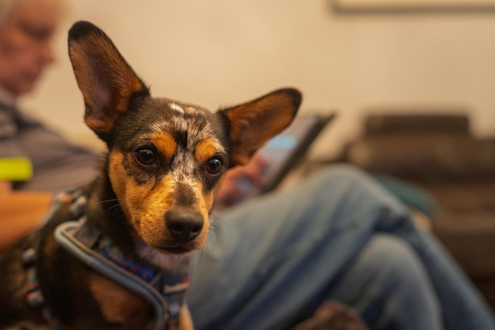

# Model Output Gallery

Generated on: 2026-11-20 18:52:25 GMT

- *Evaluation lane:* assisted
- *Prompt hints:* the image's description and keyword hints were included in the prompt, so field content may be copied from them rather than seen
- *Assessment:* General checks + metadata fields and duplicate keywords; length limits and factual accuracy not assessed
- *Input image:* JPEG, 9,984 x 6,656 pixels (66.5 MP), 49.0 MB
- *Human accuracy notes:* 0 of 41 outputs reviewed by a person for this exact image, model revision and output (accuracy_notes.yaml); the others are unreviewed; 1 note for other images or models

This run records model responses to one shared image and prompt (evaluation
lane: assisted). Mechanical checks are not factual-accuracy judgments; inspect
the image, prompt and final answers before choosing a model. Results do not
establish fitness for other tasks.

Complete per-model evidence artifact with image metadata, the source prompt, a
facts-only chooser, and full generated or crash output for every attempted
model.

## Reference Image



## Current-run Chooser

Mechanical observations and captured resource facts for this run only. No concerns detected does not mean the response fulfilled an arbitrary prompt or described the image accurately. Consult the assessment scope above. Total time is end-to-end; throughput covers generation only and requires at least 16 generated tokens. Prefill/first is the measured time to first token (input preparation, prefill and the first decode step) when captured, else upstream's model-loop first-token time; Prompt tok is the full rendered prompt including image tokens, which drives prefill cost. For cross-attention architectures the token count reflects the tokenised text burden only, not total vision prefill compute.

<!-- markdownlint-disable MD034 MD037 MD049 -->

| Model                                                                                                                               | Mechanical checks               | Total s | Gen TPS    | Prefill/first s | Peak GB | Prompt tok | Gen tok | Observations                                                                    |
|-------------------------------------------------------------------------------------------------------------------------------------|---------------------------------|---------|------------|-----------------|---------|------------|---------|---------------------------------------------------------------------------------|
| [`TechnoBaptist/Ternary-Bonsai-2-27B-mlx-2bit`](#model-technobaptist-ternary-bonsai-2-27b-mlx-2bit)                                 | `no concerns detected`          | 86.08s  | 35.6 tok/s | 61.47           | 17      | 16,576     | 768     | none                                                                            |
| [`mlx-community/AREX-2-4bit`](#model-mlx-community-arex-2-4bit)                                                                     | `no concerns detected`          | 82.30s  | 29.3 tok/s | 46.61           | 21      | 16,576     | 928     | none                                                                            |
| [`mlx-community/ERNIE-4.5-VL-28B-A3B-Thinking-4bit`](#model-mlx-community-ernie-45-vl-28b-a3b-thinking-4bit)                        | `no concerns detected`          | 11.73s  | 121 tok/s  | 2.15            | 19      | 1,606      | 846     | none                                                                            |
| [`mlx-community/GLM-4.6V-Flash-4bit`](#model-mlx-community-glm-46v-flash-4bit)                                                      | `no concerns detected`          | 18.30s  | 75.8 tok/s | 6.46            | 8.7     | 6,427      | 761     | none                                                                            |
| [`mlx-community/InternVL3-14B-4bit`](#model-mlx-community-internvl3-14b-4bit)                                                       | `no concerns detected`          | 6.41s   | 55.6 tok/s | 2.38            | 10      | 2,087      | 112     | none                                                                            |
| [`mlx-community/LFM2.5-VL-3B-OptiQ-4bit`](#model-mlx-community-lfm25-vl-3b-optiq-4bit)                                              | `no concerns detected`          | 3.33s   | 207 tok/s  | 1.28            | 4.0     | 2,087      | 79      | none                                                                            |
| [`mlx-community/MiniCPM-V-4.7-1B-4bit`](#model-mlx-community-minicpm-v-47-1b-4bit)                                                  | `no concerns detected`          | 5.49s   | 307 tok/s  | 2.39            | 3.6     | 905        | 392     | none                                                                            |
| [`mlx-community/MiniCPM-V-4.7-35B-A3B-4bit`](#model-mlx-community-minicpm-v-47-35b-a3b-4bit)                                        | `no concerns detected`          | 15.42s  | 83.7 tok/s | 1.60            | 25      | 905        | 806     | none                                                                            |
| [`mlx-community/Ministral-3-14B-Instruct-2512-mxfp4`](#model-mlx-community-ministral-3-14b-instruct-2512-mxfp4)                     | `no concerns detected`          | 6.96s   | 64.5 tok/s | 2.80            | 13      | 2,902      | 137     | none                                                                            |
| [`mlx-community/Ministral-3-3B-Instruct-2512-4bit`](#model-mlx-community-ministral-3-3b-instruct-2512-4bit)                         | `no concerns detected`          | 3.82s   | 189 tok/s  | 1.58            | 7.7     | 2,901      | 126     | none                                                                            |
| [`mlx-community/Mistral-Small-4-119B-2603-4bit`](#model-mlx-community-mistral-small-4-119b-2603-4bit)                               | `no concerns detected`          | 24.46s  | 76.9 tok/s | 9.81            | 73      | 2,381      | 116     | none                                                                            |
| [`mlx-community/Molmo2-8B-4bit`](#model-mlx-community-molmo2-8b-4bit)                                                               | `no concerns detected`          | 7.00s   | 69.6 tok/s | 3.20            | 8.1     | 1,498      | 131     | none                                                                            |
| [`mlx-community/MolmoPoint-8B-4bit`](#model-mlx-community-molmopoint-8b-4bit)                                                       | `no concerns detected`          | 10.09s  | 28.3 tok/s | 4.02            | 13      | 3,100      | 105     | none                                                                            |
| [`mlx-community/North-Micro-Vision-Instruct-4bit`](#model-mlx-community-north-micro-vision-instruct-4bit)                           | `no concerns detected`          | 5.34s   | 212 tok/s  | 2.74            | 3.7     | 4,060      | 127     | none                                                                            |
| [`mlx-community/Phi-3.5-vision-instruct-bf16`](#model-mlx-community-phi-35-vision-instruct-bf16)                                    | `no concerns detected`          | 4.30s   | 55.8 tok/s | 1.03            | 9.3     | 1,103      | 96      | none                                                                            |
| [`mlx-community/Qwen3-Omni-30B-A3B-Instruct-4bit`](#model-mlx-community-qwen3-omni-30b-a3b-instruct-4bit)                           | `no concerns detected`          | 24.54s  | 72.3 tok/s | 19.51           | 26      | 12,764     | 108     | none                                                                            |
| [`mlx-community/Qwen3-VL-30B-A3B-Instruct-4bit`](#model-mlx-community-qwen3-vl-30b-a3b-instruct-4bit)                               | `no concerns detected`          | 35.35s  | 92.8 tok/s | 31.02           | 23      | 16,521     | 117     | none                                                                            |
| [`mlx-community/Qwen3-VL-8B-Instruct-4bit`](#model-mlx-community-qwen3-vl-8b-instruct-4bit)                                         | `no concerns detected`          | 36.25s  | 69.4 tok/s | 32.62           | 11      | 16,521     | 104     | none                                                                            |
| [`mlx-community/Qwen3.5-35B-A3B-4bit`](#model-mlx-community-qwen35-35b-a3b-4bit)                                                    | `no concerns detected`          | 40.67s  | 113 tok/s  | 28.67           | 25      | 16,534     | 933     | none                                                                            |
| [`mlx-community/Qwen3.6-35B-A3B-4bit`](#model-mlx-community-qwen36-35b-a3b-4bit)                                                    | `no concerns detected`          | 48.41s  | 114 tok/s  | 36.47           | 25      | 16,534     | 927     | none                                                                            |
| [`mlx-community/Qwen3.8-27B-nvfp4`](#model-mlx-community-qwen38-27b-nvfp4)                                                          | `no concerns detected`          | 84.83s  | 30.6 tok/s | 52.96           | 21      | 16,576     | 879     | none                                                                            |
| [`mlx-community/aya-vision-8b-4bit`](#model-mlx-community-aya-vision-8b-4bit)                                                       | `no concerns detected`          | 4.94s   | 103 tok/s  | 1.61            | 6.5     | 2,069      | 119     | none                                                                            |
| [`mlx-community/diffusiongemma-26B-A4B-it-mxfp8`](#model-mlx-community-diffusiongemma-26b-a4b-it-mxfp8)                             | `no concerns detected`          | 7.51s   | 54.9 tok/s | 3.43            | 28      | 567        | 86      | none                                                                            |
| [`mlx-community/gemma-4-12B-it-4bit`](#model-mlx-community-gemma-4-12b-it-4bit)                                                     | `no concerns detected`          | 5.37s   | 63.4 tok/s | 1.27            | 7.6     | 571        | 100     | none                                                                            |
| [`mlx-community/gemma-4-26b-a4b-it-4bit`](#model-mlx-community-gemma-4-26b-a4b-it-4bit)                                             | `no concerns detected`          | 5.05s   | 127 tok/s  | 0.99            | 16      | 571        | 92      | none                                                                            |
| [`mlx-community/gemma-4-e4b-it-4bit`](#model-mlx-community-gemma-4-e4b-it-4bit)                                                     | `no concerns detected`          | 4.25s   | 126 tok/s  | 1.01            | 6.0     | 567        | 105     | none                                                                            |
| [`mlx-community/granite-4.0-3b-vision-4bit`](#model-mlx-community-granite-40-3b-vision-4bit)                                        | `no concerns detected`          | 3.26s   | 186 tok/s  | 1.17            | 4.7     | 1,361      | 93      | none                                                                            |
| [`nativ-community/Mage-VL-OptiQ-4bit`](#model-nativ-community-mage-vl-optiq-4bit)                                                   | `no concerns detected`          | 4.94s   | 130 tok/s  | 2.21            | 5.4     | 4,184      | 140     | none                                                                            |
| [`nativ-community/Mistral-Small-3.2-24B-Instruct-2506-4bit`](#model-nativ-community-mistral-small-32-24b-instruct-2506-4bit)        | `no concerns detected`          | 7.60s   | 35.9 tok/s | 2.06            | 18      | 1,248      | 113     | none                                                                            |
| [`nativ-community/Nemotron-3-Nano-Omni-30B-A3B-Reasoning-4bit`](#model-nativ-community-nemotron-3-nano-omni-30b-a3b-reasoning-4bit) | `no concerns detected`          | 11.19s  | 164 tok/s  | 3.00            | 23      | 3,603      | 837     | none                                                                            |
| [`nvidia/NVIDIA-Nemotron-3.5-Super-VL-120B-A12B-NVFP4`](#model-nvidia-nvidia-nemotron-35-super-vl-120b-a12b-nvfp4)                  | `no concerns detected`          | 74.90s  | 30.7 tok/s | 26.08           | 87      | 3,602      | 928     | none                                                                            |
| [`LiquidAI/LFM2.5-VL-450M-MLX-bf16`](#model-liquidai-lfm25-vl-450m-mlx-bf16)                                                        | `concerns detected`             | 2.43s   | 520 tok/s  | 0.91            | 1.9     | 2,095      | 126     | duplicate keywords                                                              |
| [`ibm-granite/granite-vision-4.1-4b`](#model-ibm-granite-granite-vision-41-4b)                                                      | `concerns detected`             | 6.70s   | 60.6 tok/s | 2.20            | 9.7     | 1,361      | 91      | prompt hint repeated                                                            |
| [`mlx-community/InternVL3_5-1B-4bit`](#model-mlx-community-internvl35-1b-4bit)                                                      | `concerns detected`             | 2.68s   | 454 tok/s  | 1.06            | 2.1     | 2,090      | 105     | duplicate keywords                                                              |
| [`mlx-community/FastVLM-0.5B-bf16`](#model-mlx-community-fastvlm-05b-bf16)                                                          | `major concerns: answer format` | 4.16s   | 386 tok/s  | 2.04            | 1.8     | 308        | 34      | labelled fields not detected; prompt hint repeated                              |
| [`mlx-community/MiniCPM-o-4_5-4bit`](#model-mlx-community-minicpm-o-45-4bit)                                                        | `major concerns: generation`    | 12.90s  | 98.5 tok/s | 0.92            | 7.0     | 361        | 1,000   | labelled fields not detected; cut off at token limit; incomplete thinking block |
| [`mlx-community/Muse-Glimmer-30B-OptiQ-4bit`](#model-mlx-community-muse-glimmer-30b-optiq-4bit)                                     | `major concerns: answer format` | 53.28s  | 23.9 tok/s | 7.84            | 25      | 4,387      | 1,000   | labelled fields not detected; cut off at token limit                            |
| [`mlx-community/SmolVLM2-2.2B-Instruct-mlx`](#model-mlx-community-smolvlm2-22b-instruct-mlx)                                        | `major concerns: answer format` | 3.77s   | 124 tok/s  | 1.41            | 5.6     | 1,400      | 97      | labelled fields not detected; prompt hint repeated                              |
| [`mlx-community/llm-jp-4-vl-9b-mlx-4bit`](#model-mlx-community-llm-jp-4-vl-9b-mlx-4bit)                                             | `major concerns: answer format` | 3.39s   | 107 tok/s  | 1.41            | 6.7     | 2,173      | 25      | control tokens visible; labelled fields not detected                            |
| [`mlx-community/nanoLLaVA-1.5-4bit`](#model-mlx-community-nanollava-15-4bit)                                                        | `major concerns: answer format` | 2.39s   | 378 tok/s  | 0.92            | 1.8     | 304        | 82      | labelled fields not detected                                                    |
| [`sahilchachra/LensVLM-9B-MXFP4`](#model-sahilchachra-lensvlm-9b-mxfp4)                                                             | `major concerns: answer format` | 6.85s   | 101 tok/s  | 1.64            | 7.4     | 1,846      | 304     | answer emitted twice; prompt hint repeated                                      |
<!-- markdownlint-enable MD034 MD037 MD049 -->

## Resource Highlights

Quickest completion without detected concerns (end-to-end, including model load): `mlx-community/granite-4.0-3b-vision-4bit` at 3.26s

Lowest peak memory among completions without detected concerns: `mlx-community/MiniCPM-V-4.7-1B-4bit` at 3.6 GB

Decode tok/s stays per model in the chooser and is not averaged across models: tokenizers, image-token expansion and reasoning lengths differ too much for a cross-model mean to guide a choice.

## Major Mechanical Concerns in This Run

<!-- markdownlint-disable MD034 MD037 MD049 -->

| Model                                                                                           | Mechanical checks               | Observations                                                                    |
|-------------------------------------------------------------------------------------------------|---------------------------------|---------------------------------------------------------------------------------|
| [`mlx-community/FastVLM-0.5B-bf16`](#model-mlx-community-fastvlm-05b-bf16)                      | `major concerns: answer format` | labelled fields not detected; prompt hint repeated                              |
| [`mlx-community/MiniCPM-o-4_5-4bit`](#model-mlx-community-minicpm-o-45-4bit)                    | `major concerns: generation`    | labelled fields not detected; cut off at token limit; incomplete thinking block |
| [`mlx-community/Muse-Glimmer-30B-OptiQ-4bit`](#model-mlx-community-muse-glimmer-30b-optiq-4bit) | `major concerns: answer format` | labelled fields not detected; cut off at token limit                            |
| [`mlx-community/SmolVLM2-2.2B-Instruct-mlx`](#model-mlx-community-smolvlm2-22b-instruct-mlx)    | `major concerns: answer format` | labelled fields not detected; prompt hint repeated                              |
| [`mlx-community/llm-jp-4-vl-9b-mlx-4bit`](#model-mlx-community-llm-jp-4-vl-9b-mlx-4bit)         | `major concerns: answer format` | control tokens visible; labelled fields not detected                            |
| [`mlx-community/nanoLLaVA-1.5-4bit`](#model-mlx-community-nanollava-15-4bit)                    | `major concerns: answer format` | labelled fields not detected                                                    |
| [`sahilchachra/LensVLM-9B-MXFP4`](#model-sahilchachra-lensvlm-9b-mxfp4)                         | `major concerns: answer format` | answer emitted twice; prompt hint repeated                                      |
<!-- markdownlint-enable MD034 MD037 MD049 -->

## Output at a Glance

A compact preview of each model's final answer (or failure evidence for crashes), in chooser order. Where the requested catalogue fields were detected, the preview shows a little of each: the title, the start of the description, and the first keywords with their count, so the weakest field is not hidden behind a long description. Otherwise it is the first 280 characters. A closed reasoning trace is left out of the preview and reported as an omitted-character count; the complete output, trace included, is in the model's evidence block below.

<!-- markdownlint-disable MD034 MD037 MD049 -->

| Model                                                                                                                               | Mechanical checks      | Output preview                                                                                                                                                                                                                                                                                                                                                                        |
|-------------------------------------------------------------------------------------------------------------------------------------|------------------------|---------------------------------------------------------------------------------------------------------------------------------------------------------------------------------------------------------------------------------------------------------------------------------------------------------------------------------------------------------------------------------------|
| [`TechnoBaptist/Ternary-Bonsai-2-27B-mlx-2bit`](#model-technobaptist-ternary-bonsai-2-27b-mlx-2bit)                                 | `no concerns detected` | Title: Small dog in harness gazes at camera indoors \| Description: Captured on 14 November 2026 at 17:41, a small brown-and-black dog with large erect ears and a pa... \| Keywords (18): small dog, chihuahua mix, dog harness, big ears, brown and black, alert, close up, indoors, living room, ...[2,446 characters of reasoning omitted; complete output in the evidence block] |
| [`mlx-community/AREX-2-4bit`](#model-mlx-community-arex-2-4bit)                                                                     | `no concerns detected` | Title: Small Dog in Harness Watches Over Relaxed Senior Man \| Description: A small brown-and-black dog with large erect ears, wearing a blue harness, gazes attenti... \| Keywords (17): alert, big ears, brown and black, canine, casual, chihuahua mix, close up, companion animal, dog harness, ...[3,263 characters of reasoning omitted; complete output in the evidence block] |
| [`mlx-community/ERNIE-4.5-VL-28B-A3B-Thinking-4bit`](#model-mlx-community-ernie-45-vl-28b-a3b-thinking-4bit)                        | `no concerns detected` | Title: Attentive Companion Dog with Senior Man \| Description: A close-up, intimate portrait of a small, mixed-breed dog with big, expressive eyes, wearing a harness,... \| Keywords (21): dog, small dog, chihuahua mix, companion, pet, animal, senior man, older man, elderly, sitting, tablet, ...[2,650 characters of reasoning omitted; complete output in the evidence block] |
| [`mlx-community/GLM-4.6V-Flash-4bit`](#model-mlx-community-glm-46v-flash-4bit)                                                      | `no concerns detected` | Title: Alert Mixed-Breed Dog in Living Room \| Description: An alert small mixed-breed dog in a harness looks toward the camera, with an older person relaxing i... \| Keywords (11): mixed-breed dog, harness, living room, alert, big ears, brown and black, canine, casual, indoors, senior man, ...[2,713 characters of reasoning omitted; complete output in the evidence block] |
| [`mlx-community/InternVL3-14B-4bit`](#model-mlx-community-internvl3-14b-4bit)                                                       | `no concerns detected` | Title: Alert Chihuahua Mix in Cozy Living Room \| Description: A small, alert chihuahua mix dog in a harness gazes at the camera in a warmly lit living room, with a... \| Keywords (20): Adobe Stock, Any Vision, Dog harness, Domestic life, Indoors, Man, Relaxing, Senior Man, Sitting, Tablet, ...                                                                               |
| [`mlx-community/LFM2.5-VL-3B-OptiQ-4bit`](#model-mlx-community-lfm25-vl-3b-optiq-4bit)                                              | `no concerns detected` | Title: Alert mixed-breed dog in harness indoors \| Description: A small brown and black dog wearing a harness looks attentively toward the camera while a seni... \| Keywords (13): dog, harness, mixed-breed, alert, indoors, senior man, tablet, living room, close-up, companion, canine, brown, ...                                                                               |
| [`mlx-community/MiniCPM-V-4.7-1B-4bit`](#model-mlx-community-minicpm-v-47-1b-4bit)                                                  | `no concerns detected` | Title: Alert Chihuahua Mix with Harness \| Description: A small mixed-breed dog wearing a harness looks attentively toward the camera in a warm indoor living room,... \| Keywords (17): Adobe Stock, Any Vision, Dog harness, Domestic life, Indoors, Man, Relaxing, Senior Man, Sitting, Tablet, ...[1,007 characters of reasoning omitted; complete output in the evidence block]  |
| [`mlx-community/MiniCPM-V-4.7-35B-A3B-4bit`](#model-mlx-community-minicpm-v-47-35b-a3b-4bit)                                        | `no concerns detected` | Title: Small Black and Tan Dog with Large Ears in Harness \| Description: A small mixed-breed dog with prominent upright ears and a black-and-tan coat, wearing a patter... \| Keywords (18): dog, harness, big ears, black and tan, chihuahua mix, indoors, living room, person, tablet, relaxing, ...[2,978 characters of reasoning omitted; complete output in the evidence block] |
| [`mlx-community/Ministral-3-14B-Instruct-2512-mxfp4`](#model-mlx-community-ministral-3-14b-instruct-2512-mxfp4)                     | `no concerns detected` | Title: **"Alert Mixed-Breed Dog in Harness with Senior Man Indoors"** \| Description: A small mixed-breed dog with brown and black fur, wearing a harness, sits attentively i... \| Keywords (16): dog, mixed-breed, brown and black, harness, indoor photography, living room, senior man, tablet, ...                                                                               |
| [`mlx-community/Ministral-3-3B-Instruct-2512-4bit`](#model-mlx-community-ministral-3-3b-instruct-2512-4bit)                         | `no concerns detected` | Title: A Warm Indoor Moment with a Harnessed Canine Mix \| Description: A small mixed-breed dog with expressive brown-and-black fur and prominent ears gazes attentively at th... \| Keywords (13): harnessed dog, attentive canine, mixed-breed, big ears, brown-black fur, indoor domestic scene, ...                                                                               |
| [`mlx-community/Mistral-Small-4-119B-2603-4bit`](#model-mlx-community-mistral-small-4-119b-2603-4bit)                               | `no concerns detected` | Title: Small dog in harness watches camera as senior man relaxes indoors \| Description: A small mixed-breed dog with big ears and a brown-and-black coat, wearing a... \| Keywords (17): dog harness, domestic life, indoors, senior man, sitting, tablet, alert, big ears, brown and black coat, ...                                                                                |
| [`mlx-community/Molmo2-8B-4bit`](#model-mlx-community-molmo2-8b-4bit)                                                               | `no concerns detected` | Title: Alert Chihuahua Mix in Harness, Senior Man Relaxing Indoors \| Description: A small mixed-breed dog with big ears and brown-black fur, wearing a harness, loo... \| Keywords (20): Adobe Stock, Any Vision, Dog harness, Domestic life, Indoors, Man, Relaxing, Senior Man, Sitting, Tablet, ...                                                                               |
| [`mlx-community/MolmoPoint-8B-4bit`](#model-mlx-community-molmopoint-8b-4bit)                                                       | `no concerns detected` | Title: Alert Chihuahua Mix in Living Room with Senior Man \| Description: A small brown and black chihuahua mix with a harness looks directly at the camera in a... \| Keywords (15): chihuahua mix, brown and black dog, living room, senior man, tablet, alert dog, domestic life, indoor scene, ...                                                                                |
| [`mlx-community/North-Micro-Vision-Instruct-4bit`](#model-mlx-community-north-micro-vision-instruct-4bit)                           | `no concerns detected` | Title: A Canine Companion in a Comfortable Setting \| Description: A small mixed-breed dog, adorned with a harness, sits attentively in a cozy indoor space, its brown and b... \| Keywords (18): Dog harness, Domestic life, Indoors, Man, Relaxing, Senior Man, Sitting, Tablet, alert, big ears, ...                                                                               |
| [`mlx-community/Phi-3.5-vision-instruct-bf16`](#model-mlx-community-phi-35-vision-instruct-bf16)                                    | `no concerns detected` | Title: Attentive Mixed-Breed Dog in Harness \| Description: A small, alert mixed-breed dog with large ears wearing a harness sits attentively in a living room, wit... \| Keywords (10): mixed-breed, harness, alert, large ears, senior man, tablet, living room, attentive, relaxed, companion animal                                                                               |
| [`mlx-community/Qwen3-Omni-30B-A3B-Instruct-4bit`](#model-mlx-community-qwen3-omni-30b-a3b-instruct-4bit)                           | `no concerns detected` | Title: Close-up of alert dog with big ears \| Description: A small, alert dog with large, upright ears and brown-and-black fur looks directly at the camera while wearin... \| Keywords (18): dog, close-up, alert, big ears, brown and black, small dog, dog harness, indoor, man, tablet, casual, ...                                                                               |
| [`mlx-community/Qwen3-VL-30B-A3B-Instruct-4bit`](#model-mlx-community-qwen3-vl-30b-a3b-instruct-4bit)                               | `no concerns detected` | Title: Close-up of a small dog with big ears \| Description: A small, alert dog with large brown and black ears and a speckled face looks towards the camera whi... \| Keywords (20): dog, small dog, mixed breed, big ears, brown and black, alert, companion animal, domestic life, indoors, man, ...                                                                               |
| [`mlx-community/Qwen3-VL-8B-Instruct-4bit`](#model-mlx-community-qwen3-vl-8b-instruct-4bit)                                         | `no concerns detected` | Title: Alert dog with big ears looks at camera \| Description: A small brown and black dog with large ears and a harness sits attentively indoors, looking dire... \| Keywords (18): dog, harness, alert, big ears, brown and black, indoors, companion, living room, senior man, tablet, close up, ...                                                                               |
| [`mlx-community/Qwen3.5-35B-A3B-4bit`](#model-mlx-community-qwen35-35b-a3b-4bit)                                                    | `no concerns detected` | Title: Small black and tan dog in harness held by man \| Description: Captured indoors on November 14, 2026, a small dog with black and tan fur and merle marki... \| Keywords (18): dog, harness, mini pinscher, black and tan, merle, big ears, alert, man, tablet, indoor, living room, holding, ...[2,945 characters of reasoning omitted; complete output in the evidence block] |
| [`mlx-community/Qwen3.6-35B-A3B-4bit`](#model-mlx-community-qwen36-35b-a3b-4bit)                                                    | `no concerns detected` | Title: Small black and tan dog with large ears looks at camera \| Description: Captured in warm, indoor lighting, a small mixed-breed dog with prominent uprigh... \| Keywords (20): dog, pet, animal, chihuahua, terrier, mixed breed, brown, black, big ears, close up, alert, harness, domestic, ...[3,151 characters of reasoning omitted; complete output in the evidence block] |
| [`mlx-community/Qwen3.8-27B-nvfp4`](#model-mlx-community-qwen38-27b-nvfp4)                                                          | `no concerns detected` | Title: Small dog in harness gazes at camera indoors \| Description: A small mixed-breed dog with large erect ears and a brown, black and tan coat wears a light-strap... \| Keywords (16): small dog, large ears, dog harness, close up, mixed breed, brown and black coat, attentive, living room, ...[2,991 characters of reasoning omitted; complete output in the evidence block] |
| [`mlx-community/aya-vision-8b-4bit`](#model-mlx-community-aya-vision-8b-4bit)                                                       | `no concerns detected` | Title: Small Dog's Attentive Gaze in Living Room \| Description: A small mixed-breed dog with a distinctive brown and black coat and large ears sits attentively o... \| Keywords (11): Small dog, Mixed breed, Brown and black coat, Large ears, Attentive gaze, Living room, Older man, Relaxing, ...                                                                               |
| [`mlx-community/diffusiongemma-26B-A4B-it-mxfp8`](#model-mlx-community-diffusiongemma-26b-a4b-it-mxfp8)                             | `no concerns detected` | Title: Alert chihuahua-mix dog wearing a harness indoors \| Description: A small brown and black-- dog with large ears wears a harness and looks at the camera w... \| Keywords (16): dog, chihuahua mix, harness, alert, ears, indoors, senior, man, sitting, tablet, domestic, companion, canine, ...                                                                               |
| [`mlx-community/gemma-4-12B-it-4bit`](#model-mlx-community-gemma-4-12b-it-4bit)                                                     | `no concerns detected` | Title: Small Dog with Large Ears Wearing a Harness \| Description: A small brown and black mixed-breed dog with large ears looks attentively toward the camera... \| Keywords (18): Dog, harness, big ears, canine, brown and black, chihuahua mix, domestic life, indoors, man, relaxing, tablet, ...                                                                                |
| [`mlx-community/gemma-4-26b-a4b-it-4bit`](#model-mlx-community-gemma-4-26b-a4b-it-4bit)                                             | `no concerns detected` | Title: Small mixed-breed dog with large ears wearing a harness \| Description: A small brown and black dog wearing a harness looks attentively at the camera in a br... \| Keywords (16): dog, harness, chihuahua mix, domestic life, indoors, senior man, companion, pet, alert, big ears, canine, ...                                                                               |
| [`mlx-community/gemma-4-e4b-it-4bit`](#model-mlx-community-gemma-4-e4b-it-4bit)                                                     | `no concerns detected` | Title: Attentive small dog in harness watches camera indoors. \| Description: A small, brown and black mixed-breed dog in a harness looks attentively towards the camera... \| Keywords (14): mixed-breed dog, canine companion, dog harness, indoors, alert, big ears, brown and black, close up, ...                                                                                |
| [`mlx-community/granite-4.0-3b-vision-4bit`](#model-mlx-community-granite-40-3b-vision-4bit)                                        | `no concerns detected` | Title: "Senior Man and His Alert Dog" \| Description: A small mixed-breed dog with big ears and a brown and black coat looks attentively toward the camera, while... \| Keywords (12): senior man, dog harness, domestic life, Indoors, chihuahua mix, attentive, comfortable, companion, close up, ...                                                                               |
| [`nativ-community/Mage-VL-OptiQ-4bit`](#model-nativ-community-mage-vl-optiq-4bit)                                                   | `no concerns detected` | Title: Small mixed-breed dog with alert expression in living room, senior man using... \| Description: A small mixed-breed dog wearing a harness looks attentively toward th... \| Keywords (18): Dog harness, Domestic life, Indoors, Man, Relaxing, Senior Man, Sitting, Tablet, alert, big ears, ...                                                                               |
| [`nativ-community/Mistral-Small-3.2-24B-Instruct-2506-4bit`](#model-nativ-community-mistral-small-32-24b-instruct-2506-4bit)        | `no concerns detected` | Title: Small Dog in Harness with Relaxed Older Person \| Description: A small, mixed-breed dog with large ears wears a harness and looks attentively at the camera, w... \| Keywords (20): Small dog, dog harness, chihuahua mix, big ears, brown and black fur, living room, older person, tablet, ...                                                                               |
| [`nativ-community/Nemotron-3-Nano-Omni-30B-A3B-Reasoning-4bit`](#model-nativ-community-nemotron-3-nano-omni-30b-a3b-reasoning-4bit) | `no concerns detected` | Title: Attentive Small Dog in Harness \| Description: A small mixed‑breed dog with big ears and a brown‑black coat, wearing a patterned harness, looks directly a... \| Keywords (14): dog, harness, small, mixed-breed, big-ears, brown-black, attentive, living-room, tablet, older-man, relaxed, ...[2,713 characters of reasoning omitted; complete output in the evidence block] |
| [`nvidia/NVIDIA-Nemotron-3.5-Super-VL-120B-A12B-NVFP4`](#model-nvidia-nvidia-nemotron-35-super-vl-120b-a12b-nvfp4)                  | `no concerns detected` | Title: Close-up of a small dog with big ears wearing a harness \| Description: A close-up shot features a small mixed-breed dog with large ears and a speckled brown... \| Keywords (17): dog, canine, harness, big ears, close up, mixed breed, brown and black, indoor, living room, senior man, ...[3,103 characters of reasoning omitted; complete output in the evidence block]  |
| [`LiquidAI/LFM2.5-VL-450M-MLX-bf16`](#model-liquidai-lfm25-vl-450m-mlx-bf16)                                                        | `concerns detected`    | Title: "Chihuahua in a Living Room" \| Description: A small mixed-breed dog with large ears and a brown and black coat is sitting attentively in a living room,... \| Keywords (19): Chihuahua, living room, dog, harness, attentive, casual, indoor, relaxed, comfortable, companion animal, dog, ...                                                                                |
| [`ibm-granite/granite-vision-4.1-4b`](#model-ibm-granite-granite-vision-41-4b)                                                      | `concerns detected`    | Title: "Chihuahua Mix in Harness" \| Description: A small mixed-breed dog wearing a harness looks attentively toward the camera while an older person relaxes in... \| Keywords (13): Chihuahua mix, dog harness, indoor, senior man, relaxed, digital device, living room, attentive, mixed breed, ...                                                                               |
| [`mlx-community/InternVL3_5-1B-4bit`](#model-mlx-community-internvl35-1b-4bit)                                                      | `concerns detected`    | Title: Small Dog in Harness, Man Relaxing, Digital Device in Background \| Description: A small mixed-breed dog wearing a harness sits attentively in a living roo... \| Keywords (20): Dog harness, Indoors, Man, Relaxing, Senior Man, Sitting, Tablet, alert, big ears, brown and black, canine, ...                                                                               |
| [`mlx-community/FastVLM-0.5B-bf16`](#model-mlx-community-fastvlm-05b-bf16)                                                          | `major concerns`       | A small mixed-breed dog wearing a harness looks attentively toward the camera while an older person relaxes in the background using a digital device in a living room.                                                                                                                                                                                                                |
| [`mlx-community/MiniCPM-o-4_5-4bit`](#model-mlx-community-minicpm-o-45-4bit)                                                        | `major concerns`       | &lt;think&gt;<br>User is asking to create British-English catalogue metadata from an image and some context. I need to follow the instructions carefully.<br><br>First, I'll start with the title. It should be concrete, 5-10 words. Looking at the image, there's a small dog with big ears, weari...                                                                               |
| [`mlx-community/Muse-Glimmer-30B-OptiQ-4bit`](#model-mlx-community-muse-glimmer-30b-optiq-4bit)                                     | `major concerns`       | Title: Alert Small Dog With Big Ears Wearing Harness Indoors \| Description: A small brown-and-black mixed-breed dog with large erect ears and a blue patterned harness sits on blue jeans, looking attentively toward the camera in a warmly lit \| Keywords: (not detected)                                                                                                         |
| [`mlx-community/SmolVLM2-2.2B-Instruct-mlx`](#model-mlx-community-smolvlm2-22b-instruct-mlx)                                        | `major concerns`       | Title: (not detected) \| Description: A small mixed-breed dog wearing a harness looks attentively toward the camera while an older person relaxes in the background... \| Keywords (20): Adobe Stock, Any Vision, Dog harness, Domestic life, Indoors, Man, Relaxing, Senior Man, Sitting, Tablet, ...                                                                                |
| [`mlx-community/llm-jp-4-vl-9b-mlx-4bit`](#model-mlx-community-llm-jp-4-vl-9b-mlx-4bit)                                             | `major concerns`       | <\|channel\|> analysis<\|message\|> The image shows a small dog with a harness looking at the camera while a person sits on a couch.                                                                                                                                                                                                                                                  |
| [`mlx-community/nanoLLaVA-1.5-4bit`](#model-mlx-community-nanollava-15-4bit)                                                        | `major concerns`       | Title: "A Dog's Watchful Eyes in a Living Room" \| Description: A dog wearing a harness looks attentively toward the camera, while an older person relaxes in the background using a tablet. The dog is wearing a mix of breeds, and the older person is sitting comfort... \| Keywords: (not detected)                                                                               |
| [`sahilchachra/LensVLM-9B-MXFP4`](#model-sahilchachra-lensvlm-9b-mxfp4)                                                             | `major concerns`       | Title: Alert Dog in Living Room \| Description: A small mixed-breed dog wearing a harness looks attentively toward the camera while an older person relaxes in the backgroun... \| Keywords (18): Dog harness, Domestic life, Indoors, Man, Relaxing, Senior Man, Sitting, Tablet, alert, big ears, ...[476 characters of reasoning omitted; complete output in the evidence block]   |
<!-- markdownlint-enable MD034 MD037 MD049 -->

## Run Stamps

- `mlx-vlm`: `0.8.0`
- `mlx`: `0.32.5.dev20261120+bd2d1fb43`
- `transformers`: `5.23.0`
- `tokenizers`: `0.23.3`
- `huggingface-hub`: `2.4.0`
- *Python Version:* 3.14.7
- *OS:* Darwin 27.2.0
- *macOS Version:* 27.2.1
- *GPU/Chip:* Apple M5 Max
- *MLX Device:* Apple M5 Max
- *GPU Architecture:* applegpu_g17s
- *RAM:* 128.0 GB
- *Recommended Working Set:* 115 GB
- *Fused Attention:* Available

## Image Metadata

- *Description:* A small mixed-breed dog wearing a harness looks attentively
  toward the camera while an older person relaxes in the background using a
  digital device in a living room.
- *Keywords:* Adobe Stock, Any Vision, Dog harness, Domestic life, Indoors,
  Man, Relaxing, Senior Man, Sitting, Tablet, alert, big ears, brown and
  black, canine, casual, chihuahua mix, close up, comfortable, companion,
  companion animal, couch, cozy, curious, cute, dog, domestic animal, ears up,
  family pet, friendship, furry, harness, home, indoor, jeans, lap dog,
  lifestyle, living room, looking, looking at camera, loyalty, merle, owner,
  pet, portrait, puppy, senior, small dog, sofa, terrier, terrier mix, warm
  lighting, watching
- *Date:* 2026-11-14 17:41:49 UTC+01:00
- *Time:* 17:41:49

## Prompt

<!-- markdownlint-disable MD011 MD028 MD037 MD045 -->
>
> Create British-English catalogue metadata from the image and supplied
> context.
>
> Treat any capture date/time and GPS as authoritative facts, but do not claim
> they are visible. Descriptive hints may be incomplete or wrong: retain
> details supported by the image, correct conflicts, and add important visible
> details. Prefer image evidence when a hint conflicts, and omit uncertain
> details.
>
> Context: Authoritative context:
> &#45; Capture date/time: 2026-11-14 17:41:49 UTC+01:00
>
> &#8203;Descriptive hints:
> &#45; Description hint: A small mixed-breed dog wearing a harness looks
> attentively toward the camera while an older person relaxes in the
> background using a digital device in a living room.
> &#45; Keyword hints: Adobe Stock, Any Vision, Dog harness, Domestic life,
> Indoors, Man, Relaxing, Senior Man, Sitting, Tablet, alert, big ears, brown
> and black, canine, casual, chihuahua mix, close up, comfortable, companion,
> companion animal
>
> &#8203;Write:
> &#45; a concrete 5-10-word title;
> &#45; a 1-2-sentence factual description combining relevant context with the
> main visible subject, setting, action, lighting, and distinctive details;
> &#45; 10-18 unique, comma-separated keywords covering relevant context and
> visible details.
>
> &#8203;Return exactly these three sections and nothing else:
> &#8203;Title:
> &#8203;Description:
> &#8203;Keywords:
<!-- markdownlint-enable MD011 MD028 MD037 MD045 -->

## Complete Per-model Evidence

Complete generated or crash evidence for every attempted model.

<a id="model-technobaptist-ternary-bonsai-2-27b-mlx-2bit"></a>

### TechnoBaptist/Ternary-Bonsai-2-27B-mlx-2bit

<details>
<summary>Complete evidence: TechnoBaptist/Ternary-Bonsai-2-27B-mlx-2bit</summary>

- *Execution:* completed
- *Mechanical checks:* no concerns detected
- *Assessment:* General checks + metadata fields and duplicate keywords;
  length limits and factual accuracy not assessed
- *Maintainer status:* none
- *Observations:* none
- *Arch supported by installed mlx-vlm:* yes (model_type
  prism_hadamard_qwen35)
- *Model load time:* 1.78s
- *Generation time:* 83.06s
- *Total time:* 86.08s
- *Prompt preparation time:* 1.06
- *First-token latency:* 60.5
- *Cleanup time:* 0.152
- *Prompt tokens:* 16,576
- *Generation tokens:* 768
- *Total tokens:* 17,344
- *Prompt throughput (raw):* 274 tok/s
- *Generation throughput (raw):* 35.6 tok/s
- *Peak memory (GB):* 17
- *Active memory (GB):* 8.6
- *Cache memory (GB):* 3.3
- *Model-load active memory (GB):* 8.6
- *Post-cleanup active memory (GB):* 0.00113
- *Post-cleanup cache memory (GB):* 0.0
- *Stop reason:* completed
- *Requested maximum tokens:* 1000
- *Rendered prompt characters:* 1612
- *Processor:* mlx_vlm.models.qwen3_vl.processing_qwen3_vl.Qwen3VLProcessor
- *Tokenizer:* transformers.models.qwen2.tokenization_qwen2.Qwen2Tokenizer
- *Requested model revision:* not requested
- *Resolved model revision:* 498775b03b55d038f716fea2568bf6ae6b8e0b5e
- *Resolved snapshot path:* ~/.cache/huggingface/hub/models--TechnoBaptist--Ternary-Bonsai-2-27B-mlx-2bit/snapshots/498775b03b55d038f716fea2568bf6ae6b8e0b5e
- *Generation settings:* {"enable_thinking": true, "max_tokens": 1000,
  "prefill_step_size": 2048, "seed": 0, "temperature": 0.0, "thinking_budget":
  800, "thinking_end_token": "&lt;/think&gt;", "thinking_start_token":
  "&lt;think&gt;", "top_k": 0, "top_p": 1.0}
- *EOS token:* <\|im_end\|>

*Readable output:*

<pre class="model-output-readable">
The user wants British-English catalogue metadata. I need to look carefully at the image and the context.

Capture date/time: 2026-11-14 17:41:49 UTC+01:01:00 — authoritative, but I should not claim it's visible. I'll incorporate it into the description as context (time of day, date) without saying it's visible.

Let me look at the image. A small dog, looks like a Chihuahua mix or similar small breed, with large erect ears, brown and black/tan and grey coat, wearing a harness (blue patterned harness with grey trim). The dog looks attentively at the camera. In the background, blurred, an older person (man) is sitting, using a digital device (tablet/phone) — there's a screen visible with a blue light. The setting is indoors, a living room, with a beige/cream wall. There's a yellow object on the left (maybe a toy or part of furniture). The dog is in focus, shallow depth of field.

Now the description hint says "older person relaxes in the background using a digital device in a living room." That matches.

Keywords: need 10-18 unique comma-separated. From hints: Adobe Stock, Any Vision, Dog harness, Domestic life, Indoors, Man, Relaxing, Senior Man, Sitting, Tablet, alert, big ears, brown and black, canine, casual, chihuahua mix, close up, comfortable, companion, companion animal. I should pick relevant ones and add visible details. I'll write them in British English style but keywords are usually just terms.

Let me draft title: 5-10 words. "Small dog in harness gazes at camera indoors" — count: Small(1) dog(2) in(3) harness(4) gazes(5) at(6) camera(7) indoors(8). Good, 8 words. Or "Alert small dog in harness looks at camera" 8 words.

Description: 1-2 sentences factual, combining context (date/time) with main subject, setting, action, lighting, distinctive details. E.g., "Captured on 14 November 2026 at 17:41, a small brown-and-black dog with large erect ears and a patterned harness looks attentively at the camera in a softly lit living room. An older man sits blurred in the background using a tablet." That's two sentences. Good.

Keywords: I'll list 10-18. Let's pick: small dog, chihuahua mix, dog harness, big ears, brown and black, alert, close up, indoors, living room, senior man, relaxing, tablet, domestic life, companion animal, casual, comfortable, companion, canine. That's 18. Good.

Make sure British English: "living room" fine. Use "14 November 2026".

Now produce exactly three sections.
&lt;/think&gt;

Title:
Small dog in harness gazes at camera indoors

Description:
Captured on 14 November 2026 at 17:41, a small brown-and-black dog with large erect ears and a patterned harness looks attentively at the camera in a softly lit living room. An older man sits blurred in the background using a tablet.

Keywords:
small dog, chihuahua mix, dog harness, big ears, brown and black, alert, close up, indoors, living room, senior man, relaxing, tablet, domestic life, companion animal, casual, comfortable, companion, canine
</pre>

<details>
<summary>Exact raw output</summary>

```text
The user wants British-English catalogue metadata. I need to look carefully at the image and the context.

Capture date/time: 2026-11-14 17:41:49 UTC+01:01:00 — authoritative, but I should not claim it's visible. I'll incorporate it into the description as context (time of day, date) without saying it's visible.

Let me look at the image. A small dog, looks like a Chihuahua mix or similar small breed, with large erect ears, brown and black/tan and grey coat, wearing a harness (blue patterned harness with grey trim). The dog looks attentively at the camera. In the background, blurred, an older person (man) is sitting, using a digital device (tablet/phone) — there's a screen visible with a blue light. The setting is indoors, a living room, with a beige/cream wall. There's a yellow object on the left (maybe a toy or part of furniture). The dog is in focus, shallow depth of field.

Now the description hint says "older person relaxes in the background using a digital device in a living room." That matches.

Keywords: need 10-18 unique comma-separated. From hints: Adobe Stock, Any Vision, Dog harness, Domestic life, Indoors, Man, Relaxing, Senior Man, Sitting, Tablet, alert, big ears, brown and black, canine, casual, chihuahua mix, close up, comfortable, companion, companion animal. I should pick relevant ones and add visible details. I'll write them in British English style but keywords are usually just terms.

Let me draft title: 5-10 words. "Small dog in harness gazes at camera indoors" — count: Small(1) dog(2) in(3) harness(4) gazes(5) at(6) camera(7) indoors(8). Good, 8 words. Or "Alert small dog in harness looks at camera" 8 words.

Description: 1-2 sentences factual, combining context (date/time) with main subject, setting, action, lighting, distinctive details. E.g., "Captured on 14 November 2026 at 17:41, a small brown-and-black dog with large erect ears and a patterned harness looks attentively at the camera in a softly lit living room. An older man sits blurred in the background using a tablet." That's two sentences. Good.

Keywords: I'll list 10-18. Let's pick: small dog, chihuahua mix, dog harness, big ears, brown and black, alert, close up, indoors, living room, senior man, relaxing, tablet, domestic life, companion animal, casual, comfortable, companion, canine. That's 18. Good.

Make sure British English: "living room" fine. Use "14 November 2026".

Now produce exactly three sections.
</think>

Title:
Small dog in harness gazes at camera indoors

Description:
Captured on 14 November 2026 at 17:41, a small brown-and-black dog with large erect ears and a patterned harness looks attentively at the camera in a softly lit living room. An older man sits blurred in the background using a tablet.

Keywords:
small dog, chihuahua mix, dog harness, big ears, brown and black, alert, close up, indoors, living room, senior man, relaxing, tablet, domestic life, companion animal, casual, comfortable, companion, canine
```

</details>

</details>

---

<a id="model-mlx-community-arex-2-4bit"></a>

### mlx-community/AREX-2-4bit

<details>
<summary>Complete evidence: mlx-community/AREX-2-4bit</summary>

- *Execution:* completed
- *Mechanical checks:* no concerns detected
- *Assessment:* General checks + metadata fields and duplicate keywords;
  length limits and factual accuracy not assessed
- *Maintainer status:* none
- *Observations:* none
- *Arch supported by installed mlx-vlm:* yes (model_type qwen3_5)
- *Model load time:* 2.72s
- *Generation time:* 78.24s
- *Total time:* 82.30s
- *Prompt preparation time:* 1.18
- *First-token latency:* 45.6
- *Cleanup time:* 0.133
- *Prompt tokens:* 16,576
- *Generation tokens:* 928
- *Total tokens:* 17,504
- *Prompt throughput (raw):* 364 tok/s
- *Generation throughput (raw):* 29.3 tok/s
- *Peak memory (GB):* 21
- *Active memory (GB):* 16
- *Cache memory (GB):* 1.9
- *Model-load active memory (GB):* 16.1
- *Post-cleanup active memory (GB):* 0.00185
- *Post-cleanup cache memory (GB):* 0.0
- *Stop reason:* completed
- *Requested maximum tokens:* 1000
- *Rendered prompt characters:* 1612
- *Processor:* mlx_vlm.models.qwen3_vl.processing_qwen3_vl.Qwen3VLProcessor
- *Tokenizer:* transformers.models.qwen3_5.tokenization_qwen3_5.Qwen3_5Tokenizer
- *Requested model revision:* not requested
- *Resolved model revision:* 02551ee54839c7541ea5adb44b83c9aa86aeb4f5
- *Resolved snapshot path:* ~/.cache/huggingface/hub/models--mlx-community--AREX-2-4bit/snapshots/02551ee54839c7541ea5adb44b83c9aa86aeb4f5
- *Generation settings:* {"enable_thinking": true, "max_tokens": 1000,
  "prefill_step_size": 2048, "seed": 0, "temperature": 0.0, "thinking_budget":
  800, "thinking_end_token": "&lt;/think&gt;", "thinking_start_token":
  "&lt;think&gt;", "top_k": 0, "top_p": 1.0}
- *EOS token:* <\|im_end\|>

*Readable output:*

<pre class="model-output-readable">
The user wants British-English catalogue metadata. I need to look carefully at the image.

Image evidence: A small dog with large erect ears, brown and black/tan coat, wearing a harness (blue/grey with light piping). The dog looks attentively at the camera. In the background, an older man with grey hair is sitting, wearing a grey t-shirt and blue jeans, holding a tablet device (screen glowing). There's a yellow object in his other hand. The setting is indoors, warm lighting, shallow depth of field.

The hint says "chihuahua mix" — the dog has big ears and a small head, plausible. I'll keep "small mixed-breed dog" or "chihuahua mix" cautiously. The hint mentions "chihuahua mix" as a keyword. The dog's features (large ears, small size) are consistent. I'll include it but maybe phrase as "small dog" to be safe, but the keyword hint includes chihuahua mix; I can include it as a keyword since it's plausible. Actually instructions: retain details supported by image, correct conflicts. The big ears and small size support a chihuahua mix. I'll include "chihuahua mix" in keywords.

Capture date/time authoritative: 2026-11-14 17:41:49 UTC+01:00. I should not claim it's visible, but I can mention it in description? The instruction says "Treat any capture date/time and GPS as authoritative facts, but do not claim they are visible." So I can include the date in the description as a fact. Hmm, but typically catalogue descriptions don't include capture date. The instruction says combine relevant context with main visible subject. I think I can mention the date. But it's a bit odd for a stock photo description. The instruction says "do not claim they are visible" — meaning I can state it as a fact without saying "the photo was taken at...". Actually I think it's fine to include. Let me include a brief mention. Actually, re-reading: "a 1-2-sentence factual description combining relevant context with the main visible subject, setting, action, lighting, and distinctive details". The relevant context is the capture date/time. I'll weave it in subtly, e.g., "Captured in November 2026..." Hmm but that might be claiming visibility? No, stating the capture date is a fact, not claiming it's visible in the image. I'll include it.

Let me draft.

Title (5-10 words): "Small Dog in Harness Watches Over Relaxed Senior Man" — count: Small(1) Dog(2) in(3) Harness(4) Watches(5) Over(6) Relaxed(7) Senior(8) Man(9). 9 words. Good.

Description: 1-2 sentences. "A small brown-and-black dog with large erect ears, wearing a blue harness, gazes attentively at the camera while a senior man in a grey T-shirt and jeans relaxes behind him using a tablet. The warmly lit indoor scene was captured on 14 November 2026." That's 2 sentences. Good.

Keywords: 10-18 unique, comma-separated. From hints and image: dog harness, domestic life, indoors, man, relaxing, senior man, sitting, tablet, alert, big ears, brown and black, canine, casual, chihuahua mix, close up, comfortable, companion, companion animal. I'll select and adapt to British English. Let me list: alert, big ears, brown and black, canine, casual, chihuahua mix, close up, companion animal, dog harness, domestic life, indoors, jeans, relaxing, senior man, sitting, tablet, warm lighting
&lt;/think&gt;
Title: Small Dog in Harness Watches Over Relaxed Senior Man
Description: A small brown-and-black dog with large erect ears, wearing a blue harness, gazes attentively at the camera while a senior man in a grey T-shirt and jeans relaxes behind him using a tablet. The warmly lit indoor scene was captured on 14 November 2026.
Keywords: alert, big ears, brown and black, canine, casual, chihuahua mix, close up, companion animal, dog harness, domestic life, indoors, jeans, relaxing, senior man, sitting, tablet, warm lighting
</pre>

<details>
<summary>Exact raw output</summary>

```text
The user wants British-English catalogue metadata. I need to look carefully at the image.

Image evidence: A small dog with large erect ears, brown and black/tan coat, wearing a harness (blue/grey with light piping). The dog looks attentively at the camera. In the background, an older man with grey hair is sitting, wearing a grey t-shirt and blue jeans, holding a tablet device (screen glowing). There's a yellow object in his other hand. The setting is indoors, warm lighting, shallow depth of field.

The hint says "chihuahua mix" — the dog has big ears and a small head, plausible. I'll keep "small mixed-breed dog" or "chihuahua mix" cautiously. The hint mentions "chihuahua mix" as a keyword. The dog's features (large ears, small size) are consistent. I'll include it but maybe phrase as "small dog" to be safe, but the keyword hint includes chihuahua mix; I can include it as a keyword since it's plausible. Actually instructions: retain details supported by image, correct conflicts. The big ears and small size support a chihuahua mix. I'll include "chihuahua mix" in keywords.

Capture date/time authoritative: 2026-11-14 17:41:49 UTC+01:00. I should not claim it's visible, but I can mention it in description? The instruction says "Treat any capture date/time and GPS as authoritative facts, but do not claim they are visible." So I can include the date in the description as a fact. Hmm, but typically catalogue descriptions don't include capture date. The instruction says combine relevant context with main visible subject. I think I can mention the date. But it's a bit odd for a stock photo description. The instruction says "do not claim they are visible" — meaning I can state it as a fact without saying "the photo was taken at...". Actually I think it's fine to include. Let me include a brief mention. Actually, re-reading: "a 1-2-sentence factual description combining relevant context with the main visible subject, setting, action, lighting, and distinctive details". The relevant context is the capture date/time. I'll weave it in subtly, e.g., "Captured in November 2026..." Hmm but that might be claiming visibility? No, stating the capture date is a fact, not claiming it's visible in the image. I'll include it.

Let me draft.

Title (5-10 words): "Small Dog in Harness Watches Over Relaxed Senior Man" — count: Small(1) Dog(2) in(3) Harness(4) Watches(5) Over(6) Relaxed(7) Senior(8) Man(9). 9 words. Good.

Description: 1-2 sentences. "A small brown-and-black dog with large erect ears, wearing a blue harness, gazes attentively at the camera while a senior man in a grey T-shirt and jeans relaxes behind him using a tablet. The warmly lit indoor scene was captured on 14 November 2026." That's 2 sentences. Good.

Keywords: 10-18 unique, comma-separated. From hints and image: dog harness, domestic life, indoors, man, relaxing, senior man, sitting, tablet, alert, big ears, brown and black, canine, casual, chihuahua mix, close up, comfortable, companion, companion animal. I'll select and adapt to British English. Let me list: alert, big ears, brown and black, canine, casual, chihuahua mix, close up, companion animal, dog harness, domestic life, indoors, jeans, relaxing, senior man, sitting, tablet, warm lighting
</think>
Title: Small Dog in Harness Watches Over Relaxed Senior Man
Description: A small brown-and-black dog with large erect ears, wearing a blue harness, gazes attentively at the camera while a senior man in a grey T-shirt and jeans relaxes behind him using a tablet. The warmly lit indoor scene was captured on 14 November 2026.
Keywords: alert, big ears, brown and black, canine, casual, chihuahua mix, close up, companion animal, dog harness, domestic life, indoors, jeans, relaxing, senior man, sitting, tablet, warm lighting
```

</details>

</details>

---

<a id="model-mlx-community-ernie-45-vl-28b-a3b-thinking-4bit"></a>

### mlx-community/ERNIE-4.5-VL-28B-A3B-Thinking-4bit

<details>
<summary>Complete evidence: mlx-community/ERNIE-4.5-VL-28B-A3B-Thinking-4bit</summary>

- *Execution:* completed
- *Mechanical checks:* no concerns detected
- *Assessment:* General checks + metadata fields and duplicate keywords;
  length limits and factual accuracy not assessed
- *Maintainer status:* none
- *Observations:* none
- *Arch supported by installed mlx-vlm:* yes (model_type ernie4_5_moe_vl)
- *Model load time:* 1.70s
- *Generation time:* 9.16s
- *Total time:* 11.73s
- *Prompt preparation time:* 0.727
- *First-token latency:* 1.49
- *Cleanup time:* 0.12
- *Prompt tokens:* 1,606
- *Generation tokens:* 846
- *Total tokens:* 2,452
- *Prompt throughput (raw):* 1,079 tok/s
- *Generation throughput (raw):* 121 tok/s
- *Peak memory (GB):* 19
- *Active memory (GB):* 17
- *Cache memory (GB):* 0.17
- *Model-load active memory (GB):* 17.4
- *Post-cleanup active memory (GB):* 0.00207
- *Post-cleanup cache memory (GB):* 0.0
- *Stop reason:* completed
- *Requested maximum tokens:* 1000
- *Rendered prompt characters:* 1485
- *Processor:* mlx_vlm.models.ernie4_5_moe_vl.processing_ernie4_5_moe_vl.Ernie4_5_VLProcessor
- *Tokenizer:* mlx_vlm.models.ernie4_5_moe_vl.processing_ernie4_5_moe_vl.Ernie4_5_VLTokenizer
- *Requested model revision:* not requested
- *Resolved model revision:* 846ea5576854468f25af3767d769b0805b1b08b6
- *Resolved snapshot path:* ~/.cache/huggingface/hub/models--mlx-community--ERNIE-4.5-VL-28B-A3B-Thinking-4bit/snapshots/846ea5576854468f25af3767d769b0805b1b08b6
- *Generation settings:* {"enable_thinking": true, "max_tokens": 1000,
  "prefill_step_size": 2048, "seed": 0, "temperature": 0.6, "thinking_budget":
  800, "thinking_end_token": "&lt;/think&gt;", "thinking_start_token":
  "&lt;think&gt;", "top_k": 0, "top_p": 0.95}
- *EOS token:* &lt;/s&gt;

*Readable output:*

<pre class="model-output-readable">
Alright, let's get this done. I need to create some metadata for this image, and it's my job to be thorough.

First, I need to figure out a good title. Hmm... I'm thinking something short and sweet. "A small dog with big ears..." No, too long. "Dog and Senior Man..." Maybe. "Attentive Dog with Senior Man"... That's okay, but it could be better. "Companion Dog Looking at Camera"... That's a good start. Okay, let's go with: "Attentive Companion Dog with Senior Man." Perfect!

Next, the description. I need to be factual and descriptive. Let's see... The image is a close-up of a small, mixed-breed dog, probably a Chihuahua mix. It's wearing a harness and looking intently at the camera. The dog's big, expressive eyes are the key feature. In the background, there's a senior man relaxing on a sofa with a tablet. The lighting is warm and soft. Okay, let's put that together: "A close-up, intimate portrait of a small, mixed-breed dog with big, expressive eyes, wearing a harness, attentively watching the camera. In the background, a senior man relaxes on a sofa with a tablet, creating a warm, domestic scene." Yep, that's good. It covers the main elements, the setting, and the lighting.

Finally, the keywords. I need to be comprehensive, but not redundant. I've got to include things like "dog," "small dog," "chihuahua mix," "companion," "pet," "animal," "senior man," "older man," "elderly," "sitting," "tablet," "digital device," "indoor," "domestic life," "close up," "big ears," "brown and black," "canine," "focus," "companion animal," and "life." Okay, let me refine this a bit. I need to make sure I'm hitting all the key points without repeating myself. I'll try to use a mix of specific and general terms. Okay, here's what I've got: "dog, small dog, chihuahua mix, companion, pet, animal, senior man, older man, elderly, sitting, tablet, digital device, indoor, domestic life, close up, big ears, brown and black, canine, focus, companion animal, life." Perfect!

Okay, now I just need to put it all together in the correct format.

**Title:** Attentive Companion Dog with Senior Man

**Description:** A close-up, intimate portrait of a small, mixed-breed dog with big, expressive eyes, wearing a harness, attentively watching the camera. In the background, a senior man relaxes on a sofa with a tablet, creating a warm, domestic scene.

**Keywords:** dog, small dog, chihuahua mix, companion, pet, animal, senior man, older man, elderly, sitting, tablet, digital device, indoor, domestic life, close up, big ears, brown and black, canine, focus, companion animal, life.

That should be it. I'm satisfied with the results.
&lt;/think&gt;

Title: Attentive Companion Dog with Senior Man

Description: A close-up, intimate portrait of a small, mixed-breed dog with big, expressive eyes, wearing a harness, attentively watching the camera. In the background, a senior man relaxes on a sofa with a tablet, creating a warm, domestic scene.

Keywords: dog, small dog, chihuahua mix, companion, pet, animal, senior man, older man, elderly, sitting, tablet, digital device, indoor, domestic life, close up, big ears, brown and black, canine, focus, companion animal, life
</pre>

<details>
<summary>Exact raw output</summary>

```text
Alright, let's get this done. I need to create some metadata for this image, and it's my job to be thorough.

First, I need to figure out a good title. Hmm... I'm thinking something short and sweet. "A small dog with big ears..." No, too long. "Dog and Senior Man..." Maybe. "Attentive Dog with Senior Man"... That's okay, but it could be better. "Companion Dog Looking at Camera"... That's a good start. Okay, let's go with: "Attentive Companion Dog with Senior Man." Perfect!

Next, the description. I need to be factual and descriptive. Let's see... The image is a close-up of a small, mixed-breed dog, probably a Chihuahua mix. It's wearing a harness and looking intently at the camera. The dog's big, expressive eyes are the key feature. In the background, there's a senior man relaxing on a sofa with a tablet. The lighting is warm and soft. Okay, let's put that together: "A close-up, intimate portrait of a small, mixed-breed dog with big, expressive eyes, wearing a harness, attentively watching the camera. In the background, a senior man relaxes on a sofa with a tablet, creating a warm, domestic scene." Yep, that's good. It covers the main elements, the setting, and the lighting.

Finally, the keywords. I need to be comprehensive, but not redundant. I've got to include things like "dog," "small dog," "chihuahua mix," "companion," "pet," "animal," "senior man," "older man," "elderly," "sitting," "tablet," "digital device," "indoor," "domestic life," "close up," "big ears," "brown and black," "canine," "focus," "companion animal," and "life." Okay, let me refine this a bit. I need to make sure I'm hitting all the key points without repeating myself. I'll try to use a mix of specific and general terms. Okay, here's what I've got: "dog, small dog, chihuahua mix, companion, pet, animal, senior man, older man, elderly, sitting, tablet, digital device, indoor, domestic life, close up, big ears, brown and black, canine, focus, companion animal, life." Perfect!

Okay, now I just need to put it all together in the correct format.

**Title:** Attentive Companion Dog with Senior Man

**Description:** A close-up, intimate portrait of a small, mixed-breed dog with big, expressive eyes, wearing a harness, attentively watching the camera. In the background, a senior man relaxes on a sofa with a tablet, creating a warm, domestic scene.

**Keywords:** dog, small dog, chihuahua mix, companion, pet, animal, senior man, older man, elderly, sitting, tablet, digital device, indoor, domestic life, close up, big ears, brown and black, canine, focus, companion animal, life.

That should be it. I'm satisfied with the results.
</think>

Title: Attentive Companion Dog with Senior Man

Description: A close-up, intimate portrait of a small, mixed-breed dog with big, expressive eyes, wearing a harness, attentively watching the camera. In the background, a senior man relaxes on a sofa with a tablet, creating a warm, domestic scene.

Keywords: dog, small dog, chihuahua mix, companion, pet, animal, senior man, older man, elderly, sitting, tablet, digital device, indoor, domestic life, close up, big ears, brown and black, canine, focus, companion animal, life
```

</details>

</details>

---

<a id="model-mlx-community-glm-46v-flash-4bit"></a>

### mlx-community/GLM-4.6V-Flash-4bit

<details>
<summary>Complete evidence: mlx-community/GLM-4.6V-Flash-4bit</summary>

- *Execution:* completed
- *Mechanical checks:* no concerns detected
- *Assessment:* General checks + metadata fields and duplicate keywords;
  length limits and factual accuracy not assessed
- *Maintainer status:* none
- *Observations:* none
- *Arch supported by installed mlx-vlm:* yes (model_type glm4v)
- *Model load time:* 1.08s
- *Generation time:* 16.50s
- *Total time:* 18.30s
- *Prompt preparation time:* 0.604
- *First-token latency:* 5.92
- *Cleanup time:* 0.0974
- *Prompt tokens:* 6,427
- *Generation tokens:* 761
- *Total tokens:* 7,188
- *Prompt throughput (raw):* 1,085 tok/s
- *Generation throughput (raw):* 75.8 tok/s
- *Peak memory (GB):* 8.7
- *Active memory (GB):* 7.1
- *Cache memory (GB):* 0.50
- *Model-load active memory (GB):* 7.08
- *Post-cleanup active memory (GB):* 0.00269
- *Post-cleanup cache memory (GB):* 0.0
- *Stop reason:* completed
- *Requested maximum tokens:* 1000
- *Rendered prompt characters:* 1352
- *Image placeholders:* 1
- *Processor:* mlx_vlm.models.glm4v.processing.Glm46VProcessor
- *Tokenizer:* transformers.tokenization_utils_tokenizers.TokenizersBackend
- *Requested model revision:* not requested
- *Resolved model revision:* bd7b20686e8cbf22ad221a3de8399cdc5a2a7e0e
- *Resolved snapshot path:* ~/.cache/huggingface/hub/models--mlx-community--GLM-4.6V-Flash-4bit/snapshots/bd7b20686e8cbf22ad221a3de8399cdc5a2a7e0e
- *Generation settings:* {"max_tokens": 1000, "prefill_step_size": 2048,
  "seed": 0, "temperature": 0.8, "top_k": 2, "top_p": 0.6}
- *EOS token:* <\|endoftext\|>

*Readable output:*

<pre class="model-output-readable">
&lt;think&gt;Got it, let's tackle this. First, the title needs to be 5-10 words. Looking at the image: small mixed-breed dog, harness, living room. Maybe "Alert Mixed-Breed Dog in Living Room" but need to keep it concise. Let's think: "Alert Small Mixed-Breed Dog in Living Room" – that's 10 words, maybe too long. The hint says 5-10, so maybe "Alert Mixed-Breed Dog in Living Room" – that's 7 words, good.

Next, the description. Need to combine context (capture date/time, but we don't need to mention time, just date maybe? Wait, the context says capture date/time is 2026-11-14 17:41:49 UTC+01:00. But the description shouldn't mention the time unless it's relevant, but the main thing is the dog, the setting, the action.

The descriptive hint says: "A small mixed-breed dog wearing a harness looks attentively toward the camera while an older person relaxes in the background using a digital device in a living room."

So we need to combine that with the context (date, but maybe not necessary unless the date is important, but the main description should focus on the scene). Wait, the description needs to be 1-2 sentences. Let's draft:

"An alert small mixed-breed dog in a harness looks toward the camera, with an older person relaxing in the background of a living room."

That covers the main subject (alert small mixed-breed dog in harness), action (looks toward camera), background (older person relaxing, living room). Good.

Now keywords. Need 10-18 unique, comma-separated keywords. Let's list from hints and image:

- Mixed-breed dog
- Harness
- Living room
- Alert
- Big ears
- Brown and black
- Canine
- Casual
- Chihuahua mix (maybe, but the dog looks like a kelpie mix, but the hint says chihuahua mix, but image shows a small mixed breed, maybe not chihuahua mix. So better to avoid that if uncertain. The image shows a small dog with brown and black fur, big ears, wearing a harness. So keywords should include:

- Dog
- Small dog
- Mixed breed
- Harness
- Living room
- Alert
- Big ears
- Brown and black
- Canine
- Casual
- Indoors
- Senior man (background person is older, maybe senior man)
- Tablet (background person is using a digital device, likely tablet)

Let's pick the most relevant and unique ones, 10-18. Let's list:

- Mixed-breed dog
- Harness
- Living room
- Alert
- Big ears
- Brown and black
- Canine
- Casual
- Indoors
- Senior man
- Tablet

That's 14 keywords, which is within 10-18. Let's check if they are unique and cover relevant context. Yes, they include the dog's breed (mixed-breed), the harness, the setting (living room, indoors), the dog's state (alert), physical features (big ears, brown and black), and background elements (senior man, tablet). Perfect.&lt;/think&gt;
Title: Alert Mixed-Breed Dog in Living Room
Description: An alert small mixed-breed dog in a harness looks toward the camera, with an older person relaxing in the background of a living room.
Keywords: mixed-breed dog, harness, living room, alert, big ears, brown and black, canine, casual, indoors, senior man, tablet
</pre>

<details>
<summary>Exact raw output</summary>

```text
<think>Got it, let's tackle this. First, the title needs to be 5-10 words. Looking at the image: small mixed-breed dog, harness, living room. Maybe "Alert Mixed-Breed Dog in Living Room" but need to keep it concise. Let's think: "Alert Small Mixed-Breed Dog in Living Room" – that's 10 words, maybe too long. The hint says 5-10, so maybe "Alert Mixed-Breed Dog in Living Room" – that's 7 words, good.

Next, the description. Need to combine context (capture date/time, but we don't need to mention time, just date maybe? Wait, the context says capture date/time is 2026-11-14 17:41:49 UTC+01:00. But the description shouldn't mention the time unless it's relevant, but the main thing is the dog, the setting, the action.

The descriptive hint says: "A small mixed-breed dog wearing a harness looks attentively toward the camera while an older person relaxes in the background using a digital device in a living room."

So we need to combine that with the context (date, but maybe not necessary unless the date is important, but the main description should focus on the scene). Wait, the description needs to be 1-2 sentences. Let's draft:

"An alert small mixed-breed dog in a harness looks toward the camera, with an older person relaxing in the background of a living room."

That covers the main subject (alert small mixed-breed dog in harness), action (looks toward camera), background (older person relaxing, living room). Good.

Now keywords. Need 10-18 unique, comma-separated keywords. Let's list from hints and image:

- Mixed-breed dog
- Harness
- Living room
- Alert
- Big ears
- Brown and black
- Canine
- Casual
- Chihuahua mix (maybe, but the dog looks like a kelpie mix, but the hint says chihuahua mix, but image shows a small mixed breed, maybe not chihuahua mix. So better to avoid that if uncertain. The image shows a small dog with brown and black fur, big ears, wearing a harness. So keywords should include:

- Dog
- Small dog
- Mixed breed
- Harness
- Living room
- Alert
- Big ears
- Brown and black
- Canine
- Casual
- Indoors
- Senior man (background person is older, maybe senior man)
- Tablet (background person is using a digital device, likely tablet)

Let's pick the most relevant and unique ones, 10-18. Let's list:

- Mixed-breed dog
- Harness
- Living room
- Alert
- Big ears
- Brown and black
- Canine
- Casual
- Indoors
- Senior man
- Tablet

That's 14 keywords, which is within 10-18. Let's check if they are unique and cover relevant context. Yes, they include the dog's breed (mixed-breed), the harness, the setting (living room, indoors), the dog's state (alert), physical features (big ears, brown and black), and background elements (senior man, tablet). Perfect.</think>
Title: Alert Mixed-Breed Dog in Living Room  
Description: An alert small mixed-breed dog in a harness looks toward the camera, with an older person relaxing in the background of a living room.  
Keywords: mixed-breed dog, harness, living room, alert, big ears, brown and black, canine, casual, indoors, senior man, tablet
```

</details>

</details>

---

<a id="model-mlx-community-internvl3-14b-4bit"></a>

### mlx-community/InternVL3-14B-4bit

<details>
<summary>Complete evidence: mlx-community/InternVL3-14B-4bit</summary>

- *Execution:* completed
- *Mechanical checks:* no concerns detected
- *Assessment:* General checks + metadata fields and duplicate keywords;
  length limits and factual accuracy not assessed
- *Maintainer status:* none
- *Observations:* none
- *Arch supported by installed mlx-vlm:* yes (model_type internvl_chat)
- *Model load time:* 1.21s
- *Generation time:* 4.40s
- *Total time:* 6.41s
- *Prompt preparation time:* 0.675
- *First-token latency:* 1.73
- *Cleanup time:* 0.113
- *Prompt tokens:* 2,087
- *Generation tokens:* 112
- *Total tokens:* 2,199
- *Prompt throughput (raw):* 1,209 tok/s
- *Generation throughput (raw):* 55.6 tok/s
- *Peak memory (GB):* 10
- *Active memory (GB):* 8.9
- *Cache memory (GB):* 0.51
- *Model-load active memory (GB):* 8.94
- *Post-cleanup active memory (GB):* 0.003
- *Post-cleanup cache memory (GB):* 0.0
- *Stop reason:* completed
- *Requested maximum tokens:* 1000
- *Rendered prompt characters:* 1300
- *Image placeholders:* 1
- *Processor:* mlx_vlm.models.internvl_chat.processor.InternVLChatProcessor
- *Tokenizer:* transformers.models.qwen2.tokenization_qwen2.Qwen2Tokenizer
- *Requested model revision:* not requested
- *Resolved model revision:* 26328eaab82cdc642fa3b73d8fa0b73db398710d
- *Resolved snapshot path:* ~/.cache/huggingface/hub/models--mlx-community--InternVL3-14B-4bit/snapshots/26328eaab82cdc642fa3b73d8fa0b73db398710d
- *Generation settings:* {"max_tokens": 1000, "prefill_step_size": 2048,
  "seed": 0, "temperature": 0.0, "top_k": 0, "top_p": 1.0}
- *EOS token:* <\|im_end\|>

*Readable output:*

<pre class="model-output-readable">
Title: Alert Chihuahua Mix in Cozy Living Room

Description:
A small, alert chihuahua mix dog in a harness gazes at the camera in a warmly lit living room, with an older person relaxing in the background using a digital tablet.

Keywords:
Adobe Stock, Any Vision, Dog harness, Domestic life, Indoors, Man, Relaxing, Senior Man, Sitting, Tablet, alert, big ears, brown and black, canine, casual, chihuahua mix, close up, comfortable, companion, companion animal
</pre>

</details>

---

<a id="model-mlx-community-lfm25-vl-3b-optiq-4bit"></a>

### mlx-community/LFM2.5-VL-3B-OptiQ-4bit

<details>
<summary>Complete evidence: mlx-community/LFM2.5-VL-3B-OptiQ-4bit</summary>

- *Execution:* completed
- *Mechanical checks:* no concerns detected
- *Assessment:* General checks + metadata fields and duplicate keywords;
  length limits and factual accuracy not assessed
- *Maintainer status:* none
- *Observations:* none
- *Arch supported by installed mlx-vlm:* yes (model_type lfm2_vl)
- *Model load time:* 0.85s
- *Generation time:* 1.67s
- *Total time:* 3.33s
- *Prompt preparation time:* 0.711
- *First-token latency:* 0.6
- *Cleanup time:* 0.0889
- *Prompt tokens:* 2,087
- *Generation tokens:* 79
- *Total tokens:* 2,166
- *Prompt throughput (raw):* 3,478 tok/s
- *Generation throughput (raw):* 207 tok/s
- *Peak memory (GB):* 4.0
- *Active memory (GB):* 2.8
- *Cache memory (GB):* 0.08
- *Model-load active memory (GB):* 2.82
- *Post-cleanup active memory (GB):* 0.00357
- *Post-cleanup cache memory (GB):* 0.0
- *Stop reason:* completed
- *Requested maximum tokens:* 1000
- *Rendered prompt characters:* 1346
- *Image placeholders:* 1
- *Processor:* transformers.models.lfm2_vl.processing_lfm2_vl.Lfm2VlProcessor
- *Tokenizer:* transformers.tokenization_utils_tokenizers.TokenizersBackend
- *Requested model revision:* not requested
- *Resolved model revision:* b6311011d95c8894a57289bba8b916e6fbae9a61
- *Resolved snapshot path:* ~/.cache/huggingface/hub/models--mlx-community--LFM2.5-VL-3B-OptiQ-4bit/snapshots/b6311011d95c8894a57289bba8b916e6fbae9a61
- *Generation settings:* {"max_tokens": 1000, "prefill_step_size": 2048,
  "seed": 0, "temperature": 0.0, "top_k": 0, "top_p": 1.0}
- *EOS token:* <\|im_end\|>

*Readable output:*

<pre class="model-output-readable">
Title: Alert mixed-breed dog in harness indoors
Description: A small brown and black dog wearing a harness looks attentively toward the camera while a senior man relaxes in the background using a digital device in a living room.
Keywords: dog, harness, mixed-breed, alert, indoors, senior man, tablet, living room, close-up, companion, canine, brown, black
</pre>

</details>

---

<a id="model-mlx-community-minicpm-v-47-1b-4bit"></a>

### mlx-community/MiniCPM-V-4.7-1B-4bit

<details>
<summary>Complete evidence: mlx-community/MiniCPM-V-4.7-1B-4bit</summary>

- *Execution:* completed
- *Mechanical checks:* no concerns detected
- *Assessment:* General checks + metadata fields and duplicate keywords;
  length limits and factual accuracy not assessed
- *Maintainer status:* none
- *Observations:* none
- *Arch supported by installed mlx-vlm:* yes (model_type minicpmv4_7)
- *Model load time:* 0.98s
- *Generation time:* 3.67s
- *Total time:* 5.49s
- *Prompt preparation time:* 0.725
- *First-token latency:* 1.69
- *Cleanup time:* 0.1
- *Prompt tokens:* 905
- *Generation tokens:* 392
- *Total tokens:* 1,297
- *Prompt throughput (raw):* 535 tok/s
- *Generation throughput (raw):* 307 tok/s
- *Peak memory (GB):* 3.6
- *Active memory (GB):* 2.7
- *Cache memory (GB):* 0.06
- *Model-load active memory (GB):* 2.67
- *Post-cleanup active memory (GB):* 0.00408
- *Post-cleanup cache memory (GB):* 0.0
- *Stop reason:* completed
- *Requested maximum tokens:* 1000
- *Rendered prompt characters:* 1346
- *Processor:* mlx_vlm.models.minicpmv4_7.processing_minicpmv4_7.MiniCPMV4_7Processor
- *Tokenizer:* transformers.models.qwen2.tokenization_qwen2.Qwen2Tokenizer
- *Requested model revision:* not requested
- *Resolved model revision:* 13caa569f70e4b68b0ad7dd9574f15a241b34a7d
- *Resolved snapshot path:* ~/.cache/huggingface/hub/models--mlx-community--MiniCPM-V-4.7-1B-4bit/snapshots/13caa569f70e4b68b0ad7dd9574f15a241b34a7d
- *Generation settings:* {"enable_thinking": true, "max_tokens": 1000,
  "prefill_step_size": 2048, "seed": 0, "temperature": 0.0, "thinking_budget":
  800, "thinking_end_token": "&lt;/think&gt;", "thinking_start_token":
  "&lt;think&gt;", "top_k": 0, "top_p": 1.0}
- *EOS token:* <\|im_end\|>

*Readable output:*

<pre class="model-output-readable">
Okay, let me tackle this. First, the title needs to be 5-10 words. The image has a small mixed-breed dog with a harness, looking at the camera. So, maybe "Alert Chihuahua Mix with Harness." That’s 7 words, so it fits.

Next, the description. The context is 2026-11-14 17:41:49 UTC+01:00. The setting is indoors, living room. The dog is wearing a harness, attentive, near an older person relaxing with a tablet. Lighting is warm, cozy. Distinctive details: big ears, brown/black coat, canine, close-up.

Now keywords. Need 10-18 unique, comma-separated. Let’s list: Adobe Stock, Any Vision, Dog harness, Domestic life, Indoors, Man, Relaxing, Senior Man, Sitting, Tablet, alert, big ears, brown and black, canine, casual, companion, comfortable. Wait, check count. Let’s make sure it’s 10-18. Let’s list: Adobe, Any, Vision, Dog, harness, Domestic, life, Indoors, Man, Relaxing, Senior, Sitting, Tablet, alert, big, ears, brown, black, canine, companion, comfortable. That’s 18 keywords. Looks good.
&lt;/think&gt;

Title: Alert Chihuahua Mix with Harness
Description: A small mixed-breed dog wearing a harness looks attentively toward the camera in a warm indoor living room, with an older person relaxing using a tablet, featuring big ears, brown/black coat, and canine details.
Keywords: Adobe Stock, Any Vision, Dog harness, Domestic life, Indoors, Man, Relaxing, Senior Man, Sitting, Tablet, alert, big ears, brown and black, canine, casual, companion, comfortable
</pre>

<details>
<summary>Exact raw output</summary>

```text
Okay, let me tackle this. First, the title needs to be 5-10 words. The image has a small mixed-breed dog with a harness, looking at the camera. So, maybe "Alert Chihuahua Mix with Harness." That’s 7 words, so it fits.

Next, the description. The context is 2026-11-14 17:41:49 UTC+01:00. The setting is indoors, living room. The dog is wearing a harness, attentive, near an older person relaxing with a tablet. Lighting is warm, cozy. Distinctive details: big ears, brown/black coat, canine, close-up.

Now keywords. Need 10-18 unique, comma-separated. Let’s list: Adobe Stock, Any Vision, Dog harness, Domestic life, Indoors, Man, Relaxing, Senior Man, Sitting, Tablet, alert, big ears, brown and black, canine, casual, companion, comfortable. Wait, check count. Let’s make sure it’s 10-18. Let’s list: Adobe, Any, Vision, Dog, harness, Domestic, life, Indoors, Man, Relaxing, Senior, Sitting, Tablet, alert, big, ears, brown, black, canine, companion, comfortable. That’s 18 keywords. Looks good.
</think>

Title: Alert Chihuahua Mix with Harness  
Description: A small mixed-breed dog wearing a harness looks attentively toward the camera in a warm indoor living room, with an older person relaxing using a tablet, featuring big ears, brown/black coat, and canine details.  
Keywords: Adobe Stock, Any Vision, Dog harness, Domestic life, Indoors, Man, Relaxing, Senior Man, Sitting, Tablet, alert, big ears, brown and black, canine, casual, companion, comfortable
```

</details>

</details>

---

<a id="model-mlx-community-minicpm-v-47-35b-a3b-4bit"></a>

### mlx-community/MiniCPM-V-4.7-35B-A3B-4bit

<details>
<summary>Complete evidence: mlx-community/MiniCPM-V-4.7-35B-A3B-4bit</summary>

- *Execution:* completed
- *Mechanical checks:* no concerns detected
- *Assessment:* General checks + metadata fields and duplicate keywords;
  length limits and factual accuracy not assessed
- *Maintainer status:* none
- *Observations:* none
- *Arch supported by installed mlx-vlm:* yes (model_type minicpmv4_7)
- *Model load time:* 3.28s
- *Generation time:* 11.23s
- *Total time:* 15.42s
- *Prompt preparation time:* 0.737
- *First-token latency:* 0.907
- *Cleanup time:* 0.151
- *Prompt tokens:* 905
- *Generation tokens:* 806
- *Total tokens:* 1,711
- *Prompt throughput (raw):* 998 tok/s
- *Generation throughput (raw):* 83.7 tok/s
- *Peak memory (GB):* 25
- *Active memory (GB):* 24
- *Cache memory (GB):* 0.13
- *Model-load active memory (GB):* 23.5
- *Post-cleanup active memory (GB):* 0.00459
- *Post-cleanup cache memory (GB):* 0.0
- *Stop reason:* completed
- *Requested maximum tokens:* 1000
- *Rendered prompt characters:* 1346
- *Processor:* mlx_vlm.models.minicpmv4_7.processing_minicpmv4_7.MiniCPMV4_7Processor
- *Tokenizer:* transformers.models.qwen2.tokenization_qwen2.Qwen2Tokenizer
- *Requested model revision:* not requested
- *Resolved model revision:* 0e3b706c1599ad95294122c67c77ce662de18794
- *Resolved snapshot path:* ~/.cache/huggingface/hub/models--mlx-community--MiniCPM-V-4.7-35B-A3B-4bit/snapshots/0e3b706c1599ad95294122c67c77ce662de18794
- *Generation settings:* {"enable_thinking": true, "max_tokens": 1000,
  "prefill_step_size": 2048, "seed": 0, "temperature": 1.0, "thinking_budget":
  800, "thinking_end_token": "&lt;/think&gt;", "thinking_start_token":
  "&lt;think&gt;", "top_k": 20, "top_p": 0.95}
- *EOS token:* <\|im_end\|>

*Readable output:*

<pre class="model-output-readable">
I need to create British-English catalogue metadata based on the image and the provided context. First, I'll analyze the image details and the context given.

The image shows a small dog with large ears, black and tan coloring, wearing a harness. In the background, there's a person (likely a man) sitting and using a tablet. The setting appears to be a living room, indoors, with soft lighting. The capture date is 2026-11-14 17:41:49 UTC+01:00.

Now, I'll structure the required sections:

Title: Needs to be 5-10 words, concrete. Something like "Small Dog with Big Ears in Harness Indoors" or "Attentive Chihuahua Mix Dog with Harness".

Description: 1-2 sentences, factual, combining context with visible subject, setting, action, lighting, distinctive details. Mention the dog, the person in the background, the indoor setting, and the lighting.

Keywords: 10-18 unique, comma-separated. Include visible details like dog, harness, ears, indoors, person, tablet, etc., and context like domestic life, relaxing.

Let me draft each section carefully.

Title: "Small Black and Tan Dog with Large Ears in Harness"

Description: "A small mixed-breed dog with large upright ears and a black-and-tan coat, wearing a patterned harness, looks attentively at the camera while an older person relaxes in the background using a tablet in a softly lit living room."

Keywords: dog, harness, big ears, black and tan, chihuahua mix, indoors, living room, person, tablet, relaxing, senior man, domestic life, close up, companion animal, attentive, casual, comfortable, canine

I need to ensure the keywords are unique and cover the context. Let me check the count and relevance.

Also, make sure the description uses British English where appropriate, but the keywords can be standard. The context mentions "British-English catalogue metadata", so the title and description should reflect that, though the keywords are usually standard terms.

Wait, the capture date is given, but I shouldn't claim it's visible. So I don't need to include the date in the description unless it's part of the context, but the instruction says to treat it as authoritative fact but not claim it's visible. So I can mention the time of day if it's implied by lighting, but the lighting seems soft, maybe indoor lighting.

Let me refine the description to include the lighting and setting clearly.

Final check:

Title: 5-10 words. "Small Dog with Large Ears Wearing a Harness Indoors" (7 words)

Description: "A small black and tan mixed-breed dog with prominent upright ears, wearing a patterned harness, gazes attentively towards the viewer while an older man relaxes in the background using a digital tablet in a warmly lit indoor living space."

Keywords: dog, harness, big ears, black and tan, chihuahua mix, indoors, living room, man, tablet, relaxing, senior, domestic life, close-up, companion, attentive, casual, comfortable, canine

That looks good. Now, I'll format it exactly as required.
&lt;/think&gt;

Title: Small Black and Tan Dog with Large Ears in Harness

Description: A small mixed-breed dog with prominent upright ears and a black-and-tan coat, wearing a patterned harness, looks attentively at the camera while an older person relaxes in the background using a tablet in a softly lit living room.

Keywords: dog, harness, big ears, black and tan, chihuahua mix, indoors, living room, person, tablet, relaxing, senior man, domestic life, close up, companion animal, attentive, casual, comfortable, canine
</pre>

<details>
<summary>Exact raw output</summary>

```text
I need to create British-English catalogue metadata based on the image and the provided context. First, I'll analyze the image details and the context given.

The image shows a small dog with large ears, black and tan coloring, wearing a harness. In the background, there's a person (likely a man) sitting and using a tablet. The setting appears to be a living room, indoors, with soft lighting. The capture date is 2026-11-14 17:41:49 UTC+01:00.

Now, I'll structure the required sections:

Title: Needs to be 5-10 words, concrete. Something like "Small Dog with Big Ears in Harness Indoors" or "Attentive Chihuahua Mix Dog with Harness".

Description: 1-2 sentences, factual, combining context with visible subject, setting, action, lighting, distinctive details. Mention the dog, the person in the background, the indoor setting, and the lighting.

Keywords: 10-18 unique, comma-separated. Include visible details like dog, harness, ears, indoors, person, tablet, etc., and context like domestic life, relaxing.

Let me draft each section carefully.

Title: "Small Black and Tan Dog with Large Ears in Harness"

Description: "A small mixed-breed dog with large upright ears and a black-and-tan coat, wearing a patterned harness, looks attentively at the camera while an older person relaxes in the background using a tablet in a softly lit living room."

Keywords: dog, harness, big ears, black and tan, chihuahua mix, indoors, living room, person, tablet, relaxing, senior man, domestic life, close up, companion animal, attentive, casual, comfortable, canine

I need to ensure the keywords are unique and cover the context. Let me check the count and relevance.

Also, make sure the description uses British English where appropriate, but the keywords can be standard. The context mentions "British-English catalogue metadata", so the title and description should reflect that, though the keywords are usually standard terms.

Wait, the capture date is given, but I shouldn't claim it's visible. So I don't need to include the date in the description unless it's part of the context, but the instruction says to treat it as authoritative fact but not claim it's visible. So I can mention the time of day if it's implied by lighting, but the lighting seems soft, maybe indoor lighting.

Let me refine the description to include the lighting and setting clearly.

Final check:

Title: 5-10 words. "Small Dog with Large Ears Wearing a Harness Indoors" (7 words)

Description: "A small black and tan mixed-breed dog with prominent upright ears, wearing a patterned harness, gazes attentively towards the viewer while an older man relaxes in the background using a digital tablet in a warmly lit indoor living space."

Keywords: dog, harness, big ears, black and tan, chihuahua mix, indoors, living room, man, tablet, relaxing, senior, domestic life, close-up, companion, attentive, casual, comfortable, canine

That looks good. Now, I'll format it exactly as required.
</think>

Title: Small Black and Tan Dog with Large Ears in Harness

Description: A small mixed-breed dog with prominent upright ears and a black-and-tan coat, wearing a patterned harness, looks attentively at the camera while an older person relaxes in the background using a tablet in a softly lit living room.

Keywords: dog, harness, big ears, black and tan, chihuahua mix, indoors, living room, person, tablet, relaxing, senior man, domestic life, close up, companion animal, attentive, casual, comfortable, canine
```

</details>

</details>

---

<a id="model-mlx-community-ministral-3-14b-instruct-2512-mxfp4"></a>

### mlx-community/Ministral-3-14B-Instruct-2512-mxfp4

<details>
<summary>Complete evidence: mlx-community/Ministral-3-14B-Instruct-2512-mxfp4</summary>

- *Execution:* completed
- *Mechanical checks:* no concerns detected
- *Assessment:* General checks + metadata fields and duplicate keywords;
  length limits and factual accuracy not assessed
- *Maintainer status:* none
- *Observations:* none
- *Arch supported by installed mlx-vlm:* yes (model_type mistral3)
- *Model load time:* 1.31s
- *Generation time:* 4.93s
- *Total time:* 6.96s
- *Prompt preparation time:* 0.598
- *First-token latency:* 2.23
- *Cleanup time:* 0.106
- *Prompt tokens:* 2,902
- *Generation tokens:* 137
- *Total tokens:* 3,039
- *Prompt throughput (raw):* 1,302 tok/s
- *Generation throughput (raw):* 64.5 tok/s
- *Peak memory (GB):* 13
- *Active memory (GB):* 8.0
- *Cache memory (GB):* 0.56
- *Model-load active memory (GB):* 8.01
- *Post-cleanup active memory (GB):* 0.00516
- *Post-cleanup cache memory (GB):* 0.0
- *Stop reason:* completed
- *Requested maximum tokens:* 1000
- *Rendered prompt characters:* 3733
- *Processor:* mlx_vlm.models.mistral3.processing_mistral3.Mistral3Processor
- *Tokenizer:* transformers.tokenization_utils_tokenizers.TokenizersBackend
- *Requested model revision:* not requested
- *Resolved model revision:* 7c992876448fc5426841a85c6eb951b056fe38d2
- *Resolved snapshot path:* ~/.cache/huggingface/hub/models--mlx-community--Ministral-3-14B-Instruct-2512-mxfp4/snapshots/7c992876448fc5426841a85c6eb951b056fe38d2
- *Generation settings:* {"max_tokens": 1000, "prefill_step_size": 2048,
  "seed": 0, "temperature": 0.0, "top_k": 0, "top_p": 1.0}
- *EOS token:* &lt;/s&gt;

*Readable output:*

<pre class="model-output-readable">
Title:
**"Alert Mixed-Breed Dog in Harness with Senior Man Indoors"**

Description:
A small mixed-breed dog with brown and black fur, wearing a harness, sits attentively in a well-lit living room, while an older person relaxes in the background using a tablet. The warm indoor lighting enhances the dog’s expressive eyes and perky ears, capturing a moment of quiet companionship.

Keywords:
dog, mixed-breed, brown and black, harness, indoor photography, living room, senior man, tablet, companion animal, warm lighting, alert expression, close-up portrait, domestic life, casual setting, big ears, chihuahua mix
</pre>

</details>

---

<a id="model-mlx-community-ministral-3-3b-instruct-2512-4bit"></a>

### mlx-community/Ministral-3-3B-Instruct-2512-4bit

<details>
<summary>Complete evidence: mlx-community/Ministral-3-3B-Instruct-2512-4bit</summary>

- *Execution:* completed
- *Mechanical checks:* no concerns detected
- *Assessment:* General checks + metadata fields and duplicate keywords;
  length limits and factual accuracy not assessed
- *Maintainer status:* none
- *Observations:* none
- *Arch supported by installed mlx-vlm:* yes (model_type mistral3)
- *Model load time:* 0.87s
- *Generation time:* 2.25s
- *Total time:* 3.82s
- *Prompt preparation time:* 0.597
- *First-token latency:* 1.01
- *Cleanup time:* 0.0916
- *Prompt tokens:* 2,901
- *Generation tokens:* 126
- *Total tokens:* 3,027
- *Prompt throughput (raw):* 2,866 tok/s
- *Generation throughput (raw):* 189 tok/s
- *Peak memory (GB):* 7.7
- *Active memory (GB):* 2.8
- *Cache memory (GB):* 0.38
- *Model-load active memory (GB):* 2.75
- *Post-cleanup active memory (GB):* 0.00543
- *Post-cleanup cache memory (GB):* 0.0
- *Stop reason:* completed
- *Requested maximum tokens:* 1000
- *Rendered prompt characters:* 3732
- *Processor:* mlx_vlm.models.mistral3.processing_mistral3.Mistral3Processor
- *Tokenizer:* transformers.tokenization_utils_tokenizers.TokenizersBackend
- *Requested model revision:* not requested
- *Resolved model revision:* a962dcb09eee4169c890e544c9eb938f1113fdee
- *Resolved snapshot path:* ~/.cache/huggingface/hub/models--mlx-community--Ministral-3-3B-Instruct-2512-4bit/snapshots/a962dcb09eee4169c890e544c9eb938f1113fdee
- *Generation settings:* {"max_tokens": 1000, "prefill_step_size": 2048,
  "seed": 0, "temperature": 0.0, "top_k": 0, "top_p": 1.0}
- *EOS token:* &lt;/s&gt;

*Readable output:*

<pre class="model-output-readable">
Title:
A Warm Indoor Moment with a Harnessed Canine Mix

Description:
A small mixed-breed dog with expressive brown-and-black fur and prominent ears gazes attentively at the camera while comfortably perched on a person’s lap indoors. The soft ambient lighting suggests a cozy domestic setting, with an older individual casually using a tablet in the background.

Keywords:
harnessed dog, attentive canine, mixed-breed, big ears, brown-black fur, indoor domestic scene, companion animal, close-up shot, relaxed senior man, digital device, warm lighting, chihuahua mix, cozy atmosphere
</pre>

</details>

---

<a id="model-mlx-community-mistral-small-4-119b-2603-4bit"></a>

### mlx-community/Mistral-Small-4-119B-2603-4bit

<details>
<summary>Complete evidence: mlx-community/Mistral-Small-4-119B-2603-4bit</summary>

- *Execution:* completed
- *Mechanical checks:* no concerns detected
- *Assessment:* General checks + metadata fields and duplicate keywords;
  length limits and factual accuracy not assessed
- *Maintainer status:* none
- *Observations:* none
- *Arch supported by installed mlx-vlm:* yes (model_type mistral3)
- *Model load time:* 12.15s
- *Generation time:* 11.32s
- *Total time:* 24.46s
- *Prompt preparation time:* 0.675
- *First-token latency:* 7.89
- *Cleanup time:* 0.298
- *Prompt tokens:* 2,381
- *Generation tokens:* 116
- *Total tokens:* 2,497
- *Prompt throughput (raw):* 302 tok/s
- *Generation throughput (raw):* 76.9 tok/s
- *Peak memory (GB):* 73
- *Active memory (GB):* 68
- *Cache memory (GB):* 1.6
- *Model-load active memory (GB):* 67.8
- *Post-cleanup active memory (GB):* 0.00569
- *Post-cleanup cache memory (GB):* 0.0
- *Stop reason:* completed
- *Requested maximum tokens:* 1000
- *Rendered prompt characters:* 1356
- *Processor:* mlx_vlm.models.mistral3.processing_mistral3.Mistral3Processor
- *Tokenizer:* transformers.tokenization_utils_tokenizers.TokenizersBackend
- *Requested model revision:* not requested
- *Resolved model revision:* 87b1249207734f029ec9dcefab80eabedfa6b812
- *Resolved snapshot path:* ~/.cache/huggingface/hub/models--mlx-community--Mistral-Small-4-119B-2603-4bit/snapshots/87b1249207734f029ec9dcefab80eabedfa6b812
- *Generation settings:* {"max_tokens": 1000, "prefill_step_size": 2048,
  "seed": 0, "temperature": 0.0, "top_k": 0, "top_p": 1.0}
- *EOS token:* &lt;/s&gt;

*Readable output:*

<pre class="model-output-readable">
Title:
Small dog in harness watches camera as senior man relaxes indoors

Description:
A small mixed-breed dog with big ears and a brown-and-black coat, wearing a harness, looks attentively toward the camera in a softly lit living room. An older man sits relaxed in the background using a digital device.

Keywords:
dog harness, domestic life, indoors, senior man, sitting, tablet, alert, big ears, brown and black coat, canine, casual, chihuahua mix, close-up, companion animal, relaxed atmosphere, living room, attentive dog
</pre>

</details>

---

<a id="model-mlx-community-molmo2-8b-4bit"></a>

### mlx-community/Molmo2-8B-4bit

<details>
<summary>Complete evidence: mlx-community/Molmo2-8B-4bit</summary>

- *Execution:* completed
- *Mechanical checks:* no concerns detected
- *Assessment:* General checks + metadata fields and duplicate keywords;
  length limits and factual accuracy not assessed
- *Maintainer status:* none
- *Observations:* none
- *Arch supported by installed mlx-vlm:* yes (model_type molmo2)
- *Model load time:* 1.02s
- *Generation time:* 5.09s
- *Total time:* 7.00s
- *Prompt preparation time:* 0.782
- *First-token latency:* 2.49
- *Cleanup time:* 0.096
- *Prompt tokens:* 1,498
- *Generation tokens:* 131
- *Total tokens:* 1,629
- *Prompt throughput (raw):* 602 tok/s
- *Generation throughput (raw):* 69.6 tok/s
- *Peak memory (GB):* 8.1
- *Active memory (GB):* 6.5
- *Cache memory (GB):* 0.31
- *Model-load active memory (GB):* 6.45
- *Post-cleanup active memory (GB):* 0.006
- *Post-cleanup cache memory (GB):* 0.0
- *Stop reason:* completed
- *Requested maximum tokens:* 1000
- *Rendered prompt characters:* 1333
- *Image placeholders:* 1
- *Processor:* mlx_vlm.models.molmo2.processing.Molmo2Processor
- *Tokenizer:* transformers.tokenization_utils_tokenizers.TokenizersBackend
- *Requested model revision:* not requested
- *Resolved model revision:* 4fcbe926577641af12aa5086cf5c292db9dd9730
- *Resolved snapshot path:* ~/.cache/huggingface/hub/models--mlx-community--Molmo2-8B-4bit/snapshots/4fcbe926577641af12aa5086cf5c292db9dd9730
- *Generation settings:* {"max_tokens": 1000, "prefill_step_size": 2048,
  "seed": 0, "temperature": 0.0, "top_k": 0, "top_p": 1.0}
- *EOS token:* <\|im_end\|>

*Readable output:*

<pre class="model-output-readable">
Title: Alert Chihuahua Mix in Harness, Senior Man Relaxing Indoors

Description: A small mixed-breed dog with big ears and brown-black fur, wearing a harness, looks attentively toward the camera. An older person in blue jeans relaxes in the background, using a digital device on a couch in a living room with a white wall.

Keywords: Adobe Stock, Any Vision, Dog harness, Domestic life, Indoors, Man, Relaxing, Senior Man, Sitting, Tablet, alert, big ears, brown and black, canine, casual, chihuahua mix, close up, comfortable, companion, companion animal
</pre>

</details>

---

<a id="model-mlx-community-molmopoint-8b-4bit"></a>

### mlx-community/MolmoPoint-8B-4bit

<details>
<summary>Complete evidence: mlx-community/MolmoPoint-8B-4bit</summary>

- *Execution:* completed
- *Mechanical checks:* no concerns detected
- *Assessment:* General checks + metadata fields and duplicate keywords;
  length limits and factual accuracy not assessed
- *Maintainer status:* none
- *Observations:* none
- *Arch supported by installed mlx-vlm:* yes (model_type molmo_point)
- *Model load time:* 1.35s
- *Generation time:* 7.74s
- *Total time:* 10.09s
- *Prompt preparation time:* 0.885
- *First-token latency:* 3.15
- *Cleanup time:* 0.101
- *Prompt tokens:* 3,100
- *Generation tokens:* 105
- *Total tokens:* 3,205
- *Prompt throughput (raw):* 984 tok/s
- *Generation throughput (raw):* 28.3 tok/s
- *Peak memory (GB):* 13
- *Active memory (GB):* 8.6
- *Cache memory (GB):* 3.9
- *Model-load active memory (GB):* 7.23
- *Post-cleanup active memory (GB):* 0.00662
- *Post-cleanup cache memory (GB):* 0.0
- *Stop reason:* completed
- *Requested maximum tokens:* 1000
- *Rendered prompt characters:* 1333
- *Image placeholders:* 1
- *Processor:* mlx_vlm.models.molmo_point.processing_molmo_point.MolmoPointProcessor
- *Tokenizer:* transformers.tokenization_utils_tokenizers.TokenizersBackend
- *Requested model revision:* not requested
- *Resolved model revision:* 9bab196f867ceedecdb1eab071395bfedcd62538
- *Resolved snapshot path:* ~/.cache/huggingface/hub/models--mlx-community--MolmoPoint-8B-4bit/snapshots/9bab196f867ceedecdb1eab071395bfedcd62538
- *Generation settings:* {"max_tokens": 1000, "prefill_step_size": 2048,
  "seed": 0, "temperature": 0.0, "top_k": 0, "top_p": 1.0}
- *EOS token:* <\|im_end\|>

*Readable output:*

<pre class="model-output-readable">
Title: Alert Chihuahua Mix in Living Room with Senior Man

Description: A small brown and black chihuahua mix with a harness looks directly at the camera in a cozy living room. An older man in blue jeans sits nearby, relaxed and using a tablet.

Keywords: chihuahua mix, brown and black dog, living room, senior man, tablet, alert dog, domestic life, indoor scene, canine companion, man relaxing, casual, comfortable, close up, dog harness, companion animal
</pre>

</details>

---

<a id="model-mlx-community-north-micro-vision-instruct-4bit"></a>

### mlx-community/North-Micro-Vision-Instruct-4bit

<details>
<summary>Complete evidence: mlx-community/North-Micro-Vision-Instruct-4bit</summary>

- *Execution:* completed
- *Mechanical checks:* no concerns detected
- *Assessment:* General checks + metadata fields and duplicate keywords;
  length limits and factual accuracy not assessed
- *Maintainer status:* none
- *Observations:* none
- *Arch supported by installed mlx-vlm:* yes (model_type cohere_compass)
- *Model load time:* 1.05s
- *Generation time:* 3.34s
- *Total time:* 5.34s
- *Prompt preparation time:* 0.838
- *First-token latency:* 1.94
- *Cleanup time:* 0.0977
- *Prompt tokens:* 4,060
- *Generation tokens:* 127
- *Total tokens:* 4,187
- *Prompt throughput (raw):* 2,095 tok/s
- *Generation throughput (raw):* 212 tok/s
- *Peak memory (GB):* 3.7
- *Active memory (GB):* 2.2
- *Cache memory (GB):* 0.65
- *Model-load active memory (GB):* 2.18
- *Post-cleanup active memory (GB):* 0.00756
- *Post-cleanup cache memory (GB):* 0.0
- *Stop reason:* completed
- *Requested maximum tokens:* 1000
- *Rendered prompt characters:* 1426
- *Processor:* mlx_vlm.models.cohere_compass.processing_cohere_compass.CohereCompassProcessor
- *Tokenizer:* transformers.models.cohere.tokenization_cohere.CohereTokenizer
- *Requested model revision:* not requested
- *Resolved model revision:* 87466363e6c5f57adf91c18c3a62c3c74765f8df
- *Resolved snapshot path:* ~/.cache/huggingface/hub/models--mlx-community--North-Micro-Vision-Instruct-4bit/snapshots/87466363e6c5f57adf91c18c3a62c3c74765f8df
- *Generation settings:* {"max_tokens": 1000, "prefill_step_size": 2048,
  "seed": 0, "temperature": 0.7, "top_k": 20, "top_p": 0.8}
- *EOS token:* <\|END_OF_TURN_TOKEN\|>

*Readable output:*

<pre class="model-output-readable">
Title: A Canine Companion in a Comfortable Setting

Description: A small mixed-breed dog, adorned with a harness, sits attentively in a cozy indoor space, its brown and black fur complemented by a white stripe on its face. The dog gazes directly at the camera, while in the background, an older person is seen relaxing on a couch, engrossed in their digital device.

Keywords: Dog harness, Domestic life, Indoors, Man, Relaxing, Senior Man, Sitting, Tablet, alert, big ears, brown and black, canine, casual, chihuahua mix, close up, comfortable, companion, companion animal
</pre>

</details>

---

<a id="model-mlx-community-phi-35-vision-instruct-bf16"></a>

### mlx-community/Phi-3.5-vision-instruct-bf16

<details>
<summary>Complete evidence: mlx-community/Phi-3.5-vision-instruct-bf16</summary>

- *Execution:* completed
- *Mechanical checks:* no concerns detected
- *Assessment:* General checks + metadata fields and duplicate keywords;
  length limits and factual accuracy not assessed
- *Maintainer status:* none
- *Observations:* none
- *Arch supported by installed mlx-vlm:* yes (model_type phi3_v)
- *Model load time:* 0.88s
- *Generation time:* 2.75s
- *Total time:* 4.30s
- *Prompt preparation time:* 0.561
- *First-token latency:* 0.501
- *Cleanup time:* 0.0937
- *Prompt tokens:* 1,103
- *Generation tokens:* 96
- *Total tokens:* 1,199
- *Prompt throughput (raw):* 2,200 tok/s
- *Generation throughput (raw):* 55.8 tok/s
- *Peak memory (GB):* 9.3
- *Active memory (GB):* 8.3
- *Cache memory (GB):* 0.52
- *Model-load active memory (GB):* 8.3
- *Post-cleanup active memory (GB):* 0.00762
- *Post-cleanup cache memory (GB):* 0.0
- *Stop reason:* completed
- *Requested maximum tokens:* 1000
- *Rendered prompt characters:* 1316
- *Image placeholders:* 1
- *Processor:* mlx_vlm.models.phi3_v.processing_phi3_v.Phi3VProcessor
- *Tokenizer:* transformers.tokenization_utils_tokenizers.TokenizersBackend
- *Requested model revision:* not requested
- *Resolved model revision:* d8da684308c275a86659e2b36a9189b2f4aec8ea
- *Resolved snapshot path:* ~/.cache/huggingface/hub/models--mlx-community--Phi-3.5-vision-instruct-bf16/snapshots/d8da684308c275a86659e2b36a9189b2f4aec8ea
- *Generation settings:* {"max_tokens": 1000, "prefill_step_size": 2048,
  "seed": 0, "temperature": 0.0, "top_k": 0, "top_p": 1.0}
- *EOS token:* <\|endoftext\|>

*Readable output:*

<pre class="model-output-readable">
Title: Attentive Mixed-Breed Dog in Harness

Description: A small, alert mixed-breed dog with large ears wearing a harness sits attentively in a living room, with a senior man relaxing in the background using a tablet.

Keywords: mixed-breed, harness, alert, large ears, senior man, tablet, living room, attentive, relaxed, companion animal
</pre>

</details>

---

<a id="model-mlx-community-qwen3-omni-30b-a3b-instruct-4bit"></a>

### mlx-community/Qwen3-Omni-30B-A3B-Instruct-4bit

<details>
<summary>Complete evidence: mlx-community/Qwen3-Omni-30B-A3B-Instruct-4bit</summary>

- *Execution:* completed
- *Mechanical checks:* no concerns detected
- *Assessment:* General checks + metadata fields and duplicate keywords;
  length limits and factual accuracy not assessed
- *Maintainer status:* none
- *Observations:* none
- *Arch supported by installed mlx-vlm:* yes (model_type qwen3_omni_moe)
- *Model load time:* 2.31s
- *Generation time:* 21.01s
- *Total time:* 24.54s
- *Prompt preparation time:* 1.06
- *First-token latency:* 18.6
- *Cleanup time:* 0.142
- *Prompt tokens:* 12,764
- *Generation tokens:* 108
- *Total tokens:* 12,872
- *Prompt throughput (raw):* 685 tok/s
- *Generation throughput (raw):* 72.3 tok/s
- *Peak memory (GB):* 26
- *Active memory (GB):* 22
- *Cache memory (GB):* 1.8
- *Model-load active memory (GB):* 21.8
- *Post-cleanup active memory (GB):* 0.00793
- *Post-cleanup cache memory (GB):* 0.0
- *Stop reason:* completed
- *Requested maximum tokens:* 1000
- *Rendered prompt characters:* 1367
- *Processor:* mlx_vlm.models.qwen3_omni_moe.processing_qwen3_omni_moe.Qwen3OmniMoeProcessor
- *Tokenizer:* transformers.models.qwen2.tokenization_qwen2.Qwen2Tokenizer
- *Requested model revision:* not requested
- *Resolved model revision:* 93b3cbddd65ed4babff8f22fba491cdba7a21778
- *Resolved snapshot path:* ~/.cache/huggingface/hub/models--mlx-community--Qwen3-Omni-30B-A3B-Instruct-4bit/snapshots/93b3cbddd65ed4babff8f22fba491cdba7a21778
- *Generation settings:* {"max_tokens": 1000, "prefill_step_size": 2048,
  "seed": 0, "temperature": 0.0, "top_k": 0, "top_p": 1.0}
- *EOS token:* <\|im_end\|>

*Readable output:*

<pre class="model-output-readable">
Title:
Close-up of alert dog with big ears

Description:
A small, alert dog with large, upright ears and brown-and-black fur looks directly at the camera while wearing a blue harness. An older man in casual clothing relaxes in the background, using a tablet in a softly lit indoor setting.

Keywords:
dog, close-up, alert, big ears, brown and black, small dog, dog harness, indoor, man, tablet, casual, companion animal, domestic life, relaxed, senior man, sitting, companion, canine
</pre>

</details>

---

<a id="model-mlx-community-qwen3-vl-30b-a3b-instruct-4bit"></a>

### mlx-community/Qwen3-VL-30B-A3B-Instruct-4bit

<details>
<summary>Complete evidence: mlx-community/Qwen3-VL-30B-A3B-Instruct-4bit</summary>

- *Execution:* completed
- *Mechanical checks:* no concerns detected
- *Assessment:* General checks + metadata fields and duplicate keywords;
  length limits and factual accuracy not assessed
- *Maintainer status:* none
- *Observations:* none
- *Arch supported by installed mlx-vlm:* yes (model_type qwen3_vl_moe)
- *Model load time:* 1.90s
- *Generation time:* 32.28s
- *Total time:* 35.35s
- *Prompt preparation time:* 1.03
- *First-token latency:* 30.1
- *Cleanup time:* 0.133
- *Prompt tokens:* 16,521
- *Generation tokens:* 117
- *Total tokens:* 16,638
- *Prompt throughput (raw):* 549 tok/s
- *Generation throughput (raw):* 92.8 tok/s
- *Peak memory (GB):* 23
- *Active memory (GB):* 18
- *Cache memory (GB):* 2.3
- *Model-load active memory (GB):* 18.3
- *Post-cleanup active memory (GB):* 0.00824
- *Post-cleanup cache memory (GB):* 0.0
- *Stop reason:* completed
- *Requested maximum tokens:* 1000
- *Rendered prompt characters:* 1367
- *Processor:* mlx_vlm.models.qwen3_vl.processing_qwen3_vl.Qwen3VLProcessor
- *Tokenizer:* transformers.models.qwen2.tokenization_qwen2.Qwen2Tokenizer
- *Requested model revision:* not requested
- *Resolved model revision:* 0555d34cb1ed80c0e61a5635194c70027b4c2ff3
- *Resolved snapshot path:* ~/.cache/huggingface/hub/models--mlx-community--Qwen3-VL-30B-A3B-Instruct-4bit/snapshots/0555d34cb1ed80c0e61a5635194c70027b4c2ff3
- *Generation settings:* {"max_tokens": 1000, "prefill_step_size": 2048,
  "seed": 0, "temperature": 0.7, "top_k": 20, "top_p": 0.8}
- *EOS token:* <\|im_end\|>

*Readable output:*

<pre class="model-output-readable">
Title: Close-up of a small dog with big ears
Description: A small, alert dog with large brown and black ears and a speckled face looks towards the camera while resting on a person's lap. The scene is set indoors in a warmly lit room, with a person in the background using a tablet.
Keywords: dog, small dog, mixed breed, big ears, brown and black, alert, companion animal, domestic life, indoors, man, senior man, sitting, tablet, digital device, casual, comfortable, close up, canine, dog harness, companion
</pre>

</details>

---

<a id="model-mlx-community-qwen3-vl-8b-instruct-4bit"></a>

### mlx-community/Qwen3-VL-8B-Instruct-4bit

<details>
<summary>Complete evidence: mlx-community/Qwen3-VL-8B-Instruct-4bit</summary>

- *Execution:* completed
- *Mechanical checks:* no concerns detected
- *Assessment:* General checks + metadata fields and duplicate keywords;
  length limits and factual accuracy not assessed
- *Maintainer status:* none
- *Observations:* none
- *Arch supported by installed mlx-vlm:* yes (model_type qwen3_vl)
- *Model load time:* 0.99s
- *Generation time:* 34.12s
- *Total time:* 36.25s
- *Prompt preparation time:* 1.02
- *First-token latency:* 31.7
- *Cleanup time:* 0.111
- *Prompt tokens:* 16,521
- *Generation tokens:* 104
- *Total tokens:* 16,625
- *Prompt throughput (raw):* 521 tok/s
- *Generation throughput (raw):* 69.4 tok/s
- *Peak memory (GB):* 11
- *Active memory (GB):* 5.8
- *Cache memory (GB):* 3.4
- *Model-load active memory (GB):* 5.77
- *Post-cleanup active memory (GB):* 0.00856
- *Post-cleanup cache memory (GB):* 0.0
- *Stop reason:* completed
- *Requested maximum tokens:* 1000
- *Rendered prompt characters:* 1367
- *Processor:* mlx_vlm.models.qwen3_vl.processing_qwen3_vl.Qwen3VLProcessor
- *Tokenizer:* transformers.models.qwen2.tokenization_qwen2.Qwen2Tokenizer
- *Requested model revision:* not requested
- *Resolved model revision:* defcdea7cc7a4b0858fea563cbbce171d328e457
- *Resolved snapshot path:* ~/.cache/huggingface/hub/models--mlx-community--Qwen3-VL-8B-Instruct-4bit/snapshots/defcdea7cc7a4b0858fea563cbbce171d328e457
- *Generation settings:* {"max_tokens": 1000, "prefill_step_size": 2048,
  "seed": 0, "temperature": 0.7, "top_k": 20, "top_p": 0.8}
- *EOS token:* <\|im_end\|>

*Readable output:*

<pre class="model-output-readable">
Title: Alert dog with big ears looks at camera

Description: A small brown and black dog with large ears and a harness sits attentively indoors, looking directly at the camera. The scene is warmly lit, with a blurred background showing a person relaxing with a tablet.

Keywords: dog, harness, alert, big ears, brown and black, indoors, companion, living room, senior man, tablet, close up, domestic life, sitting, relaxed, canine, comfortable, companion animal, chihuahua mix
</pre>

</details>

---

<a id="model-mlx-community-qwen35-35b-a3b-4bit"></a>

### mlx-community/Qwen3.5-35B-A3B-4bit

<details>
<summary>Complete evidence: mlx-community/Qwen3.5-35B-A3B-4bit</summary>

- *Execution:* completed
- *Mechanical checks:* no concerns detected
- *Assessment:* General checks + metadata fields and duplicate keywords;
  length limits and factual accuracy not assessed
- *Maintainer status:* none
- *Observations:* none
- *Arch supported by installed mlx-vlm:* yes (model_type qwen3_5_moe)
- *Model load time:* 2.54s
- *Generation time:* 36.91s
- *Total time:* 40.67s
- *Prompt preparation time:* 1.07
- *First-token latency:* 27.7
- *Cleanup time:* 0.134
- *Prompt tokens:* 16,534
- *Generation tokens:* 933
- *Total tokens:* 17,467
- *Prompt throughput (raw):* 596 tok/s
- *Generation throughput (raw):* 113 tok/s
- *Peak memory (GB):* 25
- *Active memory (GB):* 20
- *Cache memory (GB):* 0.92
- *Model-load active memory (GB):* 20.4
- *Post-cleanup active memory (GB):* 0.00906
- *Post-cleanup cache memory (GB):* 0.0
- *Stop reason:* completed
- *Requested maximum tokens:* 1000
- *Rendered prompt characters:* 1375
- *Processor:* mlx_vlm.models.qwen3_vl.processing_qwen3_vl.Qwen3VLProcessor
- *Tokenizer:* transformers.models.qwen3_5.tokenization_qwen3_5.Qwen3_5Tokenizer
- *Requested model revision:* not requested
- *Resolved model revision:* 1e20fd8d42056f870933bf98ca6211024744f7ec
- *Resolved snapshot path:* ~/.cache/huggingface/hub/models--mlx-community--Qwen3.5-35B-A3B-4bit/snapshots/1e20fd8d42056f870933bf98ca6211024744f7ec
- *Generation settings:* {"enable_thinking": true, "max_tokens": 1000,
  "prefill_step_size": 2048, "seed": 0, "temperature": 1.0, "thinking_budget":
  800, "thinking_end_token": "&lt;/think&gt;", "thinking_start_token":
  "&lt;think&gt;", "top_k": 20, "top_p": 0.95}
- *EOS token:* <\|im_end\|>

*Readable output:*

<pre class="model-output-readable">
The user wants catalogue metadata based on an image and provided context.

**1. Analyze the Image:**
*   **Subject:** A small dog, likely a Miniature Pinscher or similar terrier mix. It has large, alert ears, black and tan fur with some merle/dapple markings on the head (white/greyish speckles). It is wearing a blue patterned harness.
*   **Action:** The dog is looking directly at the camera, held by a person.
*   **Background/Context:** A man is holding the dog. He is wearing a grey t-shirt and blue jeans. He is holding a tablet or large smartphone. The background is a blurred living room setting with a sofa.
*   **Lighting:** Indoor, warm, artificial lighting.
*   **Date/Time:** 2026-11-14 17:41:49 UTC+01:00 (Evening/Afternoon).

**2. Evaluate Descriptive Hints:**
*   "A small mixed-breed dog wearing a harness looks attentively toward the camera while an older person relaxes in the background using a digital device in a living room." -&gt; Accurate.
*   "Keyword hints": Adobe Stock (ignore, this is internal), Any Vision (ignore), Dog harness (keep), Domestic life (keep), Indoors (keep), Man (keep), Relaxing (keep), Senior Man (maybe, face is blurry but implies older adult), Sitting (keep), Tablet (keep), alert (keep), big ears (keep), brown and black (keep), canine (keep), casual (keep), chihuahua mix (likely min pin mix), close up (keep), comfortable (keep), companion (keep), companion animal (keep).

**3. Draft Title (5-10 words):**
*   *Draft 1:* Small black and tan dog in harness held by man. (9 words) - Good.
*   *Draft 2:* Close up of alert small dog with big ears. (9 words) - Good.
*   *Draft 3:* Small mixed breed dog with merle markings in harness. (9 words) - Good.
*   *Selection:* Small black and tan dog in harness held by man.

**4. Draft Description (1-2 sentences):**
*   *Requirements:* Factual, combine context (date/time implies evening indoor), visible subject, setting, action, lighting.
*   *Draft:* Captured on November 14, 2026, this indoor shot features a small black and tan dog with distinctive merle markings and large ears looking alertly at the camera. The animal is being held by an older man wearing a grey t-shirt and blue jeans, who is using a tablet in the background.
*   *Refinement:* Keep it tighter. "Indoors on November 14, 2026, a small black and tan dog with merle markings and large ears looks attentively at the camera while being held by a man using a tablet."

**5. Draft Keywords (10-18 unique):**
*   *Selection:* dog, harness, miniature pinscher, black and tan, merle, big ears, alert, man, tablet, indoor, living room, holding, casual, evening, companion, canine, domestic, senior man.

**6. Final Review against Constraints:**
*   Title: 5-10 words? Yes.
*   Description: 1-2 sentences? Yes. Factual? Yes.
*   Keywords: 10-18? Yes. Unique? Yes.
*   Format: Exactly three sections.

Let's refine the title to be more evocative but factual. "Small black and tan
&lt;/think&gt;

Title: Small black and tan dog in harness held by man

Description: Captured indoors on November 14, 2026, a small dog with black and tan fur and merle markings looks alertly at the camera while being held by a man using a tablet in the background. The animal wears a blue patterned harness, and the scene is set in a softly lit living room.

Keywords: dog, harness, mini pinscher, black and tan, merle, big ears, alert, man, tablet, indoor, living room, holding, casual, evening, companion, canine, domestic, senior man
</pre>

<details>
<summary>Exact raw output</summary>

```text
The user wants catalogue metadata based on an image and provided context.

**1. Analyze the Image:**
*   **Subject:** A small dog, likely a Miniature Pinscher or similar terrier mix. It has large, alert ears, black and tan fur with some merle/dapple markings on the head (white/greyish speckles). It is wearing a blue patterned harness.
*   **Action:** The dog is looking directly at the camera, held by a person.
*   **Background/Context:** A man is holding the dog. He is wearing a grey t-shirt and blue jeans. He is holding a tablet or large smartphone. The background is a blurred living room setting with a sofa.
*   **Lighting:** Indoor, warm, artificial lighting.
*   **Date/Time:** 2026-11-14 17:41:49 UTC+01:00 (Evening/Afternoon).

**2. Evaluate Descriptive Hints:**
*   "A small mixed-breed dog wearing a harness looks attentively toward the camera while an older person relaxes in the background using a digital device in a living room." -> Accurate.
*   "Keyword hints": Adobe Stock (ignore, this is internal), Any Vision (ignore), Dog harness (keep), Domestic life (keep), Indoors (keep), Man (keep), Relaxing (keep), Senior Man (maybe, face is blurry but implies older adult), Sitting (keep), Tablet (keep), alert (keep), big ears (keep), brown and black (keep), canine (keep), casual (keep), chihuahua mix (likely min pin mix), close up (keep), comfortable (keep), companion (keep), companion animal (keep).

**3. Draft Title (5-10 words):**
*   *Draft 1:* Small black and tan dog in harness held by man. (9 words) - Good.
*   *Draft 2:* Close up of alert small dog with big ears. (9 words) - Good.
*   *Draft 3:* Small mixed breed dog with merle markings in harness. (9 words) - Good.
*   *Selection:* Small black and tan dog in harness held by man.

**4. Draft Description (1-2 sentences):**
*   *Requirements:* Factual, combine context (date/time implies evening indoor), visible subject, setting, action, lighting.
*   *Draft:* Captured on November 14, 2026, this indoor shot features a small black and tan dog with distinctive merle markings and large ears looking alertly at the camera. The animal is being held by an older man wearing a grey t-shirt and blue jeans, who is using a tablet in the background.
*   *Refinement:* Keep it tighter. "Indoors on November 14, 2026, a small black and tan dog with merle markings and large ears looks attentively at the camera while being held by a man using a tablet."

**5. Draft Keywords (10-18 unique):**
*   *Selection:* dog, harness, miniature pinscher, black and tan, merle, big ears, alert, man, tablet, indoor, living room, holding, casual, evening, companion, canine, domestic, senior man.

**6. Final Review against Constraints:**
*   Title: 5-10 words? Yes.
*   Description: 1-2 sentences? Yes. Factual? Yes.
*   Keywords: 10-18? Yes. Unique? Yes.
*   Format: Exactly three sections.

Let's refine the title to be more evocative but factual. "Small black and tan
</think>

Title: Small black and tan dog in harness held by man

Description: Captured indoors on November 14, 2026, a small dog with black and tan fur and merle markings looks alertly at the camera while being held by a man using a tablet in the background. The animal wears a blue patterned harness, and the scene is set in a softly lit living room.

Keywords: dog, harness, mini pinscher, black and tan, merle, big ears, alert, man, tablet, indoor, living room, holding, casual, evening, companion, canine, domestic, senior man
```

</details>

</details>

---

<a id="model-mlx-community-qwen36-35b-a3b-4bit"></a>

### mlx-community/Qwen3.6-35B-A3B-4bit

<details>
<summary>Complete evidence: mlx-community/Qwen3.6-35B-A3B-4bit</summary>

- *Execution:* completed
- *Mechanical checks:* no concerns detected
- *Assessment:* General checks + metadata fields and duplicate keywords;
  length limits and factual accuracy not assessed
- *Maintainer status:* none
- *Observations:* none
- *Arch supported by installed mlx-vlm:* yes (model_type qwen3_5_moe)
- *Model load time:* 2.54s
- *Generation time:* 44.63s
- *Total time:* 48.41s
- *Prompt preparation time:* 1.09
- *First-token latency:* 35.5
- *Cleanup time:* 0.138
- *Prompt tokens:* 16,534
- *Generation tokens:* 927
- *Total tokens:* 17,461
- *Prompt throughput (raw):* 465 tok/s
- *Generation throughput (raw):* 114 tok/s
- *Peak memory (GB):* 25
- *Active memory (GB):* 20
- *Cache memory (GB):* 0.92
- *Model-load active memory (GB):* 20.4
- *Post-cleanup active memory (GB):* 0.00957
- *Post-cleanup cache memory (GB):* 0.0
- *Stop reason:* completed
- *Requested maximum tokens:* 1000
- *Rendered prompt characters:* 1375
- *Processor:* mlx_vlm.models.qwen3_vl.processing_qwen3_vl.Qwen3VLProcessor
- *Tokenizer:* transformers.models.qwen3_5.tokenization_qwen3_5.Qwen3_5Tokenizer
- *Requested model revision:* not requested
- *Resolved model revision:* 38740b847e4cb78f352aba30aa41c76e08e6eb46
- *Resolved snapshot path:* ~/.cache/huggingface/hub/models--mlx-community--Qwen3.6-35B-A3B-4bit/snapshots/38740b847e4cb78f352aba30aa41c76e08e6eb46
- *Generation settings:* {"enable_thinking": true, "max_tokens": 1000,
  "prefill_step_size": 2048, "seed": 0, "temperature": 1.0, "thinking_budget":
  800, "thinking_end_token": "&lt;/think&gt;", "thinking_start_token":
  "&lt;think&gt;", "top_k": 20, "top_p": 0.95}
- *EOS token:* <\|im_end\|>

*Readable output:*

<pre class="model-output-readable">
The user wants metadata for an image of a dog.

**1. Analyze the Image:**
*   **Subject:** A small dog, likely a Chihuahua or Terrier mix. It has large, upright ears (one is very prominent), black and tan fur (tricolor with some white on the muzzle/nose), and dark eyes. It's wearing a blue harness.
*   **Action:** The dog is looking directly at the camera, appearing alert or attentive.
*   **Background:** A person (appears to be an older man based on the hint, though blurry) is sitting behind the dog. He is holding a smartphone or tablet. He is wearing blue jeans. The background is a blurred living room setting.
*   **Lighting:** Warm, indoor lighting. Looks like evening or late afternoon (matches the timestamp 17:41).
*   **Details:** The dog's ears are very large relative to its head. The harness is visible around the neck/shoulders.

**2. Process Context &amp; Hints:**
*   **Authoritative Context:** Date is 2026-11-14. Time is 17:41:49 UTC+01:00.
*   **Hint Analysis:**
    *   "A small mixed-breed dog wearing a harness looks attentively toward the camera..." -&gt; Matches image perfectly.
    *   "...while an older person relaxes in the background using a digital device..." -&gt; Matches image (blurry figure with phone/tablet).
    *   "...in a living room." -&gt; Matches blurry background furniture.
    *   Keywords: "Adobe Stock, Any Vision, Dog harness, Domestic life, Indoors, Man, Relaxing, Senior Man, Sitting, Tablet, alert, big ears, brown and black, canine, casual, chihuahua mix, close up, comfortable, companion, companion animal" -&gt; Most of these are valid. "Tablet" is likely a phone given the size and hold, but "digital device" covers both. "Big ears" is very accurate. "Chihuahua mix" is a good descriptor.

**3. Draft Title:**
*   Needs to be 5-10 words.
*   "Small black and tan dog with large ears looks at camera" (9 words) - Good.
*   "Alert small mixed-breed dog wearing a blue harness" (8 words) - Good.
*   "Close-up of a small dog with large ears" (8 words) - Good.
*   Let's go with: "Small black and tan dog with large ears looks at camera"

**4. Draft Description:**
*   Needs 1-2 sentences.
*   Must combine context (date/time not explicitly stated as visible but implied setting) + subject + setting + lighting.
*   "A small, alert mixed-breed dog with large, upright ears and black and tan fur wears a blue harness while gazing directly at the camera. In the softly lit background, a person sits in jeans, blurred while using a digital device in a cozy indoor setting."
*   Refining based on constraints: "Treat any capture date/time and GPS as authoritative facts, but do not claim they are visible." -&gt; I don't need to put the date in the text unless it fits naturally, but the prompt says "combining relevant context". The context is the time of day (evening).
*   "Captured in the warm light of late afternoon, this close-up features a small, alert mixed-breed dog with distinctive large ears and black and tan markings wearing a blue harness. The dog looks directly forward while a person in jeans relaxes in the blurred background, holding a mobile device."

**5. Draft Keywords:**
*   Needs 1
&lt;/think&gt;

Title: Small black and tan dog with large ears looks at camera
Description: Captured in warm, indoor lighting, a small mixed-breed dog with prominent upright ears and black and tan markings wears a blue harness while looking attentively at the camera. In the blurred background, a person sits wearing jeans and holding a digital device, suggesting a relaxed domestic scene.
Keywords: dog, pet, animal, chihuahua, terrier, mixed breed, brown, black, big ears, close up, alert, harness, domestic, indoors, man, companion, comfortable, looking, sitting, digital device
</pre>

<details>
<summary>Exact raw output</summary>

```text
The user wants metadata for an image of a dog.

**1. Analyze the Image:**
*   **Subject:** A small dog, likely a Chihuahua or Terrier mix. It has large, upright ears (one is very prominent), black and tan fur (tricolor with some white on the muzzle/nose), and dark eyes. It's wearing a blue harness.
*   **Action:** The dog is looking directly at the camera, appearing alert or attentive.
*   **Background:** A person (appears to be an older man based on the hint, though blurry) is sitting behind the dog. He is holding a smartphone or tablet. He is wearing blue jeans. The background is a blurred living room setting.
*   **Lighting:** Warm, indoor lighting. Looks like evening or late afternoon (matches the timestamp 17:41).
*   **Details:** The dog's ears are very large relative to its head. The harness is visible around the neck/shoulders.

**2. Process Context & Hints:**
*   **Authoritative Context:** Date is 2026-11-14. Time is 17:41:49 UTC+01:00.
*   **Hint Analysis:**
    *   "A small mixed-breed dog wearing a harness looks attentively toward the camera..." -> Matches image perfectly.
    *   "...while an older person relaxes in the background using a digital device..." -> Matches image (blurry figure with phone/tablet).
    *   "...in a living room." -> Matches blurry background furniture.
    *   Keywords: "Adobe Stock, Any Vision, Dog harness, Domestic life, Indoors, Man, Relaxing, Senior Man, Sitting, Tablet, alert, big ears, brown and black, canine, casual, chihuahua mix, close up, comfortable, companion, companion animal" -> Most of these are valid. "Tablet" is likely a phone given the size and hold, but "digital device" covers both. "Big ears" is very accurate. "Chihuahua mix" is a good descriptor.

**3. Draft Title:**
*   Needs to be 5-10 words.
*   "Small black and tan dog with large ears looks at camera" (9 words) - Good.
*   "Alert small mixed-breed dog wearing a blue harness" (8 words) - Good.
*   "Close-up of a small dog with large ears" (8 words) - Good.
*   Let's go with: "Small black and tan dog with large ears looks at camera"

**4. Draft Description:**
*   Needs 1-2 sentences.
*   Must combine context (date/time not explicitly stated as visible but implied setting) + subject + setting + lighting.
*   "A small, alert mixed-breed dog with large, upright ears and black and tan fur wears a blue harness while gazing directly at the camera. In the softly lit background, a person sits in jeans, blurred while using a digital device in a cozy indoor setting."
*   Refining based on constraints: "Treat any capture date/time and GPS as authoritative facts, but do not claim they are visible." -> I don't need to put the date in the text unless it fits naturally, but the prompt says "combining relevant context". The context is the time of day (evening).
*   "Captured in the warm light of late afternoon, this close-up features a small, alert mixed-breed dog with distinctive large ears and black and tan markings wearing a blue harness. The dog looks directly forward while a person in jeans relaxes in the blurred background, holding a mobile device."

**5. Draft Keywords:**
*   Needs 1
</think>

Title: Small black and tan dog with large ears looks at camera
Description: Captured in warm, indoor lighting, a small mixed-breed dog with prominent upright ears and black and tan markings wears a blue harness while looking attentively at the camera. In the blurred background, a person sits wearing jeans and holding a digital device, suggesting a relaxed domestic scene.
Keywords: dog, pet, animal, chihuahua, terrier, mixed breed, brown, black, big ears, close up, alert, harness, domestic, indoors, man, companion, comfortable, looking, sitting, digital device
```

</details>

</details>

---

<a id="model-mlx-community-qwen38-27b-nvfp4"></a>

### mlx-community/Qwen3.8-27B-nvfp4

<details>
<summary>Complete evidence: mlx-community/Qwen3.8-27B-nvfp4</summary>

- *Execution:* completed
- *Mechanical checks:* no concerns detected
- *Assessment:* General checks + metadata fields and duplicate keywords;
  length limits and factual accuracy not assessed
- *Maintainer status:* none
- *Observations:* none
- *Arch supported by installed mlx-vlm:* yes (model_type qwen3_5)
- *Model load time:* 1.93s
- *Generation time:* 81.73s
- *Total time:* 84.83s
- *Prompt preparation time:* 1.01
- *First-token latency:* 52
- *Cleanup time:* 0.14
- *Prompt tokens:* 16,576
- *Generation tokens:* 879
- *Total tokens:* 17,455
- *Prompt throughput (raw):* 318 tok/s
- *Generation throughput (raw):* 30.6 tok/s
- *Peak memory (GB):* 21
- *Active memory (GB):* 16
- *Cache memory (GB):* 1.9
- *Model-load active memory (GB):* 16.1
- *Post-cleanup active memory (GB):* 0.0101
- *Post-cleanup cache memory (GB):* 0.0
- *Stop reason:* completed
- *Requested maximum tokens:* 1000
- *Rendered prompt characters:* 1612
- *Processor:* mlx_vlm.models.qwen3_vl.processing_qwen3_vl.Qwen3VLProcessor
- *Tokenizer:* transformers.models.qwen3_5.tokenization_qwen3_5.Qwen3_5Tokenizer
- *Requested model revision:* not requested
- *Resolved model revision:* f9cb6495054684578f19bf751882716f87542a96
- *Resolved snapshot path:* ~/.cache/huggingface/hub/models--mlx-community--Qwen3.8-27B-nvfp4/snapshots/f9cb6495054684578f19bf751882716f87542a96
- *Generation settings:* {"enable_thinking": true, "max_tokens": 1000,
  "prefill_step_size": 2048, "seed": 0, "temperature": 1.0, "thinking_budget":
  800, "thinking_end_token": "&lt;/think&gt;", "thinking_start_token":
  "&lt;think&gt;", "top_k": 20, "top_p": 0.95}
- *EOS token:* <\|im_end\|>

*Readable output:*

<pre class="model-output-readable">
The user wants British-English catalogue metadata. Let me examine the image carefully.

The image shows a small dog in sharp focus in the foreground. It has large erect ears, brown and black/tan fur, a grizzle pattern on the head, and dark eyes looking directly at the camera. It appears to be wearing some kind of harness or clothing with a light blue/grey strap. The dog's breed looks like a mixed breed, possibly chihuahua or similar terrier mix, but I should be cautious. The description hint says "chihuahua mix" and "mixed-breed dog." The ears are large and erect.

In the background, blurred, there is a person. The hint says "older person" / "Senior Man." The person appears to be wearing a grey checked shirt, holding a tablet (a digital device with a lit screen). The person is holding something yellow in their hand on the left. The setting is indoors, a living room, with what looks like a brown leather sofa or chair in the background.

Lighting is warm, indoor, soft.

Capture date: 2026-11-14 17:41:49 UTC+01:00. I should not claim it's visible but can use it as context. Actually the instructions say treat capture date as authoritative but don't claim visible. The description should combine relevant context with main visible subject. The date is evening-ish (17:41). I could mention it's an indoor evening scene, but I shouldn't over-claim. I'll keep the description focused on visible elements.

Let me draft the title: 5-10 words, concrete. "Small dog in harness looks at camera indoors" — that's 9 words. Or "Close-up of small dog with large erect ears indoors". Let me count: Close-up(1) of(2) small(3) dog(4) with(5) large(6) erect(7) ears(8) indoors(9). Good. Or include the man. "Small dog in harness before man using tablet" — 9 words. Hmm. The main subject is the dog. Let me make a concrete title: "Small dog in harness gazes at camera indoors" = 9 words. Good.

Description: 1-2 sentences. "A small mixed-breed dog with large erect ears and a brown, black and tan coat wears a harness and looks attentively at the camera in a warm-lit living room. Behind it, an older man in a grey checked shirt sits out of focus holding a tablet and a yellow object." That captures it. Use British spelling: "recognised" not needed. "grey" is British. Good.

Keywords: 10-18 unique, comma-separated. From hints and image: dog harness, domestic life, indoors, man, relaxing, senior man, sitting, tablet, alert, big ears, brown and black, canine, casual, chihuahua mix, close up, comfortable, companion, companion animal. I should select and add image-supported details. Let me create a list: small dog, large ears, dog harness, close up, mixed breed, brown and black coat, attentive, living room, indoors, senior man, tablet, grey shirt, blurred background, warm lighting, companion animal, domestic life. Count: 16. Good. Ensure unique.

Let me ensure British English: "close up" or "close-up"? Keywords can be either. I'll use "close up". "grey" fine.

Now finalize.
&lt;/think&gt;

Title:
Small dog in harness gazes at camera indoors

Description:
A small mixed-breed dog with large erect ears and a brown, black and tan coat wears a light-strapped harness and looks attentively at the camera in a warm-lit living room. Behind it, an older man in a grey checked shirt sits out of focus, holding a lit tablet and a yellow object.

Keywords:
small dog, large ears, dog harness, close up, mixed breed, brown and black coat, attentive, living room, indoors, senior man, tablet, grey shirt, blurred background, warm lighting, companion animal, domestic life
</pre>

<details>
<summary>Exact raw output</summary>

```text
The user wants British-English catalogue metadata. Let me examine the image carefully.

The image shows a small dog in sharp focus in the foreground. It has large erect ears, brown and black/tan fur, a grizzle pattern on the head, and dark eyes looking directly at the camera. It appears to be wearing some kind of harness or clothing with a light blue/grey strap. The dog's breed looks like a mixed breed, possibly chihuahua or similar terrier mix, but I should be cautious. The description hint says "chihuahua mix" and "mixed-breed dog." The ears are large and erect.

In the background, blurred, there is a person. The hint says "older person" / "Senior Man." The person appears to be wearing a grey checked shirt, holding a tablet (a digital device with a lit screen). The person is holding something yellow in their hand on the left. The setting is indoors, a living room, with what looks like a brown leather sofa or chair in the background.

Lighting is warm, indoor, soft.

Capture date: 2026-11-14 17:41:49 UTC+01:00. I should not claim it's visible but can use it as context. Actually the instructions say treat capture date as authoritative but don't claim visible. The description should combine relevant context with main visible subject. The date is evening-ish (17:41). I could mention it's an indoor evening scene, but I shouldn't over-claim. I'll keep the description focused on visible elements.

Let me draft the title: 5-10 words, concrete. "Small dog in harness looks at camera indoors" — that's 9 words. Or "Close-up of small dog with large erect ears indoors". Let me count: Close-up(1) of(2) small(3) dog(4) with(5) large(6) erect(7) ears(8) indoors(9). Good. Or include the man. "Small dog in harness before man using tablet" — 9 words. Hmm. The main subject is the dog. Let me make a concrete title: "Small dog in harness gazes at camera indoors" = 9 words. Good.

Description: 1-2 sentences. "A small mixed-breed dog with large erect ears and a brown, black and tan coat wears a harness and looks attentively at the camera in a warm-lit living room. Behind it, an older man in a grey checked shirt sits out of focus holding a tablet and a yellow object." That captures it. Use British spelling: "recognised" not needed. "grey" is British. Good.

Keywords: 10-18 unique, comma-separated. From hints and image: dog harness, domestic life, indoors, man, relaxing, senior man, sitting, tablet, alert, big ears, brown and black, canine, casual, chihuahua mix, close up, comfortable, companion, companion animal. I should select and add image-supported details. Let me create a list: small dog, large ears, dog harness, close up, mixed breed, brown and black coat, attentive, living room, indoors, senior man, tablet, grey shirt, blurred background, warm lighting, companion animal, domestic life. Count: 16. Good. Ensure unique.

Let me ensure British English: "close up" or "close-up"? Keywords can be either. I'll use "close up". "grey" fine.

Now finalize.
</think>

Title:
Small dog in harness gazes at camera indoors

Description:
A small mixed-breed dog with large erect ears and a brown, black and tan coat wears a light-strapped harness and looks attentively at the camera in a warm-lit living room. Behind it, an older man in a grey checked shirt sits out of focus, holding a lit tablet and a yellow object.

Keywords:
small dog, large ears, dog harness, close up, mixed breed, brown and black coat, attentive, living room, indoors, senior man, tablet, grey shirt, blurred background, warm lighting, companion animal, domestic life
```

</details>

</details>

---

<a id="model-mlx-community-aya-vision-8b-4bit"></a>

### mlx-community/aya-vision-8b-4bit

<details>
<summary>Complete evidence: mlx-community/aya-vision-8b-4bit</summary>

- *Execution:* completed
- *Mechanical checks:* no concerns detected
- *Assessment:* General checks + metadata fields and duplicate keywords;
  length limits and factual accuracy not assessed
- *Maintainer status:* none
- *Observations:* none
- *Arch supported by installed mlx-vlm:* yes (model_type aya_vision)
- *Model load time:* 1.10s
- *Generation time:* 2.76s
- *Total time:* 4.94s
- *Prompt preparation time:* 0.964
- *First-token latency:* 0.75
- *Cleanup time:* 0.103
- *Prompt tokens:* 2,069
- *Generation tokens:* 119
- *Total tokens:* 2,188
- *Prompt throughput (raw):* 2,760 tok/s
- *Generation throughput (raw):* 103 tok/s
- *Peak memory (GB):* 6.5
- *Active memory (GB):* 5.5
- *Cache memory (GB):* 0.34
- *Model-load active memory (GB):* 5.46
- *Post-cleanup active memory (GB):* 0.0107
- *Post-cleanup cache memory (GB):* 0.0
- *Stop reason:* completed
- *Requested maximum tokens:* 1000
- *Rendered prompt characters:* 4233
- *Image placeholders:* 1
- *Processor:* mlx_vlm.models.aya_vision.processing_aya_vision.AyaVisionOutputProcessor
- *Tokenizer:* transformers.models.cohere.tokenization_cohere.CohereTokenizer
- *Requested model revision:* not requested
- *Resolved model revision:* 3e679b3e08f04d741c8965ebf0cb258295e8acf7
- *Resolved snapshot path:* ~/.cache/huggingface/hub/models--mlx-community--aya-vision-8b-4bit/snapshots/3e679b3e08f04d741c8965ebf0cb258295e8acf7
- *Generation settings:* {"max_tokens": 1000, "prefill_step_size": 2048,
  "seed": 0, "temperature": 0.0, "top_k": 0, "top_p": 1.0}
- *EOS token:* <\|END_OF_TURN_TOKEN\|>

*Readable output:*

<pre class="model-output-readable">
Title: Small Dog's Attentive Gaze in Living Room

Description: A small mixed-breed dog with a distinctive brown and black coat and large ears sits attentively on a couch, looking directly at the camera, while an older man relaxes in the background, engrossed in a digital device. The scene captures a moment of companionship and calm in a cozy indoor setting.

Keywords: Small dog, Mixed breed, Brown and black coat, Large ears, Attentive gaze, Living room, Older man, Relaxing, Digital device, Companion animal, Indoor setting
</pre>

</details>

---

<a id="model-mlx-community-diffusiongemma-26b-a4b-it-mxfp8"></a>

### mlx-community/diffusiongemma-26B-A4B-it-mxfp8

<details>
<summary>Complete evidence: mlx-community/diffusiongemma-26B-A4B-it-mxfp8</summary>

- *Execution:* completed
- *Mechanical checks:* no concerns detected
- *Assessment:* General checks + metadata fields and duplicate keywords;
  length limits and factual accuracy not assessed
- *Maintainer status:* none
- *Observations:* none
- *Arch supported by installed mlx-vlm:* yes (model_type diffusion_gemma)
- *Model load time:* 3.25s
- *Generation time:* 3.44s
- *Total time:* 7.51s
- *Prompt preparation time:* 0.666
- *First-token latency:* 1.03
- *Cleanup time:* 0.127
- *Prompt tokens:* 567
- *Generation tokens:* 86
- *Total tokens:* 653
- *Prompt throughput (raw):* 550 tok/s
- *Generation throughput (raw):* 54.9 tok/s
- *Peak memory (GB):* 28
- *Active memory (GB):* 27
- *Cache memory (GB):* 0.01
- *Model-load active memory (GB):* 27.2
- *Post-cleanup active memory (GB):* 0.0107
- *Post-cleanup cache memory (GB):* 0.0
- *Stop reason:* completed
- *Requested maximum tokens:* 1000
- *Rendered prompt characters:* 1321
- *Image placeholders:* 1
- *Processor:* mlx_vlm.models.diffusion_gemma.processing_diffusion_gemma.DiffusionGemma4Processor
- *Tokenizer:* transformers.models.gemma.tokenization_gemma.GemmaTokenizer
- *Requested model revision:* not requested
- *Resolved model revision:* ded389e478f86d498ad9e7f47666e83b166a28f1
- *Resolved snapshot path:* ~/.cache/huggingface/hub/models--mlx-community--diffusiongemma-26B-A4B-it-mxfp8/snapshots/ded389e478f86d498ad9e7f47666e83b166a28f1
- *Generation settings:* {"max_tokens": 1000, "prefill_step_size": 2048,
  "seed": 0, "temperature": 0.0, "top_k": 0, "top_p": 1.0}
- *EOS token:* &lt;eos&gt;

*Readable output:*

<pre class="model-output-readable">
Title: Alert chihuahua-mix dog wearing a harness indoors
Description: A small brown and black-- dog with large ears wears a harness and looks at the camera while an older man sits on a sofa using a tablet.
Keywords: dog, chihuahua mix, harness, alert, ears, indoors, senior, man, sitting, tablet, domestic, companion, canine, brown, black, relaxing
</pre>

<details>
<summary>Exact raw output</summary>

```text
Title: Alert chihuahua-mix dog wearing a harness indoors
Description: A small brown and black-- dog with large ears wears a harness and looks at the camera while an older man sits on a sofa using a tablet. 
Keywords: dog, chihuahua mix, harness, alert, ears, indoors, senior, man, sitting, tablet, domestic, companion, canine, brown, black, relaxing
```

</details>

</details>

---

<a id="model-mlx-community-gemma-4-12b-it-4bit"></a>

### mlx-community/gemma-4-12B-it-4bit

<details>
<summary>Complete evidence: mlx-community/gemma-4-12B-it-4bit</summary>

- *Execution:* completed
- *Mechanical checks:* no concerns detected
- *Assessment:* General checks + metadata fields and duplicate keywords;
  length limits and factual accuracy not assessed
- *Maintainer status:* none
- *Observations:* none
- *Arch supported by installed mlx-vlm:* yes (model_type gemma4_unified)
- *Model load time:* 1.72s
- *Generation time:* 2.85s
- *Total time:* 5.37s
- *Prompt preparation time:* 0.662
- *First-token latency:* 0.656
- *Cleanup time:* 0.113
- *Prompt tokens:* 571
- *Generation tokens:* 100
- *Total tokens:* 671
- *Prompt throughput (raw):* 870 tok/s
- *Generation throughput (raw):* 63.4 tok/s
- *Peak memory (GB):* 7.6
- *Active memory (GB):* 6.8
- *Cache memory (GB):* 0.30
- *Model-load active memory (GB):* 6.75
- *Post-cleanup active memory (GB):* 0.0112
- *Post-cleanup cache memory (GB):* 0.0
- *Stop reason:* completed
- *Requested maximum tokens:* 1000
- *Rendered prompt characters:* 1349
- *Image placeholders:* 1
- *Processor:* mlx_vlm.models.gemma4_unified.processing_gemma4_unified.Gemma4UnifiedProcessor
- *Tokenizer:* transformers.models.gemma.tokenization_gemma.GemmaTokenizer
- *Requested model revision:* not requested
- *Resolved model revision:* 73bcf09092aa277861d5a191b989b666f7f32e8f
- *Resolved snapshot path:* ~/.cache/huggingface/hub/models--mlx-community--gemma-4-12B-it-4bit/snapshots/73bcf09092aa277861d5a191b989b666f7f32e8f
- *Generation settings:* {"max_tokens": 1000, "prefill_step_size": 2048,
  "seed": 0, "temperature": 1.0, "top_k": 64, "top_p": 0.95}
- *EOS token:* &lt;eos&gt;

*Readable output:*

<pre class="model-output-readable">
Title:
Small Dog with Large Ears Wearing a Harness

Description:
A small brown and black mixed-breed dog with large ears looks attentively toward the camera while a man relaxes in the background. The scene captures a quiet domestic moment in a softly lit living room.

Keywords:
Dog, harness, big ears, canine, brown and black, chihuahua mix, domestic life, indoors, man, relaxing, tablet, alert, companion, pet, close up, home, portrait, sitting
</pre>

</details>

---

<a id="model-mlx-community-gemma-4-26b-a4b-it-4bit"></a>

### mlx-community/gemma-4-26b-a4b-it-4bit

<details>
<summary>Complete evidence: mlx-community/gemma-4-26b-a4b-it-4bit</summary>

- *Execution:* completed
- *Mechanical checks:* no concerns detected
- *Assessment:* General checks + metadata fields and duplicate keywords;
  length limits and factual accuracy not assessed
- *Maintainer status:* none
- *Observations:* none
- *Arch supported by installed mlx-vlm:* yes (model_type gemma4)
- *Model load time:* 2.54s
- *Generation time:* 1.72s
- *Total time:* 5.05s
- *Prompt preparation time:* 0.639
- *First-token latency:* 0.385
- *Cleanup time:* 0.126
- *Prompt tokens:* 571
- *Generation tokens:* 92
- *Total tokens:* 663
- *Prompt throughput (raw):* 1,483 tok/s
- *Generation throughput (raw):* 127 tok/s
- *Peak memory (GB):* 16
- *Active memory (GB):* 15
- *Cache memory (GB):* 0.22
- *Model-load active memory (GB):* 15.4
- *Post-cleanup active memory (GB):* 0.0118
- *Post-cleanup cache memory (GB):* 0.0
- *Stop reason:* completed
- *Requested maximum tokens:* 1000
- *Rendered prompt characters:* 1349
- *Image placeholders:* 1
- *Processor:* mlx_vlm.models.gemma4.processing_gemma4.Gemma4Processor
- *Tokenizer:* transformers.models.gemma.tokenization_gemma.GemmaTokenizer
- *Requested model revision:* not requested
- *Resolved model revision:* 0d77464eeb233a2da68ebf9d7dc4edaac7db956d
- *Resolved snapshot path:* ~/.cache/huggingface/hub/models--mlx-community--gemma-4-26b-a4b-it-4bit/snapshots/0d77464eeb233a2da68ebf9d7dc4edaac7db956d
- *Generation settings:* {"max_tokens": 1000, "prefill_step_size": 2048,
  "seed": 0, "temperature": 1.0, "top_k": 64, "top_p": 0.95}
- *EOS token:* &lt;eos&gt;

*Readable output:*

<pre class="model-output-readable">
Title: Small mixed-breed dog with large ears wearing a harness
Description: A small brown and black dog wearing a harness looks attentively at the camera in a brightly lit living room. In the blurred background, a man relaxes while using a digital tablet.
Keywords: dog, harness, chihuahua mix, domestic life, indoors, senior man, companion, pet, alert, big ears, canine, casual, close up, sitting, relaxing, companion animal
</pre>

</details>

---

<a id="model-mlx-community-gemma-4-e4b-it-4bit"></a>

### mlx-community/gemma-4-e4b-it-4bit

<details>
<summary>Complete evidence: mlx-community/gemma-4-e4b-it-4bit</summary>

- *Execution:* completed
- *Mechanical checks:* no concerns detected
- *Assessment:* General checks + metadata fields and duplicate keywords;
  length limits and factual accuracy not assessed
- *Maintainer status:* none
- *Observations:* none
- *Arch supported by installed mlx-vlm:* yes (model_type gemma4)
- *Model load time:* 1.63s
- *Generation time:* 1.85s
- *Total time:* 4.25s
- *Prompt preparation time:* 0.635
- *First-token latency:* 0.403
- *Cleanup time:* 0.103
- *Prompt tokens:* 567
- *Generation tokens:* 105
- *Total tokens:* 672
- *Prompt throughput (raw):* 1,406 tok/s
- *Generation throughput (raw):* 126 tok/s
- *Peak memory (GB):* 6.0
- *Active memory (GB):* 5.2
- *Cache memory (GB):* 0.08
- *Model-load active memory (GB):* 5.16
- *Post-cleanup active memory (GB):* 0.0123
- *Post-cleanup cache memory (GB):* 0.0
- *Stop reason:* completed
- *Requested maximum tokens:* 1000
- *Rendered prompt characters:* 1321
- *Image placeholders:* 1
- *Processor:* mlx_vlm.models.gemma4.processing_gemma4.Gemma4Processor
- *Tokenizer:* transformers.models.gemma.tokenization_gemma.GemmaTokenizer
- *Requested model revision:* not requested
- *Resolved model revision:* 475b9088d29754a3379866cf5aeb6b41acd313c2
- *Resolved snapshot path:* ~/.cache/huggingface/hub/models--mlx-community--gemma-4-e4b-it-4bit/snapshots/475b9088d29754a3379866cf5aeb6b41acd313c2
- *Generation settings:* {"max_tokens": 1000, "prefill_step_size": 2048,
  "seed": 0, "temperature": 1.0, "top_k": 64, "top_p": 0.95}
- *EOS token:* &lt;eos&gt;

*Readable output:*

<pre class="model-output-readable">
Title: Attentive small dog in harness watches camera indoors.
Description: A small, brown and black mixed-breed dog in a harness looks attentively towards the camera while an older man relaxes nearby in a living room setting. The indoor scene is softly lit, capturing a moment of quiet companionable companionship.
Keywords: mixed-breed dog, canine companion, dog harness, indoors, alert, big ears, brown and black, close up, companion animal, domestic life, relaxing, casual, living room, young animal
</pre>

</details>

---

<a id="model-mlx-community-granite-40-3b-vision-4bit"></a>

### mlx-community/granite-4.0-3b-vision-4bit

<details>
<summary>Complete evidence: mlx-community/granite-4.0-3b-vision-4bit</summary>

- *Execution:* completed
- *Mechanical checks:* no concerns detected
- *Assessment:* General checks + metadata fields and duplicate keywords;
  length limits and factual accuracy not assessed
- *Maintainer status:* none
- *Observations:* none
- *Arch supported by installed mlx-vlm:* yes (model_type granite4_vision)
- *Model load time:* 0.61s
- *Generation time:* 1.68s
- *Total time:* 3.26s
- *Prompt preparation time:* 0.856
- *First-token latency:* 0.365
- *Cleanup time:* 0.0945
- *Prompt tokens:* 1,361
- *Generation tokens:* 93
- *Total tokens:* 1,454
- *Prompt throughput (raw):* 3,727 tok/s
- *Generation throughput (raw):* 186 tok/s
- *Peak memory (GB):* 4.7
- *Active memory (GB):* 3.0
- *Cache memory (GB):* 0.22
- *Model-load active memory (GB):* 3.03
- *Post-cleanup active memory (GB):* 0.0125
- *Post-cleanup cache memory (GB):* 0.0
- *Stop reason:* completed
- *Requested maximum tokens:* 1000
- *Rendered prompt characters:* 1519
- *Image placeholders:* 1
- *Processor:* mlx_vlm.models.granite4_vision.processing_granite4_vision.Granite4VisionProcessor
- *Tokenizer:* transformers.models.gpt2.tokenization_gpt2.GPT2Tokenizer
- *Requested model revision:* not requested
- *Resolved model revision:* 70fe1d89f42c71b5635cd945ed304bed438fa1e3
- *Resolved snapshot path:* ~/.cache/huggingface/hub/models--mlx-community--granite-4.0-3b-vision-4bit/snapshots/70fe1d89f42c71b5635cd945ed304bed438fa1e3
- *Generation settings:* {"max_tokens": 1000, "prefill_step_size": 2048,
  "seed": 0, "temperature": 0.0, "top_k": 0, "top_p": 1.0}
- *EOS token:* <\|end_of_text\|>

*Readable output:*

<pre class="model-output-readable">
Title: "Senior Man and His Alert Dog"
Description: A small mixed-breed dog with big ears and a brown and black coat looks attentively toward the camera, while a senior man relaxes in the background using a digital device in a living room.
Keywords: senior man, dog harness, domestic life, Indoors, chihuahua mix, attentive, comfortable, companion, close up, relaxed, tablet, brown and black dog
</pre>

</details>

---

<a id="model-nativ-community-mage-vl-optiq-4bit"></a>

### nativ-community/Mage-VL-OptiQ-4bit

<details>
<summary>Complete evidence: nativ-community/Mage-VL-OptiQ-4bit</summary>

- *Execution:* completed
- *Mechanical checks:* no concerns detected
- *Assessment:* General checks + metadata fields and duplicate keywords;
  length limits and factual accuracy not assessed
- *Maintainer status:* none
- *Observations:* none
- *Arch supported by installed mlx-vlm:* yes (model_type mage_vl)
- *Model load time:* 0.80s
- *Generation time:* 3.29s
- *Total time:* 4.94s
- *Prompt preparation time:* 0.741
- *First-token latency:* 1.51
- *Cleanup time:* 0.0982
- *Prompt tokens:* 4,184
- *Generation tokens:* 140
- *Total tokens:* 4,324
- *Prompt throughput (raw):* 2,762 tok/s
- *Generation throughput (raw):* 130 tok/s
- *Peak memory (GB):* 5.4
- *Active memory (GB):* 3.9
- *Cache memory (GB):* 0.72
- *Model-load active memory (GB):* 3.93
- *Post-cleanup active memory (GB):* 0.0138
- *Post-cleanup cache memory (GB):* 0.0
- *Stop reason:* completed
- *Requested maximum tokens:* 1000
- *Rendered prompt characters:* 1425
- *Processor:* mlx_vlm.models.mage_vl.processing_mage_vl.MageVLProcessor
- *Tokenizer:* transformers.models.qwen2.tokenization_qwen2.Qwen2Tokenizer
- *Requested model revision:* not requested
- *Resolved model revision:* 4f0a424370e54984ed783db8f8633a219c72db78
- *Resolved snapshot path:* ~/.cache/huggingface/hub/models--nativ-community--Mage-VL-OptiQ-4bit/snapshots/4f0a424370e54984ed783db8f8633a219c72db78
- *Generation settings:* {"max_tokens": 1000, "prefill_step_size": 2048,
  "seed": 0, "temperature": 0.0, "top_k": 0, "top_p": 1.0}
- *EOS token:* <\|im_end\|>

*Readable output:*

<pre class="model-output-readable">
Title: Small mixed-breed dog with alert expression in living room, senior man using tablet in background

Description: A small mixed-breed dog wearing a harness looks attentively toward the camera while an older man relaxes in the background using a tablet in a cozy living room setting. The dog has big ears, a brown and black coat, and a calm, curious expression. The lighting is warm and indoor, creating a comfortable atmosphere.

Keywords: Dog harness, Domestic life, Indoors, Man, Relaxing, Senior Man, Sitting, Tablet, alert, big ears, brown and black, canine, casual, chihuahua mix, close up, comfortable, companion, companion animal
</pre>

</details>

---

<a id="model-nativ-community-mistral-small-32-24b-instruct-2506-4bit"></a>

### nativ-community/Mistral-Small-3.2-24B-Instruct-2506-4bit

<details>
<summary>Complete evidence: nativ-community/Mistral-Small-3.2-24B-Instruct-2506-4bit</summary>

- *Execution:* completed
- *Mechanical checks:* no concerns detected
- *Assessment:* General checks + metadata fields and duplicate keywords;
  length limits and factual accuracy not assessed
- *Maintainer status:* none
- *Observations:* none
- *Arch supported by installed mlx-vlm:* yes (model_type mistral3)
- *Model load time:* 1.70s
- *Generation time:* 5.21s
- *Total time:* 7.60s
- *Prompt preparation time:* 0.558
- *First-token latency:* 1.52
- *Cleanup time:* 0.115
- *Prompt tokens:* 1,248
- *Generation tokens:* 113
- *Total tokens:* 1,361
- *Prompt throughput (raw):* 821 tok/s
- *Generation throughput (raw):* 35.9 tok/s
- *Peak memory (GB):* 18
- *Active memory (GB):* 15
- *Cache memory (GB):* 0.28
- *Model-load active memory (GB):* 15.1
- *Post-cleanup active memory (GB):* 0.0141
- *Post-cleanup cache memory (GB):* 0.0
- *Stop reason:* completed
- *Requested maximum tokens:* 1000
- *Rendered prompt characters:* 1295
- *Processor:* mlx_vlm.models.mistral3.processing_mistral3.Mistral3Processor
- *Tokenizer:* transformers.tokenization_utils_tokenizers.TokenizersBackend
- *Requested model revision:* not requested
- *Resolved model revision:* bdbeb0d8c89eb01efd49b01139eaa9f5fa3fe19b
- *Resolved snapshot path:* ~/.cache/huggingface/hub/models--nativ-community--Mistral-Small-3.2-24B-Instruct-2506-4bit/snapshots/bdbeb0d8c89eb01efd49b01139eaa9f5fa3fe19b
- *Generation settings:* {"max_tokens": 1000, "prefill_step_size": 2048,
  "seed": 0, "temperature": 0.15, "top_k": 0, "top_p": 1.0}
- *EOS token:* &lt;/s&gt;

*Readable output:*

<pre class="model-output-readable">
Title:
Small Dog in Harness with Relaxed Older Person

Description:
A small, mixed-breed dog with large ears wears a harness and looks attentively at the camera, while an older person sits in the background using a tablet in a living room.

Keywords:
Small dog, dog harness, chihuahua mix, big ears, brown and black fur, living room, older person, tablet, indoors, relaxed, casual, companion animal, domestic life, close-up, alert, sitting, comfortable, digital device, Adobe Stock, Any Vision
</pre>

</details>

---

<a id="model-nativ-community-nemotron-3-nano-omni-30b-a3b-reasoning-4bit"></a>

### nativ-community/Nemotron-3-Nano-Omni-30B-A3B-Reasoning-4bit

<details>
<summary>Complete evidence: nativ-community/Nemotron-3-Nano-Omni-30B-A3B-Reasoning-4bit</summary>

- *Execution:* completed
- *Mechanical checks:* no concerns detected
- *Assessment:* General checks + metadata fields and duplicate keywords;
  length limits and factual accuracy not assessed
- *Maintainer status:* none
- *Observations:* none
- *Arch supported by installed mlx-vlm:* yes (model_type
  nemotronh_nano_omni_reasoning_v3 via nemotron_h_nano_omni)
- *Model load time:* 2.21s
- *Generation time:* 8.12s
- *Total time:* 11.19s
- *Prompt preparation time:* 0.699
- *First-token latency:* 2.26
- *Cleanup time:* 0.134
- *Prompt tokens:* 3,603
- *Generation tokens:* 837
- *Total tokens:* 4,440
- *Prompt throughput (raw):* 1,591 tok/s
- *Generation throughput (raw):* 164 tok/s
- *Peak memory (GB):* 23
- *Active memory (GB):* 20
- *Cache memory (GB):* 0.15
- *Model-load active memory (GB):* 19.7
- *Post-cleanup active memory (GB):* 0.015
- *Post-cleanup cache memory (GB):* 0.0
- *Stop reason:* completed
- *Requested maximum tokens:* 1000
- *Rendered prompt characters:* 1370
- *Image placeholders:* 1
- *Processor:* mlx_vlm.models.nemotron_h_nano_omni.processing_nemotron_h_nano_omni.NemotronHNanoOmniProcessor
- *Tokenizer:* transformers.tokenization_utils_tokenizers.TokenizersBackend
- *Requested model revision:* not requested
- *Resolved model revision:* 75c89904e1c2a045098d9111e7cb250a4d8adcec
- *Resolved snapshot path:* ~/.cache/huggingface/hub/models--nativ-community--Nemotron-3-Nano-Omni-30B-A3B-Reasoning-4bit/snapshots/75c89904e1c2a045098d9111e7cb250a4d8adcec
- *Generation settings:* {"enable_thinking": true, "max_tokens": 1000,
  "prefill_step_size": 2048, "seed": 0, "temperature": 0.6, "thinking_budget":
  800, "thinking_end_token": "&lt;/think&gt;", "thinking_start_token":
  "&lt;think&gt;", "top_k": 0, "top_p": 0.95}
- *EOS token:* <\|im_end\|>

*Readable output:*

<pre class="model-output-readable">
We need to produce British-English catalogue metadata. Title 5-10 words, concrete. Description 1-2 sentences factual, combine context with main visible subject, setting, action, lighting, distinctive details. Keywords 10-18 unique, comma-separated, covering relevant context and visible details.

We must not claim capture date/time visible, but we have authoritative context: 2026-11-14 17:41:49 UTC+01:00. So we can mention date/time? Probably not, as not visible. But we can incorporate context like "indoor living room setting" etc.

Title: maybe "Attentive Small Dog in Harness". That's 5 words? "Attentive Small Dog in Harness" = 5 words. Good.

Description: 1-2 sentences. Something like: "A small mixed‑breed dog with big ears and a brown‑black coat, wearing a patterned harness, looks directly at the camera while an older man relaxes in the background using a tablet in a warmly lit living room." That's one sentence. Ensure British English spelling (e.g., "colour" not needed). Use British punctuation.

Keywords: need 10-18 unique, comma-separated. Let's list: "dog, harness, small dog, mixed breed, big ears, brown black, attentive, living room, tablet, older man, relaxed, indoor, close up, canine companion, casual, chihuahua mix, domestic life". Count them: let's count: dog(1), harness(2), small dog(3) maybe treat as phrase? It's okay. We need unique keywords, not phrases? Probably each word separated by commas. We can include multi-word keywords but they count as one token? Safer to use single words or short phrases separated by commas. Let's produce 14 keywords: dog, harness, small, mixed-breed, big-ears, brown-black, attentive, living-room, tablet, older-man, relaxed, indoor, close-up, canine-companion. That's 14. Ensure uniqueness.

Check count: 1 dog, 2 harness, 3 small, 4 mixed-breed, 5 big-ears, 6 brown-black, 7 attentive, 8 living-room, 9 tablet, 10 older-man, 11 relaxed, 12 indoor, 13 close-up, 14 canine-companion. That's 14, within 10-18.

Now ensure British English: "harness" same, "living-room" hyphen, "close-up" hyphen, "older-man" hyphen. Good.

Now produce final answer with exactly three sections:

Title:
Description:
Keywords:

Make sure no extra text. Let's craft.

Title: "Attentive Small Dog in Harness" (5 words). Good.

Description: "A small mixed‑breed dog with big ears and a brown‑black coat, wearing a patterned harness, looks directly at the camera while an older man relaxes in the background using a tablet in a warmly lit living room." That's one sentence, maybe two sentences? It's okay 1-2 sentences.

Keywords: as list.

Check for British spelling: "patterned" ok, "relaxes" British? "relaxes" same. "warmly lit" fine.

Now produce final.
&lt;/think&gt;
Title: Attentive Small Dog in Harness
Description: A small mixed‑breed dog with big ears and a brown‑black coat, wearing a patterned harness, looks directly at the camera while an older man relaxes in the background using a tablet in a warmly lit living room.
Keywords: dog, harness, small, mixed-breed, big-ears, brown-black, attentive, living-room, tablet, older-man, relaxed, indoor, close-up, canine-companion
</pre>

<details>
<summary>Exact raw output</summary>

```text
We need to produce British-English catalogue metadata. Title 5-10 words, concrete. Description 1-2 sentences factual, combine context with main visible subject, setting, action, lighting, distinctive details. Keywords 10-18 unique, comma-separated, covering relevant context and visible details.

We must not claim capture date/time visible, but we have authoritative context: 2026-11-14 17:41:49 UTC+01:00. So we can mention date/time? Probably not, as not visible. But we can incorporate context like "indoor living room setting" etc.

Title: maybe "Attentive Small Dog in Harness". That's 5 words? "Attentive Small Dog in Harness" = 5 words. Good.

Description: 1-2 sentences. Something like: "A small mixed‑breed dog with big ears and a brown‑black coat, wearing a patterned harness, looks directly at the camera while an older man relaxes in the background using a tablet in a warmly lit living room." That's one sentence. Ensure British English spelling (e.g., "colour" not needed). Use British punctuation.

Keywords: need 10-18 unique, comma-separated. Let's list: "dog, harness, small dog, mixed breed, big ears, brown black, attentive, living room, tablet, older man, relaxed, indoor, close up, canine companion, casual, chihuahua mix, domestic life". Count them: let's count: dog(1), harness(2), small dog(3) maybe treat as phrase? It's okay. We need unique keywords, not phrases? Probably each word separated by commas. We can include multi-word keywords but they count as one token? Safer to use single words or short phrases separated by commas. Let's produce 14 keywords: dog, harness, small, mixed-breed, big-ears, brown-black, attentive, living-room, tablet, older-man, relaxed, indoor, close-up, canine-companion. That's 14. Ensure uniqueness.

Check count: 1 dog, 2 harness, 3 small, 4 mixed-breed, 5 big-ears, 6 brown-black, 7 attentive, 8 living-room, 9 tablet, 10 older-man, 11 relaxed, 12 indoor, 13 close-up, 14 canine-companion. That's 14, within 10-18.

Now ensure British English: "harness" same, "living-room" hyphen, "close-up" hyphen, "older-man" hyphen. Good.

Now produce final answer with exactly three sections:

Title:
Description:
Keywords:

Make sure no extra text. Let's craft.

Title: "Attentive Small Dog in Harness" (5 words). Good.

Description: "A small mixed‑breed dog with big ears and a brown‑black coat, wearing a patterned harness, looks directly at the camera while an older man relaxes in the background using a tablet in a warmly lit living room." That's one sentence, maybe two sentences? It's okay 1-2 sentences.

Keywords: as list.

Check for British spelling: "patterned" ok, "relaxes" British? "relaxes" same. "warmly lit" fine.

Now produce final.
</think>
Title: Attentive Small Dog in Harness  
Description: A small mixed‑breed dog with big ears and a brown‑black coat, wearing a patterned harness, looks directly at the camera while an older man relaxes in the background using a tablet in a warmly lit living room.  
Keywords: dog, harness, small, mixed-breed, big-ears, brown-black, attentive, living-room, tablet, older-man, relaxed, indoor, close-up, canine-companion
```

</details>

</details>

---

<a id="model-nvidia-nvidia-nemotron-35-super-vl-120b-a12b-nvfp4"></a>

### nvidia/NVIDIA-Nemotron-3.5-Super-VL-120B-A12B-NVFP4

<details>
<summary>Complete evidence: nvidia/NVIDIA-Nemotron-3.5-Super-VL-120B-A12B-NVFP4</summary>

- *Execution:* completed
- *Mechanical checks:* no concerns detected
- *Assessment:* General checks + metadata fields and duplicate keywords;
  length limits and factual accuracy not assessed
- *Maintainer status:* none
- *Observations:* none
- *Arch supported by installed mlx-vlm:* yes (model_type nemotron_h_omni via
  nemotron_h_nano_omni)
- *Model load time:* 17.41s
- *Generation time:* 56.32s
- *Total time:* 74.90s
- *Prompt preparation time:* 0.839
- *First-token latency:* 24.2
- *Cleanup time:* 0.285
- *Prompt tokens:* 3,602
- *Generation tokens:* 928
- *Total tokens:* 4,530
- *Prompt throughput (raw):* 149 tok/s
- *Generation throughput (raw):* 30.7 tok/s
- *Peak memory (GB):* 87
- *Active memory (GB):* 78
- *Cache memory (GB):* 0.30
- *Model-load active memory (GB):* 78.4
- *Post-cleanup active memory (GB):* 0.0152
- *Post-cleanup cache memory (GB):* 0.0
- *Stop reason:* completed
- *Requested maximum tokens:* 1000
- *Rendered prompt characters:* 1369
- *Image placeholders:* 1
- *Processor:* mlx_vlm.models.nemotron_h_nano_omni.processing_nemotron_h_nano_omni.NemotronHNanoOmniProcessor
- *Tokenizer:* transformers.tokenization_utils_tokenizers.TokenizersBackend
- *Requested model revision:* not requested
- *Resolved model revision:* 3acb09951cff50cda7be0200ebbad2c15a3e63ba
- *Resolved snapshot path:* ~/.cache/huggingface/hub/models--nvidia--NVIDIA-Nemotron-3.5-Super-VL-120B-A12B-NVFP4/snapshots/3acb09951cff50cda7be0200ebbad2c15a3e63ba
- *Generation settings:* {"enable_thinking": true, "max_tokens": 1000,
  "prefill_step_size": 2048, "seed": 0, "temperature": 1.0, "thinking_budget":
  800, "thinking_end_token": "&lt;/think&gt;", "thinking_start_token":
  "&lt;think&gt;", "top_k": 0, "top_p": 0.95}
- *EOS token:* <\|im_end\|>

*Readable output:*

<pre class="model-output-readable">
The user wants me to create British-English catalogue metadata based on an image and some context.

**1. Analyze the Input:**
*   **Image:** A close-up of a small dog (looks like a Chihuahua mix or similar small breed) with big ears, brown and black/white speckled fur. It's wearing a blue harness. The dog is looking at the camera. In the background, there's a blurry older man sitting, holding a tablet or digital device. He's wearing jeans and a grey shirt. The setting is indoors, likely a living room.
*   **Context:**
    *   Capture date/time: 2026-11-14 17:41:49 UTC+01:00 (Authoritative fact).
    *   Description hint: Small mixed-breed dog, harness, attentive to camera, older person relaxing in background using digital device, living room.
    *   Keyword hints: Adobe Stock, Any Vision, Dog harness, Domestic life, Indoors, Man, Relaxing, Senior Man, Sitting, Tablet, alert, big ears, brown and black, canine, casual, chihuahua mix, close up, comfortable, companion, companion animal.

**2. Draft the Title:**
*   Needs to be 5-10 words.
*   Concrete and descriptive.
*   Draft ideas: Small dog with big ears looking at camera; Chihuahua mix wearing harness indoors; Senior man with tablet and alert dog.
*   Selection: Small dog with big ears wearing a harness indoors. (8 words) - Simple and accurate. Or maybe: Close-up of a chihuahua mix wearing a harness. (9 words). Let's go with something capturing both subjects slightly or just the main one. "Small dog with big ears looking at the camera" is good. Let's try: "Close-up of a small dog with big ears". (8 words).

**3. Draft the Description:**
*   1-2 sentences.
*   Factual.
*   Combine context (date/time is authoritative but not visible, so I shouldn't claim it's visible, but I can mention the scene).
*   Setting: Indoors, living room.
*   Lighting: Indoor lighting, warm.
*   Main subject: Small dog, big ears, brown/black/white speckled coat, blue harness, looking at camera.
*   Background: Older man, sitting, relaxed, holding a tablet/digital device, wearing blue jeans.
*   Draft: A close-up shot captures a small mixed-breed dog with large ears and a speckled coat wearing a blue harness, looking directly at the camera. In the softly lit living room background, an older man sits comfortably wearing jeans while using a digital tablet.
*   Check constraints: 1-2 sentences. Looks good.

**4. Draft the Keywords:**
*   10-18 unique, comma-separated.
*   Cover context and visible details.
*   British-English spelling (though most keywords are neutral).
*   List: dog, canine, harness, big ears, close up, mixed breed, brown and black, indoor, living room, senior man, tablet, relaxing, domestic life, companion animal, alert, jeans, speckled coat.
*   Count: 17 keywords. Perfect.

**5. Final Review:**
*   Title: 5-10 words? "Close-up of a small dog with big ears" is 8 words.
*   Description: 1-2 sentences? Yes.
*   Keywords: 10-18? Yes.
*   Format: Exactly three sections.
*   Language: British-English (no specific US spellings like 'color' used).

Let's refine the title to be a bit more catalogue-like.
&lt;/think&gt;Title:
Close-up of a small dog with big ears wearing a harness

Description:
A close-up shot features a small mixed-breed dog with large ears and a speckled brown and black coat wearing a blue harness, looking attentively at the camera. In the background of a warmly lit living room, an older man sits comfortably in blue jeans while using a digital tablet.

Keywords:
dog, canine, harness, big ears, close up, mixed breed, brown and black, indoor, living room, senior man, tablet, relaxing, domestic life, companion animal, alert, jeans, speckled coat
</pre>

<details>
<summary>Exact raw output</summary>

```text
The user wants me to create British-English catalogue metadata based on an image and some context.

**1. Analyze the Input:**
*   **Image:** A close-up of a small dog (looks like a Chihuahua mix or similar small breed) with big ears, brown and black/white speckled fur. It's wearing a blue harness. The dog is looking at the camera. In the background, there's a blurry older man sitting, holding a tablet or digital device. He's wearing jeans and a grey shirt. The setting is indoors, likely a living room.
*   **Context:**
    *   Capture date/time: 2026-11-14 17:41:49 UTC+01:00 (Authoritative fact).
    *   Description hint: Small mixed-breed dog, harness, attentive to camera, older person relaxing in background using digital device, living room.
    *   Keyword hints: Adobe Stock, Any Vision, Dog harness, Domestic life, Indoors, Man, Relaxing, Senior Man, Sitting, Tablet, alert, big ears, brown and black, canine, casual, chihuahua mix, close up, comfortable, companion, companion animal.

**2. Draft the Title:**
*   Needs to be 5-10 words.
*   Concrete and descriptive.
*   Draft ideas: Small dog with big ears looking at camera; Chihuahua mix wearing harness indoors; Senior man with tablet and alert dog.
*   Selection: Small dog with big ears wearing a harness indoors. (8 words) - Simple and accurate. Or maybe: Close-up of a chihuahua mix wearing a harness. (9 words). Let's go with something capturing both subjects slightly or just the main one. "Small dog with big ears looking at the camera" is good. Let's try: "Close-up of a small dog with big ears". (8 words).

**3. Draft the Description:**
*   1-2 sentences.
*   Factual.
*   Combine context (date/time is authoritative but not visible, so I shouldn't claim it's visible, but I can mention the scene).
*   Setting: Indoors, living room.
*   Lighting: Indoor lighting, warm.
*   Main subject: Small dog, big ears, brown/black/white speckled coat, blue harness, looking at camera.
*   Background: Older man, sitting, relaxed, holding a tablet/digital device, wearing blue jeans.
*   Draft: A close-up shot captures a small mixed-breed dog with large ears and a speckled coat wearing a blue harness, looking directly at the camera. In the softly lit living room background, an older man sits comfortably wearing jeans while using a digital tablet.
*   Check constraints: 1-2 sentences. Looks good.

**4. Draft the Keywords:**
*   10-18 unique, comma-separated.
*   Cover context and visible details.
*   British-English spelling (though most keywords are neutral).
*   List: dog, canine, harness, big ears, close up, mixed breed, brown and black, indoor, living room, senior man, tablet, relaxing, domestic life, companion animal, alert, jeans, speckled coat.
*   Count: 17 keywords. Perfect.

**5. Final Review:**
*   Title: 5-10 words? "Close-up of a small dog with big ears" is 8 words.
*   Description: 1-2 sentences? Yes.
*   Keywords: 10-18? Yes.
*   Format: Exactly three sections.
*   Language: British-English (no specific US spellings like 'color' used).

Let's refine the title to be a bit more catalogue-like.
</think>Title:
Close-up of a small dog with big ears wearing a harness

Description:
A close-up shot features a small mixed-breed dog with large ears and a speckled brown and black coat wearing a blue harness, looking attentively at the camera. In the background of a warmly lit living room, an older man sits comfortably in blue jeans while using a digital tablet.

Keywords:
dog, canine, harness, big ears, close up, mixed breed, brown and black, indoor, living room, senior man, tablet, relaxing, domestic life, companion animal, alert, jeans, speckled coat
```

</details>

</details>

---

<a id="model-liquidai-lfm25-vl-450m-mlx-bf16"></a>

### LiquidAI/LFM2.5-VL-450M-MLX-bf16

<details>
<summary>Complete evidence: LiquidAI/LFM2.5-VL-450M-MLX-bf16</summary>

- *Execution:* completed
- *Mechanical checks:* concerns detected
- *Assessment:* General checks + metadata fields and duplicate keywords;
  length limits and factual accuracy not assessed
- *Maintainer status:* none
- *Observations:* Duplicate keywords: dog, comfortable
- *Arch supported by installed mlx-vlm:* yes (model_type lfm2-vl via lfm2_vl)
- *Model load time:* 0.27s
- *Generation time:* 1.15s
- *Total time:* 2.43s
- *Prompt preparation time:* 0.537
- *First-token latency:* 0.377
- *Cleanup time:* 0.0688
- *Prompt tokens:* 2,095
- *Generation tokens:* 126
- *Total tokens:* 2,221
- *Prompt throughput (raw):* 5,564 tok/s
- *Generation throughput (raw):* 520 tok/s
- *Peak memory (GB):* 1.9
- *Active memory (GB):* 0.90
- *Cache memory (GB):* 0.08
- *Model-load active memory (GB):* 0.897
- *Post-cleanup active memory (GB):* 0.000134
- *Post-cleanup cache memory (GB):* 0.0
- *Stop reason:* completed
- *Requested maximum tokens:* 1000
- *Rendered prompt characters:* 1346
- *Image placeholders:* 1
- *Processor:* transformers.models.lfm2_vl.processing_lfm2_vl.Lfm2VlProcessor
- *Tokenizer:* transformers.tokenization_utils_tokenizers.TokenizersBackend
- *Requested model revision:* not requested
- *Resolved model revision:* ed71acdae0799c98cb450787d049d1343b65cd52
- *Resolved snapshot path:* ~/.cache/huggingface/hub/models--LiquidAI--LFM2.5-VL-450M-MLX-bf16/snapshots/ed71acdae0799c98cb450787d049d1343b65cd52
- *Generation settings:* {"max_tokens": 1000, "prefill_step_size": 2048,
  "seed": 0, "temperature": 0.0, "top_k": 0, "top_p": 1.0}
- *EOS token:* <\|im_end\|>

*Readable output:*

<pre class="model-output-readable">
Title:
"Chihuahua in a Living Room"

Description:
A small mixed-breed dog with large ears and a brown and black coat is sitting attentively in a living room, looking directly at the camera. The dog is wearing a blue harness and appears to be in a relaxed, casual setting with an older person using a tablet in the background.

Keywords:
Chihuahua, living room, dog, harness, attentive, casual, indoor, relaxed, comfortable, companion animal, dog, alert, big ears, brown and black, domestic life, senior man, tablet, close up, comfortable
</pre>

</details>

---

<a id="model-ibm-granite-granite-vision-41-4b"></a>

### ibm-granite/granite-vision-4.1-4b

<details>
<summary>Complete evidence: ibm-granite/granite-vision-4.1-4b</summary>

- *Execution:* completed
- *Mechanical checks:* concerns detected
- *Assessment:* General checks + metadata fields and duplicate keywords;
  length limits and factual accuracy not assessed
- *Maintainer status:* none
- *Observations:* Repeats the prompt's hint text: description
- *Arch supported by installed mlx-vlm:* yes (model_type granite4_vision)
- *Model load time:* 1.96s
- *Generation time:* 3.70s
- *Total time:* 6.70s
- *Prompt preparation time:* 0.912
- *First-token latency:* 1.37
- *Cleanup time:* 0.105
- *Prompt tokens:* 1,361
- *Generation tokens:* 91
- *Total tokens:* 1,452
- *Prompt throughput (raw):* 996 tok/s
- *Generation throughput (raw):* 60.6 tok/s
- *Peak memory (GB):* 9.7
- *Active memory (GB):* 8.0
- *Cache memory (GB):* 0.21
- *Model-load active memory (GB):* 8
- *Post-cleanup active memory (GB):* 0.00135
- *Post-cleanup cache memory (GB):* 0.0
- *Stop reason:* completed
- *Requested maximum tokens:* 1000
- *Rendered prompt characters:* 1519
- *Image placeholders:* 1
- *Processor:* mlx_vlm.models.granite4_vision.processing_granite4_vision.Granite4VisionProcessor
- *Tokenizer:* transformers.tokenization_utils_tokenizers.TokenizersBackend
- *Requested model revision:* not requested
- *Resolved model revision:* 37d591f06319e8f1638b5adcf58bdf50e0f84f7a
- *Resolved snapshot path:* ~/.cache/huggingface/hub/models--ibm-granite--granite-vision-4.1-4b/snapshots/37d591f06319e8f1638b5adcf58bdf50e0f84f7a
- *Generation settings:* {"max_tokens": 1000, "prefill_step_size": 2048,
  "seed": 0, "temperature": 0.0, "top_k": 0, "top_p": 1.0}
- *EOS token:* <\|end_of_text\|>

*Readable output:*

<pre class="model-output-readable">
Title: "Chihuahua Mix in Harness"
Description: A small mixed-breed dog wearing a harness looks attentively toward the camera while an older person relaxes in the background using a digital device in a living room.
Keywords: Chihuahua mix, dog harness, indoor, senior man, relaxed, digital device, living room, attentive, mixed breed, small dog, close-up, comfortable, companion animal.
</pre>

</details>

---

<a id="model-mlx-community-internvl35-1b-4bit"></a>

### mlx-community/InternVL3_5-1B-4bit

<details>
<summary>Complete evidence: mlx-community/InternVL3_5-1B-4bit</summary>

- *Execution:* completed
- *Mechanical checks:* concerns detected
- *Assessment:* General checks + metadata fields and duplicate keywords;
  length limits and factual accuracy not assessed
- *Maintainer status:* none
- *Observations:* Duplicate keywords: comfortable
- *Arch supported by installed mlx-vlm:* yes (model_type internvl)
- *Model load time:* 0.60s
- *Generation time:* 1.29s
- *Total time:* 2.68s
- *Prompt preparation time:* 0.675
- *First-token latency:* 0.406
- *Cleanup time:* 0.0928
- *Prompt tokens:* 2,090
- *Generation tokens:* 105
- *Total tokens:* 2,195
- *Prompt throughput (raw):* 5,147 tok/s
- *Generation throughput (raw):* 454 tok/s
- *Peak memory (GB):* 2.1
- *Active memory (GB):* 1.1
- *Cache memory (GB):* 0.29
- *Model-load active memory (GB):* 1.08
- *Post-cleanup active memory (GB):* 0.00331
- *Post-cleanup cache memory (GB):* 0.0
- *Stop reason:* completed
- *Requested maximum tokens:* 1000
- *Rendered prompt characters:* 1338
- *Processor:* mlx_vlm.models.internvl.processing_internvl.InternVLProcessor
- *Tokenizer:* transformers.models.qwen2.tokenization_qwen2.Qwen2Tokenizer
- *Requested model revision:* not requested
- *Resolved model revision:* f9d179a8be8ac53e96c6ee5cce8493856d4b8f09
- *Resolved snapshot path:* ~/.cache/huggingface/hub/models--mlx-community--InternVL3_5-1B-4bit/snapshots/f9d179a8be8ac53e96c6ee5cce8493856d4b8f09
- *Generation settings:* {"max_tokens": 1000, "prefill_step_size": 2048,
  "seed": 0, "temperature": 0.0, "top_k": 0, "top_p": 1.0}
- *EOS token:* <\|im_end\|>

*Readable output:*

<pre class="model-output-readable">
Title: Small Dog in Harness, Man Relaxing, Digital Device in Background

Description: A small mixed-breed dog wearing a harness sits attentively in a living room, with an older person relaxing in the background using a tablet.

Keywords: Dog harness, Indoors, Man, Relaxing, Senior Man, Sitting, Tablet, alert, big ears, brown and black, canine, casual, chihuahua mix, comfortable, companion, Adobe Stock, Any Vision, close up, comfortable, domestic life.
</pre>

</details>

---

<a id="model-mlx-community-fastvlm-05b-bf16"></a>

### mlx-community/FastVLM-0.5B-bf16

<details>
<summary>Complete evidence: mlx-community/FastVLM-0.5B-bf16</summary>

- *Execution:* completed
- *Mechanical checks:* major concerns
- *Assessment:* General checks + metadata fields and duplicate keywords;
  length limits and factual accuracy not assessed
- *Maintainer status:* none
- *Observations:* Required labelled fields not detected: title, description,
  keywords; Repeats the prompt's hint text: description
- *Arch supported by installed mlx-vlm:* yes (model_type llava_qwen2 via
  fastvlm)
- *Model load time:* 0.70s
- *Generation time:* 2.13s
- *Total time:* 4.16s
- *Prompt preparation time:* 1.23
- *First-token latency:* 0.864
- *Cleanup time:* 0.0868
- *Prompt tokens:* 308
- *Generation tokens:* 34
- *Total tokens:* 342
- *Prompt throughput (raw):* 356 tok/s
- *Generation throughput (raw):* 386 tok/s
- *Peak memory (GB):* 1.8
- *Active memory (GB):* 1.2
- *Cache memory (GB):* 0.03
- *Model-load active memory (GB):* 1.25
- *Post-cleanup active memory (GB):* 0.00238
- *Post-cleanup cache memory (GB):* 0.0
- *Stop reason:* completed
- *Requested maximum tokens:* 1000
- *Rendered prompt characters:* 1390
- *Image placeholders:* 1
- *Processor:* mlx_vlm.models.fastvlm.processing.FastVLMProcessor
- *Tokenizer:* transformers.models.qwen2.tokenization_qwen2.Qwen2Tokenizer
- *Requested model revision:* not requested
- *Resolved model revision:* 81ffe929046666c43de53691147b1669ba0f3a4c
- *Resolved snapshot path:* ~/.cache/huggingface/hub/models--mlx-community--FastVLM-0.5B-bf16/snapshots/81ffe929046666c43de53691147b1669ba0f3a4c
- *Generation settings:* {"max_tokens": 1000, "prefill_step_size": 2048,
  "seed": 0, "temperature": 0.0, "top_k": 0, "top_p": 1.0}
- *EOS token:* <\|im_end\|>

*Readable output:*

<pre class="model-output-readable">
A small mixed-breed dog wearing a harness looks attentively toward the camera while an older person relaxes in the background using a digital device in a living room.
</pre>

</details>

---

<a id="model-mlx-community-minicpm-o-45-4bit"></a>

### mlx-community/MiniCPM-o-4_5-4bit

<details>
<summary>Complete evidence: mlx-community/MiniCPM-o-4_5-4bit</summary>

- *Execution:* completed
- *Mechanical checks:* major concerns
- *Assessment:* General checks + metadata fields and duplicate keywords;
  length limits and factual accuracy not assessed
- *Maintainer status:* observation needs reproduction
- *Observations:* Required labelled fields not detected: title, description,
  keywords; Response appears cut off at the token limit; Internal reasoning
  block appears incomplete
- *Arch supported by installed mlx-vlm:* yes (model_type minicpmo)
- *Model load time:* 1.14s
- *Generation time:* 11.08s
- *Total time:* 12.90s
- *Prompt preparation time:* 0.558
- *First-token latency:* 0.4
- *Cleanup time:* 0.106
- *Prompt tokens:* 361
- *Generation tokens:* 1,000
- *Total tokens:* 1,361
- *Prompt throughput (raw):* 902 tok/s
- *Generation throughput (raw):* 98.5 tok/s
- *Peak memory (GB):* 7.0
- *Active memory (GB):* 6.1
- *Cache memory (GB):* 0.23
- *Model-load active memory (GB):* 6.15
- *Post-cleanup active memory (GB):* 0.0049
- *Post-cleanup cache memory (GB):* 0.0
- *Stop reason:* max_tokens
- *Requested maximum tokens:* 1000
- *Rendered prompt characters:* 1331
- *Image placeholders:* 1
- *Processor:* mlx_vlm.models.minicpmo.processing_minicpmo.MiniCPMOProcessor
- *Tokenizer:* transformers.models.qwen2.tokenization_qwen2.Qwen2Tokenizer
- *Requested model revision:* not requested
- *Resolved model revision:* 592c09d85e7bffbc8f8e45a417aa8e9a96119814
- *Resolved snapshot path:* ~/.cache/huggingface/hub/models--mlx-community--MiniCPM-o-4_5-4bit/snapshots/592c09d85e7bffbc8f8e45a417aa8e9a96119814
- *Generation settings:* {"max_tokens": 1000, "prefill_step_size": 2048,
  "seed": 0, "temperature": 0.6, "top_k": 20, "top_p": 0.95}
- *EOS token:* <\|im_end\|>

*Readable output:*

<pre class="model-output-readable">
&lt;think&gt;
User is asking to create British-English catalogue metadata from an image and some context. I need to follow the instructions carefully.

First, I'll start with the title. It should be concrete, 5-10 words. Looking at the image, there's a small dog with big ears, wearing a harness, looking at the camera. The background has a person with a tablet. So maybe something like "Alert Chihuahua Mix Dog in Living Room".

Next, the description. It must be factual, combining context and visible details. The context says capture date/time is 2026-11-14 17:41:49 UTC+01:00. The image shows a small mixed-breed dog (possibly chihuahua mix) with brown and black coloring, big ears, wearing a harness, looking attentively at the camera. Background has an older person (maybe senior man) sitting, using a digital device (tablet), indoors, likely living room. Lighting seems natural or indoor, not sure, but visible. Distinctive details: harness, big ears, attentive gaze, person with tablet.

So description could be: A small brown and black chihuahua mix dog with large ears and a harness sits indoors, attentively looking at the camera as a senior man relaxes in the background using a tablet.

Now keywords. Need 10-18 unique, comma-separated. From context and image: Dog harness, Domestic life, Indoors, Man, Relaxing, Senior Man, Sitting, Tablet, alert, big ears, brown and black, canine, casual, companion, comfortable, companion animal, living room, digital device, attentive, close up.

Check if I have enough. Let's count: 1. Dog harness, 2. Domestic life, 3. Indoors, 4. Man, 5. Relaxing, 6. Senior Man, 7. Sitting, 8. Tablet, 9. alert, 10. big ears, 11. brown and black, 12. canine, 13. casual, 14. companion, 15. comfortable, 16. companion animal, 17. living room, 18. digital device. That's 18, which is okay.

Wait, the descriptive hint mentions "Adobe Stock, Any Vision" as keyword hints, but should I include them? The user said "omit uncertain details" and "retain details supported by the image". Since those might be stock platforms, but the image might not indicate that, I should probably not include them unless visible. Looking at the image, there's no text like Adobe Stock or Any Vision visible, so I should omit those.

So final list: Dog harness, Domestic life, Indoors, Man, Relaxing, Senior Man, Sitting, Tablet, alert, big ears, brown and black, canine, casual, companion, comfortable, companion animal, living room, digital device. Wait, that's 16. Maybe add "close up" as per hint? The hint says "close up", and the image is a close-up of the dog. So add "close up".

So 17. close up. That's okay.

Alternatively, maybe "chihuahua mix" is better than "mixed-breed" since the hint mentions it. The image shows a small dog with large ears, which is characteristic of chihuahua mix. So I'll use that.

So revised keywords: Dog harness, Domestic life, Indoors, Man, Relaxing, Senior Man, Sitting, Tablet, alert, big ears, brown and black, canine, casual, companion, comfortable, companion animal, living room, digital device, close up.

That's 19, but maybe "chihuahua mix" is better. Let me check the hint again: "chihuahua mix" is a keyword hint. So include that instead of mixed-breed.

So 1. Dog harness, 2. Domestic life, 3. Indoors, 4. Man, 5. Relaxing, 6. Senior Man, 7. Sitting, 8. Tablet, 9. alert, 10. big ears, 11. brown and black, 12. canine, 13. casual, 14. companion, 15. comfortable, 16. companion animal, 17. living room, 18. digital device, 19. chihuahua mix. Too many? But 10-18 is required, so 17 or 18 is okay.

Alternatively, maybe "pet" or something, but the hints don't mention it. Better stick to given or visible.

Another point: the person
</pre>

<details>
<summary>Exact raw output</summary>

```text
<think>
User is asking to create British-English catalogue metadata from an image and some context. I need to follow the instructions carefully.

First, I'll start with the title. It should be concrete, 5-10 words. Looking at the image, there's a small dog with big ears, wearing a harness, looking at the camera. The background has a person with a tablet. So maybe something like "Alert Chihuahua Mix Dog in Living Room".

Next, the description. It must be factual, combining context and visible details. The context says capture date/time is 2026-11-14 17:41:49 UTC+01:00. The image shows a small mixed-breed dog (possibly chihuahua mix) with brown and black coloring, big ears, wearing a harness, looking attentively at the camera. Background has an older person (maybe senior man) sitting, using a digital device (tablet), indoors, likely living room. Lighting seems natural or indoor, not sure, but visible. Distinctive details: harness, big ears, attentive gaze, person with tablet.

So description could be: A small brown and black chihuahua mix dog with large ears and a harness sits indoors, attentively looking at the camera as a senior man relaxes in the background using a tablet.

Now keywords. Need 10-18 unique, comma-separated. From context and image: Dog harness, Domestic life, Indoors, Man, Relaxing, Senior Man, Sitting, Tablet, alert, big ears, brown and black, canine, casual, companion, comfortable, companion animal, living room, digital device, attentive, close up.

Check if I have enough. Let's count: 1. Dog harness, 2. Domestic life, 3. Indoors, 4. Man, 5. Relaxing, 6. Senior Man, 7. Sitting, 8. Tablet, 9. alert, 10. big ears, 11. brown and black, 12. canine, 13. casual, 14. companion, 15. comfortable, 16. companion animal, 17. living room, 18. digital device. That's 18, which is okay.

Wait, the descriptive hint mentions "Adobe Stock, Any Vision" as keyword hints, but should I include them? The user said "omit uncertain details" and "retain details supported by the image". Since those might be stock platforms, but the image might not indicate that, I should probably not include them unless visible. Looking at the image, there's no text like Adobe Stock or Any Vision visible, so I should omit those.

So final list: Dog harness, Domestic life, Indoors, Man, Relaxing, Senior Man, Sitting, Tablet, alert, big ears, brown and black, canine, casual, companion, comfortable, companion animal, living room, digital device. Wait, that's 16. Maybe add "close up" as per hint? The hint says "close up", and the image is a close-up of the dog. So add "close up".

So 17. close up. That's okay.

Alternatively, maybe "chihuahua mix" is better than "mixed-breed" since the hint mentions it. The image shows a small dog with large ears, which is characteristic of chihuahua mix. So I'll use that.

So revised keywords: Dog harness, Domestic life, Indoors, Man, Relaxing, Senior Man, Sitting, Tablet, alert, big ears, brown and black, canine, casual, companion, comfortable, companion animal, living room, digital device, close up.

That's 19, but maybe "chihuahua mix" is better. Let me check the hint again: "chihuahua mix" is a keyword hint. So include that instead of mixed-breed.

So 1. Dog harness, 2. Domestic life, 3. Indoors, 4. Man, 5. Relaxing, 6. Senior Man, 7. Sitting, 8. Tablet, 9. alert, 10. big ears, 11. brown and black, 12. canine, 13. casual, 14. companion, 15. comfortable, 16. companion animal, 17. living room, 18. digital device, 19. chihuahua mix. Too many? But 10-18 is required, so 17 or 18 is okay.

Alternatively, maybe "pet" or something, but the hints don't mention it. Better stick to given or visible.

Another point: the person
```

</details>

</details>

---

<a id="model-mlx-community-muse-glimmer-30b-optiq-4bit"></a>

### mlx-community/Muse-Glimmer-30B-OptiQ-4bit

<details>
<summary>Complete evidence: mlx-community/Muse-Glimmer-30B-OptiQ-4bit</summary>

- *Execution:* completed
- *Mechanical checks:* major concerns
- *Assessment:* General checks + metadata fields and duplicate keywords;
  length limits and factual accuracy not assessed
- *Maintainer status:* none
- *Observations:* Required labelled fields not detected: keywords; Response
  appears cut off at the token limit
- *Arch supported by installed mlx-vlm:* yes (model_type muse_glimmer)
- *Model load time:* 2.75s
- *Generation time:* 49.64s
- *Total time:* 53.28s
- *Prompt preparation time:* 0.743
- *First-token latency:* 7.16
- *Cleanup time:* 0.13
- *Prompt tokens:* 4,387
- *Generation tokens:* 1,000
- *Total tokens:* 5,387
- *Prompt throughput (raw):* 613 tok/s
- *Generation throughput (raw):* 23.9 tok/s
- *Peak memory (GB):* 25
- *Active memory (GB):* 24
- *Cache memory (GB):* 0.23
- *Model-load active memory (GB):* 23.9
- *Post-cleanup active memory (GB):* 0.00703
- *Post-cleanup cache memory (GB):* 0.0
- *Stop reason:* max_tokens
- *Requested maximum tokens:* 1000
- *Rendered prompt characters:* 1533
- *Processor:* mlx_vlm.models.muse_glimmer.processing_muse_glimmer.MuseGlimmerProcessor
- *Tokenizer:* transformers.tokenization_utils_tokenizers.TokenizersBackend
- *Requested model revision:* not requested
- *Resolved model revision:* 865ee8de65799cc4ee406587e4b607063708f358
- *Resolved snapshot path:* ~/.cache/huggingface/hub/models--mlx-community--Muse-Glimmer-30B-OptiQ-4bit/snapshots/865ee8de65799cc4ee406587e4b607063708f358
- *Generation settings:* {"max_tokens": 1000, "prefill_step_size": 2048,
  "seed": 0, "temperature": 1.0, "top_k": 64, "top_p": 0.95}
- *EOS token:* <\|end_of_text\|>

*Readable output:*

<pre class="model-output-readable">
Title:
Alert Small Dog With Big Ears Wearing Harness Indoors

Description:
A small brown-and-black mixed-breed dog with large erect ears and a blue patterned harness sits on blue jeans, looking attentively toward the camera in a warmly lit
</pre>

</details>

---

<a id="model-mlx-community-smolvlm2-22b-instruct-mlx"></a>

### mlx-community/SmolVLM2-2.2B-Instruct-mlx

<details>
<summary>Complete evidence: mlx-community/SmolVLM2-2.2B-Instruct-mlx</summary>

- *Execution:* completed
- *Mechanical checks:* major concerns
- *Assessment:* General checks + metadata fields and duplicate keywords;
  length limits and factual accuracy not assessed
- *Maintainer status:* none
- *Observations:* Required labelled fields not detected: title; Repeats the
  prompt's hint text: description
- *Arch supported by installed mlx-vlm:* yes (model_type smolvlm)
- *Model load time:* 0.66s
- *Generation time:* 2.19s
- *Total time:* 3.77s
- *Prompt preparation time:* 0.812
- *First-token latency:* 0.637
- *Cleanup time:* 0.0932
- *Prompt tokens:* 1,400
- *Generation tokens:* 97
- *Total tokens:* 1,497
- *Prompt throughput (raw):* 2,199 tok/s
- *Generation throughput (raw):* 124 tok/s
- *Peak memory (GB):* 5.6
- *Active memory (GB):* 4.5
- *Cache memory (GB):* 0.35
- *Model-load active memory (GB):* 4.5
- *Post-cleanup active memory (GB):* 0.0102
- *Post-cleanup cache memory (GB):* 0.0
- *Stop reason:* completed
- *Requested maximum tokens:* 1000
- *Rendered prompt characters:* 1327
- *Image placeholders:* 1
- *Processor:* mlx_vlm.models.smolvlm.processing_smolvlm.SmolVLMProcessor
- *Tokenizer:* transformers.tokenization_utils_tokenizers.TokenizersBackend
- *Requested model revision:* not requested
- *Resolved model revision:* 844516024a1c4400d34489b89ee067d794e432ed
- *Resolved snapshot path:* ~/.cache/huggingface/hub/models--mlx-community--SmolVLM2-2.2B-Instruct-mlx/snapshots/844516024a1c4400d34489b89ee067d794e432ed
- *Generation settings:* {"max_tokens": 1000, "prefill_step_size": 2048,
  "seed": 0, "temperature": 0.0, "top_k": 0, "top_p": 1.0}
- *EOS token:* <end_of_utterance>

*Readable output:*

<pre class="model-output-readable">
 Title:
Description: A small mixed-breed dog wearing a harness looks attentively toward the camera while an older person relaxes in the background using a digital device in a living room.
Keywords: Adobe Stock, Any Vision, Dog harness, Domestic life, Indoors, Man, Relaxing, Senior Man, Sitting, Tablet, alert, big ears, brown and black, canine, casual, chihuahua mix, close up, comfortable, companion, companion animal
</pre>

</details>

---

<a id="model-mlx-community-llm-jp-4-vl-9b-mlx-4bit"></a>

### mlx-community/llm-jp-4-vl-9b-mlx-4bit

<details>
<summary>Complete evidence: mlx-community/llm-jp-4-vl-9b-mlx-4bit</summary>

- *Execution:* completed
- *Mechanical checks:* major concerns
- *Assessment:* General checks + metadata fields and duplicate keywords;
  length limits and factual accuracy not assessed
- *Maintainer status:* observation needs reproduction
- *Observations:* Unrecognised model control tokens remain visible; Required
  labelled fields not detected: title, description, keywords
- *Arch supported by installed mlx-vlm:* yes (model_type llmjpvl)
- *Model load time:* 0.88s
- *Generation time:* 1.65s
- *Total time:* 3.39s
- *Prompt preparation time:* 0.696
- *First-token latency:* 0.748
- *Cleanup time:* 0.149
- *Prompt tokens:* 2,173
- *Generation tokens:* 25
- *Total tokens:* 2,198
- *Prompt throughput (raw):* 2,903 tok/s
- *Generation throughput (raw):* 107 tok/s
- *Peak memory (GB):* 6.7
- *Active memory (GB):* 5.7
- *Cache memory (GB):* 0.35
- *Model-load active memory (GB):* 5.69
- *Post-cleanup active memory (GB):* 0.0129
- *Post-cleanup cache memory (GB):* 0.0
- *Stop reason:* completed
- *Requested maximum tokens:* 1000
- *Rendered prompt characters:* 1554
- *Image placeholders:* 1
- *Processor:* transformers_modules._9c056d48b1e611dc586139a5deb927ae363cfe6f.0e62407644efd7c3.processing_llmjpvl.LLMjpVLProcessor
- *Tokenizer:* transformers.tokenization_utils_tokenizers.TokenizersBackend
- *Requested model revision:* not requested
- *Resolved model revision:* 9c056d48b1e611dc586139a5deb927ae363cfe6f
- *Resolved snapshot path:* ~/.cache/huggingface/hub/models--mlx-community--llm-jp-4-vl-9b-mlx-4bit/snapshots/9c056d48b1e611dc586139a5deb927ae363cfe6f
- *Generation settings:* {"max_tokens": 1000, "prefill_step_size": 2048,
  "seed": 0, "temperature": 0.0, "top_k": 0, "top_p": 1.0}
- *EOS token:* <\|return\|>

*Readable output:*

<pre class="model-output-readable">
&lt;|channel|&gt; analysis&lt;|message|&gt; The image shows a small dog with a harness looking at the camera while a person sits on a couch.
</pre>

<details>
<summary>Exact raw output</summary>

```text
<|channel|> analysis<|message|> The image shows a small dog with a harness looking at the camera while a person sits on a couch.
```

</details>

</details>

---

<a id="model-mlx-community-nanollava-15-4bit"></a>

### mlx-community/nanoLLaVA-1.5-4bit

<details>
<summary>Complete evidence: mlx-community/nanoLLaVA-1.5-4bit</summary>

- *Execution:* completed
- *Mechanical checks:* major concerns
- *Assessment:* General checks + metadata fields and duplicate keywords;
  length limits and factual accuracy not assessed
- *Maintainer status:* none
- *Observations:* Required labelled fields not detected: keywords
- *Arch supported by installed mlx-vlm:* yes (model_type llava-qwen2 via
  llava_bunny)
- *Model load time:* 0.50s
- *Generation time:* 1.14s
- *Total time:* 2.39s
- *Prompt preparation time:* 0.656
- *First-token latency:* 0.277
- *Cleanup time:* 0.0973
- *Prompt tokens:* 304
- *Generation tokens:* 82
- *Total tokens:* 386
- *Prompt throughput (raw):* 1,097 tok/s
- *Generation throughput (raw):* 378 tok/s
- *Peak memory (GB):* 1.8
- *Active memory (GB):* 0.61
- *Cache memory (GB):* 0.28
- *Model-load active memory (GB):* 0.612
- *Post-cleanup active memory (GB):* 0.0135
- *Post-cleanup cache memory (GB):* 0.0
- *Stop reason:* completed
- *Requested maximum tokens:* 1000
- *Rendered prompt characters:* 1381
- *Image placeholders:* 1
- *Processor:* transformers.models.qwen2.tokenization_qwen2.Qwen2Tokenizer
- *Tokenizer:* transformers.models.qwen2.tokenization_qwen2.Qwen2Tokenizer
- *Requested model revision:* not requested
- *Resolved model revision:* 5240204744963d72823e5de933c528c4aa82dfca
- *Resolved snapshot path:* ~/.cache/huggingface/hub/models--mlx-community--nanoLLaVA-1.5-4bit/snapshots/5240204744963d72823e5de933c528c4aa82dfca
- *Generation settings:* {"max_tokens": 1000, "prefill_step_size": 2048,
  "seed": 0, "temperature": 0.0, "top_k": 0, "top_p": 1.0}
- *EOS token:* <\|im_end\|>

*Readable output:*

<pre class="model-output-readable">
Title: "A Dog's Watchful Eyes in a Living Room"
Description: A dog wearing a harness looks attentively toward the camera, while an older person relaxes in the background using a tablet. The dog is wearing a mix of breeds, and the older person is sitting comfortably in a living room setting. The image captures a moment of quiet companionship between the dog and the older person.
</pre>

</details>

---

<a id="model-sahilchachra-lensvlm-9b-mxfp4"></a>

### sahilchachra/LensVLM-9B-MXFP4

<details>
<summary>Complete evidence: sahilchachra/LensVLM-9B-MXFP4</summary>

- *Execution:* completed
- *Mechanical checks:* major concerns
- *Assessment:* General checks + metadata fields and duplicate keywords;
  length limits and factual accuracy not assessed
- *Maintainer status:* none
- *Observations:* Final answer emitted twice, around &lt;/think&gt;; Repeats
  the prompt's hint text: description
- *Arch supported by installed mlx-vlm:* yes (model_type qwen3_5)
- *Model load time:* 1.23s
- *Generation time:* 4.66s
- *Total time:* 6.85s
- *Prompt preparation time:* 0.825
- *First-token latency:* 0.982
- *Cleanup time:* 0.112
- *Prompt tokens:* 1,846
- *Generation tokens:* 304
- *Total tokens:* 2,150
- *Prompt throughput (raw):* 1,879 tok/s
- *Generation throughput (raw):* 101 tok/s
- *Peak memory (GB):* 7.4
- *Active memory (GB):* 5.7
- *Cache memory (GB):* 0.21
- *Model-load active memory (GB):* 5.69
- *Post-cleanup active memory (GB):* 0.0157
- *Post-cleanup cache memory (GB):* 0.0
- *Stop reason:* completed
- *Requested maximum tokens:* 1000
- *Rendered prompt characters:* 1375
- *Processor:* mlx_vlm.models.qwen3_vl.processing_qwen3_vl.Qwen3VLProcessor
- *Tokenizer:* transformers.models.qwen3_5.tokenization_qwen3_5.Qwen3_5Tokenizer
- *Requested model revision:* not requested
- *Resolved model revision:* 23ae80ae9a7d0b8ce975f5a409ba6f017699af6c
- *Resolved snapshot path:* ~/.cache/huggingface/hub/models--sahilchachra--LensVLM-9B-MXFP4/snapshots/23ae80ae9a7d0b8ce975f5a409ba6f017699af6c
- *Generation settings:* {"enable_thinking": true, "max_tokens": 1000,
  "prefill_step_size": 2048, "seed": 0, "temperature": 0.0, "thinking_budget":
  800, "thinking_end_token": "&lt;/think&gt;", "thinking_start_token":
  "&lt;think&gt;", "top_k": 0, "top_p": 1.0}
- *EOS token:* <\|im_end\|>

*Readable output:*

<pre class="model-output-readable">
The image features a small mixed-breed dog with large ears and a harness, looking directly at the camera. In the background, an older person is relaxed, using a digital device like a tablet in a living room setting. The capture date is noted as 2026-11-14 17:41:49 UTC+01:00, which provides the specific timestamp for this domestic scene. I need to create a title, a factual description, and a list of keywords based on these visible details and the provided context.
&lt;/think&gt;
Title: Alert Dog in Living Room
Description: A small mixed-breed dog wearing a harness looks attentively toward the camera while an older person relaxes in the background using a digital device in a living room.
Keywords: Dog harness, Domestic life, Indoors, Man, Relaxing, Senior Man, Sitting, Tablet, alert, big ears, brown and black, canine, casual, chihuahua mix, close up, comfortable, companion
&lt;/think&gt;
Title: Alert Dog in Living Room
Description: A small mixed-breed dog wearing a harness looks attentively toward the camera while an older person relaxes in the background using a digital device in a living room.
Keywords: Dog harness, Domestic life, Indoors, Man, Relaxing, Senior Man, Sitting, Tablet, alert, big ears, brown and black, canine, casual, chihuahua mix, close up, comfortable, companion
</pre>

<details>
<summary>Exact raw output</summary>

```text
The image features a small mixed-breed dog with large ears and a harness, looking directly at the camera. In the background, an older person is relaxed, using a digital device like a tablet in a living room setting. The capture date is noted as 2026-11-14 17:41:49 UTC+01:00, which provides the specific timestamp for this domestic scene. I need to create a title, a factual description, and a list of keywords based on these visible details and the provided context.
</think>
Title: Alert Dog in Living Room
Description: A small mixed-breed dog wearing a harness looks attentively toward the camera while an older person relaxes in the background using a digital device in a living room.
Keywords: Dog harness, Domestic life, Indoors, Man, Relaxing, Senior Man, Sitting, Tablet, alert, big ears, brown and black, canine, casual, chihuahua mix, close up, comfortable, companion
</think>
Title: Alert Dog in Living Room
Description: A small mixed-breed dog wearing a harness looks attentively toward the camera while an older person relaxes in the background using a digital device in a living room.
Keywords: Dog harness, Domestic life, Indoors, Man, Relaxing, Senior Man, Sitting, Tablet, alert, big ears, brown and black, canine, casual, chihuahua mix, close up, comfortable, companion
```

</details>

</details>

---
