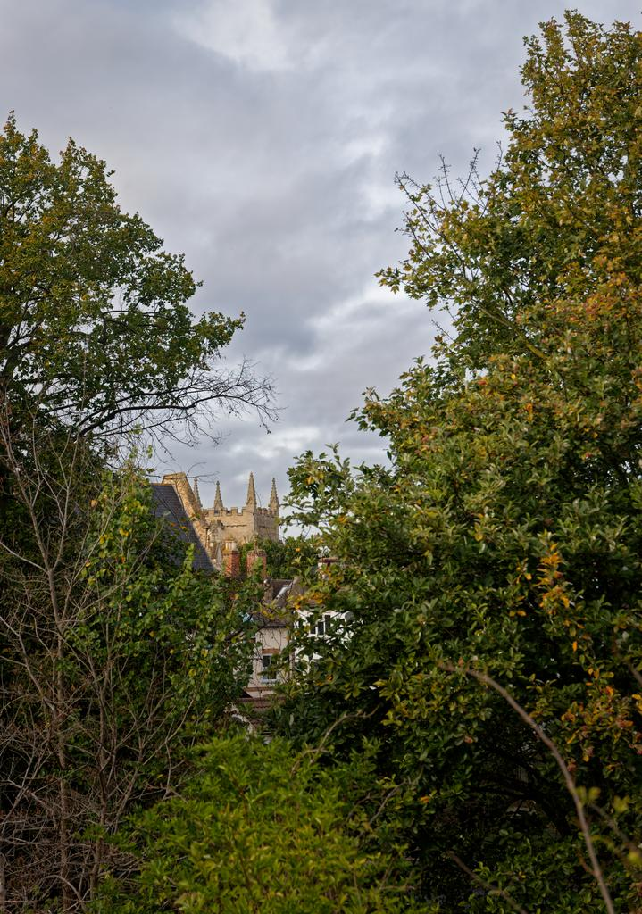

# Model Output Gallery

Generated on: 2026-10-28 18:45:39 GMT

- *Evaluation lane:* assisted
- *Prompt hints:* the image's description and keyword hints were included in the prompt, so field content may be copied from them rather than seen
- *Assessment:* General checks + metadata fields and duplicate keywords; length limits and factual accuracy not assessed
- *Input image:* JPEG, 6,656 x 9,483 pixels (63.1 MP), 60.5 MB
- *Human accuracy notes:* 0 of 43 outputs reviewed by a person for this exact image, model revision and output (accuracy_notes.yaml); the others are unreviewed; 1 note for other images or models

This run records model responses to one shared image and prompt (evaluation
lane: assisted). Mechanical checks are not factual-accuracy judgments; inspect
the image, prompt and final answers before choosing a model. Results do not
establish fitness for other tasks.

Complete per-model evidence artifact with image metadata, the source prompt, a
facts-only chooser, and full generated or crash output for every attempted
model.

## Reference Image



## Current-run Chooser

Mechanical observations and captured resource facts for this run only. No concerns detected does not mean the response fulfilled an arbitrary prompt or described the image accurately. Consult the assessment scope above. Total time is end-to-end; throughput covers generation only and requires at least 16 generated tokens. Prefill/first is the measured time to first token (input preparation, prefill and the first decode step) when captured, else upstream's model-loop first-token time; Prompt tok is the full rendered prompt including image tokens, which drives prefill cost. For cross-attention architectures the token count reflects the tokenised text burden only, not total vision prefill compute.

<!-- markdownlint-disable MD034 MD037 MD049 -->

| Model                                                                                                                               | Mechanical checks               | Total s | Gen TPS    | Prefill/first s | Peak GB | Prompt tok | Gen tok | Observations                                                               |
|-------------------------------------------------------------------------------------------------------------------------------------|---------------------------------|---------|------------|-----------------|---------|------------|---------|----------------------------------------------------------------------------|
| [`LiquidAI/LFM2.5-VL-450M-MLX-bf16`](#model-liquidai-lfm25-vl-450m-mlx-bf16)                                                        | `no concerns detected`          | 2.38s   | 484 tok/s  | 0.91            | 1.9     | 2,104      | 69      | none                                                                       |
| [`TechnoBaptist/Ternary-Bonsai-2-27B-mlx-2bit`](#model-technobaptist-ternary-bonsai-2-27b-mlx-2bit)                                 | `no concerns detected`          | 61.35s  | 35.4 tok/s | 55.46           | 17      | 16,594     | 118     | none                                                                       |
| [`ibm-granite/granite-vision-4.1-4b`](#model-ibm-granite-granite-vision-41-4b)                                                      | `no concerns detected`          | 6.11s   | 65.1 tok/s | 2.35            | 9.6     | 1,430      | 109     | none                                                                       |
| [`mlx-community/AREX-2-4bit`](#model-mlx-community-arex-2-4bit)                                                                     | `no concerns detected`          | 51.02s  | 30.3 tok/s | 43.93           | 21      | 16,594     | 114     | none                                                                       |
| [`mlx-community/ERNIE-4.5-VL-28B-A3B-Thinking-4bit`](#model-mlx-community-ernie-45-vl-28b-a3b-thinking-4bit)                        | `no concerns detected`          | 11.99s  | 119 tok/s  | 2.32            | 19      | 1,596      | 855     | none                                                                       |
| [`mlx-community/GLM-4.6V-Flash-4bit`](#model-mlx-community-glm-46v-flash-4bit)                                                      | `no concerns detected`          | 9.64s   | 78.6 tok/s | 6.41            | 8.7     | 6,343      | 104     | none                                                                       |
| [`mlx-community/InternVL3-14B-4bit`](#model-mlx-community-internvl3-14b-4bit)                                                       | `no concerns detected`          | 6.96s   | 56.7 tok/s | 2.98            | 10      | 2,104      | 108     | none                                                                       |
| [`mlx-community/MiniCPM-V-4.7-35B-A3B-4bit`](#model-mlx-community-minicpm-v-47-35b-a3b-4bit)                                        | `no concerns detected`          | 6.48s   | 75.8 tok/s | 1.47            | 25      | 927        | 108     | none                                                                       |
| [`mlx-community/MiniCPM-o-4_5-4bit`](#model-mlx-community-minicpm-o-45-4bit)                                                        | `no concerns detected`          | 3.76s   | 105 tok/s  | 0.98            | 7.1     | 382        | 94      | none                                                                       |
| [`mlx-community/Ministral-3-14B-Instruct-2512-mxfp4`](#model-mlx-community-ministral-3-14b-instruct-2512-mxfp4)                     | `no concerns detected`          | 6.83s   | 65.8 tok/s | 3.03            | 13      | 3,046      | 119     | none                                                                       |
| [`mlx-community/Ministral-3-3B-Instruct-2512-4bit`](#model-mlx-community-ministral-3-3b-instruct-2512-4bit)                         | `no concerns detected`          | 4.14s   | 185 tok/s  | 1.64            | 8.2     | 3,045      | 153     | none                                                                       |
| [`mlx-community/Mistral-Small-4-119B-2603-4bit`](#model-mlx-community-mistral-small-4-119b-2603-4bit)                               | `no concerns detected`          | 13.65s  | 69.9 tok/s | 3.78            | 73      | 2,525      | 120     | none                                                                       |
| [`mlx-community/Molmo2-8B-4bit`](#model-mlx-community-molmo2-8b-4bit)                                                               | `no concerns detected`          | 6.63s   | 72.2 tok/s | 2.86            | 8.0     | 1,318      | 133     | none                                                                       |
| [`mlx-community/MolmoPoint-8B-4bit`](#model-mlx-community-molmopoint-8b-4bit)                                                       | `no concerns detected`          | 10.25s  | 31.2 tok/s | 4.20            | 12      | 3,136      | 112     | none                                                                       |
| [`mlx-community/Muse-Glimmer-30B-OptiQ-4bit`](#model-mlx-community-muse-glimmer-30b-optiq-4bit)                                     | `no concerns detected`          | 51.60s  | 24.9 tok/s | 8.73            | 25      | 4,367      | 973     | none                                                                       |
| [`mlx-community/North-Micro-Vision-Instruct-4bit`](#model-mlx-community-north-micro-vision-instruct-4bit)                           | `no concerns detected`          | 5.54s   | 155 tok/s  | 2.76            | 3.7     | 4,044      | 110     | none                                                                       |
| [`mlx-community/Qwen3-VL-30B-A3B-Instruct-4bit`](#model-mlx-community-qwen3-vl-30b-a3b-instruct-4bit)                               | `no concerns detected`          | 35.05s  | 78.0 tok/s | 29.81           | 23      | 16,578     | 155     | none                                                                       |
| [`mlx-community/Qwen3-VL-8B-Instruct-4bit`](#model-mlx-community-qwen3-vl-8b-instruct-4bit)                                         | `no concerns detected`          | 34.70s  | 68.8 tok/s | 31.22           | 11      | 16,578     | 87      | none                                                                       |
| [`mlx-community/Qwen3.5-35B-A3B-4bit`](#model-mlx-community-qwen35-35b-a3b-4bit)                                                    | `no concerns detected`          | 32.74s  | 73.3 tok/s | 27.50           | 25      | 16,594     | 112     | none                                                                       |
| [`mlx-community/Qwen3.8-27B-nvfp4`](#model-mlx-community-qwen38-27b-nvfp4)                                                          | `no concerns detected`          | 52.65s  | 30.8 tok/s | 45.45           | 21      | 16,594     | 121     | none                                                                       |
| [`mlx-community/aya-vision-8b-4bit`](#model-mlx-community-aya-vision-8b-4bit)                                                       | `no concerns detected`          | 5.27s   | 103 tok/s  | 1.80            | 6.5     | 2,081      | 117     | none                                                                       |
| [`mlx-community/diffusiongemma-26B-A4B-it-mxfp8`](#model-mlx-community-diffusiongemma-26b-a4b-it-mxfp8)                             | `no concerns detected`          | 8.00s   | 48.4 tok/s | 3.83            | 28      | 586        | 76      | none                                                                       |
| [`mlx-community/gemma-4-12B-it-4bit`](#model-mlx-community-gemma-4-12b-it-4bit)                                                     | `no concerns detected`          | 5.73s   | 62.7 tok/s | 1.47            | 7.6     | 590        | 104     | none                                                                       |
| [`mlx-community/gemma-4-26b-a4b-it-4bit`](#model-mlx-community-gemma-4-26b-a4b-it-4bit)                                             | `no concerns detected`          | 4.99s   | 114 tok/s  | 1.07            | 16      | 590        | 75      | none                                                                       |
| [`mlx-community/gemma-4-e4b-it-4bit`](#model-mlx-community-gemma-4-e4b-it-4bit)                                                     | `no concerns detected`          | 4.19s   | 124 tok/s  | 1.02            | 6.0     | 586        | 83      | none                                                                       |
| [`nativ-community/Mage-VL-OptiQ-4bit`](#model-nativ-community-mage-vl-optiq-4bit)                                                   | `no concerns detected`          | 4.68s   | 129 tok/s  | 2.23            | 5.4     | 4,173      | 99      | none                                                                       |
| [`nativ-community/Mistral-Small-3.2-24B-Instruct-2506-4bit`](#model-nativ-community-mistral-small-32-24b-instruct-2506-4bit)        | `no concerns detected`          | 7.72s   | 36.2 tok/s | 2.24            | 18      | 1,313      | 111     | none                                                                       |
| [`nativ-community/NVIDIA-Nemotron-3.5-Bolt-74B-A9B-4bit`](#model-nativ-community-nvidia-nemotron-35-bolt-74b-a9b-4bit)              | `no concerns detected`          | 12.44s  | 63.3 tok/s | 5.59            | 52      | 3,640      | 123     | none                                                                       |
| [`nativ-community/Nemotron-3-Nano-Omni-30B-A3B-Reasoning-4bit`](#model-nativ-community-nemotron-3-nano-omni-30b-a3b-reasoning-4bit) | `no concerns detected`          | 7.05s   | 141 tok/s  | 3.05            | 23      | 3,641      | 135     | none                                                                       |
| [`nvidia/NVIDIA-Nemotron-3.5-Super-VL-120B-A12B-NVFP4`](#model-nvidia-nvidia-nemotron-35-super-vl-120b-a12b-nvfp4)                  | `no concerns detected`          | 37.60s  | 30.9 tok/s | 18.26           | 87      | 3,640      | 133     | none                                                                       |
| [`mlx-community/LFM2.5-VL-3B-OptiQ-4bit`](#model-mlx-community-lfm25-vl-3b-optiq-4bit)                                              | `concerns detected`             | 3.55s   | 209 tok/s  | 1.47            | 4.0     | 2,096      | 83      | prompt hint repeated                                                       |
| [`mlx-community/MiniCPM-V-4.6-4bit`](#model-mlx-community-minicpm-v-46-4bit)                                                        | `concerns detected`             | 6.97s   | 250 tok/s  | 2.12            | 3.2     | 925        | 752     | duplicate keywords                                                         |
| [`mlx-community/MiniCPM-V-4.7-1B-4bit`](#model-mlx-community-minicpm-v-47-1b-4bit)                                                  | `concerns detected`             | 3.23s   | 266 tok/s  | 0.94            | 3.7     | 927        | 114     | duplicate keywords                                                         |
| [`mlx-community/Phi-3.5-vision-instruct-bf16`](#model-mlx-community-phi-35-vision-instruct-bf16)                                    | `concerns detected`             | 5.33s   | 57.0 tok/s | 1.09            | 9.3     | 1,120      | 149     | duplicate keywords                                                         |
| [`mlx-community/Qwen3-Omni-30B-A3B-Instruct-4bit`](#model-mlx-community-qwen3-omni-30b-a3b-instruct-4bit)                           | `concerns detected`             | 22.36s  | 70.5 tok/s | 17.58           | 26      | 12,683     | 90      | prompt hint repeated                                                       |
| [`mlx-community/SmolVLM2-2.2B-Instruct-mlx`](#model-mlx-community-smolvlm2-22b-instruct-mlx)                                        | `concerns detected`             | 3.60s   | 127 tok/s  | 1.42            | 5.6     | 1,419      | 74      | prompt hint repeated                                                       |
| [`mlx-community/X-Reasoner-7B-8bit`](#model-mlx-community-x-reasoner-7b-8bit)                                                       | `concerns detected`             | 19.14s  | 59.4 tok/s | 13.02           | 14      | 16,589     | 229     | duplicate keywords                                                         |
| [`mlx-community/granite-4.0-3b-vision-4bit`](#model-mlx-community-granite-40-3b-vision-4bit)                                        | `concerns detected`             | 3.27s   | 179 tok/s  | 1.28            | 4.6     | 1,454      | 68      | prompt hint repeated                                                       |
| [`sahilchachra/LensVLM-9B-MXFP4`](#model-sahilchachra-lensvlm-9b-mxfp4)                                                             | `concerns detected`             | 4.59s   | 101 tok/s  | 1.65            | 7.3     | 1,802      | 83      | prompt hint repeated                                                       |
| [`mlx-community/FastVLM-0.5B-bf16`](#model-mlx-community-fastvlm-05b-bf16)                                                          | `major concerns: answer format` | 4.01s   | 322 tok/s  | 2.00            | 1.8     | 325        | 22      | labelled fields not detected; prompt hint repeated                         |
| [`mlx-community/InternVL3_5-1B-4bit`](#model-mlx-community-internvl35-1b-4bit)                                                      | `major concerns: generation`    | 3.19s   | 326 tok/s  | 1.19            | 2.1     | 2,107      | 200     | repeated text; stopped early: repeating; duplicate keywords                |
| [`mlx-community/llm-jp-4-vl-9b-mlx-4bit`](#model-mlx-community-llm-jp-4-vl-9b-mlx-4bit)                                             | `major concerns: answer format` | 3.57s   | 103 tok/s  | 1.46            | 6.7     | 2,186      | 29      | control tokens visible; labelled fields not detected; prompt hint repeated |
| [`mlx-community/nanoLLaVA-1.5-4bit`](#model-mlx-community-nanollava-15-4bit)                                                        | `major concerns: answer format` | 2.96s   | 206 tok/s  | 0.93            | 1.8     | 321        | 148     | labelled fields not detected                                               |
<!-- markdownlint-enable MD034 MD037 MD049 -->

## Resource Highlights

Quickest completion without detected concerns (end-to-end, including model load): `LiquidAI/LFM2.5-VL-450M-MLX-bf16` at 2.38s

Lowest peak memory among completions without detected concerns: `LiquidAI/LFM2.5-VL-450M-MLX-bf16` at 1.9 GB

Decode tok/s stays per model in the chooser and is not averaged across models: tokenizers, image-token expansion and reasoning lengths differ too much for a cross-model mean to guide a choice.

## Major Mechanical Concerns in This Run

<!-- markdownlint-disable MD034 MD037 MD049 -->

| Model                                                                                   | Mechanical checks               | Observations                                                               |
|-----------------------------------------------------------------------------------------|---------------------------------|----------------------------------------------------------------------------|
| [`mlx-community/FastVLM-0.5B-bf16`](#model-mlx-community-fastvlm-05b-bf16)              | `major concerns: answer format` | labelled fields not detected; prompt hint repeated                         |
| [`mlx-community/InternVL3_5-1B-4bit`](#model-mlx-community-internvl35-1b-4bit)          | `major concerns: generation`    | repeated text; stopped early: repeating; duplicate keywords                |
| [`mlx-community/llm-jp-4-vl-9b-mlx-4bit`](#model-mlx-community-llm-jp-4-vl-9b-mlx-4bit) | `major concerns: answer format` | control tokens visible; labelled fields not detected; prompt hint repeated |
| [`mlx-community/nanoLLaVA-1.5-4bit`](#model-mlx-community-nanollava-15-4bit)            | `major concerns: answer format` | labelled fields not detected                                               |
<!-- markdownlint-enable MD034 MD037 MD049 -->

## Output at a Glance

A compact preview of each model's final answer (or failure evidence for crashes), in chooser order. Where the requested catalogue fields were detected, the preview shows a little of each: the title, the start of the description, and the first keywords with their count, so the weakest field is not hidden behind a long description. Otherwise it is the first 280 characters. A closed reasoning trace is left out of the preview and reported as an omitted-character count; the complete output, trace included, is in the model's evidence block below.

<!-- markdownlint-disable MD034 MD037 MD049 -->

| Model                                                                                                                               | Mechanical checks      | Output preview                                                                                                                                                                                                                                                                                                                                                                        |
|-------------------------------------------------------------------------------------------------------------------------------------|------------------------|---------------------------------------------------------------------------------------------------------------------------------------------------------------------------------------------------------------------------------------------------------------------------------------------------------------------------------------------------------------------------------------|
| [`LiquidAI/LFM2.5-VL-450M-MLX-bf16`](#model-liquidai-lfm25-vl-450m-mlx-bf16)                                                        | `no concerns detected` | Title: Historic Gothic Tower in Oxfordshire \| Description: A historic gothic tower stands amidst lush green trees under an overcast sky, with rooftops partially visible. \| Keywords (8): Historic architecture, Oxfordshire, gothic tower, overcast sky, trees, rooftops, architecture, landscape                                                                                  |
| [`TechnoBaptist/Ternary-Bonsai-2-27B-mlx-2bit`](#model-technobaptist-ternary-bonsai-2-27b-mlx-2bit)                                 | `no concerns detected` | Title: Historic Gothic Tower Framed by Autumn Trees \| Description: A historic stone Gothic tower with multiple pinnacles and a steep slate roof is partially visible throu... \| Keywords (18): Architecture, Branch, Building, Chimney, Cloud, Cloudy sky, England, English countryside, Foliage, ...                                                                               |
| [`ibm-granite/granite-vision-4.1-4b`](#model-ibm-granite-granite-vision-41-4b)                                                      | `no concerns detected` | Title: "Oxfordshire Gothic Tower Amidst Autumn Foliage" \| Description: A historic stone gothic tower stands majestically, partially obscured by dense green trees under an... \| Keywords (20): Architecture, Branch, Building, Chimney, Cloud, Cloudy sky, England, English countryside, Foliage, ...                                                                               |
| [`mlx-community/AREX-2-4bit`](#model-mlx-community-arex-2-4bit)                                                                     | `no concerns detected` | Title: Gothic Tower Peeking Through Autumn Trees \| Description: A historic stone Gothic tower with ornate pinnacles rises above rooftops, partially framed by dense green... \| Keywords (20): Architecture, Branch, Building, Chimney, Cloud, Cloudy sky, England, English countryside, Foliage, ...                                                                                |
| [`mlx-community/ERNIE-4.5-VL-28B-A3B-Thinking-4bit`](#model-mlx-community-ernie-45-vl-28b-a3b-thinking-4bit)                        | `no concerns detected` | Title: Gothic Tower Framed by Green Foliage \| Description: A historic stone gothic tower in Northamptonshire, England, is partially framed by lush green folia... \| Keywords (18): Tower, Rooftops, Building, Foliage, Sky, Cloud, England, English countryside, Architecture, Historic Building, ...[2,299 characters of reasoning omitted; complete output in the evidence block] |
| [`mlx-community/GLM-4.6V-Flash-4bit`](#model-mlx-community-glm-46v-flash-4bit)                                                      | `no concerns detected` | Title: Historic Tower Through Trees \| Description: A historic stone gothic tower and rooftops are partially visible through dense green foliage under an overcast sky... \| Keywords (9): Architecture, Historic Building, Gothic Tower, Foliage, Overcast Sky, Rooftops, Oxford, England, Scenic View                                                                               |
| [`mlx-community/InternVL3-14B-4bit`](#model-mlx-community-internvl3-14b-4bit)                                                       | `no concerns detected` | Title: Oxford Gothic Tower Amidst Autumnal Foliage \| Description: The image captures a historic stone Gothic tower in Oxford, England, framed by dense green and y... \| Keywords (18): Architecture, Branch, Building, Chimney, Cloud, Cloudy sky, England, English countryside, Foliage, Gothic, ...                                                                               |
| [`mlx-community/MiniCPM-V-4.7-35B-A3B-4bit`](#model-mlx-community-minicpm-v-47-35b-a3b-4bit)                                        | `no concerns detected` | Title: Gothic Tower Framed by Autumn Trees in Oxford \| Description: A historic stone Gothic tower with pinnacles is partially visible through dense green and... \| Keywords (18): Architecture, Building, Chimney, Cloudy sky, England, Foliage, Gothic architecture, Historic building, Leaves, ...                                                                                |
| [`mlx-community/MiniCPM-o-4_5-4bit`](#model-mlx-community-minicpm-o-45-4bit)                                                        | `no concerns detected` | Title: Gothic Tower Peeks Through Autumn Trees \| Description: A historic stone Gothic tower is partially visible behind dense green foliage under a cloudy sky,... \| Keywords (19): Architecture, Branch, Building, Cloud, Cloudy sky, England, English countryside, Foliage, Historic Building, ...                                                                                |
| [`mlx-community/Ministral-3-14B-Instruct-2512-mxfp4`](#model-mlx-community-ministral-3-14b-instruct-2512-mxfp4)                     | `no concerns detected` | Title: **Gothic Tower Framed by Autumn Foliage, Oxford** \| Description: A historic stone Gothic tower with intricate pinnacles and rooftops partially obscured by dense... \| Keywords (16): Gothic architecture, Oxford tower, historic building, overcast sky, autumn foliage, stone structure, ...                                                                                |
| [`mlx-community/Ministral-3-3B-Instruct-2512-4bit`](#model-mlx-community-ministral-3-3b-instruct-2512-4bit)                         | `no concerns detected` | Title: Gothic Tower Framed by Autumn Foliage, Oxfordshire \| Description: A historic stone Gothic tower and rooftops are partially obscured by dense green foliage un... \| Keywords (14): Historic stone Gothic tower, Oxfordshire England, dense green foliage, overcast sky, stone architecture, ...                                                                               |
| [`mlx-community/Mistral-Small-4-119B-2603-4bit`](#model-mlx-community-mistral-small-4-119b-2603-4bit)                               | `no concerns detected` | Title: Historic Oxford tower framed by autumn trees under overcast sky \| Description: A view of Oxford’s historic stone tower and rooftops framed by dense gree... \| Keywords (16): Historic stone tower, Oxford rooftops, gothic architecture, dense green foliage, autumn leaves, overcast sky, ...                                                                               |
| [`mlx-community/Molmo2-8B-4bit`](#model-mlx-community-molmo2-8b-4bit)                                                               | `no concerns detected` | Title: Gothic Tower and Rooftops Peeking Through Dense Trees in Oxfordshire \| Description: A scenic view of a historic stone gothic tower and rooftops partially framed by... \| Keywords (20): Architecture, Branch, Building, Chimney, Cloud, Cloudy sky, England, English countryside, Foliage, ...                                                                               |
| [`mlx-community/MolmoPoint-8B-4bit`](#model-mlx-community-molmopoint-8b-4bit)                                                       | `no concerns detected` | Title: Gothic Stone Tower Peeks Through Autumn Trees in Oxfordshire \| Description: A historic stone gothic tower with multiple spires stands partially obscured by de... \| Keywords (16): Oxfordshire, historic building, gothic architecture, autumn foliage, overcast sky, stone tower, spires, ...                                                                               |
| [`mlx-community/Muse-Glimmer-30B-OptiQ-4bit`](#model-mlx-community-muse-glimmer-30b-optiq-4bit)                                     | `no concerns detected` | Title: Gothic Tower Framed by Autumn Trees Oxford \| Description: On 2026-10-17 15:44:34 UTC+01:00 at 51.751667°N, 1.252222°W, a historic stone Gothic tower wi... \| Keywords (18): Architecture, Building, Branch, Chimney, Cloud, Cloudy sky, England, Foliage, Gothic tower, Historic building, ...                                                                               |
| [`mlx-community/North-Micro-Vision-Instruct-4bit`](#model-mlx-community-north-micro-vision-instruct-4bit)                           | `no concerns detected` | Title: Historic Tower View with Overcast Sky \| Description: A view of a historic stone gothic tower and rooftops partially framed by dense green trees under an overcast s... \| Keywords (20): Architecture, Branch, Building, Chimney, Cloud, Cloudy sky, England, English countryside, Foliage, ...                                                                               |
| [`mlx-community/Qwen3-VL-30B-A3B-Instruct-4bit`](#model-mlx-community-qwen3-vl-30b-a3b-instruct-4bit)                               | `no concerns detected` | Title: Historic Oxford tower viewed through trees \| Description: A view of a historic stone Gothic tower and surrounding rooftops in Oxford, England, framed by dense gree... \| Keywords (19): Architecture, Branch, Building, Chimney, Cloud, Cloudy sky, England, English countryside, Foliage, ...                                                                               |
| [`mlx-community/Qwen3-VL-8B-Instruct-4bit`](#model-mlx-community-qwen3-vl-8b-instruct-4bit)                                         | `no concerns detected` | Title: Gothic Tower Peeks Through Autumn Foliage \| Description: A historic stone Gothic tower rises above rooftops, framed by dense green and yellowing foliage und... \| Keywords (10): Gothic tower, autumn foliage, overcast sky, Oxfordshire, England, historic architecture, trees, rooftops, ...                                                                               |
| [`mlx-community/Qwen3.5-35B-A3B-4bit`](#model-mlx-community-qwen35-35b-a3b-4bit)                                                    | `no concerns detected` | Title: Stone Gothic Tower Hidden in Trees \| Description: Taken on October 17, 2026, from coordinates near Oxford, this image captures a historic stone building feat... \| Keywords (18): architecture, branch, building, chimney, cloudy sky, english countryside, foliage, gothic tower, leaves, ...                                                                               |
| [`mlx-community/Qwen3.8-27B-nvfp4`](#model-mlx-community-qwen38-27b-nvfp4)                                                          | `no concerns detected` | Title: Gothic tower and rooftops seen through autumn foliage \| Description: A stone Gothic tower featuring crenellated battlements and tall pinnacles rises above a... \| Keywords (17): Architecture, Autumn, Building, Chimney, Cloud, England, Foliage, Gothic, Leaves, Oxford, Pinnacle, Roof, ...                                                                               |
| [`mlx-community/aya-vision-8b-4bit`](#model-mlx-community-aya-vision-8b-4bit)                                                       | `no concerns detected` | Title: Gothic Tower Rooftops Amidst Green Canopy \| Description: This image captures a historic stone gothic tower and rooftops partially framed by dense green tre... \| Keywords (14): Gothic architecture, Stone structure, Rooftops, Trees, Overcast sky, Clouds, England, English countryside, ...                                                                               |
| [`mlx-community/diffusiongemma-26B-A4B-it-mxfp8`](#model-mlx-community-diffusiongemma-26b-a4b-it-mxfp8)                             | `no concerns detected` | Title: Gothic Stone Tower Framed by Trees in Oxford \| Description: A historic stone gothic tower and rooftops are visible through dense green foliage under an overca... \| Keywords (14): Architecture, Building, Cloud, England, Foliage, Historic Building, Leaves, Outdoors, Overcast, Oxford, ...                                                                               |
| [`mlx-community/gemma-4-12B-it-4bit`](#model-mlx-community-gemma-4-12b-it-4bit)                                                     | `no concerns detected` | Title: Gothic Architecture Framed by Foliage in Oxford \| Description: A view of a historic stone Gothic tower and rooftops nestled among dense green foliage under a cloud... \| Keywords (20): Architecture, Branch, Building, Chimney, Cloud, Cloudy sky, England, English countryside, Foliage, ...                                                                               |
| [`mlx-community/gemma-4-26b-a4b-it-4bit`](#model-mlx-community-gemma-4-26b-a4b-it-4bit)                                             | `no concerns detected` | Title: Historic Gothic Tower Framed by Green Foliage \| Description: A historic stone gothic tower and rooftops emerge from dense green foliage under an overc... \| Keywords (16): Architecture, Building, Cloudy sky, England, Foliage, Historic Building, Leaves, Oxford, Oxfordshire, Pinnacle, ...                                                                               |
| [`mlx-community/gemma-4-e4b-it-4bit`](#model-mlx-community-gemma-4-e4b-it-4bit)                                                     | `no concerns detected` | Title: Historic Gothic Tower Framed by Autumn Foliage Under Overcast Sky \| Description: A view captures the pinnacled rooftops of a historic stone building, part... \| Keywords (14): Gothic architecture, historic building, rooftops, foliage, trees, overcast sky, pinnacles, stone structure, ...                                                                               |
| [`nativ-community/Mage-VL-OptiQ-4bit`](#model-nativ-community-mage-vl-optiq-4bit)                                                   | `no concerns detected` | Title: Gothic Tower Amidst Lush Foliage Under Overcast Skies \| Description: A historic stone Gothic tower with pointed spires rises above dense green trees and rooftops,... \| Keywords (20): Architecture, Branch, Building, Chimney, Cloud, Cloudy sky, England, English countryside, Foliage, ...                                                                                |
| [`nativ-community/Mistral-Small-3.2-24B-Instruct-2506-4bit`](#model-nativ-community-mistral-small-32-24b-instruct-2506-4bit)        | `no concerns detected` | Title: Gothic Tower Amidst Autumn Foliage \| Description: A historic stone Gothic tower and rooftops peek through dense green and autumnal trees under an overcast s... \| Keywords (19): Gothic tower, Oxfordshire, historic architecture, autumn foliage, overcast sky, stone building, rooftops, ...                                                                               |
| [`nativ-community/NVIDIA-Nemotron-3.5-Bolt-74B-A9B-4bit`](#model-nativ-community-nvidia-nemotron-35-bolt-74b-a9b-4bit)              | `no concerns detected` | Title: Oxford Historic Tower Peeking Through Autumn Trees \| Description: A view of a historic stone Gothic tower and rooftops partially framed by dense green trees under... \| Keywords (20): Architecture, Branch, Building, Chimney, Cloud, Cloudy sky, England, English countryside, Foliage, ...                                                                                |
| [`nativ-community/Nemotron-3-Nano-Omni-30B-A3B-Reasoning-4bit`](#model-nativ-community-nemotron-3-nano-omni-30b-a3b-reasoning-4bit) | `no concerns detected` | Title: Historic Gothic Tower Through Autumnal Trees \| Description: A view of a historic stone gothic tower and rooftops partially framed by dense green trees under an ove... \| Keywords (20): Architecture, Branch, Building, Chimney, Cloud, Cloudy sky, England, English countryside, Foliage, ...                                                                               |
| [`nvidia/NVIDIA-Nemotron-3.5-Super-VL-120B-A12B-NVFP4`](#model-nvidia-nvidia-nemotron-35-super-vl-120b-a12b-nvfp4)                  | `no concerns detected` | Title: Historic stone tower framed by trees under cloudy sky \| Description: A view of a historic stone gothic tower and rooftops partially framed by dense green trees und... \| Keywords (20): Architecture, Branch, Building, Chimney, Cloud, Cloudy sky, England, English countryside, Foliage, ...                                                                               |
| [`mlx-community/LFM2.5-VL-3B-OptiQ-4bit`](#model-mlx-community-lfm25-vl-3b-optiq-4bit)                                              | `concerns detected`    | Title: Historic stone tower framed by trees \| Description: A view of a historic stone gothic tower and rooftops partially framed by dense green trees under an over... \| Keywords (15): Architecture, Branch, Building, Chimney, Cloud, Cloudy sky, England, Oxford, Oxfordshire, Pinnacle, Roof, ...                                                                               |
| [`mlx-community/MiniCPM-V-4.6-4bit`](#model-mlx-community-minicpm-v-46-4bit)                                                        | `concerns detected`    | Title: Gothic Tower Visible Through Lush Trees Under Overcast Sky \| Description: The historic stone gothic tower is partially framed by dense foliage, seen under... \| Keywords (21): Gothic tower, historic stone, gothic architecture, foliage, overcast sky, England, trees, roofs, pinnacles, ...[2,499 characters of reasoning omitted; complete output in the evidence block] |
| [`mlx-community/MiniCPM-V-4.7-1B-4bit`](#model-mlx-community-minicpm-v-47-1b-4bit)                                                  | `concerns detected`    | Title: Framed Gothic Tower Through Trees \| Description: A historic stone gothic tower with pinnacles and chimneys peeks through dense green foliage under an overcast sk... \| Keywords (25): Gothic tower, trees, foliage, overcast, cloudy sky, England, Oxford, Oxfordshire, historic building, ...                                                                               |
| [`mlx-community/Phi-3.5-vision-instruct-bf16`](#model-mlx-community-phi-35-vision-instruct-bf16)                                    | `concerns detected`    | Title: "Overcast Skies Over Oxford's Historic Architecture" \| Description: On October 17, 2026, at 15:44:34 UTC+01:00, a historic stone gothic tower stands as a pinnacle... \| Keywords (20): historic, architecture, gothic, tower, overcast, sky, leaves, foliage, English countryside, Oxford, ...                                                                               |
| [`mlx-community/Qwen3-Omni-30B-A3B-Instruct-4bit`](#model-mlx-community-qwen3-omni-30b-a3b-instruct-4bit)                           | `concerns detected`    | Title: Historic Tower View Through Autumn Foliage \| Description: A view of a historic stone Gothic tower and rooftops partially framed by dense green trees under an... \| Keywords (18): Architecture, Branch, Building, Chimney, Cloud, Cloudy sky, England, Foliage, Historic Building, Leaves, ...                                                                               |
| [`mlx-community/SmolVLM2-2.2B-Instruct-mlx`](#model-mlx-community-smolvlm2-22b-instruct-mlx)                                        | `concerns detected`    | Title: Oxford Castle \| Description: A historic stone gothic tower and rooftops framed by dense green trees under an overcast sky. \| Keywords (18): architecture, branch, building, chimney, cloudy sky, english countryside, foliage, historic building, leaves, ...                                                                                                                |
| [`mlx-community/X-Reasoner-7B-8bit`](#model-mlx-community-x-reasoner-7b-8bit)                                                       | `concerns detected`    | Title: Gothic Tower Through Foliage \| Description: A historic stone gothic tower and rooftops are framed by dense green trees under an overcast sky, with a v... \| Keywords (51): Oxfordshire, England, Gothic tower, historic building, stone architecture, overcast sky, cloudy, green foliage, ...                                                                               |
| [`mlx-community/granite-4.0-3b-vision-4bit`](#model-mlx-community-granite-40-3b-vision-4bit)                                        | `concerns detected`    | Title: Gothic Tower Amidst Greenery \| Description: A view of a historic stone gothic tower and rooftops partially framed by dense green trees under an overcast sky. \| Keywords (11): Gothic tower, stone architecture, green foliage, overcast sky, historic building, rooftops, foliage, trees, ...                                                                               |
| [`sahilchachra/LensVLM-9B-MXFP4`](#model-sahilchachra-lensvlm-9b-mxfp4)                                                             | `concerns detected`    | Title: Oxford Castle spire seen through trees \| Description: A view of a historic stone gothic tower and rooftops partially framed by dense green trees under an overcast... \| Keywords (15): Architecture, Branch, Building, Chimney, Cloud, Cloudy sky, England, English countryside, Foliage, ...                                                                                |
| [`mlx-community/FastVLM-0.5B-bf16`](#model-mlx-community-fastvlm-05b-bf16)                                                          | `major concerns`       | A historic stone gothic tower and rooftops partially framed by dense green trees under an overcast sky.                                                                                                                                                                                                                                                                               |
| [`mlx-community/InternVL3_5-1B-4bit`](#model-mlx-community-internvl35-1b-4bit)                                                      | `major concerns`       | Title: Historic Gothic Tower Under Overcast Sky \| Description: The image showcases a historic stone gothic tower partially obscured by dense green trees, set agains... \| Keywords (57): Architecture, Gothic, Tower, Overcast sky, Foliage, Historic building, England, Pinnacle, Sky, Rooftops, ...                                                                               |
| [`mlx-community/llm-jp-4-vl-9b-mlx-4bit`](#model-mlx-community-llm-jp-4-vl-9b-mlx-4bit)                                             | `major concerns`       | <\|channel\|> analysis<\|message\|> The image shows a view of a historic stone gothic tower and rooftops partially framed by dense green trees under an overcast sky.                                                                                                                                                                                                                 |
| [`mlx-community/nanoLLaVA-1.5-4bit`](#model-mlx-community-nanollava-15-4bit)                                                        | `major concerns`       | Title: A Historical View of Oxfordshire's Tower and Trees \| Description: A detailed depiction of a historic stone gothic tower and rooftops in Oxfordshire, UK, set against a backdrop of dense green trees under an overcast sky. The image captures the architectural... \| Keywords: (not detected)                                                                               |
<!-- markdownlint-enable MD034 MD037 MD049 -->

## Run Stamps

- `mlx-vlm`: `0.7.10`
- `mlx`: `0.32.5.dev20261028+7d2d94a55`
- `transformers`: `5.21.0`
- `tokenizers`: `0.23.3`
- `huggingface-hub`: `2.3.0`
- *Python Version:* 3.14.7
- *OS:* Darwin 27.2.0
- *macOS Version:* 27.2
- *GPU/Chip:* Apple M5 Max
- *MLX Device:* Apple M5 Max
- *GPU Architecture:* applegpu_g17s
- *RAM:* 128.0 GB
- *Recommended Working Set:* 115 GB
- *Fused Attention:* Available

## Image Metadata

- *Description:* A view of a historic stone gothic tower and rooftops
  partially framed by dense green trees under an overcast sky.
- *Keywords:* Architecture, Branch, Building, Chimney, Cloud, Cloudy sky,
  England, English countryside, Foliage, Historic Building, Leaves, Outdoors,
  Overcast, Oxford, Oxfordshire, Pinnacle, Roof, Rooftops, Scenic, Sky, Spire,
  Tower, Townscape, Tree, Trees, United Kingdom, Urban greenery, autumn,
  branches, british, chapel, chimneys, church, church tower, cityscape,
  daytime, destination, europe, framed view, gothic, greenery, heritage,
  hidden, historic, landscape, medieval, nature, old town, outdoor, overcast
  sky, peek, residential, stone, tourism, traditional, travel, urban
  landscape, view, viewpoint
- *Date:* 2026-10-17 15:44:34 UTC+01:00
- *Time:* 15:44:34
- *GPS:* 51.751667°N, 1.252222°W

## Prompt

<!-- markdownlint-disable MD011 MD028 MD037 MD045 -->
>
> Create British-English catalogue metadata from the image and supplied
> context.
>
> Treat any capture date/time and GPS as authoritative facts, but do not claim
> they are visible. Descriptive hints may be incomplete or wrong: retain
> details supported by the image, correct conflicts, and add important visible
> details. Prefer image evidence when a hint conflicts, and omit uncertain
> details.
>
> Context: Authoritative context:
> &#45; Capture date/time: 2026-10-17 15:44:34 UTC+01:00
> &#45; GPS: 51.751667°N, 1.252222°W
>
> &#8203;Descriptive hints:
> &#45; Description hint: A view of a historic stone gothic tower and rooftops
> partially framed by dense green trees under an overcast sky.
> &#45; Keyword hints: Architecture, Branch, Building, Chimney, Cloud, Cloudy sky,
> England, English countryside, Foliage, Historic Building, Leaves, Outdoors,
> Overcast, Oxford, Oxfordshire, Pinnacle, Roof, Rooftops, Scenic, Sky
>
> &#8203;Write:
> &#45; a concrete 5-10-word title;
> &#45; a 1-2-sentence factual description combining relevant context with the
> main visible subject, setting, action, lighting, and distinctive details;
> &#45; 10-18 unique, comma-separated keywords covering relevant context and
> visible details.
>
> &#8203;Return exactly these three sections and nothing else:
> &#8203;Title:
> &#8203;Description:
> &#8203;Keywords:
<!-- markdownlint-enable MD011 MD028 MD037 MD045 -->

## Complete Per-model Evidence

Complete generated or crash evidence for every attempted model.

<a id="model-liquidai-lfm25-vl-450m-mlx-bf16"></a>

### LiquidAI/LFM2.5-VL-450M-MLX-bf16

<details>
<summary>Complete evidence: LiquidAI/LFM2.5-VL-450M-MLX-bf16</summary>

- *Execution:* completed
- *Mechanical checks:* no concerns detected
- *Assessment:* General checks + metadata fields and duplicate keywords;
  length limits and factual accuracy not assessed
- *Maintainer status:* none
- *Observations:* none
- *Arch supported by installed mlx-vlm:* yes (model_type lfm2-vl via lfm2_vl)
- *Model load time:* 0.29s
- *Generation time:* 1.05s
- *Total time:* 2.38s
- *Prompt preparation time:* 0.558
- *First-token latency:* 0.367
- *Cleanup time:* 0.0682
- *Prompt tokens:* 2,104
- *Generation tokens:* 69
- *Total tokens:* 2,173
- *Prompt throughput (raw):* 5,734 tok/s
- *Generation throughput (raw):* 484 tok/s
- *Peak memory (GB):* 1.9
- *Active memory (GB):* 0.90
- *Cache memory (GB):* 0.07
- *Model-load active memory (GB):* 0.897
- *Post-cleanup active memory (GB):* 0.000134
- *Post-cleanup cache memory (GB):* 0.0
- *Stop reason:* completed
- *Requested maximum tokens:* 1000
- *Rendered prompt characters:* 1307
- *Image placeholders:* 1
- *Processor:* transformers.models.lfm2_vl.processing_lfm2_vl.Lfm2VlProcessor
- *Tokenizer:* transformers.tokenization_utils_tokenizers.TokenizersBackend
- *Requested model revision:* not requested
- *Resolved model revision:* ed71acdae0799c98cb450787d049d1343b65cd52
- *Resolved snapshot path:* ~/.cache/huggingface/hub/models--LiquidAI--LFM2.5-VL-450M-MLX-bf16/snapshots/ed71acdae0799c98cb450787d049d1343b65cd52
- *Generation settings:* {"max_tokens": 1000, "prefill_step_size": 2048,
  "seed": 0, "temperature": 0.0, "top_k": 0, "top_p": 1.0}
- *EOS token:* <\|im_end\|>

*Readable output:*

<pre class="model-output-readable">
Title:
Historic Gothic Tower in Oxfordshire

Description:
A historic gothic tower stands amidst lush green trees under an overcast sky, with rooftops partially visible.

Keywords:
Historic architecture, Oxfordshire, gothic tower, overcast sky, trees, rooftops, architecture, landscape
</pre>

</details>

---

<a id="model-technobaptist-ternary-bonsai-2-27b-mlx-2bit"></a>

### TechnoBaptist/Ternary-Bonsai-2-27B-mlx-2bit

<details>
<summary>Complete evidence: TechnoBaptist/Ternary-Bonsai-2-27B-mlx-2bit</summary>

- *Execution:* completed
- *Mechanical checks:* no concerns detected
- *Assessment:* General checks + metadata fields and duplicate keywords;
  length limits and factual accuracy not assessed
- *Maintainer status:* none
- *Observations:* none
- *Arch supported by installed mlx-vlm:* yes (model_type
  prism_hadamard_qwen35)
- *Model load time:* 1.49s
- *Generation time:* 58.79s
- *Total time:* 61.35s
- *Prompt preparation time:* 0.924
- *First-token latency:* 54.6
- *Cleanup time:* 0.118
- *Prompt tokens:* 16,594
- *Generation tokens:* 118
- *Total tokens:* 16,712
- *Prompt throughput (raw):* 304 tok/s
- *Generation throughput (raw):* 35.4 tok/s
- *Peak memory (GB):* 17
- *Active memory (GB):* 8.6
- *Cache memory (GB):* 3.3
- *Model-load active memory (GB):* 8.6
- *Post-cleanup active memory (GB):* 0.00113
- *Post-cleanup cache memory (GB):* 0.0
- *Stop reason:* completed
- *Requested maximum tokens:* 1000
- *Rendered prompt characters:* 1347
- *Processor:* mlx_vlm.models.qwen3_vl.processing_qwen3_vl.Qwen3VLProcessor
- *Tokenizer:* transformers.models.qwen2.tokenization_qwen2.Qwen2Tokenizer
- *Requested model revision:* not requested
- *Resolved model revision:* 498775b03b55d038f716fea2568bf6ae6b8e0b5e
- *Resolved snapshot path:* ~/.cache/huggingface/hub/models--TechnoBaptist--Ternary-Bonsai-2-27B-mlx-2bit/snapshots/498775b03b55d038f716fea2568bf6ae6b8e0b5e
- *Generation settings:* {"max_tokens": 1000, "prefill_step_size": 2048,
  "seed": 0, "temperature": 0.0, "top_k": 0, "top_p": 1.0}
- *EOS token:* <\|im_end\|>

*Readable output:*

<pre class="model-output-readable">
Title: Historic Gothic Tower Framed by Autumn Trees

Description: A historic stone Gothic tower with multiple pinnacles and a steep slate roof is partially visible through dense green and yellowing foliage under an overcast sky. The scene is set in Oxford, England, with brick chimneys and residential rooftops visible below the tower.

Keywords: Architecture, Branch, Building, Chimney, Cloud, Cloudy sky, England, English countryside, Foliage, Historic Building, Leaves, Outdoors, Overcast, Oxford, Oxfordshire, Pinnacle, Roof, Rooftops
</pre>

</details>

---

<a id="model-ibm-granite-granite-vision-41-4b"></a>

### ibm-granite/granite-vision-4.1-4b

<details>
<summary>Complete evidence: ibm-granite/granite-vision-4.1-4b</summary>

- *Execution:* completed
- *Mechanical checks:* no concerns detected
- *Assessment:* General checks + metadata fields and duplicate keywords;
  length limits and factual accuracy not assessed
- *Maintainer status:* none
- *Observations:* none
- *Arch supported by installed mlx-vlm:* yes (model_type granite4_vision)
- *Model load time:* 1.09s
- *Generation time:* 4.03s
- *Total time:* 6.11s
- *Prompt preparation time:* 0.9
- *First-token latency:* 1.49
- *Cleanup time:* 0.0836
- *Prompt tokens:* 1,430
- *Generation tokens:* 109
- *Total tokens:* 1,539
- *Prompt throughput (raw):* 957 tok/s
- *Generation throughput (raw):* 65.1 tok/s
- *Peak memory (GB):* 9.6
- *Active memory (GB):* 8.0
- *Cache memory (GB):* 0.24
- *Model-load active memory (GB):* 8
- *Post-cleanup active memory (GB):* 0.00135
- *Post-cleanup cache memory (GB):* 0.0
- *Stop reason:* completed
- *Requested maximum tokens:* 1000
- *Rendered prompt characters:* 1480
- *Image placeholders:* 1
- *Processor:* mlx_vlm.models.granite4_vision.processing_granite4_vision.Granite4VisionProcessor
- *Tokenizer:* transformers.tokenization_utils_tokenizers.TokenizersBackend
- *Requested model revision:* not requested
- *Resolved model revision:* 37d591f06319e8f1638b5adcf58bdf50e0f84f7a
- *Resolved snapshot path:* ~/.cache/huggingface/hub/models--ibm-granite--granite-vision-4.1-4b/snapshots/37d591f06319e8f1638b5adcf58bdf50e0f84f7a
- *Generation settings:* {"max_tokens": 1000, "prefill_step_size": 2048,
  "seed": 0, "temperature": 0.0, "top_k": 0, "top_p": 1.0}
- *EOS token:* <\|end_of_text\|>

*Readable output:*

<pre class="model-output-readable">
Title: "Oxfordshire Gothic Tower Amidst Autumn Foliage"
Description: A historic stone gothic tower stands majestically, partially obscured by dense green trees under an overcast sky, showcasing the blend of nature and architecture in Oxfordshire.
Keywords: Architecture, Branch, Building, Chimney, Cloud, Cloudy sky, England, English countryside, Foliage, Historic Building, Leaves, Outdoors, Overcast, Oxford, Oxfordshire, Pinnacle, Roof, Rooftops, Scenic, Sky
</pre>

</details>

---

<a id="model-mlx-community-arex-2-4bit"></a>

### mlx-community/AREX-2-4bit

<details>
<summary>Complete evidence: mlx-community/AREX-2-4bit</summary>

- *Execution:* completed
- *Mechanical checks:* no concerns detected
- *Assessment:* General checks + metadata fields and duplicate keywords;
  length limits and factual accuracy not assessed
- *Maintainer status:* none
- *Observations:* none
- *Arch supported by installed mlx-vlm:* yes (model_type qwen3_5)
- *Model load time:* 2.15s
- *Generation time:* 47.70s
- *Total time:* 51.02s
- *Prompt preparation time:* 1.02
- *First-token latency:* 43
- *Cleanup time:* 0.127
- *Prompt tokens:* 16,594
- *Generation tokens:* 114
- *Total tokens:* 16,708
- *Prompt throughput (raw):* 386 tok/s
- *Generation throughput (raw):* 30.3 tok/s
- *Peak memory (GB):* 21
- *Active memory (GB):* 16
- *Cache memory (GB):* 1.9
- *Model-load active memory (GB):* 16.1
- *Post-cleanup active memory (GB):* 0.00185
- *Post-cleanup cache memory (GB):* 0.0
- *Stop reason:* completed
- *Requested maximum tokens:* 1000
- *Rendered prompt characters:* 1347
- *Processor:* mlx_vlm.models.qwen3_vl.processing_qwen3_vl.Qwen3VLProcessor
- *Tokenizer:* transformers.models.qwen3_5.tokenization_qwen3_5.Qwen3_5Tokenizer
- *Requested model revision:* not requested
- *Resolved model revision:* 02551ee54839c7541ea5adb44b83c9aa86aeb4f5
- *Resolved snapshot path:* ~/.cache/huggingface/hub/models--mlx-community--AREX-2-4bit/snapshots/02551ee54839c7541ea5adb44b83c9aa86aeb4f5
- *Generation settings:* {"max_tokens": 1000, "prefill_step_size": 2048,
  "seed": 0, "temperature": 0.0, "top_k": 0, "top_p": 1.0}
- *EOS token:* <\|im_end\|>

*Readable output:*

<pre class="model-output-readable">
Title: Gothic Tower Peeking Through Autumn Trees
Description: A historic stone Gothic tower with ornate pinnacles rises above rooftops, partially framed by dense green and yellowing foliage under an overcast sky. The scene is set in Oxford, England, on a cloudy afternoon.
Keywords: Architecture, Branch, Building, Chimney, Cloud, Cloudy sky, England, English countryside, Foliage, Historic Building, Leaves, Outdoors, Overcast, Oxford, Oxfordshire, Pinnacle, Roof, Rooftops, Scenic, Sky
</pre>

</details>

---

<a id="model-mlx-community-ernie-45-vl-28b-a3b-thinking-4bit"></a>

### mlx-community/ERNIE-4.5-VL-28B-A3B-Thinking-4bit

<details>
<summary>Complete evidence: mlx-community/ERNIE-4.5-VL-28B-A3B-Thinking-4bit</summary>

- *Execution:* completed
- *Mechanical checks:* no concerns detected
- *Assessment:* General checks + metadata fields and duplicate keywords;
  length limits and factual accuracy not assessed
- *Maintainer status:* none
- *Observations:* none
- *Arch supported by installed mlx-vlm:* yes (model_type ernie4_5_moe_vl)
- *Model load time:* 1.68s
- *Generation time:* 9.48s
- *Total time:* 11.99s
- *Prompt preparation time:* 0.711
- *First-token latency:* 1.66
- *Cleanup time:* 0.102
- *Prompt tokens:* 1,596
- *Generation tokens:* 855
- *Total tokens:* 2,451
- *Prompt throughput (raw):* 962 tok/s
- *Generation throughput (raw):* 119 tok/s
- *Peak memory (GB):* 19
- *Active memory (GB):* 17
- *Cache memory (GB):* 0.17
- *Model-load active memory (GB):* 17.4
- *Post-cleanup active memory (GB):* 0.00207
- *Post-cleanup cache memory (GB):* 0.0
- *Stop reason:* completed
- *Requested maximum tokens:* 1000
- *Rendered prompt characters:* 1446
- *Processor:* mlx_vlm.models.ernie4_5_moe_vl.processing_ernie4_5_moe_vl.Ernie4_5_VLProcessor
- *Tokenizer:* mlx_vlm.models.ernie4_5_moe_vl.processing_ernie4_5_moe_vl.Ernie4_5_VLTokenizer
- *Requested model revision:* not requested
- *Resolved model revision:* 846ea5576854468f25af3767d769b0805b1b08b6
- *Resolved snapshot path:* ~/.cache/huggingface/hub/models--mlx-community--ERNIE-4.5-VL-28B-A3B-Thinking-4bit/snapshots/846ea5576854468f25af3767d769b0805b1b08b6
- *Generation settings:* {"enable_thinking": true, "max_tokens": 1000,
  "prefill_step_size": 2048, "seed": 0, "temperature": 0.6, "thinking_budget":
  800, "thinking_end_token": "&lt;/think&gt;", "thinking_start_token":
  "&lt;think&gt;", "top_k": 0, "top_p": 0.95}
- *EOS token:* &lt;/s&gt;

*Readable output:*

<pre class="model-output-readable">
Alright, let's get this done. I need to create some metadata for this image, and it's my job to be thorough.

First, I need to figure out the title. It should be short, catchy, and descriptive. I'm thinking "Historic Townscape with Stone Tower" or "Gothic Tower Framed by Green Foliage." Okay, let's go with "Gothic Tower Framed by Green Foliage." That's a good balance of clarity and visual description.

Now, for the description. I have to include the date, location, the main subject, the setting, and the overall feel. The image is of a historic stone gothic tower and rooftops partially framed by dense green trees under an overcast sky. The location is Northamptonshire, England, around 15:44 on October 17, 2026. I need to mention the overcast sky and the light. I will use the description hint as a starting point.

Okay, here's my draft: "A historic stone gothic tower in Northamptonshire, England, is partially framed by lush green foliage under a cloudy sky, captured at 15:44 UTC+01:00 on October 17, 2026." That's solid. It hits all the key points.

Finally, the keywords. I need to be comprehensive. Let's start with the core subjects: Tower, Rooftops, Building, Foliage, Sky, Cloud, Branch, Leaves, Pinnacle, Chimney, Roof. Then, add the location: England, English countryside, Northamptonshire, Oxfordshire. Then, the architectural style: Architecture, Historic Building, Gothic, Stone, Brick. Then the atmosphere: Overcast, Scenic, Outdoors, Historic.

Okay, I'm going to refine the list.
1.  Tower
2.  Rooftops
3.  Building
4.  Foliage
5.  Sky
6.  Cloud
7.  England
8.  English countryside
9.  Architecture
10. Historic Building
11. Gothic
12. Stone
13. Overcast
14. Scenic
15. Branch
16. Leaves
17. Pinnacle
18. Chimney

Now, I'm going to combine them. I'll do this in the correct order.

*   **Title:** Gothic Tower Framed by Green Foliage
*   **Description:** A historic stone gothic tower in Northamptonshire, England, is partially framed by lush green foliage under an overcast sky, captured at 15:44 UTC+01:00 on October 17, 2026.
*   **Keywords:** Tower, Rooftops, Building, Foliage, Sky, Cloud, England, English countryside, Architecture, Historic Building, Gothic, Stone, Overcast, Scenic, Branch, Leaves, Pinnacle, Chimney

Perfect. That's exactly what's needed.
&lt;/think&gt;

Title: Gothic Tower Framed by Green Foliage

Description: A historic stone gothic tower in Northamptonshire, England, is partially framed by lush green foliage under an overcast sky, captured at 15:44 UTC+01:00 on October 17, 2026. The scene includes the rooftops of buildings and architectural details like a pinnacle and a chimney.

Keywords: Tower, Rooftops, Building, Foliage, Sky, Cloud, England, English countryside, Architecture, Historic Building, Gothic, Stone, Overcast, Scenic, Branch, Leaves, Pinnacle, Chimney
</pre>

<details>
<summary>Exact raw output</summary>

```text
Alright, let's get this done. I need to create some metadata for this image, and it's my job to be thorough.

First, I need to figure out the title. It should be short, catchy, and descriptive. I'm thinking "Historic Townscape with Stone Tower" or "Gothic Tower Framed by Green Foliage." Okay, let's go with "Gothic Tower Framed by Green Foliage." That's a good balance of clarity and visual description.

Now, for the description. I have to include the date, location, the main subject, the setting, and the overall feel. The image is of a historic stone gothic tower and rooftops partially framed by dense green trees under an overcast sky. The location is Northamptonshire, England, around 15:44 on October 17, 2026. I need to mention the overcast sky and the light. I will use the description hint as a starting point.

Okay, here's my draft: "A historic stone gothic tower in Northamptonshire, England, is partially framed by lush green foliage under a cloudy sky, captured at 15:44 UTC+01:00 on October 17, 2026." That's solid. It hits all the key points.

Finally, the keywords. I need to be comprehensive. Let's start with the core subjects: Tower, Rooftops, Building, Foliage, Sky, Cloud, Branch, Leaves, Pinnacle, Chimney, Roof. Then, add the location: England, English countryside, Northamptonshire, Oxfordshire. Then, the architectural style: Architecture, Historic Building, Gothic, Stone, Brick. Then the atmosphere: Overcast, Scenic, Outdoors, Historic.

Okay, I'm going to refine the list.
1.  Tower
2.  Rooftops
3.  Building
4.  Foliage
5.  Sky
6.  Cloud
7.  England
8.  English countryside
9.  Architecture
10. Historic Building
11. Gothic
12. Stone
13. Overcast
14. Scenic
15. Branch
16. Leaves
17. Pinnacle
18. Chimney

Now, I'm going to combine them. I'll do this in the correct order.

*   **Title:** Gothic Tower Framed by Green Foliage
*   **Description:** A historic stone gothic tower in Northamptonshire, England, is partially framed by lush green foliage under an overcast sky, captured at 15:44 UTC+01:00 on October 17, 2026.
*   **Keywords:** Tower, Rooftops, Building, Foliage, Sky, Cloud, England, English countryside, Architecture, Historic Building, Gothic, Stone, Overcast, Scenic, Branch, Leaves, Pinnacle, Chimney

Perfect. That's exactly what's needed.
</think>

Title: Gothic Tower Framed by Green Foliage

Description: A historic stone gothic tower in Northamptonshire, England, is partially framed by lush green foliage under an overcast sky, captured at 15:44 UTC+01:00 on October 17, 2026. The scene includes the rooftops of buildings and architectural details like a pinnacle and a chimney.

Keywords: Tower, Rooftops, Building, Foliage, Sky, Cloud, England, English countryside, Architecture, Historic Building, Gothic, Stone, Overcast, Scenic, Branch, Leaves, Pinnacle, Chimney
```

</details>

</details>

---

<a id="model-mlx-community-glm-46v-flash-4bit"></a>

### mlx-community/GLM-4.6V-Flash-4bit

<details>
<summary>Complete evidence: mlx-community/GLM-4.6V-Flash-4bit</summary>

- *Execution:* completed
- *Mechanical checks:* no concerns detected
- *Assessment:* General checks + metadata fields and duplicate keywords;
  length limits and factual accuracy not assessed
- *Maintainer status:* none
- *Observations:* none
- *Arch supported by installed mlx-vlm:* yes (model_type glm4v)
- *Model load time:* 1.19s
- *Generation time:* 7.74s
- *Total time:* 9.64s
- *Prompt preparation time:* 0.591
- *First-token latency:* 5.87
- *Cleanup time:* 0.1
- *Prompt tokens:* 6,343
- *Generation tokens:* 104
- *Total tokens:* 6,447
- *Prompt throughput (raw):* 1,081 tok/s
- *Generation throughput (raw):* 78.6 tok/s
- *Peak memory (GB):* 8.7
- *Active memory (GB):* 7.1
- *Cache memory (GB):* 0.47
- *Model-load active memory (GB):* 7.08
- *Post-cleanup active memory (GB):* 0.00269
- *Post-cleanup cache memory (GB):* 0.0
- *Stop reason:* completed
- *Requested maximum tokens:* 1000
- *Rendered prompt characters:* 1337
- *Image placeholders:* 1
- *Processor:* mlx_vlm.models.glm4v.processing.Glm46VProcessor
- *Tokenizer:* transformers.tokenization_utils_tokenizers.TokenizersBackend
- *Requested model revision:* not requested
- *Resolved model revision:* bd7b20686e8cbf22ad221a3de8399cdc5a2a7e0e
- *Resolved snapshot path:* ~/.cache/huggingface/hub/models--mlx-community--GLM-4.6V-Flash-4bit/snapshots/bd7b20686e8cbf22ad221a3de8399cdc5a2a7e0e
- *Generation settings:* {"max_tokens": 1000, "prefill_step_size": 2048,
  "seed": 0, "temperature": 0.8, "top_k": 2, "top_p": 0.6}
- *EOS token:* <\|endoftext\|>

*Readable output:*

<pre class="model-output-readable">
Title: Historic Tower Through Trees
Description: A historic stone gothic tower and rooftops are partially visible through dense green foliage under an overcast sky, captured on 2026-10-17 at 15:44:34 UTC+01:00 at 51.751667°N, 1.252222°W.
Keywords: Architecture, Historic Building, Gothic Tower, Foliage, Overcast Sky, Rooftops, Oxford, England, Scenic View
</pre>

</details>

---

<a id="model-mlx-community-internvl3-14b-4bit"></a>

### mlx-community/InternVL3-14B-4bit

<details>
<summary>Complete evidence: mlx-community/InternVL3-14B-4bit</summary>

- *Execution:* completed
- *Mechanical checks:* no concerns detected
- *Assessment:* General checks + metadata fields and duplicate keywords;
  length limits and factual accuracy not assessed
- *Maintainer status:* none
- *Observations:* none
- *Arch supported by installed mlx-vlm:* yes (model_type internvl_chat)
- *Model load time:* 1.25s
- *Generation time:* 4.89s
- *Total time:* 6.96s
- *Prompt preparation time:* 0.694
- *First-token latency:* 2.31
- *Cleanup time:* 0.109
- *Prompt tokens:* 2,104
- *Generation tokens:* 108
- *Total tokens:* 2,212
- *Prompt throughput (raw):* 912 tok/s
- *Generation throughput (raw):* 56.7 tok/s
- *Peak memory (GB):* 10
- *Active memory (GB):* 8.9
- *Cache memory (GB):* 0.51
- *Model-load active memory (GB):* 8.94
- *Post-cleanup active memory (GB):* 0.003
- *Post-cleanup cache memory (GB):* 0.0
- *Stop reason:* completed
- *Requested maximum tokens:* 1000
- *Rendered prompt characters:* 1261
- *Image placeholders:* 1
- *Processor:* mlx_vlm.models.internvl_chat.processor.InternVLChatProcessor
- *Tokenizer:* transformers.models.qwen2.tokenization_qwen2.Qwen2Tokenizer
- *Requested model revision:* not requested
- *Resolved model revision:* 26328eaab82cdc642fa3b73d8fa0b73db398710d
- *Resolved snapshot path:* ~/.cache/huggingface/hub/models--mlx-community--InternVL3-14B-4bit/snapshots/26328eaab82cdc642fa3b73d8fa0b73db398710d
- *Generation settings:* {"max_tokens": 1000, "prefill_step_size": 2048,
  "seed": 0, "temperature": 0.0, "top_k": 0, "top_p": 1.0}
- *EOS token:* <\|im_end\|>

*Readable output:*

<pre class="model-output-readable">
Title:
Oxford Gothic Tower Amidst Autumnal Foliage

Description:
The image captures a historic stone Gothic tower in Oxford, England, framed by dense green and yellow foliage under an overcast sky. The scene is set in Oxfordshire, with rooftops visible in the foreground.

Keywords:
Architecture, Branch, Building, Chimney, Cloud, Cloudy sky, England, English countryside, Foliage, Gothic, Historic Building, Leaves, Oxford, Oxfordshire, Pinnacle, Rooftops, Scenic, Sky
</pre>

</details>

---

<a id="model-mlx-community-minicpm-v-47-35b-a3b-4bit"></a>

### mlx-community/MiniCPM-V-4.7-35B-A3B-4bit

<details>
<summary>Complete evidence: mlx-community/MiniCPM-V-4.7-35B-A3B-4bit</summary>

- *Execution:* completed
- *Mechanical checks:* no concerns detected
- *Assessment:* General checks + metadata fields and duplicate keywords;
  length limits and factual accuracy not assessed
- *Maintainer status:* none
- *Observations:* none
- *Arch supported by installed mlx-vlm:* yes (model_type minicpmv4_7)
- *Model load time:* 2.71s
- *Generation time:* 2.90s
- *Total time:* 6.48s
- *Prompt preparation time:* 0.714
- *First-token latency:* 0.774
- *Cleanup time:* 0.135
- *Prompt tokens:* 927
- *Generation tokens:* 108
- *Total tokens:* 1,035
- *Prompt throughput (raw):* 1,198 tok/s
- *Generation throughput (raw):* 75.8 tok/s
- *Peak memory (GB):* 25
- *Active memory (GB):* 24
- *Cache memory (GB):* 0.11
- *Model-load active memory (GB):* 23.5
- *Post-cleanup active memory (GB):* 0.0051
- *Post-cleanup cache memory (GB):* 0.0
- *Stop reason:* completed
- *Requested maximum tokens:* 1000
- *Rendered prompt characters:* 1318
- *Processor:* mlx_vlm.models.minicpmv4_7.processing_minicpmv4_7.MiniCPMV4_7Processor
- *Tokenizer:* transformers.models.qwen2.tokenization_qwen2.Qwen2Tokenizer
- *Requested model revision:* not requested
- *Resolved model revision:* 0e3b706c1599ad95294122c67c77ce662de18794
- *Resolved snapshot path:* ~/.cache/huggingface/hub/models--mlx-community--MiniCPM-V-4.7-35B-A3B-4bit/snapshots/0e3b706c1599ad95294122c67c77ce662de18794
- *Generation settings:* {"max_tokens": 1000, "prefill_step_size": 2048,
  "seed": 0, "temperature": 1.0, "top_k": 20, "top_p": 0.95}
- *EOS token:* <\|im_end\|>

*Readable output:*

<pre class="model-output-readable">
Title: Gothic Tower Framed by Autumn Trees in Oxford

Description: A historic stone Gothic tower with pinnacles is partially visible through dense green and autumnal foliage, under an overcast sky in Oxford, captured on 17 October 2026.

Keywords: Architecture, Building, Chimney, Cloudy sky, England, Foliage, Gothic architecture, Historic building, Leaves, Oxford, Oxfordshire, Pinnacle, Roof, Rooftops, Trees, Overcast sky, Autumn foliage, Stone tower
</pre>

</details>

---

<a id="model-mlx-community-minicpm-o-45-4bit"></a>

### mlx-community/MiniCPM-o-4_5-4bit

<details>
<summary>Complete evidence: mlx-community/MiniCPM-o-4_5-4bit</summary>

- *Execution:* completed
- *Mechanical checks:* no concerns detected
- *Assessment:* General checks + metadata fields and duplicate keywords;
  length limits and factual accuracy not assessed
- *Maintainer status:* none
- *Observations:* none
- *Arch supported by installed mlx-vlm:* yes (model_type minicpmo)
- *Model load time:* 1.20s
- *Generation time:* 1.88s
- *Total time:* 3.76s
- *Prompt preparation time:* 0.558
- *First-token latency:* 0.442
- *Cleanup time:* 0.106
- *Prompt tokens:* 382
- *Generation tokens:* 94
- *Total tokens:* 476
- *Prompt throughput (raw):* 864 tok/s
- *Generation throughput (raw):* 105 tok/s
- *Peak memory (GB):* 7.1
- *Active memory (GB):* 6.1
- *Cache memory (GB):* 0.09
- *Model-load active memory (GB):* 6.15
- *Post-cleanup active memory (GB):* 0.00541
- *Post-cleanup cache memory (GB):* 0.0
- *Stop reason:* completed
- *Requested maximum tokens:* 1000
- *Rendered prompt characters:* 1311
- *Image placeholders:* 1
- *Processor:* mlx_vlm.models.minicpmo.processing_minicpmo.MiniCPMOProcessor
- *Tokenizer:* transformers.models.qwen2.tokenization_qwen2.Qwen2Tokenizer
- *Requested model revision:* not requested
- *Resolved model revision:* 592c09d85e7bffbc8f8e45a417aa8e9a96119814
- *Resolved snapshot path:* ~/.cache/huggingface/hub/models--mlx-community--MiniCPM-o-4_5-4bit/snapshots/592c09d85e7bffbc8f8e45a417aa8e9a96119814
- *Generation settings:* {"max_tokens": 1000, "prefill_step_size": 2048,
  "seed": 0, "temperature": 0.6, "top_k": 20, "top_p": 0.95}
- *EOS token:* <\|im_end\|>

*Readable output:*

<pre class="model-output-readable">
Title: Gothic Tower Peeks Through Autumn Trees

Description: A historic stone Gothic tower is partially visible behind dense green foliage under a cloudy sky, captured outdoors in Oxford, England, with overcast lighting.

Keywords: Architecture, Branch, Building, Cloud, Cloudy sky, England, English countryside, Foliage, Historic Building, Leaves, Outdoors, Overcast, Oxford, Oxfordshire, Pinnacle, Roof, Rooftops, Scenic, Sky
</pre>

</details>

---

<a id="model-mlx-community-ministral-3-14b-instruct-2512-mxfp4"></a>

### mlx-community/Ministral-3-14B-Instruct-2512-mxfp4

<details>
<summary>Complete evidence: mlx-community/Ministral-3-14B-Instruct-2512-mxfp4</summary>

- *Execution:* completed
- *Mechanical checks:* no concerns detected
- *Assessment:* General checks + metadata fields and duplicate keywords;
  length limits and factual accuracy not assessed
- *Maintainer status:* none
- *Observations:* none
- *Arch supported by installed mlx-vlm:* yes (model_type mistral3)
- *Model load time:* 1.27s
- *Generation time:* 4.84s
- *Total time:* 6.83s
- *Prompt preparation time:* 0.608
- *First-token latency:* 2.44
- *Cleanup time:* 0.096
- *Prompt tokens:* 3,046
- *Generation tokens:* 119
- *Total tokens:* 3,165
- *Prompt throughput (raw):* 1,251 tok/s
- *Generation throughput (raw):* 65.8 tok/s
- *Peak memory (GB):* 13
- *Active memory (GB):* 8.0
- *Cache memory (GB):* 0.60
- *Model-load active memory (GB):* 8.01
- *Post-cleanup active memory (GB):* 0.00567
- *Post-cleanup cache memory (GB):* 0.0
- *Stop reason:* completed
- *Requested maximum tokens:* 1000
- *Rendered prompt characters:* 3694
- *Processor:* mlx_vlm.models.mistral3.processing_mistral3.Mistral3Processor
- *Tokenizer:* transformers.tokenization_utils_tokenizers.TokenizersBackend
- *Requested model revision:* not requested
- *Resolved model revision:* 7c992876448fc5426841a85c6eb951b056fe38d2
- *Resolved snapshot path:* ~/.cache/huggingface/hub/models--mlx-community--Ministral-3-14B-Instruct-2512-mxfp4/snapshots/7c992876448fc5426841a85c6eb951b056fe38d2
- *Generation settings:* {"max_tokens": 1000, "prefill_step_size": 2048,
  "seed": 0, "temperature": 0.0, "top_k": 0, "top_p": 1.0}
- *EOS token:* &lt;/s&gt;

*Readable output:*

<pre class="model-output-readable">
Title:
**Gothic Tower Framed by Autumn Foliage, Oxford**

Description:
A historic stone Gothic tower with intricate pinnacles and rooftops partially obscured by dense green trees, captured under an overcast sky on 17 October 2026 in Oxford, Oxfordshire.

Keywords:
Gothic architecture, Oxford tower, historic building, overcast sky, autumn foliage, stone structure, English countryside, rooftops, dense trees, Oxfordshire, cloudy weather, pinnacle details, scenic view, green leaves, Gothic design, UK landmark
</pre>

</details>

---

<a id="model-mlx-community-ministral-3-3b-instruct-2512-4bit"></a>

### mlx-community/Ministral-3-3B-Instruct-2512-4bit

<details>
<summary>Complete evidence: mlx-community/Ministral-3-3B-Instruct-2512-4bit</summary>

- *Execution:* completed
- *Mechanical checks:* no concerns detected
- *Assessment:* General checks + metadata fields and duplicate keywords;
  length limits and factual accuracy not assessed
- *Maintainer status:* none
- *Observations:* none
- *Arch supported by installed mlx-vlm:* yes (model_type mistral3)
- *Model load time:* 0.94s
- *Generation time:* 2.48s
- *Total time:* 4.14s
- *Prompt preparation time:* 0.612
- *First-token latency:* 1.05
- *Cleanup time:* 0.101
- *Prompt tokens:* 3,045
- *Generation tokens:* 153
- *Total tokens:* 3,198
- *Prompt throughput (raw):* 2,889 tok/s
- *Generation throughput (raw):* 185 tok/s
- *Peak memory (GB):* 8.2
- *Active memory (GB):* 2.8
- *Cache memory (GB):* 0.41
- *Model-load active memory (GB):* 2.75
- *Post-cleanup active memory (GB):* 0.00593
- *Post-cleanup cache memory (GB):* 0.0
- *Stop reason:* completed
- *Requested maximum tokens:* 1000
- *Rendered prompt characters:* 3693
- *Processor:* mlx_vlm.models.mistral3.processing_mistral3.Mistral3Processor
- *Tokenizer:* transformers.tokenization_utils_tokenizers.TokenizersBackend
- *Requested model revision:* not requested
- *Resolved model revision:* a962dcb09eee4169c890e544c9eb938f1113fdee
- *Resolved snapshot path:* ~/.cache/huggingface/hub/models--mlx-community--Ministral-3-3B-Instruct-2512-4bit/snapshots/a962dcb09eee4169c890e544c9eb938f1113fdee
- *Generation settings:* {"max_tokens": 1000, "prefill_step_size": 2048,
  "seed": 0, "temperature": 0.0, "top_k": 0, "top_p": 1.0}
- *EOS token:* &lt;/s&gt;

*Readable output:*

<pre class="model-output-readable">
Title:
Gothic Tower Framed by Autumn Foliage, Oxfordshire

Description:
A historic stone Gothic tower and rooftops are partially obscured by dense green foliage under an overcast sky, captured on 2026-10-17 at 15:44 UTC+01:00 in Oxfordshire, England. The lighting highlights the muted tones of the stone architecture amid the rich, autumnal hues of the trees.

Keywords:
Historic stone Gothic tower, Oxfordshire England, dense green foliage, overcast sky, stone architecture, rooftops, autumn leaves, scenic countryside, gothic architecture, natural framing, historic building, Oxfordshire landscape, muted lighting, stone pinnacles.
</pre>

</details>

---

<a id="model-mlx-community-mistral-small-4-119b-2603-4bit"></a>

### mlx-community/Mistral-Small-4-119B-2603-4bit

<details>
<summary>Complete evidence: mlx-community/Mistral-Small-4-119B-2603-4bit</summary>

- *Execution:* completed
- *Mechanical checks:* no concerns detected
- *Assessment:* General checks + metadata fields and duplicate keywords;
  length limits and factual accuracy not assessed
- *Maintainer status:* none
- *Observations:* none
- *Arch supported by installed mlx-vlm:* yes (model_type mistral3)
- *Model load time:* 7.29s
- *Generation time:* 5.50s
- *Total time:* 13.65s
- *Prompt preparation time:* 0.639
- *First-token latency:* 2.81
- *Cleanup time:* 0.206
- *Prompt tokens:* 2,525
- *Generation tokens:* 120
- *Total tokens:* 2,645
- *Prompt throughput (raw):* 899 tok/s
- *Generation throughput (raw):* 69.9 tok/s
- *Peak memory (GB):* 73
- *Active memory (GB):* 68
- *Cache memory (GB):* 1.7
- *Model-load active memory (GB):* 67.8
- *Post-cleanup active memory (GB):* 0.0062
- *Post-cleanup cache memory (GB):* 0.0
- *Stop reason:* completed
- *Requested maximum tokens:* 1000
- *Rendered prompt characters:* 1317
- *Processor:* mlx_vlm.models.mistral3.processing_mistral3.Mistral3Processor
- *Tokenizer:* transformers.tokenization_utils_tokenizers.TokenizersBackend
- *Requested model revision:* not requested
- *Resolved model revision:* 87b1249207734f029ec9dcefab80eabedfa6b812
- *Resolved snapshot path:* ~/.cache/huggingface/hub/models--mlx-community--Mistral-Small-4-119B-2603-4bit/snapshots/87b1249207734f029ec9dcefab80eabedfa6b812
- *Generation settings:* {"max_tokens": 1000, "prefill_step_size": 2048,
  "seed": 0, "temperature": 0.0, "top_k": 0, "top_p": 1.0}
- *EOS token:* &lt;/s&gt;

*Readable output:*

<pre class="model-output-readable">
Title:
Historic Oxford tower framed by autumn trees under overcast sky

Description:
A view of Oxford’s historic stone tower and rooftops framed by dense green and autumnal foliage under a cloudy sky, captured at 3:44 pm on 17 October 2026.

Keywords:
Historic stone tower, Oxford rooftops, gothic architecture, dense green foliage, autumn leaves, overcast sky, Oxfordshire, England, pinnacle, chimney, branch, building, rooftop, scenic view, cloudy sky, outdoors
</pre>

</details>

---

<a id="model-mlx-community-molmo2-8b-4bit"></a>

### mlx-community/Molmo2-8B-4bit

<details>
<summary>Complete evidence: mlx-community/Molmo2-8B-4bit</summary>

- *Execution:* completed
- *Mechanical checks:* no concerns detected
- *Assessment:* General checks + metadata fields and duplicate keywords;
  length limits and factual accuracy not assessed
- *Maintainer status:* none
- *Observations:* none
- *Arch supported by installed mlx-vlm:* yes (model_type molmo2)
- *Model load time:* 1.07s
- *Generation time:* 4.70s
- *Total time:* 6.63s
- *Prompt preparation time:* 0.736
- *First-token latency:* 2.15
- *Cleanup time:* 0.112
- *Prompt tokens:* 1,318
- *Generation tokens:* 133
- *Total tokens:* 1,451
- *Prompt throughput (raw):* 612 tok/s
- *Generation throughput (raw):* 72.2 tok/s
- *Peak memory (GB):* 8.0
- *Active memory (GB):* 6.5
- *Cache memory (GB):* 0.26
- *Model-load active memory (GB):* 6.45
- *Post-cleanup active memory (GB):* 0.00651
- *Post-cleanup cache memory (GB):* 0.0
- *Stop reason:* completed
- *Requested maximum tokens:* 1000
- *Rendered prompt characters:* 1294
- *Image placeholders:* 1
- *Processor:* mlx_vlm.models.molmo2.processing.Molmo2Processor
- *Tokenizer:* transformers.tokenization_utils_tokenizers.TokenizersBackend
- *Requested model revision:* not requested
- *Resolved model revision:* 4fcbe926577641af12aa5086cf5c292db9dd9730
- *Resolved snapshot path:* ~/.cache/huggingface/hub/models--mlx-community--Molmo2-8B-4bit/snapshots/4fcbe926577641af12aa5086cf5c292db9dd9730
- *Generation settings:* {"max_tokens": 1000, "prefill_step_size": 2048,
  "seed": 0, "temperature": 0.0, "top_k": 0, "top_p": 1.0}
- *EOS token:* <\|im_end\|>

*Readable output:*

<pre class="model-output-readable">
Title: Gothic Tower and Rooftops Peeking Through Dense Trees in Oxfordshire

Description: A scenic view of a historic stone gothic tower and rooftops partially framed by dense green trees under an overcast sky. The image captures the essence of the English countryside with its mix of natural and man-made elements, showcasing the architectural beauty of the tower against the backdrop of lush foliage.

Keywords: Architecture, Branch, Building, Chimney, Cloud, Cloudy sky, England, English countryside, Foliage, Historic Building, Leaves, Outdoors, Overcast, Oxford, Oxfordshire, Pinnacle, Roof, Rooftops, Scenic, Sky
</pre>

</details>

---

<a id="model-mlx-community-molmopoint-8b-4bit"></a>

### mlx-community/MolmoPoint-8B-4bit

<details>
<summary>Complete evidence: mlx-community/MolmoPoint-8B-4bit</summary>

- *Execution:* completed
- *Mechanical checks:* no concerns detected
- *Assessment:* General checks + metadata fields and duplicate keywords;
  length limits and factual accuracy not assessed
- *Maintainer status:* none
- *Observations:* none
- *Arch supported by installed mlx-vlm:* yes (model_type molmo_point)
- *Model load time:* 1.45s
- *Generation time:* 7.81s
- *Total time:* 10.25s
- *Prompt preparation time:* 0.869
- *First-token latency:* 3.36
- *Cleanup time:* 0.104
- *Prompt tokens:* 3,136
- *Generation tokens:* 112
- *Total tokens:* 3,248
- *Prompt throughput (raw):* 933 tok/s
- *Generation throughput (raw):* 31.2 tok/s
- *Peak memory (GB):* 12
- *Active memory (GB):* 8.6
- *Cache memory (GB):* 3.9
- *Model-load active memory (GB):* 7.23
- *Post-cleanup active memory (GB):* 0.00713
- *Post-cleanup cache memory (GB):* 0.0
- *Stop reason:* completed
- *Requested maximum tokens:* 1000
- *Rendered prompt characters:* 1294
- *Image placeholders:* 1
- *Processor:* mlx_vlm.models.molmo_point.processing_molmo_point.MolmoPointProcessor
- *Tokenizer:* transformers.tokenization_utils_tokenizers.TokenizersBackend
- *Requested model revision:* not requested
- *Resolved model revision:* 9bab196f867ceedecdb1eab071395bfedcd62538
- *Resolved snapshot path:* ~/.cache/huggingface/hub/models--mlx-community--MolmoPoint-8B-4bit/snapshots/9bab196f867ceedecdb1eab071395bfedcd62538
- *Generation settings:* {"max_tokens": 1000, "prefill_step_size": 2048,
  "seed": 0, "temperature": 0.0, "top_k": 0, "top_p": 1.0}
- *EOS token:* <\|im_end\|>

*Readable output:*

<pre class="model-output-readable">
Title: Gothic Stone Tower Peeks Through Autumn Trees in Oxfordshire

Description: A historic stone gothic tower with multiple spires stands partially obscured by dense green foliage. The scene captures an overcast sky above the rooftops of surrounding buildings, creating a moody, atmospheric view of the English countryside.

Keywords: Oxfordshire, historic building, gothic architecture, autumn foliage, overcast sky, stone tower, spires, rooftops, English countryside, historic architecture, Oxford, countryside scenery, cloudy weather, tree branches, historic structure, architectural landmark
</pre>

</details>

---

<a id="model-mlx-community-muse-glimmer-30b-optiq-4bit"></a>

### mlx-community/Muse-Glimmer-30B-OptiQ-4bit

<details>
<summary>Complete evidence: mlx-community/Muse-Glimmer-30B-OptiQ-4bit</summary>

- *Execution:* completed
- *Mechanical checks:* no concerns detected
- *Assessment:* General checks + metadata fields and duplicate keywords;
  length limits and factual accuracy not assessed
- *Maintainer status:* none
- *Observations:* none
- *Arch supported by installed mlx-vlm:* yes (model_type muse_glimmer)
- *Model load time:* 2.86s
- *Generation time:* 47.85s
- *Total time:* 51.60s
- *Prompt preparation time:* 0.729
- *First-token latency:* 8.04
- *Cleanup time:* 0.146
- *Prompt tokens:* 4,367
- *Generation tokens:* 973
- *Total tokens:* 5,340
- *Prompt throughput (raw):* 543 tok/s
- *Generation throughput (raw):* 24.9 tok/s
- *Peak memory (GB):* 25
- *Active memory (GB):* 24
- *Cache memory (GB):* 0.31
- *Model-load active memory (GB):* 23.9
- *Post-cleanup active memory (GB):* 0.00754
- *Post-cleanup cache memory (GB):* 0.0
- *Stop reason:* completed
- *Requested maximum tokens:* 1000
- *Rendered prompt characters:* 1494
- *Processor:* mlx_vlm.models.muse_glimmer.processing_muse_glimmer.MuseGlimmerProcessor
- *Tokenizer:* transformers.tokenization_utils_tokenizers.TokenizersBackend
- *Requested model revision:* not requested
- *Resolved model revision:* 865ee8de65799cc4ee406587e4b607063708f358
- *Resolved snapshot path:* ~/.cache/huggingface/hub/models--mlx-community--Muse-Glimmer-30B-OptiQ-4bit/snapshots/865ee8de65799cc4ee406587e4b607063708f358
- *Generation settings:* {"max_tokens": 1000, "prefill_step_size": 2048,
  "seed": 0, "temperature": 1.0, "top_k": 64, "top_p": 0.95}
- *EOS token:* <\|end_of_text\|>

*Readable output:*

<pre class="model-output-readable">
Title: Gothic Tower Framed by Autumn Trees Oxford
Description:
On 2026-10-17 15:44:34 UTC+01:00 at 51.751667°N, 1.252222°W, a historic stone Gothic tower with pinnacles and crenellations is partially visible above residential rooftops and chimneys, framed by dense green and autumnal foliage under an overcast sky.
Keywords:
Architecture, Building, Branch, Chimney, Cloud, Cloudy sky, England, Foliage, Gothic tower, Historic building, Leaves, Oxford, Oxfordshire, Overcast, Pinnacle, Roof, Rooftops, Sky
</pre>

</details>

---

<a id="model-mlx-community-north-micro-vision-instruct-4bit"></a>

### mlx-community/North-Micro-Vision-Instruct-4bit

<details>
<summary>Complete evidence: mlx-community/North-Micro-Vision-Instruct-4bit</summary>

- *Execution:* completed
- *Mechanical checks:* no concerns detected
- *Assessment:* General checks + metadata fields and duplicate keywords;
  length limits and factual accuracy not assessed
- *Maintainer status:* none
- *Observations:* none
- *Arch supported by installed mlx-vlm:* yes (model_type cohere_compass)
- *Model load time:* 1.11s
- *Generation time:* 3.47s
- *Total time:* 5.54s
- *Prompt preparation time:* 0.843
- *First-token latency:* 1.98
- *Cleanup time:* 0.0999
- *Prompt tokens:* 4,044
- *Generation tokens:* 110
- *Total tokens:* 4,154
- *Prompt throughput (raw):* 2,046 tok/s
- *Generation throughput (raw):* 155 tok/s
- *Peak memory (GB):* 3.7
- *Active memory (GB):* 2.2
- *Cache memory (GB):* 0.65
- *Model-load active memory (GB):* 2.18
- *Post-cleanup active memory (GB):* 0.00806
- *Post-cleanup cache memory (GB):* 0.0
- *Stop reason:* completed
- *Requested maximum tokens:* 1000
- *Rendered prompt characters:* 1387
- *Processor:* mlx_vlm.models.cohere_compass.processing_cohere_compass.CohereCompassProcessor
- *Tokenizer:* transformers.models.cohere.tokenization_cohere.CohereTokenizer
- *Requested model revision:* not requested
- *Resolved model revision:* 87466363e6c5f57adf91c18c3a62c3c74765f8df
- *Resolved snapshot path:* ~/.cache/huggingface/hub/models--mlx-community--North-Micro-Vision-Instruct-4bit/snapshots/87466363e6c5f57adf91c18c3a62c3c74765f8df
- *Generation settings:* {"max_tokens": 1000, "prefill_step_size": 2048,
  "seed": 0, "temperature": 0.7, "top_k": 20, "top_p": 0.8}
- *EOS token:* <\|END_OF_TURN_TOKEN\|>

*Readable output:*

<pre class="model-output-readable">
Title: Historic Tower View with Overcast Sky

Description: A view of a historic stone gothic tower and rooftops partially framed by dense green trees under an overcast sky. The overcast sky adds a subdued lighting to the scene, highlighting the architectural details of the tower and the lush foliage of the surrounding trees.

Keywords: Architecture, Branch, Building, Chimney, Cloud, Cloudy sky, England, English countryside, Foliage, Historic Building, Leaves, Outdoors, Overcast, Oxford, Oxfordshire, Pinnacle, Roof, Rooftops, Scenic, Sky
</pre>

</details>

---

<a id="model-mlx-community-qwen3-vl-30b-a3b-instruct-4bit"></a>

### mlx-community/Qwen3-VL-30B-A3B-Instruct-4bit

<details>
<summary>Complete evidence: mlx-community/Qwen3-VL-30B-A3B-Instruct-4bit</summary>

- *Execution:* completed
- *Mechanical checks:* no concerns detected
- *Assessment:* General checks + metadata fields and duplicate keywords;
  length limits and factual accuracy not assessed
- *Maintainer status:* none
- *Observations:* none
- *Arch supported by installed mlx-vlm:* yes (model_type qwen3_vl_moe)
- *Model load time:* 2.02s
- *Generation time:* 31.81s
- *Total time:* 35.05s
- *Prompt preparation time:* 1.08
- *First-token latency:* 28.9
- *Cleanup time:* 0.14
- *Prompt tokens:* 16,578
- *Generation tokens:* 155
- *Total tokens:* 16,733
- *Prompt throughput (raw):* 574 tok/s
- *Generation throughput (raw):* 78.0 tok/s
- *Peak memory (GB):* 23
- *Active memory (GB):* 18
- *Cache memory (GB):* 2.4
- *Model-load active memory (GB):* 18.3
- *Post-cleanup active memory (GB):* 0.00875
- *Post-cleanup cache memory (GB):* 0.0
- *Stop reason:* completed
- *Requested maximum tokens:* 1000
- *Rendered prompt characters:* 1328
- *Processor:* mlx_vlm.models.qwen3_vl.processing_qwen3_vl.Qwen3VLProcessor
- *Tokenizer:* transformers.models.qwen2.tokenization_qwen2.Qwen2Tokenizer
- *Requested model revision:* not requested
- *Resolved model revision:* 0555d34cb1ed80c0e61a5635194c70027b4c2ff3
- *Resolved snapshot path:* ~/.cache/huggingface/hub/models--mlx-community--Qwen3-VL-30B-A3B-Instruct-4bit/snapshots/0555d34cb1ed80c0e61a5635194c70027b4c2ff3
- *Generation settings:* {"max_tokens": 1000, "prefill_step_size": 2048,
  "seed": 0, "temperature": 0.7, "top_k": 20, "top_p": 0.8}
- *EOS token:* <\|im_end\|>

*Readable output:*

<pre class="model-output-readable">
Title: Historic Oxford tower viewed through trees
Description: A view of a historic stone Gothic tower and surrounding rooftops in Oxford, England, framed by dense green foliage under a cloudy sky. The scene is captured on 2026-10-17 at 15:44:34 UTC+01:00, with the location at 51.751667°N, 1.252222°W.
Keywords: Architecture, Branch, Building, Chimney, Cloud, Cloudy sky, England, English countryside, Foliage, Historic Building, Leaves, Outdoors, Overcast, Oxford, Oxfordshire, Pinnacle, Roof, Rooftops, Scenic
</pre>

</details>

---

<a id="model-mlx-community-qwen3-vl-8b-instruct-4bit"></a>

### mlx-community/Qwen3-VL-8B-Instruct-4bit

<details>
<summary>Complete evidence: mlx-community/Qwen3-VL-8B-Instruct-4bit</summary>

- *Execution:* completed
- *Mechanical checks:* no concerns detected
- *Assessment:* General checks + metadata fields and duplicate keywords;
  length limits and factual accuracy not assessed
- *Maintainer status:* none
- *Observations:* none
- *Arch supported by installed mlx-vlm:* yes (model_type qwen3_vl)
- *Model load time:* 1.04s
- *Generation time:* 32.49s
- *Total time:* 34.70s
- *Prompt preparation time:* 1.05
- *First-token latency:* 30.3
- *Cleanup time:* 0.116
- *Prompt tokens:* 16,578
- *Generation tokens:* 87
- *Total tokens:* 16,665
- *Prompt throughput (raw):* 548 tok/s
- *Generation throughput (raw):* 68.8 tok/s
- *Peak memory (GB):* 11
- *Active memory (GB):* 5.8
- *Cache memory (GB):* 3.4
- *Model-load active memory (GB):* 5.77
- *Post-cleanup active memory (GB):* 0.00906
- *Post-cleanup cache memory (GB):* 0.0
- *Stop reason:* completed
- *Requested maximum tokens:* 1000
- *Rendered prompt characters:* 1328
- *Processor:* mlx_vlm.models.qwen3_vl.processing_qwen3_vl.Qwen3VLProcessor
- *Tokenizer:* transformers.models.qwen2.tokenization_qwen2.Qwen2Tokenizer
- *Requested model revision:* not requested
- *Resolved model revision:* defcdea7cc7a4b0858fea563cbbce171d328e457
- *Resolved snapshot path:* ~/.cache/huggingface/hub/models--mlx-community--Qwen3-VL-8B-Instruct-4bit/snapshots/defcdea7cc7a4b0858fea563cbbce171d328e457
- *Generation settings:* {"max_tokens": 1000, "prefill_step_size": 2048,
  "seed": 0, "temperature": 0.7, "top_k": 20, "top_p": 0.8}
- *EOS token:* <\|im_end\|>

*Readable output:*

<pre class="model-output-readable">
Title: Gothic Tower Peeks Through Autumn Foliage

Description: A historic stone Gothic tower rises above rooftops, framed by dense green and yellowing foliage under an overcast sky in Oxfordshire, England. The scene captures autumnal trees partially obscuring the architectural landmark.

Keywords: Gothic tower, autumn foliage, overcast sky, Oxfordshire, England, historic architecture, trees, rooftops, stone building, cloudy day
</pre>

</details>

---

<a id="model-mlx-community-qwen35-35b-a3b-4bit"></a>

### mlx-community/Qwen3.5-35B-A3B-4bit

<details>
<summary>Complete evidence: mlx-community/Qwen3.5-35B-A3B-4bit</summary>

- *Execution:* completed
- *Mechanical checks:* no concerns detected
- *Assessment:* General checks + metadata fields and duplicate keywords;
  length limits and factual accuracy not assessed
- *Maintainer status:* none
- *Observations:* none
- *Arch supported by installed mlx-vlm:* yes (model_type qwen3_5_moe)
- *Model load time:* 2.51s
- *Generation time:* 29.03s
- *Total time:* 32.74s
- *Prompt preparation time:* 1.04
- *First-token latency:* 26.6
- *Cleanup time:* 0.146
- *Prompt tokens:* 16,594
- *Generation tokens:* 112
- *Total tokens:* 16,706
- *Prompt throughput (raw):* 625 tok/s
- *Generation throughput (raw):* 73.3 tok/s
- *Peak memory (GB):* 25
- *Active memory (GB):* 20
- *Cache memory (GB):* 0.90
- *Model-load active memory (GB):* 20.4
- *Post-cleanup active memory (GB):* 0.00957
- *Post-cleanup cache memory (GB):* 0.0
- *Stop reason:* completed
- *Requested maximum tokens:* 1000
- *Rendered prompt characters:* 1347
- *Processor:* mlx_vlm.models.qwen3_vl.processing_qwen3_vl.Qwen3VLProcessor
- *Tokenizer:* transformers.models.qwen3_5.tokenization_qwen3_5.Qwen3_5Tokenizer
- *Requested model revision:* not requested
- *Resolved model revision:* 1e20fd8d42056f870933bf98ca6211024744f7ec
- *Resolved snapshot path:* ~/.cache/huggingface/hub/models--mlx-community--Qwen3.5-35B-A3B-4bit/snapshots/1e20fd8d42056f870933bf98ca6211024744f7ec
- *Generation settings:* {"max_tokens": 1000, "prefill_step_size": 2048,
  "seed": 0, "temperature": 1.0, "top_k": 20, "top_p": 0.95}
- *EOS token:* <\|im_end\|>

*Readable output:*

<pre class="model-output-readable">
Title: Stone Gothic Tower Hidden in Trees

Description: Taken on October 17, 2026, from coordinates near Oxford, this image captures a historic stone building featuring Gothic architectural details and pinnacles rising above domestic rooftops. Dense green foliage frames the scene against a cloudy, overcast sky.

Keywords: architecture, branch, building, chimney, cloudy sky, english countryside, foliage, gothic tower, leaves, outdoors, overcast, oxford, oxfordshire, pinnacle, roof, rooftops, scenic, trees
</pre>

</details>

---

<a id="model-mlx-community-qwen38-27b-nvfp4"></a>

### mlx-community/Qwen3.8-27B-nvfp4

<details>
<summary>Complete evidence: mlx-community/Qwen3.8-27B-nvfp4</summary>

- *Execution:* completed
- *Mechanical checks:* no concerns detected
- *Assessment:* General checks + metadata fields and duplicate keywords;
  length limits and factual accuracy not assessed
- *Maintainer status:* none
- *Observations:* none
- *Arch supported by installed mlx-vlm:* yes (model_type qwen3_5)
- *Model load time:* 2.07s
- *Generation time:* 49.39s
- *Total time:* 52.65s
- *Prompt preparation time:* 1.03
- *First-token latency:* 44.5
- *Cleanup time:* 0.14
- *Prompt tokens:* 16,594
- *Generation tokens:* 121
- *Total tokens:* 16,715
- *Prompt throughput (raw):* 373 tok/s
- *Generation throughput (raw):* 30.8 tok/s
- *Peak memory (GB):* 21
- *Active memory (GB):* 16
- *Cache memory (GB):* 1.9
- *Model-load active memory (GB):* 16.1
- *Post-cleanup active memory (GB):* 0.0101
- *Post-cleanup cache memory (GB):* 0.0
- *Stop reason:* completed
- *Requested maximum tokens:* 1000
- *Rendered prompt characters:* 1347
- *Processor:* mlx_vlm.models.qwen3_vl.processing_qwen3_vl.Qwen3VLProcessor
- *Tokenizer:* transformers.models.qwen3_5.tokenization_qwen3_5.Qwen3_5Tokenizer
- *Requested model revision:* not requested
- *Resolved model revision:* 5ff8ef173ad0d7c3aae92f0be43031a6ab8067c6
- *Resolved snapshot path:* ~/.cache/huggingface/hub/models--mlx-community--Qwen3.8-27B-nvfp4/snapshots/5ff8ef173ad0d7c3aae92f0be43031a6ab8067c6
- *Generation settings:* {"max_tokens": 1000, "prefill_step_size": 2048,
  "seed": 0, "temperature": 1.0, "top_k": 20, "top_p": 0.95}
- *EOS token:* <\|im_end\|>

*Readable output:*

<pre class="model-output-readable">
Title:
Gothic tower and rooftops seen through autumn foliage
Description:
A stone Gothic tower featuring crenellated battlements and tall pinnacles rises above a cluster of chimneys and rooftops in Oxford, England. The structure is partially obscured by the dense green and yellowing branches of trees in the foreground, set against a grey, overcast sky.
Keywords:
Architecture, Autumn, Building, Chimney, Cloud, England, Foliage, Gothic, Leaves, Oxford, Pinnacle, Roof, Rooftops, Sky, Stone, Tower, Trees
</pre>

</details>

---

<a id="model-mlx-community-aya-vision-8b-4bit"></a>

### mlx-community/aya-vision-8b-4bit

<details>
<summary>Complete evidence: mlx-community/aya-vision-8b-4bit</summary>

- *Execution:* completed
- *Mechanical checks:* no concerns detected
- *Assessment:* General checks + metadata fields and duplicate keywords;
  length limits and factual accuracy not assessed
- *Maintainer status:* none
- *Observations:* none
- *Arch supported by installed mlx-vlm:* yes (model_type aya_vision)
- *Model load time:* 1.16s
- *Generation time:* 2.94s
- *Total time:* 5.27s
- *Prompt preparation time:* 1.04
- *First-token latency:* 0.865
- *Cleanup time:* 0.112
- *Prompt tokens:* 2,081
- *Generation tokens:* 117
- *Total tokens:* 2,198
- *Prompt throughput (raw):* 2,407 tok/s
- *Generation throughput (raw):* 103 tok/s
- *Peak memory (GB):* 6.5
- *Active memory (GB):* 5.5
- *Cache memory (GB):* 0.34
- *Model-load active memory (GB):* 5.46
- *Post-cleanup active memory (GB):* 0.011
- *Post-cleanup cache memory (GB):* 0.0
- *Stop reason:* completed
- *Requested maximum tokens:* 1000
- *Rendered prompt characters:* 4194
- *Image placeholders:* 1
- *Processor:* mlx_vlm.models.aya_vision.processing_aya_vision.AyaVisionOutputProcessor
- *Tokenizer:* transformers.models.cohere.tokenization_cohere.CohereTokenizer
- *Requested model revision:* not requested
- *Resolved model revision:* 3e679b3e08f04d741c8965ebf0cb258295e8acf7
- *Resolved snapshot path:* ~/.cache/huggingface/hub/models--mlx-community--aya-vision-8b-4bit/snapshots/3e679b3e08f04d741c8965ebf0cb258295e8acf7
- *Generation settings:* {"max_tokens": 1000, "prefill_step_size": 2048,
  "seed": 0, "temperature": 0.0, "top_k": 0, "top_p": 1.0}
- *EOS token:* <\|END_OF_TURN_TOKEN\|>

*Readable output:*

<pre class="model-output-readable">
Title: Gothic Tower Rooftops Amidst Green Canopy

Description: This image captures a historic stone gothic tower and rooftops partially framed by dense green trees under an overcast sky. The tower, with its distinctive spires and intricate architecture, stands out against the cloudy backdrop, while the lush foliage adds a touch of nature to the scene.

Keywords: Gothic architecture, Stone structure, Rooftops, Trees, Overcast sky, Clouds, England, English countryside, Historic building, Foliage, Pinnacle, Outdoor scene, Oxford, Oxfordshire.
</pre>

</details>

---

<a id="model-mlx-community-diffusiongemma-26b-a4b-it-mxfp8"></a>

### mlx-community/diffusiongemma-26B-A4B-it-mxfp8

<details>
<summary>Complete evidence: mlx-community/diffusiongemma-26B-A4B-it-mxfp8</summary>

- *Execution:* completed
- *Mechanical checks:* no concerns detected
- *Assessment:* General checks + metadata fields and duplicate keywords;
  length limits and factual accuracy not assessed
- *Maintainer status:* none
- *Observations:* none
- *Arch supported by installed mlx-vlm:* yes (model_type diffusion_gemma)
- *Model load time:* 3.32s
- *Generation time:* 3.83s
- *Total time:* 8.00s
- *Prompt preparation time:* 0.685
- *First-token latency:* 1.39
- *Cleanup time:* 0.137
- *Prompt tokens:* 586
- *Generation tokens:* 76
- *Total tokens:* 662
- *Prompt throughput (raw):* 421 tok/s
- *Generation throughput (raw):* 48.4 tok/s
- *Peak memory (GB):* 28
- *Active memory (GB):* 27
- *Cache memory (GB):* 0.01
- *Model-load active memory (GB):* 27.2
- *Post-cleanup active memory (GB):* 0.011
- *Post-cleanup cache memory (GB):* 0.0
- *Stop reason:* completed
- *Requested maximum tokens:* 1000
- *Rendered prompt characters:* 1282
- *Image placeholders:* 1
- *Processor:* mlx_vlm.models.diffusion_gemma.processing_diffusion_gemma.DiffusionGemma4Processor
- *Tokenizer:* transformers.models.gemma.tokenization_gemma.GemmaTokenizer
- *Requested model revision:* not requested
- *Resolved model revision:* ded389e478f86d498ad9e7f47666e83b166a28f1
- *Resolved snapshot path:* ~/.cache/huggingface/hub/models--mlx-community--diffusiongemma-26B-A4B-it-mxfp8/snapshots/ded389e478f86d498ad9e7f47666e83b166a28f1
- *Generation settings:* {"max_tokens": 1000, "prefill_step_size": 2048,
  "seed": 0, "temperature": 0.0, "top_k": 0, "top_p": 1.0}
- *EOS token:* &lt;eos&gt;

*Readable output:*

<pre class="model-output-readable">
Title: Gothic Stone Tower Framed by Trees in Oxford
Description: A historic stone gothic tower and rooftops are visible through dense green foliage under an overcast sky in Oxford, Oxfordshire.
Keywords: Architecture, Building, Cloud, England, Foliage, Historic Building, Leaves, Outdoors, Overcast, Oxford, Oxfordshire, Pinnacle, Roof, Rooftops
</pre>

</details>

---

<a id="model-mlx-community-gemma-4-12b-it-4bit"></a>

### mlx-community/gemma-4-12B-it-4bit

<details>
<summary>Complete evidence: mlx-community/gemma-4-12B-it-4bit</summary>

- *Execution:* completed
- *Mechanical checks:* no concerns detected
- *Assessment:* General checks + metadata fields and duplicate keywords;
  length limits and factual accuracy not assessed
- *Maintainer status:* none
- *Observations:* none
- *Arch supported by installed mlx-vlm:* yes (model_type gemma4_unified)
- *Model load time:* 1.76s
- *Generation time:* 3.13s
- *Total time:* 5.73s
- *Prompt preparation time:* 0.682
- *First-token latency:* 0.832
- *Cleanup time:* 0.123
- *Prompt tokens:* 590
- *Generation tokens:* 104
- *Total tokens:* 694
- *Prompt throughput (raw):* 709 tok/s
- *Generation throughput (raw):* 62.7 tok/s
- *Peak memory (GB):* 7.6
- *Active memory (GB):* 6.8
- *Cache memory (GB):* 0.32
- *Model-load active memory (GB):* 6.75
- *Post-cleanup active memory (GB):* 0.0116
- *Post-cleanup cache memory (GB):* 0.0
- *Stop reason:* completed
- *Requested maximum tokens:* 1000
- *Rendered prompt characters:* 1310
- *Image placeholders:* 1
- *Processor:* mlx_vlm.models.gemma4_unified.processing_gemma4_unified.Gemma4UnifiedProcessor
- *Tokenizer:* transformers.models.gemma.tokenization_gemma.GemmaTokenizer
- *Requested model revision:* not requested
- *Resolved model revision:* 73bcf09092aa277861d5a191b989b666f7f32e8f
- *Resolved snapshot path:* ~/.cache/huggingface/hub/models--mlx-community--gemma-4-12B-it-4bit/snapshots/73bcf09092aa277861d5a191b989b666f7f32e8f
- *Generation settings:* {"max_tokens": 1000, "prefill_step_size": 2048,
  "seed": 0, "temperature": 1.0, "top_k": 64, "top_p": 0.95}
- *EOS token:* &lt;eos&gt;

*Readable output:*

<pre class="model-output-readable">
Title:
Gothic Architecture Framed by Foliage in Oxford

Description:
A view of a historic stone Gothic tower and rooftops nestled among dense green foliage under a cloudy sky. The scene captures a glimpse of traditional architecture nestled in an English town setting.

Keywords:
Architecture, Branch, Building, Chimney, Cloud, Cloudy sky, England, English countryside, Foliage, Historic Building, Leaves, Outdoors, Overcast, Oxford, Oxfordshire, Pinnacle, Roof, Rooftops, Scenic, Sky
</pre>

</details>

---

<a id="model-mlx-community-gemma-4-26b-a4b-it-4bit"></a>

### mlx-community/gemma-4-26b-a4b-it-4bit

<details>
<summary>Complete evidence: mlx-community/gemma-4-26b-a4b-it-4bit</summary>

- *Execution:* completed
- *Mechanical checks:* no concerns detected
- *Assessment:* General checks + metadata fields and duplicate keywords;
  length limits and factual accuracy not assessed
- *Maintainer status:* none
- *Observations:* none
- *Arch supported by installed mlx-vlm:* yes (model_type gemma4)
- *Model load time:* 2.42s
- *Generation time:* 1.74s
- *Total time:* 4.99s
- *Prompt preparation time:* 0.66
- *First-token latency:* 0.442
- *Cleanup time:* 0.139
- *Prompt tokens:* 590
- *Generation tokens:* 75
- *Total tokens:* 665
- *Prompt throughput (raw):* 1,335 tok/s
- *Generation throughput (raw):* 114 tok/s
- *Peak memory (GB):* 16
- *Active memory (GB):* 15
- *Cache memory (GB):* 0.22
- *Model-load active memory (GB):* 15.4
- *Post-cleanup active memory (GB):* 0.0121
- *Post-cleanup cache memory (GB):* 0.0
- *Stop reason:* completed
- *Requested maximum tokens:* 1000
- *Rendered prompt characters:* 1310
- *Image placeholders:* 1
- *Processor:* mlx_vlm.models.gemma4.processing_gemma4.Gemma4Processor
- *Tokenizer:* transformers.models.gemma.tokenization_gemma.GemmaTokenizer
- *Requested model revision:* not requested
- *Resolved model revision:* 0d77464eeb233a2da68ebf9d7dc4edaac7db956d
- *Resolved snapshot path:* ~/.cache/huggingface/hub/models--mlx-community--gemma-4-26b-a4b-it-4bit/snapshots/0d77464eeb233a2da68ebf9d7dc4edaac7db956d
- *Generation settings:* {"max_tokens": 1000, "prefill_step_size": 2048,
  "seed": 0, "temperature": 1.0, "top_k": 64, "top_p": 0.95}
- *EOS token:* &lt;eos&gt;

*Readable output:*

<pre class="model-output-readable">
Title: Historic Gothic Tower Framed by Green Foliage
Description: A historic stone gothic tower and rooftops emerge from dense green foliage under an overcast sky in Oxford, England.
Keywords: Architecture, Building, Cloudy sky, England, Foliage, Historic Building, Leaves, Oxford, Oxfordshire, Pinnacle, Rooftops, Scenic, Sky, Trees, Urban, Limestone
</pre>

</details>

---

<a id="model-mlx-community-gemma-4-e4b-it-4bit"></a>

### mlx-community/gemma-4-e4b-it-4bit

<details>
<summary>Complete evidence: mlx-community/gemma-4-e4b-it-4bit</summary>

- *Execution:* completed
- *Mechanical checks:* no concerns detected
- *Assessment:* General checks + metadata fields and duplicate keywords;
  length limits and factual accuracy not assessed
- *Maintainer status:* none
- *Observations:* none
- *Arch supported by installed mlx-vlm:* yes (model_type gemma4)
- *Model load time:* 1.69s
- *Generation time:* 1.70s
- *Total time:* 4.19s
- *Prompt preparation time:* 0.666
- *First-token latency:* 0.4
- *Cleanup time:* 0.112
- *Prompt tokens:* 586
- *Generation tokens:* 83
- *Total tokens:* 669
- *Prompt throughput (raw):* 1,464 tok/s
- *Generation throughput (raw):* 124 tok/s
- *Peak memory (GB):* 6.0
- *Active memory (GB):* 5.2
- *Cache memory (GB):* 0.08
- *Model-load active memory (GB):* 5.16
- *Post-cleanup active memory (GB):* 0.0126
- *Post-cleanup cache memory (GB):* 0.0
- *Stop reason:* completed
- *Requested maximum tokens:* 1000
- *Rendered prompt characters:* 1282
- *Image placeholders:* 1
- *Processor:* mlx_vlm.models.gemma4.processing_gemma4.Gemma4Processor
- *Tokenizer:* transformers.models.gemma.tokenization_gemma.GemmaTokenizer
- *Requested model revision:* not requested
- *Resolved model revision:* 475b9088d29754a3379866cf5aeb6b41acd313c2
- *Resolved snapshot path:* ~/.cache/huggingface/hub/models--mlx-community--gemma-4-e4b-it-4bit/snapshots/475b9088d29754a3379866cf5aeb6b41acd313c2
- *Generation settings:* {"max_tokens": 1000, "prefill_step_size": 2048,
  "seed": 0, "temperature": 1.0, "top_k": 64, "top_p": 0.95}
- *EOS token:* &lt;eos&gt;

*Readable output:*

<pre class="model-output-readable">
Title: Historic Gothic Tower Framed by Autumn Foliage Under Overcast Sky
Description: A view captures the pinnacled rooftops of a historic stone building, partially viewed through dense, leafy trees beneath a dramatic, cloudy sky.
Keywords: Gothic architecture, historic building, rooftops, foliage, trees, overcast sky, pinnacles, stone structure, English countryside, autumn, cloudy, outdoors, scenery, Oxfordshire
</pre>

</details>

---

<a id="model-nativ-community-mage-vl-optiq-4bit"></a>

### nativ-community/Mage-VL-OptiQ-4bit

<details>
<summary>Complete evidence: nativ-community/Mage-VL-OptiQ-4bit</summary>

- *Execution:* completed
- *Mechanical checks:* no concerns detected
- *Assessment:* General checks + metadata fields and duplicate keywords;
  length limits and factual accuracy not assessed
- *Maintainer status:* none
- *Observations:* none
- *Arch supported by installed mlx-vlm:* yes (model_type mage_vl)
- *Model load time:* 0.81s
- *Generation time:* 3.00s
- *Total time:* 4.68s
- *Prompt preparation time:* 0.758
- *First-token latency:* 1.53
- *Cleanup time:* 0.103
- *Prompt tokens:* 4,173
- *Generation tokens:* 99
- *Total tokens:* 4,272
- *Prompt throughput (raw):* 2,733 tok/s
- *Generation throughput (raw):* 129 tok/s
- *Peak memory (GB):* 5.4
- *Active memory (GB):* 3.9
- *Cache memory (GB):* 0.72
- *Model-load active memory (GB):* 3.93
- *Post-cleanup active memory (GB):* 0.0142
- *Post-cleanup cache memory (GB):* 0.0
- *Stop reason:* completed
- *Requested maximum tokens:* 1000
- *Rendered prompt characters:* 1386
- *Processor:* mlx_vlm.models.mage_vl.processing_mage_vl.MageVLProcessor
- *Tokenizer:* transformers.models.qwen2.tokenization_qwen2.Qwen2Tokenizer
- *Requested model revision:* not requested
- *Resolved model revision:* 4f0a424370e54984ed783db8f8633a219c72db78
- *Resolved snapshot path:* ~/.cache/huggingface/hub/models--nativ-community--Mage-VL-OptiQ-4bit/snapshots/4f0a424370e54984ed783db8f8633a219c72db78
- *Generation settings:* {"max_tokens": 1000, "prefill_step_size": 2048,
  "seed": 0, "temperature": 0.0, "top_k": 0, "top_p": 1.0}
- *EOS token:* <\|im_end\|>

*Readable output:*

<pre class="model-output-readable">
Title: Gothic Tower Amidst Lush Foliage Under Overcast Skies
Description: A historic stone Gothic tower with pointed spires rises above dense green trees and rooftops, set against a cloudy sky.
Keywords: Architecture, Branch, Building, Chimney, Cloud, Cloudy sky, England, English countryside, Foliage, Historic Building, Leaves, Outdoors, Overcast, Oxford, Oxfordshire, Pinnacle, Roof, Rooftops, Scenic, Sky
</pre>

</details>

---

<a id="model-nativ-community-mistral-small-32-24b-instruct-2506-4bit"></a>

### nativ-community/Mistral-Small-3.2-24B-Instruct-2506-4bit

<details>
<summary>Complete evidence: nativ-community/Mistral-Small-3.2-24B-Instruct-2506-4bit</summary>

- *Execution:* completed
- *Mechanical checks:* no concerns detected
- *Assessment:* General checks + metadata fields and duplicate keywords;
  length limits and factual accuracy not assessed
- *Maintainer status:* none
- *Observations:* none
- *Arch supported by installed mlx-vlm:* yes (model_type mistral3)
- *Model load time:* 1.70s
- *Generation time:* 5.31s
- *Total time:* 7.72s
- *Prompt preparation time:* 0.585
- *First-token latency:* 1.68
- *Cleanup time:* 0.116
- *Prompt tokens:* 1,313
- *Generation tokens:* 111
- *Total tokens:* 1,424
- *Prompt throughput (raw):* 783 tok/s
- *Generation throughput (raw):* 36.2 tok/s
- *Peak memory (GB):* 18
- *Active memory (GB):* 15
- *Cache memory (GB):* 0.28
- *Model-load active memory (GB):* 15.1
- *Post-cleanup active memory (GB):* 0.0144
- *Post-cleanup cache memory (GB):* 0.0
- *Stop reason:* completed
- *Requested maximum tokens:* 1000
- *Rendered prompt characters:* 1256
- *Processor:* mlx_vlm.models.mistral3.processing_mistral3.Mistral3Processor
- *Tokenizer:* transformers.tokenization_utils_tokenizers.TokenizersBackend
- *Requested model revision:* not requested
- *Resolved model revision:* bdbeb0d8c89eb01efd49b01139eaa9f5fa3fe19b
- *Resolved snapshot path:* ~/.cache/huggingface/hub/models--nativ-community--Mistral-Small-3.2-24B-Instruct-2506-4bit/snapshots/bdbeb0d8c89eb01efd49b01139eaa9f5fa3fe19b
- *Generation settings:* {"max_tokens": 1000, "prefill_step_size": 2048,
  "seed": 0, "temperature": 0.15, "top_k": 0, "top_p": 1.0}
- *EOS token:* &lt;/s&gt;

*Readable output:*

<pre class="model-output-readable">
Title:
Gothic Tower Amidst Autumn Foliage

Description:
A historic stone Gothic tower and rooftops peek through dense green and autumnal trees under an overcast sky in Oxfordshire, captured in October 2026.

Keywords:
Gothic tower, Oxfordshire, historic architecture, autumn foliage, overcast sky, stone building, rooftops, trees, chimney, pinnacles, English countryside, scenic view, outdoors, cloudy sky, leaves, branches, historic building, architecture, Oxford
</pre>

</details>

---

<a id="model-nativ-community-nvidia-nemotron-35-bolt-74b-a9b-4bit"></a>

### nativ-community/NVIDIA-Nemotron-3.5-Bolt-74B-A9B-4bit

<details>
<summary>Complete evidence: nativ-community/NVIDIA-Nemotron-3.5-Bolt-74B-A9B-4bit</summary>

- *Execution:* completed
- *Mechanical checks:* no concerns detected
- *Assessment:* General checks + metadata fields and duplicate keywords;
  length limits and factual accuracy not assessed
- *Maintainer status:* none
- *Observations:* none
- *Arch supported by installed mlx-vlm:* yes (model_type nemotron_h_omni via
  nemotron_h_nano_omni)
- *Model load time:* 3.95s
- *Generation time:* 7.53s
- *Total time:* 12.44s
- *Prompt preparation time:* 0.762
- *First-token latency:* 4.67
- *Cleanup time:* 0.175
- *Prompt tokens:* 3,640
- *Generation tokens:* 123
- *Total tokens:* 3,763
- *Prompt throughput (raw):* 780 tok/s
- *Generation throughput (raw):* 63.3 tok/s
- *Peak memory (GB):* 52
- *Active memory (GB):* 43
- *Cache memory (GB):* 0.30
- *Model-load active memory (GB):* 43.2
- *Post-cleanup active memory (GB):* 0.0153
- *Post-cleanup cache memory (GB):* 0.0
- *Stop reason:* completed
- *Requested maximum tokens:* 1000
- *Rendered prompt characters:* 1337
- *Image placeholders:* 1
- *Processor:* mlx_vlm.models.nemotron_h_nano_omni.processing_nemotron_h_nano_omni.NemotronHNanoOmniProcessor
- *Tokenizer:* transformers.tokenization_utils_tokenizers.TokenizersBackend
- *Requested model revision:* not requested
- *Resolved model revision:* 4bc0a247d78e3621a1dc8929a3d0172ace572ada
- *Resolved snapshot path:* ~/.cache/huggingface/hub/models--nativ-community--NVIDIA-Nemotron-3.5-Bolt-74B-A9B-4bit/snapshots/4bc0a247d78e3621a1dc8929a3d0172ace572ada
- *Generation settings:* {"max_tokens": 1000, "prefill_step_size": 2048,
  "seed": 0, "temperature": 1.0, "top_k": 0, "top_p": 0.95}
- *EOS token:* <\|im_end\|>

*Readable output:*

<pre class="model-output-readable">
Title: Oxford Historic Tower Peeking Through Autumn Trees

Description: A view of a historic stone Gothic tower and rooftops partially framed by dense green trees under an overcast sky, captured at 15:44 BST on 17 October 2026 near Oxford, Oxfordshire, England.

Keywords: Architecture, Branch, Building, Chimney, Cloud, Cloudy sky, England, English countryside, Foliage, Historic Building, Leaves, Outdoors, Overcast, Oxford, Oxfordshire, Pinnacle, Roof, Rooftops, Scenic, Sky
</pre>

</details>

---

<a id="model-nativ-community-nemotron-3-nano-omni-30b-a3b-reasoning-4bit"></a>

### nativ-community/Nemotron-3-Nano-Omni-30B-A3B-Reasoning-4bit

<details>
<summary>Complete evidence: nativ-community/Nemotron-3-Nano-Omni-30B-A3B-Reasoning-4bit</summary>

- *Execution:* completed
- *Mechanical checks:* no concerns detected
- *Assessment:* General checks + metadata fields and duplicate keywords;
  length limits and factual accuracy not assessed
- *Maintainer status:* none
- *Observations:* none
- *Arch supported by installed mlx-vlm:* yes (model_type
  nemotronh_nano_omni_reasoning_v3 via nemotron_h_nano_omni)
- *Model load time:* 2.20s
- *Generation time:* 4.01s
- *Total time:* 7.05s
- *Prompt preparation time:* 0.689
- *First-token latency:* 2.32
- *Cleanup time:* 0.13
- *Prompt tokens:* 3,641
- *Generation tokens:* 135
- *Total tokens:* 3,776
- *Prompt throughput (raw):* 1,571 tok/s
- *Generation throughput (raw):* 141 tok/s
- *Peak memory (GB):* 23
- *Active memory (GB):* 20
- *Cache memory (GB):* 0.15
- *Model-load active memory (GB):* 19.7
- *Post-cleanup active memory (GB):* 0.0156
- *Post-cleanup cache memory (GB):* 0.0
- *Stop reason:* completed
- *Requested maximum tokens:* 1000
- *Rendered prompt characters:* 1338
- *Image placeholders:* 1
- *Processor:* mlx_vlm.models.nemotron_h_nano_omni.processing_nemotron_h_nano_omni.NemotronHNanoOmniProcessor
- *Tokenizer:* transformers.tokenization_utils_tokenizers.TokenizersBackend
- *Requested model revision:* not requested
- *Resolved model revision:* 75c89904e1c2a045098d9111e7cb250a4d8adcec
- *Resolved snapshot path:* ~/.cache/huggingface/hub/models--nativ-community--Nemotron-3-Nano-Omni-30B-A3B-Reasoning-4bit/snapshots/75c89904e1c2a045098d9111e7cb250a4d8adcec
- *Generation settings:* {"max_tokens": 1000, "prefill_step_size": 2048,
  "seed": 0, "temperature": 0.6, "top_k": 0, "top_p": 0.95}
- *EOS token:* <\|im_end\|>

*Readable output:*

<pre class="model-output-readable">

Title: Historic Gothic Tower Through Autumnal Trees

Description: A view of a historic stone gothic tower and rooftops partially framed by dense green trees under an overcast sky, with the scene captured on October 17, 2026, at 15:44:34 UTC+01:00 near Oxford, England.

Keywords: Architecture, Branch, Building, Chimney, Cloud, Cloudy sky, England, English countryside, Foliage, Historic Building, Leaves, Outdoors, Overcast, Oxford, Oxfordshire, Pinnacle, Roof, Rooftops, Scenic, Sky
</pre>

</details>

---

<a id="model-nvidia-nvidia-nemotron-35-super-vl-120b-a12b-nvfp4"></a>

### nvidia/NVIDIA-Nemotron-3.5-Super-VL-120B-A12B-NVFP4

<details>
<summary>Complete evidence: nvidia/NVIDIA-Nemotron-3.5-Super-VL-120B-A12B-NVFP4</summary>

- *Execution:* completed
- *Mechanical checks:* no concerns detected
- *Assessment:* General checks + metadata fields and duplicate keywords;
  length limits and factual accuracy not assessed
- *Maintainer status:* none
- *Observations:* none
- *Arch supported by installed mlx-vlm:* yes (model_type nemotron_h_omni via
  nemotron_h_nano_omni)
- *Model load time:* 13.62s
- *Generation time:* 22.57s
- *Total time:* 37.60s
- *Prompt preparation time:* 1.12
- *First-token latency:* 16.4
- *Cleanup time:* 0.257
- *Prompt tokens:* 3,640
- *Generation tokens:* 133
- *Total tokens:* 3,773
- *Prompt throughput (raw):* 222 tok/s
- *Generation throughput (raw):* 30.9 tok/s
- *Peak memory (GB):* 87
- *Active memory (GB):* 78
- *Cache memory (GB):* 0.29
- *Model-load active memory (GB):* 78.4
- *Post-cleanup active memory (GB):* 0.0158
- *Post-cleanup cache memory (GB):* 0.0
- *Stop reason:* completed
- *Requested maximum tokens:* 1000
- *Rendered prompt characters:* 1337
- *Image placeholders:* 1
- *Processor:* mlx_vlm.models.nemotron_h_nano_omni.processing_nemotron_h_nano_omni.NemotronHNanoOmniProcessor
- *Tokenizer:* transformers.tokenization_utils_tokenizers.TokenizersBackend
- *Requested model revision:* not requested
- *Resolved model revision:* da5b2650a835292c678994a1fa3fb653250fb508
- *Resolved snapshot path:* ~/.cache/huggingface/hub/models--nvidia--NVIDIA-Nemotron-3.5-Super-VL-120B-A12B-NVFP4/snapshots/da5b2650a835292c678994a1fa3fb653250fb508
- *Generation settings:* {"max_tokens": 1000, "prefill_step_size": 2048,
  "seed": 0, "temperature": 1.0, "top_k": 0, "top_p": 0.95}
- *EOS token:* <\|im_end\|>

*Readable output:*

<pre class="model-output-readable">
Title: Historic stone tower framed by trees under cloudy sky

Description: A view of a historic stone gothic tower and rooftops partially framed by dense green trees under an overcast sky. The scene is captured from a high vantage point in Oxford, Oxfordshire, England, with the spires and battlements of the building visible through the foliage.

Keywords: Architecture, Branch, Building, Chimney, Cloud, Cloudy sky, England, English countryside, Foliage, Historic Building, Leaves, Outdoors, Overcast, Oxford, Oxfordshire, Pinnacle, Roof, Rooftops, Scenic, Sky
</pre>

</details>

---

<a id="model-mlx-community-lfm25-vl-3b-optiq-4bit"></a>

### mlx-community/LFM2.5-VL-3B-OptiQ-4bit

<details>
<summary>Complete evidence: mlx-community/LFM2.5-VL-3B-OptiQ-4bit</summary>

- *Execution:* completed
- *Mechanical checks:* concerns detected
- *Assessment:* General checks + metadata fields and duplicate keywords;
  length limits and factual accuracy not assessed
- *Maintainer status:* none
- *Observations:* Repeats the prompt's hint text: description
- *Arch supported by installed mlx-vlm:* yes (model_type lfm2_vl)
- *Model load time:* 0.85s
- *Generation time:* 1.87s
- *Total time:* 3.55s
- *Prompt preparation time:* 0.717
- *First-token latency:* 0.778
- *Cleanup time:* 0.0967
- *Prompt tokens:* 2,096
- *Generation tokens:* 83
- *Total tokens:* 2,179
- *Prompt throughput (raw):* 2,694 tok/s
- *Generation throughput (raw):* 209 tok/s
- *Peak memory (GB):* 4.0
- *Active memory (GB):* 2.8
- *Cache memory (GB):* 0.08
- *Model-load active memory (GB):* 2.82
- *Post-cleanup active memory (GB):* 0.00357
- *Post-cleanup cache memory (GB):* 0.0
- *Stop reason:* completed
- *Requested maximum tokens:* 1000
- *Rendered prompt characters:* 1307
- *Image placeholders:* 1
- *Processor:* transformers.models.lfm2_vl.processing_lfm2_vl.Lfm2VlProcessor
- *Tokenizer:* transformers.tokenization_utils_tokenizers.TokenizersBackend
- *Requested model revision:* not requested
- *Resolved model revision:* b6311011d95c8894a57289bba8b916e6fbae9a61
- *Resolved snapshot path:* ~/.cache/huggingface/hub/models--mlx-community--LFM2.5-VL-3B-OptiQ-4bit/snapshots/b6311011d95c8894a57289bba8b916e6fbae9a61
- *Generation settings:* {"max_tokens": 1000, "prefill_step_size": 2048,
  "seed": 0, "temperature": 0.0, "top_k": 0, "top_p": 1.0}
- *EOS token:* <\|im_end\|>

*Readable output:*

<pre class="model-output-readable">
Title: Historic stone tower framed by trees
Description: A view of a historic stone gothic tower and rooftops partially framed by dense green trees under an overcast sky in England.
Keywords: Architecture, Branch, Building, Chimney, Cloud, Cloudy sky, England, Oxford, Oxfordshire, Pinnacle, Roof, Rooftops, Scenic, Sky, Foliage
</pre>

</details>

---

<a id="model-mlx-community-minicpm-v-46-4bit"></a>

### mlx-community/MiniCPM-V-4.6-4bit

<details>
<summary>Complete evidence: mlx-community/MiniCPM-V-4.6-4bit</summary>

- *Execution:* completed
- *Mechanical checks:* concerns detected
- *Assessment:* General checks + metadata fields and duplicate keywords;
  length limits and factual accuracy not assessed
- *Maintainer status:* none
- *Observations:* Duplicate keywords: foliage
- *Arch supported by installed mlx-vlm:* yes (model_type minicpmv4_6)
- *Model load time:* 0.99s
- *Generation time:* 5.14s
- *Total time:* 6.97s
- *Prompt preparation time:* 0.73
- *First-token latency:* 1.42
- *Cleanup time:* 0.102
- *Prompt tokens:* 925
- *Generation tokens:* 752
- *Total tokens:* 1,677
- *Prompt throughput (raw):* 653 tok/s
- *Generation throughput (raw):* 250 tok/s
- *Peak memory (GB):* 3.2
- *Active memory (GB):* 2.2
- *Cache memory (GB):* 0.06
- *Model-load active memory (GB):* 2.16
- *Post-cleanup active memory (GB):* 0.00408
- *Post-cleanup cache memory (GB):* 0.0
- *Stop reason:* completed
- *Requested maximum tokens:* 1000
- *Rendered prompt characters:* 1324
- *Image placeholders:* 1
- *Processor:* mlx_vlm.models.minicpmv4_6.processing_minicpmv4_6.MiniCPMVProcessor
- *Tokenizer:* transformers.models.qwen2.tokenization_qwen2.Qwen2Tokenizer
- *Requested model revision:* not requested
- *Resolved model revision:* 86cd463d33a946e4481b77e3c10fc63121b60a19
- *Resolved snapshot path:* ~/.cache/huggingface/hub/models--mlx-community--MiniCPM-V-4.6-4bit/snapshots/86cd463d33a946e4481b77e3c10fc63121b60a19
- *Generation settings:* {"max_tokens": 1000, "prefill_step_size": 2048,
  "seed": 0, "temperature": 0.7, "top_k": 0, "top_p": 1.0}
- *EOS token:* <\|im_end\|>

*Readable output:*

<pre class="model-output-readable">
&lt;think&gt;
Here's a breakdown of the required sections:

Title: I need to create a concise, 5-10 word title that captures the image's main subject (historic gothic tower framed by trees).

Description: I must combine relevant context (British landscape, gothic architecture) with the main subject, setting, action, lighting, and distinctive details. Ensure it's factual based on the visible elements.

Keywords: I need to list 10-18 unique keywords covering the context (architecture, trees, overcast, England, etc.) and visible details (historic building, roof, pinnacles, foliage, etc.).

Let's draft:

Title: Gothic Tower Visible Through Lush Trees Under Overcast Sky

Description: The historic stone gothic tower is partially framed by dense foliage, seen under cloudy skies in an English setting.

Keywords: Gothic tower, historic stone, gothic architecture, foliage, overcast sky, England, trees, roof, pinnacles, cloudy, Scenic, Outdoors, Architecture, Foliage, Sky, British countryside, Cloddy, Pinnacle, Building, Chimney, Leaves, Overhead.

Now, check word count for title: 6 words. Good.

Description: Combine the visible elements (gothic tower, framed by trees, under overcast sky, in England setting), and mention lighting (cloudy), distinct building details (rooftops, chimneys). Ensure it's 1-2 sentences.

Keywords: Gothic tower, historic building, overcast sky, foliage, England, architecture, roofs, pinnacles, leaves, cloudy, scenic, outdoors, British, Cloddy, chimney, leafy, sky, structure, pinnacles.

I need to ensure 10-18 unique keywords. Let's list them and check uniqueness.

Final check:

Title: Gothic Tower Visible Through Lush Trees Under Overcast Sky

Description: The historic stone gothic tower is partially framed by dense foliage, seen under cloudy skies in an English setting.

Keywords: Gothic tower, historic stone, gothic architecture, foliage, overcast sky, England, trees, roofs, pinnacles, cloudy, Scenic, Outdoors, Architecture, Foliage, Sky, Cloddy, Pinnacle, Building, Chimney, Leaves, Overhead.

Count keywords: Let's list them:

1. Gothic tower
2. historic stone
3. gothic architecture
4. foliage
5. overcast sky
6. England
7. trees
8. roofs
9. pinnacles
10. cloudy
11. Scenic
12. Outdoors
13. Architecture
14. Foliage
15. Sky
16. Cloddy
17. Pinnacle
18. Building
19. Chimney
20. Leaves
21. Overhead

That's 21 keywords, which is within 10-18 (but we can adjust to ensure they are unique and cover context and details).

I'll proceed with these.
&lt;/think&gt;

Title: Gothic Tower Visible Through Lush Trees Under Overcast Sky
Description: The historic stone gothic tower is partially framed by dense foliage, seen under cloudy skies in an English setting.
Keywords: Gothic tower, historic stone, gothic architecture, foliage, overcast sky, England, trees, roofs, pinnacles, cloudy, Scenic, Outdoors, Architecture, Foliage, Sky, Cloddy, Pinnacle, Building, Chimney, Leaves, Overhead
</pre>

<details>
<summary>Exact raw output</summary>

```text
<think>
Here's a breakdown of the required sections:

Title: I need to create a concise, 5-10 word title that captures the image's main subject (historic gothic tower framed by trees).

Description: I must combine relevant context (British landscape, gothic architecture) with the main subject, setting, action, lighting, and distinctive details. Ensure it's factual based on the visible elements.

Keywords: I need to list 10-18 unique keywords covering the context (architecture, trees, overcast, England, etc.) and visible details (historic building, roof, pinnacles, foliage, etc.).

Let's draft:

Title: Gothic Tower Visible Through Lush Trees Under Overcast Sky

Description: The historic stone gothic tower is partially framed by dense foliage, seen under cloudy skies in an English setting.

Keywords: Gothic tower, historic stone, gothic architecture, foliage, overcast sky, England, trees, roof, pinnacles, cloudy, Scenic, Outdoors, Architecture, Foliage, Sky, British countryside, Cloddy, Pinnacle, Building, Chimney, Leaves, Overhead.

Now, check word count for title: 6 words. Good.

Description: Combine the visible elements (gothic tower, framed by trees, under overcast sky, in England setting), and mention lighting (cloudy), distinct building details (rooftops, chimneys). Ensure it's 1-2 sentences.

Keywords: Gothic tower, historic building, overcast sky, foliage, England, architecture, roofs, pinnacles, leaves, cloudy, scenic, outdoors, British, Cloddy, chimney, leafy, sky, structure, pinnacles.

I need to ensure 10-18 unique keywords. Let's list them and check uniqueness.

Final check:

Title: Gothic Tower Visible Through Lush Trees Under Overcast Sky

Description: The historic stone gothic tower is partially framed by dense foliage, seen under cloudy skies in an English setting.

Keywords: Gothic tower, historic stone, gothic architecture, foliage, overcast sky, England, trees, roofs, pinnacles, cloudy, Scenic, Outdoors, Architecture, Foliage, Sky, Cloddy, Pinnacle, Building, Chimney, Leaves, Overhead.

Count keywords: Let's list them:

1. Gothic tower
2. historic stone
3. gothic architecture
4. foliage
5. overcast sky
6. England
7. trees
8. roofs
9. pinnacles
10. cloudy
11. Scenic
12. Outdoors
13. Architecture
14. Foliage
15. Sky
16. Cloddy
17. Pinnacle
18. Building
19. Chimney
20. Leaves
21. Overhead

That's 21 keywords, which is within 10-18 (but we can adjust to ensure they are unique and cover context and details).

I'll proceed with these.
</think>

Title: Gothic Tower Visible Through Lush Trees Under Overcast Sky
Description: The historic stone gothic tower is partially framed by dense foliage, seen under cloudy skies in an English setting.
Keywords: Gothic tower, historic stone, gothic architecture, foliage, overcast sky, England, trees, roofs, pinnacles, cloudy, Scenic, Outdoors, Architecture, Foliage, Sky, Cloddy, Pinnacle, Building, Chimney, Leaves, Overhead
```

</details>

</details>

---

<a id="model-mlx-community-minicpm-v-47-1b-4bit"></a>

### mlx-community/MiniCPM-V-4.7-1B-4bit

<details>
<summary>Complete evidence: mlx-community/MiniCPM-V-4.7-1B-4bit</summary>

- *Execution:* completed
- *Mechanical checks:* concerns detected
- *Assessment:* General checks + metadata fields and duplicate keywords;
  length limits and factual accuracy not assessed
- *Maintainer status:* none
- *Observations:* Duplicate keywords: foliage, england, sky
- *Arch supported by installed mlx-vlm:* yes (model_type minicpmv4_7)
- *Model load time:* 1.02s
- *Generation time:* 1.37s
- *Total time:* 3.23s
- *Prompt preparation time:* 0.727
- *First-token latency:* 0.242
- *Cleanup time:* 0.101
- *Prompt tokens:* 927
- *Generation tokens:* 114
- *Total tokens:* 1,041
- *Prompt throughput (raw):* 3,833 tok/s
- *Generation throughput (raw):* 266 tok/s
- *Peak memory (GB):* 3.7
- *Active memory (GB):* 2.7
- *Cache memory (GB):* 0.06
- *Model-load active memory (GB):* 2.67
- *Post-cleanup active memory (GB):* 0.00459
- *Post-cleanup cache memory (GB):* 0.0
- *Stop reason:* completed
- *Requested maximum tokens:* 1000
- *Rendered prompt characters:* 1318
- *Processor:* mlx_vlm.models.minicpmv4_7.processing_minicpmv4_7.MiniCPMV4_7Processor
- *Tokenizer:* transformers.models.qwen2.tokenization_qwen2.Qwen2Tokenizer
- *Requested model revision:* not requested
- *Resolved model revision:* 13caa569f70e4b68b0ad7dd9574f15a241b34a7d
- *Resolved snapshot path:* ~/.cache/huggingface/hub/models--mlx-community--MiniCPM-V-4.7-1B-4bit/snapshots/13caa569f70e4b68b0ad7dd9574f15a241b34a7d
- *Generation settings:* {"max_tokens": 1000, "prefill_step_size": 2048,
  "seed": 0, "temperature": 0.0, "top_k": 0, "top_p": 1.0}
- *EOS token:* <\|im_end\|>

*Readable output:*

<pre class="model-output-readable">
Title: Framed Gothic Tower Through Trees

Description: A historic stone gothic tower with pinnacles and chimneys peeks through dense green foliage under an overcast sky, viewed from outdoors in Oxfordshire’s English countryside.

Keywords: Gothic tower, trees, foliage, overcast, cloudy sky, England, Oxford, Oxfordshire, historic building, architecture, roof, rooftops, Scenic, Sky, Branch, Chimney, Leaves, Pinnacle, Outdoors, Rooflines, Foliage, Cloudy, Sky, England, English countryside
</pre>

</details>

---

<a id="model-mlx-community-phi-35-vision-instruct-bf16"></a>

### mlx-community/Phi-3.5-vision-instruct-bf16

<details>
<summary>Complete evidence: mlx-community/Phi-3.5-vision-instruct-bf16</summary>

- *Execution:* completed
- *Mechanical checks:* concerns detected
- *Assessment:* General checks + metadata fields and duplicate keywords;
  length limits and factual accuracy not assessed
- *Maintainer status:* none
- *Observations:* Duplicate keywords: sky
- *Arch supported by installed mlx-vlm:* yes (model_type phi3_v)
- *Model load time:* 0.96s
- *Generation time:* 3.71s
- *Total time:* 5.33s
- *Prompt preparation time:* 0.572
- *First-token latency:* 0.536
- *Cleanup time:* 0.0888
- *Prompt tokens:* 1,120
- *Generation tokens:* 149
- *Total tokens:* 1,269
- *Prompt throughput (raw):* 2,090 tok/s
- *Generation throughput (raw):* 57.0 tok/s
- *Peak memory (GB):* 9.3
- *Active memory (GB):* 8.3
- *Cache memory (GB):* 0.52
- *Model-load active memory (GB):* 8.3
- *Post-cleanup active memory (GB):* 0.00813
- *Post-cleanup cache memory (GB):* 0.0
- *Stop reason:* completed
- *Requested maximum tokens:* 1000
- *Rendered prompt characters:* 1277
- *Image placeholders:* 1
- *Processor:* mlx_vlm.models.phi3_v.processing_phi3_v.Phi3VProcessor
- *Tokenizer:* transformers.tokenization_utils_tokenizers.TokenizersBackend
- *Requested model revision:* not requested
- *Resolved model revision:* d8da684308c275a86659e2b36a9189b2f4aec8ea
- *Resolved snapshot path:* ~/.cache/huggingface/hub/models--mlx-community--Phi-3.5-vision-instruct-bf16/snapshots/d8da684308c275a86659e2b36a9189b2f4aec8ea
- *Generation settings:* {"max_tokens": 1000, "prefill_step_size": 2048,
  "seed": 0, "temperature": 0.0, "top_k": 0, "top_p": 1.0}
- *EOS token:* <\|endoftext\|>

*Readable output:*

<pre class="model-output-readable">
Title: "Overcast Skies Over Oxford's Historic Architecture"

Description: On October 17, 2026, at 15:44:34 UTC+01:00, a historic stone gothic tower stands as a pinnacle amidst the English countryside, partially obscured by dense foliage under an overcast sky.

Keywords: historic, architecture, gothic, tower, overcast, sky, leaves, foliage, English countryside, Oxford, Oxfordshire, pinnacle, rooftops, scenic, historic building, building, chimney, outdoors, sky, clouds
</pre>

</details>

---

<a id="model-mlx-community-qwen3-omni-30b-a3b-instruct-4bit"></a>

### mlx-community/Qwen3-Omni-30B-A3B-Instruct-4bit

<details>
<summary>Complete evidence: mlx-community/Qwen3-Omni-30B-A3B-Instruct-4bit</summary>

- *Execution:* completed
- *Mechanical checks:* concerns detected
- *Assessment:* General checks + metadata fields and duplicate keywords;
  length limits and factual accuracy not assessed
- *Maintainer status:* none
- *Observations:* Repeats the prompt's hint text: description
- *Arch supported by installed mlx-vlm:* yes (model_type qwen3_omni_moe)
- *Model load time:* 2.37s
- *Generation time:* 18.86s
- *Total time:* 22.36s
- *Prompt preparation time:* 0.969
- *First-token latency:* 16.7
- *Cleanup time:* 0.142
- *Prompt tokens:* 12,683
- *Generation tokens:* 90
- *Total tokens:* 12,773
- *Prompt throughput (raw):* 759 tok/s
- *Generation throughput (raw):* 70.5 tok/s
- *Peak memory (GB):* 26
- *Active memory (GB):* 22
- *Cache memory (GB):* 1.8
- *Model-load active memory (GB):* 21.8
- *Post-cleanup active memory (GB):* 0.00844
- *Post-cleanup cache memory (GB):* 0.0
- *Stop reason:* completed
- *Requested maximum tokens:* 1000
- *Rendered prompt characters:* 1328
- *Processor:* mlx_vlm.models.qwen3_omni_moe.processing_qwen3_omni_moe.Qwen3OmniMoeProcessor
- *Tokenizer:* transformers.models.qwen2.tokenization_qwen2.Qwen2Tokenizer
- *Requested model revision:* not requested
- *Resolved model revision:* 93b3cbddd65ed4babff8f22fba491cdba7a21778
- *Resolved snapshot path:* ~/.cache/huggingface/hub/models--mlx-community--Qwen3-Omni-30B-A3B-Instruct-4bit/snapshots/93b3cbddd65ed4babff8f22fba491cdba7a21778
- *Generation settings:* {"max_tokens": 1000, "prefill_step_size": 2048,
  "seed": 0, "temperature": 0.0, "top_k": 0, "top_p": 1.0}
- *EOS token:* <\|im_end\|>

*Readable output:*

<pre class="model-output-readable">
Title:
Historic Tower View Through Autumn Foliage

Description:
A view of a historic stone Gothic tower and rooftops partially framed by dense green trees under an overcast sky in Oxford, England.

Keywords:
Architecture, Branch, Building, Chimney, Cloud, Cloudy sky, England, Foliage, Historic Building, Leaves, Outdoors, Overcast, Pinnacle, Roof, Rooftops, Sky, Stone, Tower
</pre>

</details>

---

<a id="model-mlx-community-smolvlm2-22b-instruct-mlx"></a>

### mlx-community/SmolVLM2-2.2B-Instruct-mlx

<details>
<summary>Complete evidence: mlx-community/SmolVLM2-2.2B-Instruct-mlx</summary>

- *Execution:* completed
- *Mechanical checks:* concerns detected
- *Assessment:* General checks + metadata fields and duplicate keywords;
  length limits and factual accuracy not assessed
- *Maintainer status:* none
- *Observations:* Repeats the prompt's hint text: description
- *Arch supported by installed mlx-vlm:* yes (model_type smolvlm)
- *Model load time:* 0.67s
- *Generation time:* 2.01s
- *Total time:* 3.60s
- *Prompt preparation time:* 0.823
- *First-token latency:* 0.641
- *Cleanup time:* 0.0906
- *Prompt tokens:* 1,419
- *Generation tokens:* 74
- *Total tokens:* 1,493
- *Prompt throughput (raw):* 2,215 tok/s
- *Generation throughput (raw):* 127 tok/s
- *Peak memory (GB):* 5.6
- *Active memory (GB):* 4.5
- *Cache memory (GB):* 0.35
- *Model-load active memory (GB):* 4.5
- *Post-cleanup active memory (GB):* 0.0102
- *Post-cleanup cache memory (GB):* 0.0
- *Stop reason:* completed
- *Requested maximum tokens:* 1000
- *Rendered prompt characters:* 1288
- *Image placeholders:* 1
- *Processor:* mlx_vlm.models.smolvlm.processing_smolvlm.SmolVLMProcessor
- *Tokenizer:* transformers.tokenization_utils_tokenizers.TokenizersBackend
- *Requested model revision:* not requested
- *Resolved model revision:* 844516024a1c4400d34489b89ee067d794e432ed
- *Resolved snapshot path:* ~/.cache/huggingface/hub/models--mlx-community--SmolVLM2-2.2B-Instruct-mlx/snapshots/844516024a1c4400d34489b89ee067d794e432ed
- *Generation settings:* {"max_tokens": 1000, "prefill_step_size": 2048,
  "seed": 0, "temperature": 0.0, "top_k": 0, "top_p": 1.0}
- *EOS token:* <end_of_utterance>

*Readable output:*

<pre class="model-output-readable">
 Title: Oxford Castle
Description: A historic stone gothic tower and rooftops framed by dense green trees under an overcast sky.
Keywords: architecture, branch, building, chimney, cloudy sky, english countryside, foliage, historic building, leaves, outdoors, overcast, oxford, oxfordshire, pinnacle, roof, rooftops, scenic, sky
</pre>

</details>

---

<a id="model-mlx-community-x-reasoner-7b-8bit"></a>

### mlx-community/X-Reasoner-7B-8bit

<details>
<summary>Complete evidence: mlx-community/X-Reasoner-7B-8bit</summary>

- *Execution:* completed
- *Mechanical checks:* concerns detected
- *Assessment:* General checks + metadata fields and duplicate keywords;
  length limits and factual accuracy not assessed
- *Maintainer status:* none
- *Observations:* Duplicate keywords: oxfordshire, england, historic building,
  rooftops, architecture, scenic, english countryside, foliage, leaves,
  building, chimney, cloud, cloudy sky
- *Arch supported by installed mlx-vlm:* yes (model_type qwen2_5_vl)
- *Model load time:* 1.16s
- *Generation time:* 16.88s
- *Total time:* 19.14s
- *Prompt preparation time:* 0.984
- *First-token latency:* 12.1
- *Cleanup time:* 0.108
- *Prompt tokens:* 16,589
- *Generation tokens:* 229
- *Total tokens:* 16,818
- *Prompt throughput (raw):* 1,369 tok/s
- *Generation throughput (raw):* 59.4 tok/s
- *Peak memory (GB):* 14
- *Active memory (GB):* 9.5
- *Cache memory (GB):* 1.4
- *Model-load active memory (GB):* 9.46
- *Post-cleanup active memory (GB):* 0.0105
- *Post-cleanup cache memory (GB):* 0.0
- *Stop reason:* completed
- *Requested maximum tokens:* 1000
- *Rendered prompt characters:* 1386
- *Processor:* mlx_vlm.models.qwen2_5_vl.processing_qwen2_5_vl.Qwen2_5_VLProcessor
- *Tokenizer:* transformers.models.qwen2.tokenization_qwen2.Qwen2Tokenizer
- *Requested model revision:* not requested
- *Resolved model revision:* 21732e74613b465bc98e9d5ec210aba5c7adbcc1
- *Resolved snapshot path:* ~/.cache/huggingface/hub/models--mlx-community--X-Reasoner-7B-8bit/snapshots/21732e74613b465bc98e9d5ec210aba5c7adbcc1
- *Generation settings:* {"max_tokens": 1000, "prefill_step_size": 2048,
  "seed": 0, "temperature": 0.0, "top_k": 0, "top_p": 1.0}
- *EOS token:* <\|im_end\|>

*Readable output:*

<pre class="model-output-readable">
Title:
Gothic Tower Through Foliage

Description:
A historic stone gothic tower and rooftops are framed by dense green trees under an overcast sky, with a view of neighboring buildings and chimneys, set in England's Oxfordshire countryside.

Keywords:
Oxfordshire, England, Gothic tower, historic building, stone architecture, overcast sky, cloudy, green foliage, trees, rooftops, chimneys, pinnacles, architecture, outdoors, scenic, England, English countryside, foliage, leaves, building, chimney, cloud, cloudy sky, 2026-10-17 15:44:34 UTC+01:00, GPS: 51.751667°N, 1.252222°W, architecture, branch, building, chimney, cloud, cloudy sky, England, English countryside, foliage, historic building, leaves, outdo, overcast, Oxford, Oxfordshire, pinnacle, roof, rooftops, scenic, sky, stone, tower, tree, urban, view.
</pre>

<details>
<summary>Exact raw output</summary>

```text
Title:
Gothic Tower Through Foliage

Description:
A historic stone gothic tower and rooftops are framed by dense green trees under an overcast sky, with a view of neighboring buildings and chimneys, set in England's Oxfordshire countryside.

Keywords: 
Oxfordshire, England, Gothic tower, historic building, stone architecture, overcast sky, cloudy, green foliage, trees, rooftops, chimneys, pinnacles, architecture, outdoors, scenic, England, English countryside, foliage, leaves, building, chimney, cloud, cloudy sky, 2026-10-17 15:44:34 UTC+01:00, GPS: 51.751667°N, 1.252222°W, architecture, branch, building, chimney, cloud, cloudy sky, England, English countryside, foliage, historic building, leaves, outdo, overcast, Oxford, Oxfordshire, pinnacle, roof, rooftops, scenic, sky, stone, tower, tree, urban, view.
```

</details>

</details>

---

<a id="model-mlx-community-granite-40-3b-vision-4bit"></a>

### mlx-community/granite-4.0-3b-vision-4bit

<details>
<summary>Complete evidence: mlx-community/granite-4.0-3b-vision-4bit</summary>

- *Execution:* completed
- *Mechanical checks:* concerns detected
- *Assessment:* General checks + metadata fields and duplicate keywords;
  length limits and factual accuracy not assessed
- *Maintainer status:* none
- *Observations:* Repeats the prompt's hint text: description
- *Arch supported by installed mlx-vlm:* yes (model_type granite4_vision)
- *Model load time:* 0.61s
- *Generation time:* 1.66s
- *Total time:* 3.27s
- *Prompt preparation time:* 0.881
- *First-token latency:* 0.44
- *Cleanup time:* 0.096
- *Prompt tokens:* 1,454
- *Generation tokens:* 68
- *Total tokens:* 1,522
- *Prompt throughput (raw):* 3,306 tok/s
- *Generation throughput (raw):* 179 tok/s
- *Peak memory (GB):* 4.6
- *Active memory (GB):* 3.0
- *Cache memory (GB):* 0.23
- *Model-load active memory (GB):* 3.03
- *Post-cleanup active memory (GB):* 0.0128
- *Post-cleanup cache memory (GB):* 0.0
- *Stop reason:* completed
- *Requested maximum tokens:* 1000
- *Rendered prompt characters:* 1480
- *Image placeholders:* 1
- *Processor:* mlx_vlm.models.granite4_vision.processing_granite4_vision.Granite4VisionProcessor
- *Tokenizer:* transformers.models.gpt2.tokenization_gpt2.GPT2Tokenizer
- *Requested model revision:* not requested
- *Resolved model revision:* 70fe1d89f42c71b5635cd945ed304bed438fa1e3
- *Resolved snapshot path:* ~/.cache/huggingface/hub/models--mlx-community--granite-4.0-3b-vision-4bit/snapshots/70fe1d89f42c71b5635cd945ed304bed438fa1e3
- *Generation settings:* {"max_tokens": 1000, "prefill_step_size": 2048,
  "seed": 0, "temperature": 0.0, "top_k": 0, "top_p": 1.0}
- *EOS token:* <\|end_of_text\|>

*Readable output:*

<pre class="model-output-readable">
Title: Gothic Tower Amidst Greenery
Description: A view of a historic stone gothic tower and rooftops partially framed by dense green trees under an overcast sky.
Keywords: Gothic tower, stone architecture, green foliage, overcast sky, historic building, rooftops, foliage, trees, landscape, Oxfordshire, England
</pre>

</details>

---

<a id="model-sahilchachra-lensvlm-9b-mxfp4"></a>

### sahilchachra/LensVLM-9B-MXFP4

<details>
<summary>Complete evidence: sahilchachra/LensVLM-9B-MXFP4</summary>

- *Execution:* completed
- *Mechanical checks:* concerns detected
- *Assessment:* General checks + metadata fields and duplicate keywords;
  length limits and factual accuracy not assessed
- *Maintainer status:* none
- *Observations:* Repeats the prompt's hint text: description
- *Arch supported by installed mlx-vlm:* yes (model_type qwen3_5)
- *Model load time:* 1.28s
- *Generation time:* 2.47s
- *Total time:* 4.59s
- *Prompt preparation time:* 0.711
- *First-token latency:* 0.981
- *Cleanup time:* 0.116
- *Prompt tokens:* 1,802
- *Generation tokens:* 83
- *Total tokens:* 1,885
- *Prompt throughput (raw):* 1,837 tok/s
- *Generation throughput (raw):* 101 tok/s
- *Peak memory (GB):* 7.3
- *Active memory (GB):* 5.7
- *Cache memory (GB):* 0.20
- *Model-load active memory (GB):* 5.69
- *Post-cleanup active memory (GB):* 0.0164
- *Post-cleanup cache memory (GB):* 0.0
- *Stop reason:* completed
- *Requested maximum tokens:* 1000
- *Rendered prompt characters:* 1347
- *Processor:* mlx_vlm.models.qwen3_vl.processing_qwen3_vl.Qwen3VLProcessor
- *Tokenizer:* transformers.models.qwen3_5.tokenization_qwen3_5.Qwen3_5Tokenizer
- *Requested model revision:* not requested
- *Resolved model revision:* 23ae80ae9a7d0b8ce975f5a409ba6f017699af6c
- *Resolved snapshot path:* ~/.cache/huggingface/hub/models--sahilchachra--LensVLM-9B-MXFP4/snapshots/23ae80ae9a7d0b8ce975f5a409ba6f017699af6c
- *Generation settings:* {"max_tokens": 1000, "prefill_step_size": 2048,
  "seed": 0, "temperature": 0.0, "top_k": 0, "top_p": 1.0}
- *EOS token:* <\|im_end\|>

*Readable output:*

<pre class="model-output-readable">
Title:
Oxford Castle spire seen through trees

Description:
A view of a historic stone gothic tower and rooftops partially framed by dense green trees under an overcast sky.

Keywords:
Architecture, Branch, Building, Chimney, Cloud, Cloudy sky, England, English countryside, Foliage, Historic Building, Leaves, Outdoors, Overcast, Oxford, Oxfordshire
</pre>

</details>

---

<a id="model-mlx-community-fastvlm-05b-bf16"></a>

### mlx-community/FastVLM-0.5B-bf16

<details>
<summary>Complete evidence: mlx-community/FastVLM-0.5B-bf16</summary>

- *Execution:* completed
- *Mechanical checks:* major concerns
- *Assessment:* General checks + metadata fields and duplicate keywords;
  length limits and factual accuracy not assessed
- *Maintainer status:* none
- *Observations:* Required labelled fields not detected: title, description,
  keywords; Repeats the prompt's hint text: description
- *Arch supported by installed mlx-vlm:* yes (model_type llava_qwen2 via
  fastvlm)
- *Model load time:* 0.70s
- *Generation time:* 2.07s
- *Total time:* 4.01s
- *Prompt preparation time:* 1.15
- *First-token latency:* 0.903
- *Cleanup time:* 0.0883
- *Prompt tokens:* 325
- *Generation tokens:* 22
- *Total tokens:* 347
- *Prompt throughput (raw):* 360 tok/s
- *Generation throughput (raw):* 322 tok/s
- *Peak memory (GB):* 1.8
- *Active memory (GB):* 1.2
- *Cache memory (GB):* 0.02
- *Model-load active memory (GB):* 1.25
- *Post-cleanup active memory (GB):* 0.00238
- *Post-cleanup cache memory (GB):* 0.0
- *Stop reason:* completed
- *Requested maximum tokens:* 1000
- *Rendered prompt characters:* 1351
- *Image placeholders:* 1
- *Processor:* mlx_vlm.models.fastvlm.processing.FastVLMProcessor
- *Tokenizer:* transformers.models.qwen2.tokenization_qwen2.Qwen2Tokenizer
- *Requested model revision:* not requested
- *Resolved model revision:* 81ffe929046666c43de53691147b1669ba0f3a4c
- *Resolved snapshot path:* ~/.cache/huggingface/hub/models--mlx-community--FastVLM-0.5B-bf16/snapshots/81ffe929046666c43de53691147b1669ba0f3a4c
- *Generation settings:* {"max_tokens": 1000, "prefill_step_size": 2048,
  "seed": 0, "temperature": 0.0, "top_k": 0, "top_p": 1.0}
- *EOS token:* <\|im_end\|>

*Readable output:*

<pre class="model-output-readable">
A historic stone gothic tower and rooftops partially framed by dense green trees under an overcast sky.
</pre>

</details>

---

<a id="model-mlx-community-internvl35-1b-4bit"></a>

### mlx-community/InternVL3_5-1B-4bit

<details>
<summary>Complete evidence: mlx-community/InternVL3_5-1B-4bit</summary>

- *Execution:* completed
- *Mechanical checks:* major concerns
- *Assessment:* General checks + metadata fields and duplicate keywords;
  length limits and factual accuracy not assessed
- *Maintainer status:* observation needs reproduction
- *Observations:* Response repeats the same text; Generation was stopped early
  after sustained repeated output; Duplicate keywords: sky, sky view, skyline
- *Arch supported by installed mlx-vlm:* yes (model_type internvl)
- *Model load time:* 0.59s
- *Generation time:* 1.80s
- *Total time:* 3.19s
- *Prompt preparation time:* 0.698
- *First-token latency:* 0.516
- *Cleanup time:* 0.0913
- *Prompt tokens:* 2,107
- *Generation tokens:* 200
- *Total tokens:* 2,307
- *Prompt throughput (raw):* 4,082 tok/s
- *Generation throughput (raw):* 326 tok/s
- *Peak memory (GB):* 2.1
- *Active memory (GB):* 1.1
- *Cache memory (GB):* 0.61
- *Model-load active memory (GB):* 1.08
- *Post-cleanup active memory (GB):* 0.00331
- *Post-cleanup cache memory (GB):* 0.0
- *Stop reason:* repetition_abort
- *Requested maximum tokens:* 1000
- *Rendered prompt characters:* 1299
- *Processor:* mlx_vlm.models.internvl.processing_internvl.InternVLProcessor
- *Tokenizer:* transformers.models.qwen2.tokenization_qwen2.Qwen2Tokenizer
- *Requested model revision:* not requested
- *Resolved model revision:* f9d179a8be8ac53e96c6ee5cce8493856d4b8f09
- *Resolved snapshot path:* ~/.cache/huggingface/hub/models--mlx-community--InternVL3_5-1B-4bit/snapshots/f9d179a8be8ac53e96c6ee5cce8493856d4b8f09
- *Generation settings:* {"max_tokens": 1000, "prefill_step_size": 2048,
  "seed": 0, "temperature": 0.0, "top_k": 0, "top_p": 1.0}
- *EOS token:* <\|im_end\|>

*Readable output:*

<pre class="model-output-readable">
Title: Historic Gothic Tower Under Overcast Sky

Description: The image showcases a historic stone gothic tower partially obscured by dense green trees, set against an overcast sky, with a cloudy backdrop and a view of rooftops in the vicinity.

Keywords: Architecture, Gothic, Tower, Overcast sky, Foliage, Historic building, England, Pinnacle, Sky, Rooftops, Dense trees, Cloudy, Oxford, Oxfordshire, Historic England, Outdoors, Sky view, Building details, Skyline, Greenery, Historic landmarks, Skyline, Sky view, Sky, Skyline, Sky, Skyline, Sky, Skyline, Sky, Skyline, Sky, Skyline, Sky, Skyline, Sky, Skyline, Sky, Skyline, Sky, Skyline, Sky, Skyline, Sky, Skyline, Sky, Skyline, Sky, Skyline, Sky, Skyline, Sky, Skyline, Sky, Skyline, Sky, Sky
</pre>

</details>

---

<a id="model-mlx-community-llm-jp-4-vl-9b-mlx-4bit"></a>

### mlx-community/llm-jp-4-vl-9b-mlx-4bit

<details>
<summary>Complete evidence: mlx-community/llm-jp-4-vl-9b-mlx-4bit</summary>

- *Execution:* completed
- *Mechanical checks:* major concerns
- *Assessment:* General checks + metadata fields and duplicate keywords;
  length limits and factual accuracy not assessed
- *Maintainer status:* observation needs reproduction
- *Observations:* Unrecognised model control tokens remain visible; Required
  labelled fields not detected: title, description, keywords; Repeats the
  prompt's hint text: description
- *Arch supported by installed mlx-vlm:* yes (model_type llmjpvl)
- *Model load time:* 0.92s
- *Generation time:* 1.75s
- *Total time:* 3.57s
- *Prompt preparation time:* 0.731
- *First-token latency:* 0.759
- *Cleanup time:* 0.161
- *Prompt tokens:* 2,186
- *Generation tokens:* 29
- *Total tokens:* 2,215
- *Prompt throughput (raw):* 2,881 tok/s
- *Generation throughput (raw):* 103 tok/s
- *Peak memory (GB):* 6.7
- *Active memory (GB):* 5.7
- *Cache memory (GB):* 0.35
- *Model-load active memory (GB):* 5.69
- *Post-cleanup active memory (GB):* 0.0132
- *Post-cleanup cache memory (GB):* 0.0
- *Stop reason:* completed
- *Requested maximum tokens:* 1000
- *Rendered prompt characters:* 1515
- *Image placeholders:* 1
- *Processor:* transformers_modules._9c056d48b1e611dc586139a5deb927ae363cfe6f.0e62407644efd7c3.processing_llmjpvl.LLMjpVLProcessor
- *Tokenizer:* transformers.tokenization_utils_tokenizers.TokenizersBackend
- *Requested model revision:* not requested
- *Resolved model revision:* 9c056d48b1e611dc586139a5deb927ae363cfe6f
- *Resolved snapshot path:* ~/.cache/huggingface/hub/models--mlx-community--llm-jp-4-vl-9b-mlx-4bit/snapshots/9c056d48b1e611dc586139a5deb927ae363cfe6f
- *Generation settings:* {"max_tokens": 1000, "prefill_step_size": 2048,
  "seed": 0, "temperature": 0.0, "top_k": 0, "top_p": 1.0}
- *EOS token:* <\|return\|>

*Readable output:*

<pre class="model-output-readable">
&lt;|channel|&gt; analysis&lt;|message|&gt; The image shows a view of a historic stone gothic tower and rooftops partially framed by dense green trees under an overcast sky.
</pre>

<details>
<summary>Exact raw output</summary>

```text
<|channel|> analysis<|message|> The image shows a view of a historic stone gothic tower and rooftops partially framed by dense green trees under an overcast sky.
```

</details>

</details>

---

<a id="model-mlx-community-nanollava-15-4bit"></a>

### mlx-community/nanoLLaVA-1.5-4bit

<details>
<summary>Complete evidence: mlx-community/nanoLLaVA-1.5-4bit</summary>

- *Execution:* completed
- *Mechanical checks:* major concerns
- *Assessment:* General checks + metadata fields and duplicate keywords;
  length limits and factual accuracy not assessed
- *Maintainer status:* none
- *Observations:* Required labelled fields not detected: keywords
- *Arch supported by installed mlx-vlm:* yes (model_type llava-qwen2 via
  llava_bunny)
- *Model load time:* 0.52s
- *Generation time:* 1.65s
- *Total time:* 2.96s
- *Prompt preparation time:* 0.681
- *First-token latency:* 0.284
- *Cleanup time:* 0.102
- *Prompt tokens:* 321
- *Generation tokens:* 148
- *Total tokens:* 469
- *Prompt throughput (raw):* 1,128 tok/s
- *Generation throughput (raw):* 206 tok/s
- *Peak memory (GB):* 1.8
- *Active memory (GB):* 0.61
- *Cache memory (GB):* 0.29
- *Model-load active memory (GB):* 0.612
- *Post-cleanup active memory (GB):* 0.0138
- *Post-cleanup cache memory (GB):* 0.0
- *Stop reason:* completed
- *Requested maximum tokens:* 1000
- *Rendered prompt characters:* 1342
- *Image placeholders:* 1
- *Processor:* transformers.models.qwen2.tokenization_qwen2.Qwen2Tokenizer
- *Tokenizer:* transformers.models.qwen2.tokenization_qwen2.Qwen2Tokenizer
- *Requested model revision:* not requested
- *Resolved model revision:* 5240204744963d72823e5de933c528c4aa82dfca
- *Resolved snapshot path:* ~/.cache/huggingface/hub/models--mlx-community--nanoLLaVA-1.5-4bit/snapshots/5240204744963d72823e5de933c528c4aa82dfca
- *Generation settings:* {"max_tokens": 1000, "prefill_step_size": 2048,
  "seed": 0, "temperature": 0.0, "top_k": 0, "top_p": 1.0}
- *EOS token:* <\|im_end\|>

*Readable output:*

<pre class="model-output-readable">
Title: A Historical View of Oxfordshire's Tower and Trees
Description: A detailed depiction of a historic stone gothic tower and rooftops in Oxfordshire, UK, set against a backdrop of dense green trees under an overcast sky. The image captures the architectural details of the building, with the surrounding greenery providing a natural frame. The photograph is taken during the day under an overcast sky, and the time is 15:44:34 UTC+01:00. The image is described as a 10-18-sentence caption that covers the main subject, setting, action, lighting, and distinctive details, while also including the context of the location and the photographer's intent.
</pre>

</details>

---
